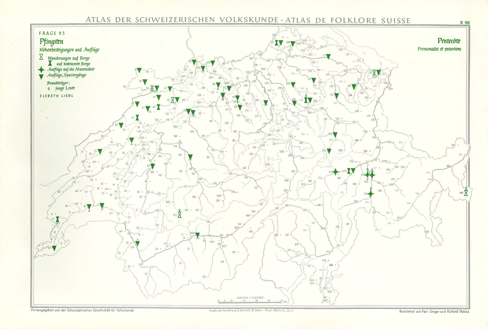
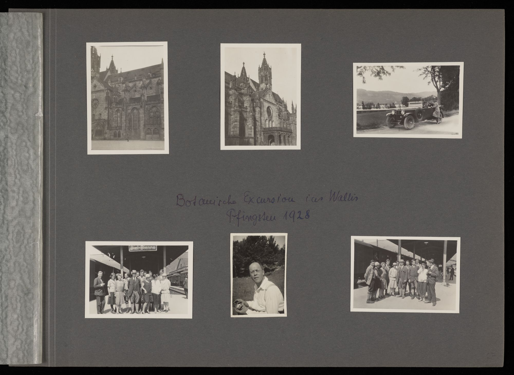
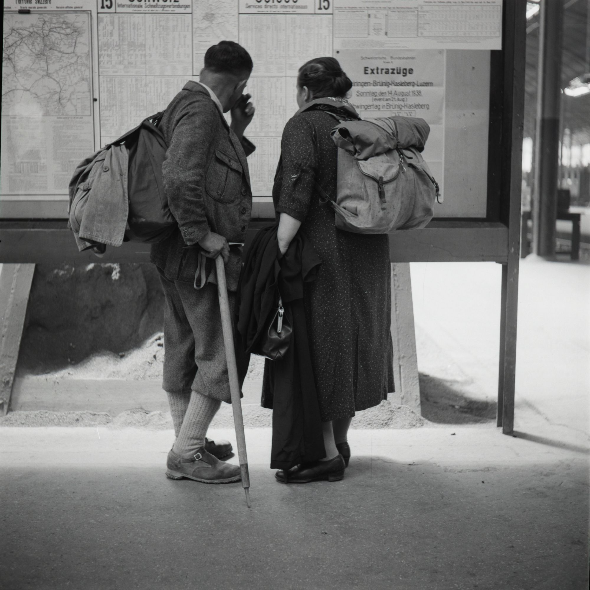

# 2. Context {id="cha:context"}

In this chapter, I will set the stage for my PhD thesis by providing important background information. First, in [Section 2.1](#sec:title), I will explain why I chose the title for my thesis. This will give you an understanding of the main focus and the direction of my research. Next, in [Section 2.2](#sec:pia), I will describe the PIA research project, which is central to my work. This section will cover the project's goals, significance, and overall framework. In [Section 2.3](#sec:pia-contribution), I will detail my specific contributions to the PIA project. I will emphasise how my work fits into the larger project and its importance to my thesis. Finally, in [Section 2.4](#sec:involvement_iiif_la), I will talk about my active participation in the IIIF and Linked Art communities. This section will highlight how my involvement in these communities has influenced my research and its broader implications.

## 2.1 PhD Title {id="sec:title"}

I chose the title ‘Linked Open Usable Data for Cultural Heritage: Perspectives on Community Practices and Semantic Interoperability’ as it encapsulates the essence of my research focus but I could have indeed chosen other ones.

During the initial stages of my research, multiple working titles were explored to capture the diverse facets of my interests and objectives. If I was quite sure about having ‘Linked Open Usable Data’ in the title after the third iteration, I was quite unsure of what should follow and if a subtitle was actually needed at all. Amidst this dynamic progression, the underlying theme of my research remained steadfast -- to delve into the transformative potential of LOUD for CH.

I also opted to maintain ‘Cultural Heritage’ in the title of my thesis subsection. While ‘Digital Heritage’ holds its appeal, my choice reflects a broader narrative that acknowledges the crucial role of CHIs and spotlighting the multifaceted nature of heritage preservation, encapsulating both its digital facets and the essential contribution of individuals and institutions in curating, interpreting, and making heritage accessible. 

As for the subtitle, while I do explore CoP as defined by @lave_situated_1991 and @wenger_communities_2011 through investigating the social fabrics of the IIIF and Linked Art communities, my main interest lies in the broader application of LOUD for describing and interlinking CH resources. Thus, I decided to opt for the more generic ‘Community Practices’ as the first axis or perspective. 

For the second perspective, I wanted to see how semantic interoperability can be achieved through standards adhering to the LOUD design principles, as they seem to be key enablers for seamless collaboration and knowledge exchange among practitioners. There was a time in my research when I envisaged decoupling ‘semantics’ and ‘interoperability’, perceiving them as two distinct dimensions. However, what really captivates me is the unification of these factors to facilitate collective reasoning for both humans and machines. 

In summary, this title reflects my enthusiasm for using web-based and community-driven technologies to transform the way we understand, share and value CH.

## 2.2 The PIA Research Project {id="sec:pia"}

I undertook my doctoral studies within the scope of the PIA research project financed by the SNSF under their Sinergia funding scheme from February 2021 to January 2025[^3]. The project aimed to analyse the interplay of participants, epistemological orders and the graphical representation of information and knowledge in relation to three photographic collections from CAS. It sought to bring together the world of data and things in an interdisciplinary manner, exploring the phases of the analogue and digital archive from a cultural anthropological, technical and design research perspective [@felsing_community_2023 p. 42]. As part of this endeavour, interfaces were developed to enable the collaborative indexing and use of photographic archival records [@chiquet_participatory_2023 p. 110]. I discuss in more detail the interdisciplinary components and briefly introduce the people involved in the project in [Subsection 2.2.1](#subsec:interdisciplinary), then talk about the photographic collections that were the overarching narrative of the research in [Subsection 2.2.2](#subsec:sgv_collections), and lastly in [Subsection 2.2.3](#subsec:pia_vision), the vision that we had put together.

### 2.2.1 An Interdisciplinary Endeavour {id="subsec:interdisciplinary"}

The project, divided in three interdisciplinary teams, was led by the University of Basel through the Institute for Cultural Anthropology and European Ethnology[^4] (Team A) and the DHLab[^5] in collaboration with the DBIS group (Team B) as well as by the HKB[^6], an art school and department of the Bern University of Applied Sciences (Team C) [@felsing_community_2023 p. 43]. [Table 2.1](#tab:pia-team) lists the people who contributed to the project, broken down by the three teams and their particular perspectives.

<figure id="tab:pia-team" style="text-align: center;">
  <figcaption><strong>Table 2.1</strong>: PIA Team Core Members</figcaption>
  
  <table style="margin: 1em auto;">
    <thead>
      <tr>
        <th><strong>Perspective</strong></th>
        <th><strong>People</strong></th>
      </tr>
    </thead>
    <tbody>
      <tr>
        <td>A) Anthropological</td>
        <td>
          Prof. Dr. Walter Leimgruber, Team Leader and Dissertation Supervisor 
          Dr. Nicole Peduzzi, Photographic Restoration and Digitisation Supervisor 
          Regula Anklin, Conservation and Restoration Specialist (project partner at Anklin &amp; Assen) 
          Murielle Cornut, PhD Candidate in Cultural Anthropology 
          Birgit Huber, PhD Candidate in Cultural Anthropology 
          Fabienne Lüthi, PhD Candidate in Cultural Anthropology
        </td>
      </tr>
      <tr>
        <td>B) Technical</td>
        <td>
          Prof. Dr. Peter Fornaro, Team Leader and Dissertation Supervisor 
          Prof. Dr. Heiko Schuldt, Dissertation Supervisor (project partner at the University of Basel) 
          Dr. Vera Chiquet, Postdoctoral Researcher 
          Adrian Demleitner, Software Developer (2021-2023) 
          Fabian Frei, Software Developer (2023-2025) 
          Christoph Rohrer, Software Developer (2023-2025) 
          Julien A. Raemy, PhD Candidate in Digital Humanities 
          Florian Spiess, PhD Candidate in Computer Science
        </td>
      </tr>
      <tr>
        <td>C) Communicative</td>
        <td>
          Dr. Ulrike Felsing, Team Leader and Dissertation Supervisor 
          Prof. Dr. Tobias Hodel, Dissertation Supervisor (project partner at the University of Bern) 
          Daniel Schoeneck, Research Fellow 
          Lukas Zimmer, Designer (project partner at A/Z&amp;T) 
          Max Frischknecht, PhD Candidate in Digital Humanities
        </td>
      </tr>
    </tbody>
  </table>
</figure>

### 2.2.2 Photographic Collections/Archives as Anchors {id="subsec:sgv_collections"}

Cultural Anthropology Switzerland (CAS)[^7], established in 1896, has been actively involved in the collection and preservation of photographs since the 1930s [@sgv_125_2021]. These photographs, both amateur and professional, originate from all of the language regions of Switzerland (German, French, Italian, Romansh) and extend to various countries across the globe [@peduzzi_archivio_2018]. The CAS archives is listed as a cultural asset of national importance (category A) in the Swiss Cultural Property Inventory[^8] and has been undergoing extensive conservation and restoration since 2014, the year in which CAS launched a significant photographic project, focusing on the processing of approximately 105,000 photographic objects from seventeen collections [@graf_fotoarchiv_2019]. This project encompassed a wide array of essential tasks, including meticulous conservation, expert restoration, digitisation, and meticulous documentation of the photographic objects within the Salsah system[^9], originally built by the DHLab and now maintained through the Swiss National Data and Service Center for the Humanities (DaSCH) who preserve the photographic archives and their metadata. In 2018, the project reached a milestone when the photographs were made available to the public online[^10].

CAS has historically been engaged in active collaborations that bridge the academic research and the public sphere, primarily through traditional analogue methods. The PIA project was created with the intention of exploring the complexities inherent in both analogue and digital approaches, and to encourage and investigate these collaborative endeavours between academia and the wider public. As such, PIA represents a paradigm shift within the scope of projects associated with or supported by CAS, facilitating the seamless integration of digital tools to explore multiple facets of participation and engagement. This transformative endeavour embodies a profound exploration of new intersections where scholarly endeavours intertwine with the active involvement of citizens.

PIA drew on three collections: one focusing on scientific cartography and titled ‘Atlas of Swiss Folklore’ (*Atlas der Schweizerischen Volkskunde*), a second from the estate of the photojournalist Ernst Brunner (1901--1979), and a third collection consisting of vernacular photography which was owned by the Kreis Family (1860--1970).

**SGV_05 ASV** consists of 292 maps and 1000 pages of commentary published from 1950 to 1995 --- an example of such a map is shown in [Figure 2.1](#fig:sgv-atlas). This collection was commissioned by the CAS to do an extensive survey of the Swiss population in the 1930s and 1940s on many issues pertaining, for instance, to everyday life, local laws, superstitions, celebrations or labour [@weiss_atlas_1940]. The contents were compiled by researchers and by people who were described as ‘laymen’[^11]. Questions were asked about everyday habits, community rights, work, trade, superstitions, and many other topics [@schmoll_richard_2009; @schmoll_vermessung_2009]. This collection offers a snapshot of everyday life in Switzerland right before the beginning of a modernisation process that fundamentally changed lifestyles in all areas during the postwar period. A digitised version of the ASV would not only allow the results of that time to be enriched with further findings  [@schranz_critical_2021], but would also make transparent how knowledge was generated in cartographic form through a complex process along different types of media and actors. The restoration, digitisation, cataloguing and indexing efforts took all part throughout PIA under the supervision of Birgit Huber, who extensively based her doctoral research on this particular collection [see @huber_entdeckung_2023].

<figure id="fig:sgv-atlas" style="margin: 0 auto; text-align: center;">
  

  <figcaption>
    <strong>Figure 2.1</strong>: 
    Map from the SGV_05 Collection Relating to Question 93 Showing Walks and Excursions at Pentecost. ASV. CAS. CC BY-NC 4.0
  </figcaption>
</figure>

**SGV_10 Kreis Family** comprises approximately 20,000 loose photographic objects, where a quarter of them are organised and kept in 93 photo albums --- as illustrated by [Figure 2.2](#fig:sgv-kreis), from a wealthy Basel-based family and spanning from the 1850s to the 1980s. This private collection was acquired by CAS in 1991. The collection, which originally arrived in banana cases and was enigmatic due to the lack of clear organisation or accompanying information from the family, posed significant challenges. Despite these initial hurdles, CAS undertook meticulous efforts to catalogue and preserve its contents [@felsing_re-imagining_2024 p. 42]. The pictures were taken by studio photographers as well as by family members themselves. The Kreis Family collection represents a typical example of urban bourgeois culture and gives a comprehensive insight into the development of private photography over the course of a century [@pagenstecher_private_2009]. The photographic materials and formats are very diverse, ranging from prints to negatives, small, medium or large format photographs, black and white or colour. The collection also encompasses many photographic techniques, from the one-off daguerreotypes and ferrotypes, to the glass-based negatives that could be reproduced *en masse*, to the modern paper prints. While some of the albums and loose images were restored and digitised during the 2014 project, much of this work was completed during PIA and overseen by Murielle Cornut, whose doctoral investigation was centred on the study of photo albums [see @cornut_open_2023].

<figure id="fig:sgv-kreis" style="margin: 0 auto; text-align: center;">
  

  <figcaption>
    <strong>Figure 2.2</strong>: 
    A photo Album Page from the SGV_10 Collection, Bearing the Following Inscription: 
    <em>Botanische Excursion ins Wallis, Pfingster 1928</em>. 
    SGV_10A_00031_015. Kreis Family. CAS. 
    CC BY-NC 4.0
  </figcaption>
</figure>

**SGV_12 Ernst Brunner** is a donation of about 48,000 negatives and 20,000 prints to the CAS archives from Ernst Brunner, a self-taught photojournalist, who lived from 1901 to 1979 and who documented mainly in the 1930s and 1940s a wide range of folkloristic themes --- as shown by [Figure 2.3](#fig:sgv-brunner). He is one of the most important photographers of the era and one of the most outstanding visual chroniclers of Swiss society [@pfrunder_ernst_1995]. His photographs show rural lifestyles, but also urban motifs. In his late work, he led the documentation and research on farmhouses in a specific Swiss district, a project initiated by CAS. Before Ernst Brunner became an independent photojournalist in the mid-1930s, he worked as a carpenter, influenced by the ideas of the *Bauhaus* and *Neues Bauen* movements. This can also be seen in the aesthetics and formal language of his photography. If all the black and white negatives were digitised and recorded between 2014 and 2018, the digitisation of prints, which is a selection done by Ernst Brunner, was conducted at the end of the PIA research project. The latter was supervised by Fabienne Lüthi, whose PhD was about organisational systems and knowledge practices in the Ernst Brunner Collection.

<figure id="fig:sgv-brunner" style="margin: 0 auto; text-align: center;">
  

  <figcaption>
    <strong>Figure 2.3</strong>: 
    Picture from the SGV_12 Collection Showing Walkers Looking at the Timetable Train. 
    [Wanderer studieren den Fahrplan in der Bahnhofhalle]. 
    Lucerne, 1938. Ernst Brunner. SGV_12N_00716. CAS. 
    CC BY-NC 4.0
  </figcaption>
</figure>

Whereas for each of the PhD Candidates in Cultural Anthropology, a particular collection was assigned to them and its content was to varying degrees part of their subject of study, this was not exactly the same for the PhD Candidates in DH, including myself, and in Computer Science. Put differently, we had relative leeway in terms of what interested us in each or all of these three photographic collections. In my case, I briefly explain my contribution to the project more in and then in as part of the empirical portion of my thesis focusing on the deployment of LOUD specifications using the three CAS photographic collections.

Florian Spiess focused on the use of VR through vitrivr, a multimedia retrieval system developed by the DBIS research group at the Department of Mathematics and Computer Science [@spiess_multimodal_2022; @spiess_forschung_2023; @spiess_exploring_2024]. His work included experiments with PIA-related collections, such as the creation of virtual galleries clustered according to content-based similarity [see @peterhans_automatic_2022]. In the case of Max Frischknecht, his doctoral research centred on generative design[^12], a methodology to visualise dynamic cultural archives. He mostly worked on the ASV collection and on a mapping tool which is a cartographic visualisation designed to explore the CAS photographic archives [see @frischknecht_generating_2022; @eggmann_digitalisierung_2024].

It should also be mentioned that not only did we use the three collections of the CAS photographic archives within the project, but that both formal and informal meetings took place most commonly within the photographic archives at the Spalenvorstadt premises in the old Gewerbemuseum and later either at the ‘Provisorium’ on Allschwilerstrasse, though less frequently, or at Rheinsprung where the Institute for Cultural Anthropology and European Ethnology is located. This meant that there was a strong and sometimes blurred entanglement between those involved in the archives and the PIA core team members.

### 2.2.3 Project Vision {id="subsec:pia_vision"}

Between December 2021 and March 2022, we worked together to develop and finalise a vision for the project[^13]. It includes seven key priorities, or pillars, which were meant to strengthen the interdisciplinary perspectives of PIA. Although ambitious, these elements were of paramount importance to us and served as a guiding blueprint for all PIA activities. Hereafter is a modified version of the vision[^14] taken from @cornut_annotations_2023 [p. 4].

1.  **Accessibility** by developing open interfaces and offering the     possibility of expanding the archive and turning it into an     instrument of current research that collects and evaluates knowledge     with the participation of other users (Citizen Science).

2.  **Heterogeneity** by making visible where, why and under what     circumstances the objects were created, how they were handled and     what path they have taken to get to and in the archive. We work on     visualisations that take into account the heterogeneous character of     archival materials and make their respective biographies visible.

3.  **Materiality** by conveying the material properties of the objects:     they have front and back sides, inscriptions, traces, development     errors, they are transparent, multi-layered or fabric-covered. They     tell of their origin, use, and peculiarities. We want to make this     knowledge accessible and understandable in digital form. To this     end, we also consider the necessary infrastructure involved in the     creation as part of their narrative: the restoration, the     relocation, the indexing, the storage devices, the research tools,     the display medium, as well as the process of repro-photography.

4.  **Interoperability** as a crucial component and which will be done     by supporting digital means that allow different stakeholders to     freely access and interact with the project's data. Both humans and     machines can use, contribute to, correct and annotate the existing     data in an open and interoperable manner, thus encouraging exchange     and the creation of new knowledge. To do this, we use web-based     standards that are widely adopted in the cultural heritage field.

5.  **Affinities** by leveraging data models and pattern recognition     which can uncover semantic relationships between entities that were     previously incomplete or difficult for users to access. Using     specific interfaces and visualisations, we make it possible to     explore digital assets and discover forms of relationships and     similarities between images.

6.  **AI** that     facilitates automated searches for simple image attributes such as     colour, shapes, and localisation of image components. It should also     become possible to recognise texts and object types for extracting     metadata.

7.  **Bias Management** by taking into account that associated metadata     was human-made[^15] and thus is never objective. Collections and     their metadata reflect biases or focus narrowly on selected areas     and perceptions. Machines working on the basis of such data     automatically reproduce the implicit biases in decision-making due     to so-called biased algorithms. Therefore, understanding the data     used for training and the algorithms applied for decision making is     crucial to ensure the integrity of the application of these     technologies in archives. We take ethical issues into account when     using AI and     visualisations, because the higher the awareness of a possible bias,     the faster it can be detected or brought up for consideration with     users.

As my thesis is notably concerned with semantic interoperability, **Interoperability** and **Affinities** are of particular importance to my PhD thesis, although I recognise the importance of all pillars. Each of these resonated with me and my fellow PhD Candidates. As we immersed ourselves in the vision of the PIA research project, it became a unifying thread that brought us together in our research ambitions. We found that all these priorities within the project spoke to us at different points and provided a strong point of communication and practice in the development of processes, prototypes or interfaces.

## 2.3 Contribution to PIA and its Relevance to the Thesis {id="sec:pia-contribution"}

To develop a participatory platform, an open and sustainable technological foundation for facilitating the reuse of CH resources was needed [@raemy_applying_2021]. Throughout the PIA project, I was mainly involved in the extension of the data infrastructure, the uptake of IIIF as well as designing the data model, leveraging Linked Art and WADM [@raemy_interlinking_2024]. As a member of Team B, I undertook this PhD as a bridge between the different teams, mostly participating in discussions with the three doctoral candidates from Team A to further develop and agree on the CAS data model and with the software developers from my team to discuss the impact of the data model on our evolving --- yet transitory --- infrastructure as well as helping in implementing the APIs adhering to the LOUD design principles.

It was necessary to redesign the data model within the context of a database migration, from Salsah to the DSP, that happened between November 2021 and March 2024. This updated version, based on the Knora Base Ontology[^16], corresponded to the needs of the CAS archives and to some extent to those of PIA, in particular to enable the PhD Candidates in Cultural Anthropology to make more precise assertions, whether in terms of descriptive metadata, or in the ability to link one object to another or to provide comments on these objects in several narrative forms.

Moreover, an assessment of the appropriate technical standards for improved usability of the objects by both humans and machines was carried out, as a basis for extending the capabilities provided by DaSCH, such as helping the software developers to implement SIPI[^17], a `C++` image server compatible with the IIIF Image API and build services that create IIIF Presentation API 3.0 resources.

While the theoretical framework of the thesis extends across the scope of PIA, the empirical part focuses on a specific set of findings derived from the research project outlined in [Chapter 7](#cha:pia-laboratory), under the title ‘PIA as a Laboratory’. In this chapter, I discuss the data model and its refinement as well as the generation of custom IIIF Manifests during the specific digitisation, cataloguing and indexing efforts that took place throughout the project for the three CAS collections (SGV_05, SGV_10 and SGV_12) under investigation, the implementation of LOUD standards, and the overall design of the technological underpinnings.

## 2.4 Involvement within the IIIF and Linked Art communities {id="sec:involvement_iiif_la"}

I must acknowledge the invaluable role that my involvement within the IIIF and Linked Art communities has played in shaping my journey as a trained information specialist and an aspiring DH practitioner. Being an active participant in both communities has not only broadened my understanding of the latest developments in the field but has also profoundly influenced the trajectory of this dissertation.

I have been involved within the IIIF community since October 2016 and the Working Groups Meeting that happened in The Hague[^18]. This significant journey was, in fact, initiated by a recommendation from my first supervisor, Peter Fornaro, during my time as an undergraduate doing an internship at the DHLab. Little did I know that this recommendation would lead me to be carrying out a PhD and looking at IIIF not only as community-driven standards but as an object of study. Engaging with the IIIF community exposed me to cutting-edge advances in image interoperability and standards, and fostered a deeper appreciation for the importance of digital representations of cultural heritage. Through collaborative discussions with experts from diverse backgrounds, I gained new perspectives on the potential of technology to advance humanities research and preserve our collective cultural memory.

Similarly, my involvement in the Linked Art community introduced me to the opportunities offered by LOUD and its transformative impact on research discourse. Exposure to Linked Data methodologies and the CIDOC-CRM has significantly influenced the way I have structured and interpreted the data in this dissertation, thereby enriching its scholarly breadth and rigour. I started to be actively involved in Linked Art at the beginning of my PhD in 2021, but I was already a ‘fly on the wall’ by 2020, driven by the efforts of Rob Sanderson, my third supervisor. By mid-2023, I had become a member of the Editorial Board.

The individuals I have met and the knowledge shared in these vibrant communities have deeply informed my approach as a scholar. The invaluable connections and collaborations I have made have expanded my network of fellow researchers, educators, and experts, leading to fruitful discussions that have significantly shaped the research questions addressed in this thesis. The events and workshops organised by these communities have also provided immersive learning experiences, giving me first-hand insights into the tools, technologies and methodologies used in the context of describing and disseminating CH data. The dynamic ecosystem of these communities has served as an inspiring backdrop, fostering innovative thinking and encouraging a more holistic approach to my research.

[^3]: SNSF Data Portal - Grant number 193788:
    <https://data.snf.ch/grants/grant/193788>

[^4]: *Seminar für Kulturwissenschaft und Europäische Ethnologie*:
    <https://kulturwissenschaft.philhist.unibas.ch/>

[^5]: DHLab:
    <https://dhlab.philhist.unibas.ch/>

[^6]: HKB:
    <https://www.hkb.bfh.ch/>

[^7]: CAS, formerly
    SSFS (English)\
    *Empirische Kulturwissenschaft Schweiz*, formerly *Schweizerische
    Gesellschaft für Volkskunde* (German)\
    *Anthropologie Culturelle Suisse*, formerly *Société suisse des
    traditions populaires* (French)\
    *Anthropologia Culturale Svizzera*, formerly *Società svizzera per
    le tradizioni popolari* (Italian)

[^8]: Inventory of Cultural Property of National and Regional Importance
    (see Canton BS):\
    <https://www.babs.admin.ch/en/aufgabenbabs/kgs/inventar.html>

[^9]: Salsah: <https://www.salsah.org/>

[^10]: CAS photo archive website: <https://www.ekws.ch/de/archiv>

[^11]: The considerable size of the ASV collection, which includes over
    90,000 analogue objects, reflects not just the work of the main
    authors but also the contributions from numerous explorers and
    additional material beyond the maps and primary publications.

[^12]: Max Frischknecht's PhD: <https://phd.maxfrischknecht.ch/>

[^13]: PIA project
    website: <https://about.participatory-archives.ch/>

[^14]: The vision of the PIA project was first written in German
    and then translated into English and French.

[^15]: In our joint paper, we wrote ‘man-made’, corrected here, which makes me
    think of the transition within the
    CIDOC-CRM
    for the Entity `E22 Human-Made Object` from version 6.2.7 onward.

[^16]: Knora Base Ontology: <https://docs.dasch.swiss/latest/DSP-API/02-dsp-ontologies/knora-base/>

[^17]: SIPI
    documentation: <https://sipi.io/>

[^18]: IIIF
    Working Groups Meeting, The Hague, 2016:
    <https://iiif.io/event/2016/thehague/>
