# 3. Interlinking Cultural Heritage Data {id="cha:literature"}

Interlinking CH data is an important aspect of publishing heritage collections over the web, in particular by using LOD technologies to make assertions more easily readable and meaningful to machines [@marcondes_integrated_2021]. Due to the complexity of CH data and their intrinsic inter-relationships, it is necessary to define its nature and introduce controlled vocabularies and ontologies that can be integrated with existing web standards and interoperable with relevant platforms [@bruseker_cultural_2017; @hyvonen_using_2020].

Efforts to interlink CH data have brought about significant advancements, but challenges remain. One such challenge is finding a balance between completeness and precision of expression to ensure that the that CH data remain accessible and usable to a wider audience. Addressing this challenge, the Linked Open Usable Data (LOUD) design principles and the specifications that adhere to those, such as the IIIF Presentation API 3.0 and Linked Art, offer a promising approach [@raemy_enabling_2023]. By focusing on usability aspects from the perspective of software developers and data scientists involved in designing visualisation tools and data aggregation approaches, LOUD strives to enhance the overall user experience [@sanderson_keynote_2019].

Finding this equilibrium becomes crucial as CH data continues to grow in complexity and size, necessitating the seamless integration of native web technologies. The LOUD concept cultivates an environment that encourages the formation of vibrant CoP and the seamless integration of native web technologies, wherein an essential principle is the availability of comprehensive documentation supplemented with practical examples [@raemy_ameliorer_2022]. Moreover, the emphasis on leveraging widely adopted technologies enhances the interoperability of data and promotes its wider dissemination. With LOUD principles guiding the linking of CH data, the resulting web of knowledge becomes more than just a machine-readable resource; it transforms into a user-centric ecosystem where both accessibility of Linked Data and usability intersect to enable scholars and a wider audience to engage in the exploration and appreciation of CH [@newbury_loud_2018]. Finally, by fostering a collaborative, knowledge-sharing mindset, LOUD empowers software developers to implement data in a robust way, drawing insights from shared experiences [see @page_linked_2020].

In this chapter, which serves as the literature review of the PhD thesis, I attempt to draw on this brief introduction by dividing the insights into seven sections in order to provide an overview of the key concepts related to interlinking data in the CH domain. The literature review primarily encompasses works published up until December 2023, providing a comprehensive snapshot of the field's current state and its evolution. [Section 3.1](#sec:standout) discusses what makes CH data stand out and [Section 3.2](#sec:metadata) is about CH metadata standards, while [Section 3.3](#sec:movements) explores the technological trends, scientific movements and guiding principles that have shaped the field. [Section 3.4](#sec:linkeddata) provides an overview of the web as an open platform, which are essential to understanding the current landscape of interlinking CH data. [Section 3.5](#sec:loud) focuses on LOUD, while [Section 3.6](#sec:semantics-interoperability) looks at characterising the community practices and semantic interoperability dimensions for CH. Finally, in [Section 3.7](#sec:review-summary-insights), I summarise key elements from each section and within each of these I give some initial thoughts with respect to LOUD, and then conclude the chapter with some considerations on why we as a society need to care about CH data.

## 3.1 What Makes Cultural Heritage Data Stand Out? {id="sec:standout"} 

Here, I aim to establish the indirect territory of my study, as I am situated on a distinct plane that focuses on web technologies and standards --- as well as software and services that enable them --- as the subjects of investigation. However, it is crucial to acknowledge that LOUD specifications owe their existence to the available data that have served as case studies. Thus, their significance can be best understood through the lens of data and I recognise here the pivotal role played by CH practitioners --- encompassing individuals from research and memory institutions --- who have had a significant impact on specifying a series of web-based standards and who have helped to move forward the discovery of CH data and beyond, in particular those belonging to the public domain, in an open manner.

In [Section 3.1.1](#subsec:cultural-heritage), I provide an introduction to CH as recognised by the UNESCO. I explore the tangible, intangible, and natural dimensions of CH, laying the foundation for further discussions on its representation and preservation, notably by giving a first definition of CH data. Next in [Section 3.1.2](#subsec:reprez), I look at the challenges of representation and embodiment of CH data. This subsection examines the challenges in describing and preserving its materiality or embodied aspects. Understanding the significance of collective efforts, communities, and the interplay of technologies. Thirdly, I discuss what I called ‘Collectives and Apparatuses’ in [Section 3.1.3](#subsec:collective-apparatus) where I highlight how actors in terms of collaborative actions and apparatuses play a pivotal role in CH.

### 3.1.1 Cultural Heritage {id="subsec:cultural-heritage"}

The legacy of CH encompasses physical artefacts and intangible aspects inherited from past generations, reflecting the history and traditions of societies. Meanwhile, CH constantly evolves due to complex historical processes, necessitating preservation and protection efforts to prevent its loss over time [@loulanski_revising_2006]. The dynamic nature of CH demands collaborative actions, including documentation and the use of a range of technologies.

The concept of CH is also characterised by perpetual evolution, mirroring the historical processes that shape societies over time. Social, political, economic, and technological shifts invariably influence the definition and perception of CH, prompting continuous reinterpretations and reevaluations of its significance. Over the years, the enthusiasm for the protection of cultural property has enriched the term with new shades of meaning. As societies undergo transformations, new layers of meaning and relevance are superimposed on existing CH, perpetually enriching its essence. As articulated by [@ferrazzi_notion_2021 p. 765]:

> ‘Cultural heritage’, as an abstract legacy or as a merge of tangible and intangible values, is able to encompass the totality of culture(s); in so, assuming a symbolic value that brings a clear break with all other terminologies. In conclusion, ‘cultural heritage’ as a legal term has demonstrated more than any others to be a real ensemble of historical stratification and cultural diversity.

The advent of globalisation and rapid advancements in technology have further accelerated the evolution of CH. Increased interconnectedness and cross-cultural interactions have led to the fusion of traditions and the emergence of novel cultural expressions. Moreover, the digital era has facilitated the dissemination of CH resources on a global scale, transcending geographical barriers and preserving cultural knowledge for future generations as *‘Information and Communication Technologies (ICTs) provide researchers with powerful tools to deal with the digital acquisition, storage, conservation, recreation, reconstruction, and representation of CH assets’* [@portales_digital_2018].

Thus, the intriguing nature of CH resources can be attributed to their multifaceted and diverse characteristics. The conservation and promotion of these resources demand a nuanced comprehension of the various types of heritage resources, culminating in effective preservation and promotion strategies that can account for their heterogeneity [@windhager_visualization_2019].

According to [@unesco_institute_for_statistics_unesco_2009], CH includes tangible and intangible heritage. Tangible CH refers to physical objects such as artworks, artefacts, monuments, and buildings, while intangible CH comprises practices, knowledge, folklore and traditions that hold cultural significance [@munjeri_tangible_2004]. The concept of heritage has evolved through a process of extension to include objects that were not traditionally considered part of the heritage. The criteria for selecting heritage have also changed, taking into account cultural value, identity, and the ability of the object to evoke memory. This shift has led to the recognition and protection of intangible CH, challenging a Eurocentric perspective and embracing cultural diversity as a valuable asset for humanity [@vecco_definition_2010].

Conservation guidelines have broadened the concept of heritage to include not only individual buildings and sites but also groups of buildings, historical areas, towns, environments, social factors, and intangible heritage [@ahmad_scope_2006]. In 2019, another instance of UNESCO defines CH in an even more comprehensive manner, taking into account natural heritage:

> Cultural heritage is, in its broadest sense, both a product and a process, which provides societies with a wealth of resources that are inherited from the past, created in the present and bestowed for the benefit of future generations. Most importantly, it includes not only tangible, but also natural and intangible heritage. [@unesco_culture_for_development_indicators_methodology_2014 p. 130]

In thinking about the concept of CH, I find this last definition particularly resonant. This broader perspective is motivated by my interest with LOUD specifications as a research area, particularly because of their notable data agnosticism and as it resonated with @hyvonen_cultural_2012 [pp. 1-3]'s subdivision of CH as well. These services have the adaptability to process and use different types of data, transcending the boundaries of specific domains or disciplines. Although grounded in concrete CH cases, their potential to extend to any type of data, including those from STEM, is a compelling prospect that warrants further exploration, a point that I will explore later.

The following sub-subsections aim to briefly discuss tangible, intangible, and natural heritage, as well as providing a definition of CH data which can serve as a foundational reference for this thesis.

#### 3.1.1.1 Tangible Heritage {id="subsubsec:tangible"}

Tangible CH encompasses physical artefacts and sites of immense cultural significance that are passed through generations in a society [@vecco_definition_2010]. These objects are tangible manifestations of human creativity, representing artistic creations, architectural achievements, archaeological remains as well as collections held by CHIs.

One aspect of tangible CH is artistic creations such as paintings, sculptures and traditional handicrafts. These artefacts embody cultural values and artistic expressions and serve as essential reflections of a society's collective ethos. For example, artworks such as ‘Irises’ from Vincent van Gogh[^21] and Alberto Giacometti's ‘L'Homme qui Marche I’ [^22] are revered works of art that have deep cultural significance in Europe and all over the world.

The built heritage, including monuments, temples and historic buildings, is another important component of the tangible CH. These architectural marvels not only represent past civilisations, but also convey the social values and aspirations of their time. The Taj Mahal, an exemplary white marble structure in India, stands as a poignant testament to Mughal architecture. Closer to where I write this dissertation one can mention the Abbey of St Gall, a convent from the 8<sup>th</sup> century which is inscribed on the UNESCO World Heritage List. In the context of urban heritage, conventional definitions of built heritage often focus narrowly on the architectural and historical value of individual buildings and monuments, which are well protected by existing legislation. However, the challenge is to preserve urban fragments - areas within towns and cities that may not qualify as designated conservation areas, but are of significant cultural and morphological importance [@tweed_built_2007]. For instance, [@rautenberg_lemergence_1998] proposes two categories of built CH: heritage by designation and heritage by appropriation. Heritage by designation involves experts conferring heritage status on sites, buildings, and cultural objects through a top-down approach, often without public participation. This method can be predictable and uncontroversial, but can be criticised for being elitist and neglecting unconventional heritage. On the other hand, heritage by appropriation emphasises community and public involvement in identifying and preserving cultural expressions, leading to a more inclusive and dynamic understanding of heritage.

Archaeological sites are also an integral part of the tangible CH, offering invaluable insights into past societies and ways of life. As per May 2024, UNESCO's long list of World Heritage Sites includes 1,199 cultural and natural sites in 168 different state parties --- including 48 sites in transboundary regions[^23]. Sites such as Machu Picchu, an impressive Inca citadel in the Peruvian Andes, bear witness to the architectural achievements and cultural practices of ancient civilisations. If archaeological sites are invaluable, they face significant threats such as looting, destruction, exploitation, and extreme weather phenomena [@bowman_transnational_2008; @micle_archaeological_2014]. To safeguard them, conservation efforts must be case-specific and include documentation and assessment of experiences gained [@aslan_protective_1997].

The preservation of tangible CH extends beyond physical objects to include libraries, archives and museums that house collections of books, manuscripts, historical documents and artefacts.

Incidentally, the term “cultural property” is also employed as a related concept to tangible CH, encompassing both movable and immovable properties as opposed to less tangible cultural expressions [@ahmad_scope_2006]. Cultural property is protected by a number of international conventions and national laws. For instance, the Blue Shield[^24] --- an international organisation established in 1996 by four non-governmental organisations[^25] --- aims to protect and preserve heritage in times of armed conflict and natural disasters [@van_der_auwera_unesco_2013]. Its mission has been revised in 2016:

> The Blue Shield is committed to the protection of the world’s cultural property, and is concerned with the protection of cultural and natural heritage, tangible and intangible, in the event of armed conflict, natural- or human-made disaster. [@blue_shield_blue_2016 art. 2.1]

Overall, tangible CH is a testament to human ingenuity and cultural diversity, and serves as a bridge between the past and the present. Its preservation is a collective responsibility, ensuring that the legacy of past generations endures and the wealth of cultural diversity continues to enrich the fabric of society.

#### 3.1.1.2 Intangible Heritage {id="subsubsec:intangible"}

The concept of intangible heritage emerged in the 1970s and was coined at the UNESCO Mexico Conference in 1982 [@leimgruber_switzerland_2010] with the aim of protecting cultural expressions that were previously excluded from preservation efforts [@hertz_politiques_2018]. UNESCO's previous focus had been on material objects, primarily from wealthier regions of the global North, leaving the intangible cultural heritage of the South overlooked. Attempts to protect intangible heritage through legal measures like copyright and patents were ineffective due to the collective nature of these cultural expressions and the anonymity of creators. The Convention acknowledges that intangible CH is essential for cultural diversity and sustainable development.

Below is the definition given by the *Convention for the Safeguarding of the Intangible Cultural Heritage*:

> ‘The Intangible Cultural Heritage’ means the practices, representations, expressions, knowledge, skills – as well as the instruments, objects, artefacts and cultural spaces associated therewith – that communities, groups and, in some cases, individuals recognize as part of their cultural heritage. This intangible cultural heritage, transmitted from generation to generation, is constantly recreated by communities and groups in response to their environment, their interaction with nature and their history, and provides them with a sense of identity and continuity, thus promoting respect for cultural diversity and human creativity. [@unesco_basic_2022]

According to UNESCO, intangible CH can be manifested in the following domains:

-   oral traditions and expressions, including language as a vehicle of     the intangible CH;
-   performing arts;
-   social practices, rituals and festive events;
-   knowledge and practices concerning nature and the universe;
-   traditional craftsmanship.

Overall, intangible CH is a multifaceted concept that encompasses both traditional practices inherited from the past and contemporary expressions in which diverse cultural groups actively participate [@munjeri_tangible_2004; @leimgruber_was_2008]. It includes inclusive elements shared by different communities, whether they are neighbouring villages, distant cities around the world, or practices adapted by migrant populations in new regions. These expressions have been passed down from generation to generation, evolving in response to their environment, and play a crucial role in shaping our collective identity and continuity. Intangible CH promotes social cohesion, strengthens a sense of belonging and responsibility, and enables individuals to connect with different communities and society at large.

Central to the nature of intangible CH is its representation within communities. Its value goes beyond mere exclusivity or exceptional importance; rather, it thrives on its association with the people who preserve and transmit their knowledge of traditions, skills and customs to others within the community and across generations. The recognition and preservation of intangible CH depends on the communities, groups or individuals directly involved in its creation, maintenance and transmission. Without their recognition, no external entity can decide on their behalf whether a particular practice or expression constitutes their heritage. The community-based approach ensures that intangible CH remains authentic and deeply rooted in the living fabric of society, protected by those who care for and perpetuate it.

In Switzerland, the Winegrower's Festival in Vevey (*La Fête des Vignerons*), a plurisecular event celebrating the world of wine making [@vinckMetiersOmbreFete2019] and the Carnival of Basel (*Basler Fasnacht*) [@chiquet_how_2023] are examples of traditions that are listed among UNESCO's intangible CH.

(In)tangibility is not always a straightforward concept and can indeed be blurred, i.e. it goes beyond the mere idea of materialisation. Many artefacts and elements of CH possess both tangible and intangible qualities that intertwine and complement each other, making the distinction less clear-cut.

For instance, this Male Face Mask, held at the Art Institute Chicago[^26], also known as ‘Zamble’, from the Guro people in the Ivory Coast holds dual significance as both a tangible and intangible CH. As a tangible object, the mask is a physical artefact made from wood and pigment, fabric, and various adornments, that combines animal and human features representing the Guro people's artistic skills. On the other hand, as an intangible cultural object, the Zamble mask carries profound spiritual and cultural meaning. It plays a significant role in commemorating the deceased during a man's second funeral. These second funerals are organised months or even years after the actual burial as a way to honour and remember the departed [see @haxaire_power_2009]. Thus, the preservation and appreciation of both the tangible and intangible aspects of the mask are essential to its cultural relevance.

Another example of the blurred line between tangible and intangible heritage is emphasised by @de_muynke_ears_2022 in recreating reported perceptions of the acoustics of Notre-Dame de Paris through a collaboration between sciences of acoustics and anthropology. The authors highlight the heritage value of how people subjectively perceive sound in a space, particularly in places of worship where sound and music are integral to the religious experience. The authors advocate integrating the study of both material and non-material aspects to understand the changing sonic environments of heritage buildings [@de_muynke_ears_2022 pp. 1-2]. @katz_digitally_2023 articulates that *‘acoustics is an intangible product of a tangible building’*. This integrated perspective could lead to a more holistic understanding of the dynamics between physical spaces and the perceptual and experiential dimensions attached to them.

#### 3.1.1.3 Natural Heritage {id="subsubsec:natural"}

Natural heritage, encompassing geological formations, biodiversity, and ecosystems of cultural, scientific, and aesthetic value, shares a significant overlap with CH. Many natural sites hold spiritual and symbolic importance for communities, becoming repositories of cultural memory and identity [@lowenthal_natural_2005]. Traditional ecological knowledge developed by various cultures also underscores the interconnectedness of cultural and natural heritage, as indigenous communities have accumulated wisdom on sustainable resource use and ecological balance [@azzopardi_what_2023]. Moreover, the conservation and sustainable management of natural heritage is often intertwined with efforts to protect CH, fostering a collective commitment to preserve these entangled legacies for future generations.

The link between natural and CH goes beyond their shared values; spatial overlaps further accentuate their interdependence. Natural sites may have cultural significance, while CH sites may be situated within natural landscapes. For example, a national park may include archaeological sites or culturally revered landscapes, thus intertwining the cultural and natural dimensions. This spatial intermingling highlights the inextricable relationship between human societies and the natural environment, as cultural practices and beliefs become intertwined with the landscapes they inhabit. In this way, the preservation of both natural and cultural heritage becomes essential not only for their intrinsic worth but also for sustaining the narrative of our shared human and environmental history.

Additionally, the distinction between nature and culture is not only subjective and dependent on human appreciation [@vandenhende_management_2017]. Rather, it is a concept intrinsically linked with the overarching framework of modernism, a perspective that has been critically examined and deconstructed by the influential sociologist and philosopher, Bruno Latour, that have argued that *‘we have never been modern’* [@latour_we_1993]. Latour's deconstruction of the modernist perspective extends to the recognition that the *‘the proliferation of hybrids has saturated the constitutional framework of the moderns’* [@latour_we_1993 p. 51]. This assertion underscores the fundamental challenge posed by hybrid entities -- those that blur the boundaries between nature and culture -- to the traditional categories upon which modernist thinking has been predicated. In essence, the concept of hybrids disrupts the neat divisions between the natural and social worlds that have been a hallmark of modernist discourse and provide us an opportunity to situate ourselves as ‘amodern’ as opposed to postmodern [@latour_postmodern_1990].

In addition to Latour's critique of the modernistic distinction between nature and culture, the concept of the ‘parasite’, as expounded by Michel Serres, one of the influential thinkers who significantly influenced Latour's intellectual development [@berressem_deja_2015]. It offers a valuable lens through which to examine the intricacies of interconnectedness and interdependence within our world. In his view, everything is enmeshed in a complex web of relationships that negates the existence of self-contained entities. Rather than seeing discrete and isolated entities, Serres invites us to see everything as an integral part of a larger system in which each component is inextricably dependent on the others [@serres_parasite_2014]. Together, these complementary perspectives invite us to reevaluate our understanding of the intricate tapestry of existence, emphasising the complexities of our relationship with the world.

Thus, the appreciation of nature and culture is not mutually exclusive, but rather forms a continuous and evolving relationship. The modern perspective has historically separated these realms, treating them as distinct and disconnected. However, a more inclusive approach dissolves this artificial boundary and recognises the interconnectedness of nature and culture [@haraway_encounters_2008; @haraway_staying_2016]. This paradigm shift challenges the traditional modern understanding and invites a more holistic view in which natural and cultural heritage are mutually constructed within a complex network of relationships.

Recognition of this relationship is essential in the context of heritage conservation and understanding. The dynamic interplay between nature and culture is recognised, and the acknowledgement of their coexistence promotes a more holistic approach to heritage conservation, where cultural practices, traditions and ecological systems are seen as interdependent aspects of the wider heritage tapestry. This recognition encourages us to see heritage sites not as isolated entities, but as part of a larger web of interconnectedness, and urges us to conserve and value both cultural and natural heritage with a shared responsibility. Adopting this interconnected perspective enables us to appreciate the profound connections between human societies and the natural world, and inspires a collective commitment to safeguarding these precious legacies for future generations.

#### 3.1.1.4 Cultural Heritage Data {id="subsubsec:chd"}

As I embark on the exploration of CH data, it is first necessary to establish a basic understanding of data in this context. At its core, data represents more than mere numbers and facts; it constitutes a collection of discrete or continuous values that are assembled for reference or in-depth analysis. In essence, data are the rich tapestry upon which the narratives of CH are woven, making its comprehension a critical prerequisite for our expedition into this domain.

Luciano Floridi --- a prominent philosopher in the field of information and digital ethics --- provides a thorough perspective on the term ‘data’ and offers valuable insights into its fundamental nature in its PI. He perceives *‘data at its most basic level as the absence of uniformity, whether in the real world or in some symbolic system. Only once such data have some recognisable structure and are given some meaning can they be considered information’* [@floridi_information_2010]. This initial definition sets the stage for a deeper exploration of Floridi's understanding of data, as he further focuses on its transformative journey into a more meaningful and structured form, which we will explore next.

Building upon Floridi's foundational concept of data as the absence of uniformity, his subsequent definition provides a more comprehensive perspective. In a previous work, @floridi_is_2005 [p. 357] argues that *‘data are definable as constraining affordances, exploitable by a system as input of adequate queries that correctly semanticise them to produce information as output’*. This definition highlights the dynamic role of data, not only as raw entities awaiting structure and meaning but also as elements imbued with the potential to constrain and guide systems towards the generation of meaningful information.

Transitioning from Floridi's concept of data, we progress to the view that data can be notably seen as interpretable texts within the DH perspective. According to (Owens, 2011) @owens_defining_2011: there are four main perspectives on how Humanists can engage with data:

-   **Data as constructed artefacts**: data are a product of human creation, not something inherently raw or neutral;
-   **Data as interpretable texts**: Humanists can interpret data as     authored works, considering the intentions of the creators and how     different audiences understand and use the data;
-   **Data as processable information**: data can be processed by computers, allowing various forms of visualisation, manipulation and     analysis, which can lead to further perspectives and insights;
-   **Data can hold evidentiary value**: data, as a form of human artefact and cultural object, can provide evidence to support claims     and arguments.

These considerations highlight the multifaceted nature of data within the field of DH. It is in this complex landscape that we recognise that data transcends its traditional role as a passive entity. As @rodighiero_mapping_2021 [p. 26, citing [@akrich_sociologie_2006]] suggests that *‘there is no doubt that data are full-fledged actors that take part in the social network the actor-network theory describes, in which both human and non-human intertwine and overlap’*. This notion -- rooted and borrowed from STS -- reinforces the idea that data, as an active and dynamic entity, plays a significant role in shaping the interactions between human and non-human actors in any digital spheres.

From these angles, I can look at the characteristics of CH data. @bruseker_cultural_2017 [p. 94] articulate that *‘data coming from the cultural heritage community comes in many shapes and sizes. Born from different disciplines, techniques, traditions, positions, and technologies, the data generated by the many different specializations that fall under this rubric come in an impressive array of forms’*.

In exploring CH data, it is important to recognise the inherent diversity stemming from diverse disciplines, techniques, and traditions. @bruseker_cultural_2017 [p. 94] aptly emphasise this, highlighting the extensive array of forms in which data manifests. This heterogeneity raises fundamental questions about the unity and identity of CH data --- a crucial aspect deserving acknowledgement within this context. As the authors astutely ponder:

>  It could be a natural problem to pose from the beginning: if the data of this community indeed presents itself in such a state of heterogeneity, does it not beg the question if there is truly an identity and unity to cultural heritage data in the first place? It could be argued that Cultural Heritage, as a term, offers a fairly useful means to describe the fuzzy and approximate togetherness of a wide array of disciplines and traditions that concern themselves with the human past.

Expanding on these insights, CH data refer to digital or data-driven affordances of CH[^27], embodying a rich and varied compilation of insights originating from a variety of disciplines, techniques, traditions, positions and technologies. It encompasses both tangible and intangible aspects of a society's culture as well as natural heritage. These data, derived from a wide range of disciplines, offer a latent capacity to support the generation of knowledge relating to historical time periods, geospatial areas, as well as current and past human and non-human activities. They are collected, curated and maintained by various entities such as libraries, archives, museums, higher education institutions, non-governmental organisations, indigenous communities and local groups as well as by the wider public.

Building further on the mosaic of CH data, three primary dimensions come to the fore: heterogeneity, knowledge latency, and custodianship.

- **Heterogeneity**:   As a fundamental characteristic, signifies the diverse forms and     origins that shape this invaluable reservoir of human heritage.     Different techniques and varying viewpoints in treating modelling     also contribute to this heterogeneity [@guillem_faire_2023].

- **Knowledge latency**:   It highlights the temporal dimension, presenting     CH data as a     repository of latent knowledge awaiting discovery and     interpretation. Notably, not all artefacts are -- or should be --     digitised, and even among those that are, (mis)representation and     challenges in interconnecting them persist     [@rossenova_iterative_2022]. Besides, the issue of structured data     -- or the lack of it -- reinforces the aspect of knowledge latency     [@haciguzeller_emerging_2021].

- **Custodianship**:   This dimension reinforces the essential role played by a variety of     entities, predominantly CHIs, in safeguarding and managing     resources, ensuring their preservation and accessibility for present     and future generations. However, it is very important to acknowledge     the great divide in terms of resources, with indigenous and local     communities often facing challenges in custodianship     responsibilities.

Taken together, these dimensions contribute to a comprehensive understanding of the nuanced fabric of CH data. They reveal the diversity of forms and origins, the temporal aspects and the responsible stewardship that are crucial to the sustainability of such data.

By shifting our focus to the sphere of humanities data, we broaden our scope to extend beyond the peculiarities of CH data. Drawing parallels between these areas allows us to grasp the interconnectedness of our heritage.

CH data usually refers to information about cultural artefacts, sites, and practices that hold historical or cultural significance. Humanities data encompasses information about human culture, history, and society, including literature, philosophy, art, and language [@tasovac_cultural_2020]. Both often involve ethical considerations, such as ownership, access, and preservation, and require a comprehensive understanding of their various meanings and values [@ioannides_towards_2019]. Moreover, @schoch_big_2013 explains that data in the humanities, such as text and visual elements, have unique qualities. While these analogue forms could be considered data, they lack the ability to be analysed computationally as they are non-discrete. The semiotic nature of language, text and art introduces dimensions tied to meaning and context, making the term ‘data’ problematic. Critics question its use because it conflicts with humanistic principles such as contextual interpretation and the subjective position of the scholar.

@schoch_big_2013 distinguish data in the humanities further into two core types: smart and big data. The former tends to be small in volume, carefully curated, but harder to scale such as digital editions. As for the latter, it describes voluminous and varied data and it loosely relies on the three *Vs* by @laney_3d_2001: volume, velocity and variety (see [Section 3.3.1.2](#subsubsec:big_data)). Yet, big data in the humanities differs significantly from other fields as it rarely requires rapid real-time analysis, is less focused on handling massive volumes, and instead deals with diverse, unstructured data sources. @schoch_big_2013 concludes by arguing that *‘I believe the most interesting challenge for the next years when it comes to dealing with data in the humanities will be to actually transgress this opposition of smart and big data. What we need is bigger smart data or smarter big data, and to create and use it, we need to make use of new methods’*.

Data processing offers great potential for humanities research as @owens_defining_2011 argues: *‘In the end, the kinds of questions humanists ask about texts and artifacts are just as relevant to ask of data. While the new and exciting prospects of processing data offer humanists a range of exciting possibilities for research, humanistic approaches to the textual and artifactual qualities of data also have a considerable amount to offer to the interpretation of data’*.

While the term ‘data’ in the context of the humanities may raise questions due to its semiotic and contextual complexities, it serves as a foundation for understanding both CH data and broader humanities data. The data originating from CH and the humanities are inherently intertwined, as they often share a similar nature and purpose for scholars. This strong interconnection leads to a collaborative relationship between the GLAM sector and the humanities or DH. Scholars in the humanities frequently rely on digitised cultural artefacts, historical records, linguistic resources, and literary works provided by GLAM institutions to gain valuable insights into human history, culture, and traditions. The digitisation efforts and research collaborations between these entities play a pivotal role in preserving CH data and advancing our understanding of diverse societies, fostering a deeper appreciation of our shared human heritage. CH data and humanities data are distinct from other scientific data due to their qualitative and subjective nature, which requires different methods of analysis than quantitative scientific data. They include archival and special collections, rare books, manuscripts, photographs, recordings, artefacts, and other primary sources that reflect the cultural beliefs, identity, and memory of a people [see @sabharwal_2_2015; @izu_sociocultural_2022].

In summary, while CH data and humanities data share some commonalities, they differ in terms of scope and subject matter. CH data focuses specifically on the preservation and documentation of physical artefacts and intangible attributes, while humanities data encompasses a broader range of disciplines within the humanities [@munster_digital_2019]. However, it is important to note that the distinction between CH data and humanities data can be blurred, as (meta)data should ideally be co-created and integrated across both domains.

### 3.1.2 Representation and Embodiment of Cultural Heritage Data {id="subsec:reprez"}

Digital representation of CH data, while preserving their context and complexity, remain a significant challenge. Those representations, sometimes referred to as digital surrogates or digital twins [@conway_digital_2015; @shao_digital_2018; @semeraro_digital_2021], of CH data can potentially lead to a loss of context and a reduction in the richness of the CH represented. For instance, a digital image of a cultural artefact may not capture its materiality, such as its texture, weight, and feel, which are essential aspects of the artefact's cultural significance [@force_context_2021]. Furthermore, digital representations may also exclude vital social, cultural, and historical contexts surrounding the object, which is crucial to understanding its full cultural value [@cameron_beyond_2007].

This subsection is structured around two key dimensions. Firstly, it explores materiality, highlighting how digital representations may fail to capture important aspects that are integral to understanding the significance of CH resources. Secondly, it navigates the convergence and divergence between digitised CH and digital heritage.

#### 3.1.2.1 Materiality {id="subsubsec:materiality"}

Briefly, materiality refers to the physical qualities of an object or artefact, such as its colour, texture, and composition. As part of built heritage, the emphasis for materiality relates primarily to architecture, its associated techniques and the range of materials used in the construction or renovation of a building. More specifically, materiality acts as a pivotal factor in the transformation of disparate fragments of material culture into heritage, providing a vital link to the intangible facets of heritage. It contributes significantly to an individual's social position and ability to navigate specific social milieus, thereby determining their ability to transmit cultural knowledge and values to future generations. The transformative potential of materiality in this regard underscores its fundamental role in perpetuating heritage and the transmission of cultural legacies [@carman_where_2009]. The physical attributes of objects, including texture, colour and shape, can evoke different emotions and associations, shaping people's perceptions and memories of these events. Beyond retrospective influences, the potential of materiality extends to the creation of new memories and meanings, as exemplified by the use of materials such as glass in contemporary art. In such cases, materials evoke not only their inherent properties but also symbolic connotations, adding new layers of meaning and memory to the artistic narrative [@fiorentino_persistence_2023].

@edwards_photographs_2004 [p. 3] argue that materiality is not just concerned with physical objects in a positivist sense, but also involves complex and fluid relationships between people, images, and things. This relationship is influenced by social, cultural, and historical contexts, and plays a crucial role in shaping our perceptions and experiences of the world. Moreover, materiality is central to giving meaning to non-human entities [see @latour_actor-network_1996; @haraway_companion_2003; @star_institutional_1989], which emphasises the role of both humans and non-humans in shaping social and cultural phenomena. For CH data, diversity is at its core, as it allows for the exploration of different ways of knowing, experiencing, and expressing the world. Therefore, it is important to approach materiality not as a static and fixed concept, but as a dynamic and evolving phenomenon that is shaped by multiple forces [@hahn_digitale_2018 pp. 62-63]. When discussing materiality, there is also its negation, i.e. the notion of space or emptiness, such as how people interact with it through built heritage, which is regarded as a primordial medium of material culture, as expounded by @guillem_rcc8_2023 [p. 2]:

>  The most intuitive and foundational definition of architecture is the built thing, that is the architecture qua building or built work. Human beings continuously interact with the built materiality through the non-materiality of space. Space as emptiness is formed and defined by the materiality that affects its existence. That relation between fullness and emptiness is what makes possible architecture as lived and experienced space.

Materiality also offers a means of challenging dominant narratives and power structures, particularly the Western-centric perspective on CH. It gives greater recognition to the importance of intangible CH, which often takes a back seat to tangible objects in dominant narratives [@lenzerini_intangible_2011]. By highlighting the materiality of marginalised or forgotten elements, individuals can reclaim their heritage and challenge dominant narratives that marginalise certain groups, contributing to a more inclusive and accurate representation of CH.

The primary focus in terms of digitisation is also on preserving material-based knowledge, often overlooking the dynamic and living nature of intangibility. @hou_digitizing_2022 stress the crucial role of computational heritage and information technologies advances in preserving and improving access to intangible CH. Effectively documenting the ephemeral aspects of intangible heritage and communicating the knowledge that is deeply linked to individuals are pressing challenges. Recent initiatives seek to capture the dynamic facets of cultural practices, using visualisation, augmentation, participation and immersive experiences to enhance experiential narratives. There is a strong call for a strategic re-evaluation of the intangible CH digitisation process, emphasising the human body as a vessel for traditions and memories, such as capturing traditional Southern Chinese martial arts, who has been passed down colloquially from generations and needs a methodological approach to capture such embodied knowledge [see @adamou_facets_2023; @hou_ontology-based_2024].

Even in cases where considerable efforts have been devoted to digitisation of physical objects such as medieval manuscripts and rare books over the past few decades [@nielsen_digitisation_2008], a lingering concern persists regarding the authentic encounter with the original artefact, despite its enhanced accessibility through digital surrogates [@van_lit_digital_2020]. Material attributes present a persistent challenge to achieving full replication. Despite advances facilitated by techniques such as RTI, 3D digitisation, or VR and AR, which offer better experiential immersion and are more effective than two-dimensional representations in addressing certain materiality concerns, the ability to replicate the multifaceted sensory experience associated with the original object, including the palpable emotions and spatial sensation, remains an ongoing endeavour, presenting a complex and multifaceted dimension of a challenge that is quite unlikely and may never be fully feasible [see @endres_digitizing_2019].

#### 3.1.2.2 Digitised Cultural Heritage and Digital Heritage {id="subsubsec:digitised_digital_heritage"}

The concepts of digitised CH and digital heritage intersect through the use of digital technology for the preservation, access, and dissemination of CH resources. Digitised CH focuses on converting physical artefacts into digital forms, ensuring their long-term preservation and accessibility through digital means. Conversely, digital heritage includes a broader range of digital tools and resources *‘to preserve, research and communicate cultural heritage’* (@munster_digital_2021 p. 2, citing [@georgopoulos_cipas_2018]).

Digitised CH acts as a critical bridge, facilitating a transition from traditional or analogue GLAM practices to a digital environment. This shift is pivotal in unlocking the potential of digitised CH. These values extend beyond scholarly pursuits, despite the majority of digitisation efforts being driven by research funding. In doing so, it becomes evident that the creative reuse and data-driven innovation stemming from digitised CH necessitate substantial and sustained investment in the GLAM sector. This investment is fundamental, especially amidst reduced funding due to years of austerity. @terras_value_2021 underscore this need, shedding light on the delicate balance required with commercial outcomes. They emphasised that leveraging CH datasets offers vast opportunities for technological innovation and economic benefits, urging professionals from various domains to collaborate and experiment in a low-risk environment.

Digital heritage[^28] encompasses a wide range of human knowledge and expression in cultural, educational, scientific and various other domains. In today's rapidly evolving technological landscape, an increasing amount of this knowledge is either digitally created or in the process of being converted from analogue to digital formats [@he_digital_2017]. These digital resources cover a wide range, including text, multimedia, software and more, and require deliberate and strategic management to ensure their long-term preservation. This valuable heritage, spread across the globe and expressed in multiple languages [@unesco_charter_2009].

In summary, digitised CH not only forges the path to digital heritage but also embodies an ever-evolving cultural landscape. Recognising the transformative potency with digital heritage is essential to enriching our understanding and engagement with our cultural roots. Both concepts are intimately embedded in CH and play a vital role as conduits.

### 3.1.3 Collectives and Apparatuses {id="subsec:collective-apparatus"}

The collaborative efforts of collectives and the operation of various apparatuses play a fundamental part in shaping the preservation, interpretation and dissemination of cultural artefacts and practices. This subsection is concerned with the central contributions of human and non-human actors engaged in cooperative action and the *modus operandi* of various apparatuses, such as building (digital) infrastructures. Some of these considerations are drawn from STS, which are more fully captured in [Chapter 4](#cha:theoretical), serving as the theoretical framework for the thesis.

Bruno Latour's concept of the importance of collectives and apparatuses [see @latour_habiter_2022 p. 15] can be extrapolated to CHIs. Every institution's or project's ultimate success hinges on the collaboration and support of individuals, as well as the tools, systems and technologies they use. Indeed, paralleling CHIs with wider contexts suggests that collective efforts and apparatuses play a critical role in shaping the effectiveness of any institution. This highlights the importance of recognising the influence of both human and non-human entities in institutional functioning and underlines the need for a more comprehensive understanding of the dynamics involved therein.

ANT can be a useful lens to analyse the creation, use, and dissemination of CH data. ANT posits that actors are not independent entities but are instead part of a network that consists of both human and non-human entities. According to ANT, every actor, be it a person or a technology, is a node in the network and contributes to the overall functioning of the network [@latour_reassembling_2005; @callon_actor_2001]. When we apply this framework to CHIs, we can identify the different actors involved in the creation, use, and dissemination of CH data. These actors can include individuals, such as curators, conservators, and historians, as well as non-human entities, such as databases, digitisation equipment, and software. Moreover, this approach can help us understand the interactions between these actors and how they shape the overall functioning of CHIs. For instance, digitisation equipment can enable the creation of high-quality digital images of artefacts, which can then be disseminated globally through online platforms. Examining the Notre-Dame de Paris, one can discern the keystones at the summit of its arches as indispensable actors within its architectural narrative. These keystones, imbued with historical narratives and a non-human facet, played a central role in the (digital) rescue and subsequent restoration efforts following the tragic roof fire in April 2019. @guillem_faire_2023's study further elucidates this restoration journey, emphasising how the keystones, with their individual narratives and structural significance, contributed to the (digital) reassembly.

Building on this perspective, we can explore the importance of community involvement in the preservation and management of CH data, thereby increasing the potential for sustainable practices and inclusive engagement.

Local communities have an integral part to play in the management and preservation CH data, especially in the digital age where resources are often scarce for GLAM institutions. Community involvement has several benefits, including increased engagement and participation, access to local knowledge and expertise, and more sustainable and inclusive management and preservation practices [@ridge_12_2021]. For instance, geophysical technologies such as ground-penetrating radar have been used with great success in identifying and evaluating the depth, extent, and composition of CH resources for research and management purposes, easing tensions when working with sensitive ancestral places [@nelson_role_2021]. Collaborative environments can also help with CH information sharing and communication tasks because of the way in which they provide a visual context to users, making it easier to find and relate CH content [@respaldiza_hidalgo_metadata_2011].

Embarking on @brown_communities_2023 [pp. 6-7]'s insightful analysis, a prominent illustration of exemplary community practice can be found in the sphere of community museums in Latin America: *Inicio - Museos Comunitarios de América*[^29]. The author highlights the role of community engagement and leadership in the creation and operation of these museums. Such engagement ensures that these museums are not imposed from outside, but rather emerge organically as museums ‘of’ the community, resonating with its unique CH and identity. This approach is consistent with the ethos of *‘telling a story’*, building a future, which embodies a deep commitment to community empowerment and cultural preservation. This community-centric approach amplifies the museum's resonance with the community's lived experiences and historical narratives.


At the same time, institutions can also benefit from collaborating with peer communities like IIIF to promote greater access to their collections. IIIF provides a set of open standards for delivering high-quality digital objects online at scale, which can help memory and academic institutions share their collections with each other and with the wider public [@snydman_international_2015; @weinthal_iiif_2019]. By adopting IIIF standards, organisations can make their collections more discoverable and accessible to researchers, developers, and other CH professionals [@padfield_joseph_practical_2022]. Involvement in communities such as IIIF also helps to mitigate costs as they develop shared or adaptable resources and services [@raemy_international_2017].

Participation of communities in the management and preservation of CH resources is essential to ensure that CH is protected and accessible for future generations. By involving and participating in communities, GLAMs can tap into local as well as peer knowledge and expertise, making management and preservation practices more sustainable and inclusive. This approach also increases engagement and participation, ensuring that CH is valued and appreciated by the wider community. Thus, memory institutions need to collaborate closely with communities to ensure that CH data, and their underlying infrastructures and services, is being effectively curated [@delmas-glass_fostering_2020].

Closely related to this context, @star_ethnography_1999 points out the often unacknowledged role of infrastructure within society. She argues that infrastructures are necessary but often invisible and taken for granted:

> People commonly envision infrastructure as a system of substrates – railroad, lines, pipes and plumbing, electrical power plants, and wires. It is by definition invisible, part of the background for other kinds of work. It is ready-to-hand. This image holds up well enough for many purposes – turn on the faucet for a drink of water and you use a vast infrastructure of plumbing and water regulation without usually thinking much about it. [@star_ethnography_1999 p. 380]

@star_ethnography_1999 [pp. 381-382, citing [@star_steps_1994]] identifies nine dimensions to define infrastructure. They provide a comprehensive framework to comprehend the nuanced nature of infrastructure and its pervasive impact on diverse societal facets. The following dimensions are vital for analysing the often imperceptible, yet deeply embedded structures that constitute the foundational framework of both daily life and broader societal operations[^30]:

- **Embeddedness**:   Infrastructure is sunk into and inside of other structures, social     arrangements, and technologies. People do not necessarily     distinguish the several coordinated aspects of infrastructure.
- **Transparency**:   Infrastructure is transparent to use, in the sense that it does not     have to be reinvented each time or assembled for each task, but     invisibly supports those tasks.
- **Reach or scope**:   This may be either spatial or temporal -- infrastructure has reach     beyond a single event or one-site practice.
- **Learned as part of membership**:   Strangers and outsiders encounter infrastructure as a target object     to be learned about. New participants acquire a naturalised     familiarity with its objects, as they become members.
- **Links with conventions of practice**:   Infrastructure both shapes and is shaped by the conventions of a     community of practice.
- **Embodiment of standards**:   Modified by scope and often by conflicting conventions,     infrastructure takes on transparency by plugging into other     infrastructures and tools in a standardised fashion.
- **Built on an installed base**:   Infrastructure does not grow *de novo*; it wrestles with the inertia     of the installed based and inherits strengths and limitations from     that base.
- **Becomes visible upon breakdown**:   The normally invisible quality of working infrastructure becomes     visible when it breaks: the server is down, the bridge washes out,     there is a power blackout.
- **Is fixed in modular increments, not all at once or globally**:   Because infrastructure is big, layered, and complex, and because it     means different things locally, it is never changed from above.     Changes take time and negotiations, and adjustment with other     aspects of the systems are involved.

An appreciation of these dimensions is crucial to the analysis of the network of infrastructural systems that underpin contemporary society, and is necessary for the analysis of any digital infrastructure that manages CH data.

Digital infrastructures -- also known as e-infrastructures or cyberinfrastructures -- are forms of infrastructure that are essential for the functioning of today's society [see @jackson_understanding_2007; @ribes_sociotechnical_2010]. These kinds of infrastructure need to be understood as socio-technical systems, showcasing the interplay between technological components (such as hardware, software, and networks) and the social and organisational contexts in which they operate [@star_steps_1994]. According to @fresa_data_2013 [p. 33], digital CH infrastructures should be able to serve the research needs of humanities scholars as well as having dedicated services for education, learning, and general public access. In terms of requirements, @fresa_data_2013 [pp. 36-39] identifies three different layers of services: for content providers, for managing and adding value to the content, and for the research communities. For the latter, several sub-services tailored to research communities are listed. These encompass long-term preservation, PIDs[^31], interoperability and aggregation, advanced search, data resource set-up, user authentication and access control, as well as rights management.

Overall, (digital) infrastructures are imperative apparatuses in preserving and sharing CH data. First, they support preservation by archiving digital artefacts and their metadata, protecting them from deterioration and loss. Secondly, these infrastructures facilitate accessibility, allowing a global audience to explore and appreciate cultural heritage online. Finally, they encourage interpretation and engagement, promoting cross-cultural understanding and knowledge sharing.

Moreover, infrastructure is a fundamental component that demands extensive investment, particularly in the creation of streamlined integration layers capable of interacting seamlessly with different systems. This can be exemplified by such institutions as the Rijksmuseum[^32], where a well-constructed infrastructure allows for efficient integration and interaction with various technological and organisational systems [@dijkshoorn_building_2023]. This investment serves as the foundation for an institution's functionality, allowing for the smooth flow of data, the coordination of processes and the optimal use of resources. In a similar vein, @canning_power_2022 argue that the often invisible structures of metadata, particularly in Linked Data ontologies, play a crucial role in shaping the interpretation of data. These structures, while not immediately apparent, are imbued with value judgements and ideological implications, extending the impact of metadata beyond mere technicalities to encompass diverse and inter-sectional perspectives. This multidimensional ontological approach addresses the complexity and diversity of data sources, paralleling the need for sophisticated infrastructures in institutions like the Rijksmuseum. It underscores the importance of integrating inter-sectional feminist principles in information systems, reflecting a commitment to diverse ways of knowing and nuanced storytelling.

Furthermore, as all (meta)data requires storage, it raises an important concern in terms of the entrenched power dynamics governing knowledge representation within information systems, as pointed out by @canning_what_2023. This perspective, initially centred around museum objects, holds broader implications for all CH resources [see @simandiraki-grimshaw_what_2023]. Canning strongly advocates for the essential adaptation of databases to embrace a diverse array of epistemological approaches by introducing new types of affordances. Databases, despite their role in information preservation, wield significant influence that can inadvertently stifle diverse modes of knowledge interpretation and *‘can constrain ways of knowing’*. Furthermore, she compellingly argues that modifications to databases extend beyond technical adjustments; they are inextricably linked to shifts in institutional power dynamics and the enduring, often inequitable, power dynamics governing the world of museums -- *or any CHIs* -- and their curation.

In understanding the interplay of collectives and apparatuses, it is clear that key actors, including individuals, institutions, local and global communities, as well as the sophisticated fabric of (digital) infrastructures and their components, are deeply entangled and interconnected. These entities, both human and non-human, collectively shape and navigate the rich networks of human interactions and technologies that underpin the foundations of contemporary society.

## 3.2 Cultural Heritage Metadata {id="sec:metadata"}

This subsection offers insights into the importance of metadata in CH, underlining its role in enhancing the understanding and accessibility of cultural artefacts. It is structured into ~~three~~ **four**[^400] essential parts. I start with an introductory segment in [Subsection 3.2.1](#subsec:metadata-introduction), then I explore the types and functions of metadata in [Subsection 3.2.2](#subsec:types-functions), thirdly in [Subsection 3.2.3](#subsec:metadata-standards), I outline some of the most important CH metadata standards, and finally in [Subsection 3.2.4](#subsec:kos), I explore the use of KOS, such as generic classification systems and controlled vocabularies.

### 3.2.1 Data about Data {id="subsec:metadata-introduction"}

For curating CH resources, metadata[^33], ‘data about data’, is probably one of the key concept that needs to be introduced here. Metadata permeate our digital and physical landscapes, playing a vital role in organising, describing and managing a vast array of information. Rather than being confined to a specific domain, they are ubiquitous and pervade many aspects of our everyday lives [@riley_understanding_2017 pp. 2-3]. From websites and databases to social media platforms and online marketplaces, metadata adds meaning to data, enabling users to understand their context, relevance and provenance. As an example, [Figure 3.1](#fig:meta-metadata) shows the metadata of a book[^34].

<figure id="fig:meta-metadata" style="margin: 0 auto; text-align: center;">
  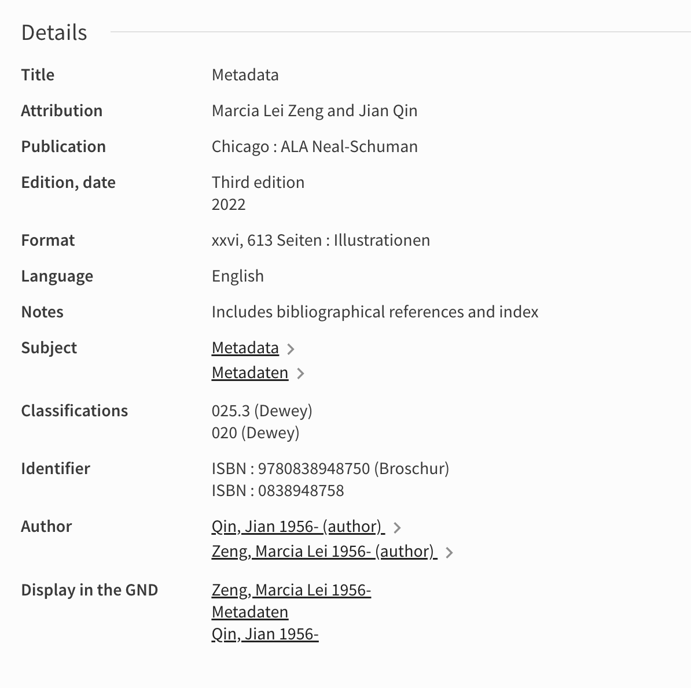

  <figcaption>
    <strong>Figure 3.1</strong>: Snapshot from the Swisscovery Platform Showing the Bibliographic Record of @zeng_metadata_2022
  </figcaption>
</figure>

Metadata are central to the management and preservation of CH data, providing essential information to ensure that data can be properly organised, discovered and retrieved. For example, they facilitate the understanding and interpretation of data, enabling scholars and the public to access and use them effectively [@constantopoulos_aspects_2008]. Metadata also help to ensure the long-term preservation and accessibility of CH data [@zeng_metadata_2022 pp. 490-491]. Providing metadata in a structured manner facilitates forms of aggregation, i.e. individuals and institutions being able to harvest and organise metadata from multiple sources or repositories into a centralised location [see @freire_survey_2017; @freire_metadata_2021]. In addition, the importance of metadata as a gateway to information is particularly compelling when the primary embodiment of a record is either unavailable or lost. In cases where resources, time constraints, sensitive content or strategic decisions prevent the digitisation of an item, metadata becomes the principal means of representation and access. If a physical record is lost or damaged, the metadata associated with that record acts as a proxy for the record.

@riley_understanding_2017 [p. 5] discusses the transformation of libraries over time. Initially, libraries moved from search terminals to the modern web-based resource discovery systems we use today. This shift was driven by advances in computerisation. Libraries' basic approach to metadata is ‘bibliographic’, deeply rooted in their traditional expertise in describing books. This approach involves providing detailed descriptions of individual items so that users can easily locate them within the library's collection.

On the other hand, archives use ‘finding aids’, which are descriptive inventories of their collections, coupled with historical context. These aids are essential for users to understand the material and to find groups of related items within the archive. The metadata used in archives allows for the contextualisation of materials, particularly papers of individuals or records of organisations, providing a richer understanding of the content.

Similarly, museums actively manage and track their acquisitions, exhibitions and loans through metadata. Museum curators use metadata to interpret collections for visitors, explaining the historical and social significance of artefacts and describing the relationships and connections between different objects. This helps to enhance the overall visitor experience and understanding of the artefacts on display or the digital resources on a particular website.

### 3.2.2 Types and Functions {id="subsec:types-functions"}

CHIs share common objectives and concerns related to information management, as highlighted by @lim_metadata_2011 [pp. 484-485]. These goals typically include facilitating access to knowledge and ensuring the integrity of CH data. However, it is important to note that CHIs also differ widely in how they deal with metadata. Different domains have unique approaches and standards for describing the materials they collect, preserve and disseminate, and even within a single domain there are significant differences.

There have been different attempts to categorise the metadata landscape. For instance, @baca_setting_2016 identified the following five categories of metadata and their respective functions:

- **Administrative**:   Metadata used in managing and administering collections and     information resources, such as acquisition and appraisal information     or documentation related to repatriation.
- **Descriptive**:   Metadata used to identify, authenticate, and describe collections     and related trusted information resources. Finding aids, cataloguing     records, annotations by practitioners and end users, as well as     metadata generated by or through a given DAM system can often be classified as     descriptive metadata.
- **Preservation**:   Metadata related to the preservation management of collections and     information resources. Common examples of preservation metadata are     documentation of physical condition of resources or of any actions     taken to preserve resources, whether physical restoration or data     migration.
- **Technical**:   Metadata related to how a system functions or metadata behaves.     Examples include software documentation and digitisation     information.
- **Use**:   Metadata related to the level and type of use of collections and     information resources, such as circulation records, search logs, or     rights metadata.

Meanwhile @riley_seeing_2009, as illustrated in a comprehensive visualisation graph[^35], suggested seven functions, i.e. the role a standard play in the creation and storage and metadata, and seven purposes referring to the general type of metadata.

- **Functions**:   Conceptual Model, Content Standard, Controlled Vocabulary,     Framework/Technology, Markup Language, Record Format, and Structure     Standard.
- **Purposes**:   Data, Descriptive Metadata, Metadata Wrappers, Preservation     Metadata, Rights Metadata, Structural Metadata, and Technical     Metadata.

Almost a decade later, @riley_understanding_2017 [pp. 6-7] summarised metadata types into four groupings instead of the seven purposes previously mentioned. ‘Data’ is removed from the list and technical, preservation and rights metadata are now grouped into a newly created administrative metadata category.

1. **Descriptive metadata**: For finding or understanding a resource
2. **Administrative metadata**: Umbrella term referring to the information needed to manage a resource or that relates to its creation  
   - **2.1 Technical metadata**: For decoding and rendering files  
   - **2.2 Preservation metadata**: Long-term management of files  
   - **2.3 Rights metadata**: Intellectual property rights attached to content
3. **Structural metadata**: Relationships of parts of resources to one another
4. **Markup Language**: Integrates metadata and flags for other structural or semantic features within content[^36].

This classification of metadata types and function differs to the categories identified by @baca_setting_2016 mostly due to the addition of structural metadata and markup language as their own categories [@zeng_metadata_2022 p. 19]. [Table 3.1](#tab:riley-metadata-types) lists the major types of metadata according to @riley_understanding_2017 [p 7] and include example properties and their primary uses.

<figure id="tab:riley-metadata-types" style="text-align: center;">
  <figcaption><strong>Table 3.1</strong>: Types of Metadata According to @riley_understanding_2017 [p. 7]</figcaption>
  
  <table style="margin: 1em auto;">
    <thead>
      <tr>
        <th><strong>Metadata (Sub)type</strong></th>
        <th><strong>Example properties</strong></th>
        <th><strong>Primary uses</strong></th>
      </tr>
    </thead>
    <tbody>
      <tr>
        <td>1. Descriptive metadata</td>
        <td>Title, Author, Subject, Genre, Publication date</td>
        <td>Discovery, Display, Interoperability</td>
      </tr>
      <tr>
        <td>2.1 Technical metadata</td>
        <td>File type, File size, Creation date, Compression scheme</td>
        <td>Interoperability, Digital object management, Preservation</td>
      </tr>
      <tr>
        <td>2.2 Preservation metadata</td>
        <td>Checksum, Preservation event</td>
        <td>Interoperability, Digital object management, Preservation</td>
      </tr>
      <tr>
        <td>2.3 Rights metadata</td>
        <td>Copyright status, Licence terms, Rights holder</td>
        <td>Interoperability, Digital object management</td>
      </tr>
      <tr>
        <td>3. Structural metadata</td>
        <td>Sequence, Place in hierarchy</td>
        <td>Navigation</td>
      </tr>
      <tr>
        <td>4. Markup languages</td>
        <td>Paragraph, Heading, List, Name, Date</td>
        <td>Navigation, Interoperability</td>
      </tr>
    </tbody>
  </table>
</figure>

Ultimately, metadata can also be leveraged to create more inclusive and diverse representations of CH. For instance, metadata can be used to document and promote underrepresented communities and their heritage, providing greater visibility and recognition. This approach aligns with the principles of decolonising CH, promoting equity and social justice by recognising and valuing diverse cultural perspectives, especially in the prevailing anglophone and Western-centric standpoint in DH [@mullaney_internet_2021; @mahony_cultural_2018].

Moreover, the distinction between data and metadata, as discussed in the work of @alter_view_2023, is not always distinct, leading to the concept of *‘semantic transposition’*. This complexity reflects in CH where what is considered metadata in one context might be primary data in another, underscoring the necessity for adaptable frameworks in data management. This understanding is crucial for fostering inclusive and diverse representations in CH, ensuring that all cultural narratives are appropriately documented and acknowledged.

### 3.2.3 Standards {id="subsec:metadata-standards"}

Metadata standards play a crucial role in ensuring that data are organised and consistent, facilitating mutual understanding between different stakeholders [@raemy_enabling_2020]. CHIs such as GLAMs typically follow established conventions or standards when organising their resources. Current methods of cataloguing have historical roots dating back to the 19<sup>th</sup> century, particularly with the development of cataloguing systems such as Antonio Panizzi's ‘Ninety-One Cataloguing Rules’ at the British Museum and Charles Coffin Jewett's efforts to mechanically duplicate entries at the library of the Smithsonian Institution [@zeng_metadata_2022 pp. 14-15].

Unique metadata standards, rules and models have been established and maintained within specific sub-fields. In addition, certain standards for information resources have been endorsed by authoritative bodies [@greenberg_understanding_2005], and some are used exclusively within specific domain communities [@hillmann_metadata_2008]. @riley_understanding_2017 [p. 5] underscores the predilection of CH metadata -- whether these standards emanate from libraries, archives, or museums -- toward accentuating descriptive attributes. The foundational CH metadata standards, primarily conceived to *‘describe what resources are and what they are about, and organising them according to controllable criteria’* [@zeng_metadata_2022 p. 11], manifest this thematic focus. Within the CH domain, metadata standards vary widely in scope, and a number of different standards have been developed to meet different needs and priorities[^37] [@freire_availability_2018].

The following quoted passage sheds some light on the different approaches and levels of collaboration in metadata standardisation, namely among the library and museum sectors.

> Despite the striving for homogeneity, in practice, the production of metadata among  information  specialists  and  the  use  of  metadata  standards  is  already  marked by considerable diversity. This has come about for very pragmatic reasons. Different types of objects and collections require different types of metadata. The curatorial interest for particular information differs for example between images held  in  an  art  gallery  and  a  library,  as  does  the  information  specialists’ domain  expertise. Accordingly,  diversity  in  metadata  practice  seems  to  be  greatest  in  museums  as  they  are  the  institutions  that  govern  the  most  diverse  collections.  While the library sector has *‘systematically and cooperatively created and shared’* metadata standards since the 1960s, the museum sector, mostly handling images and objects, has been slower to establish such collaboration and consensus. [@dahlgren_diversity_2020 p. 244]

In this context, I want to focus on some metadata standards that have proved vital across libraries, archives, museums and galleries. These standards, which I will briefly describe, serve as the foundation for organising, describing, and enabling efficient access to vast and diverse collections. Of particular interest I will be taking a closer look at CIDOC-CRM as it serves as the cornerstone of Linked Art, a fundamental LOUD standard.

#### 3.2.3.1 Library Metadata Standards {id="subsubsec:library-metadata"}

In libraries, several metadata standards have played crucial roles in organising and accessing collections over the years. The most prevalent historical standard, MARC[^38], was a pilot project from the 1960s funded by the CLIR and led by the LoC to structure cataloguing data and distribute them through magnetic tapes [@avram_marc_1968 p. 3]. The standard evolved into MARC21 in 1999 [@zeng_metadata_2022 p. 418] -- as exemplified by [Code Snippet 3.1](#lst:marc21), providing a structured format for bibliographic records and related information in machine-readable form. It uses codes, fields, and sub-fields to structure data. Another significant historical standard is the AACR, published in 1967 and revised in 1978 that provides sets of rules for descriptive cataloguing of various types of information resources.

<figure id="lst:marc21" style="text-align: center;">
  <figcaption>
    <strong>Code Snippet 3.1</strong>: MARC21 Record of @zeng_metadata_2022 in the Swisscovery Platform
  </figcaption>
  
  

```marc21
leader  01424nam a2200397 c 4500
001 991170746542405501
005 20220427104002.0
008 210818s2022    xxu      b    001 0 eng
010 ##$a  2021031231
020 ##$a9780838948750 $qBroschur
020 ##$a0838948758
035 ##$a(OCoLC)1264724191
040 ##$aDLC $bger $erda $cDLC $dCH-ZuSLS UZB ZB
042 ##$apcc
050 00$aZ666.7 $b.Z46 2022
082 00$a025.3 $223
082 74$a020 $223sdnb
100 1#$aZeng, Marcia Lei $d1956- $4aut $0(DE-588)136417035
245 10$aMetadata $cMarcia Lei Zeng and Jian Qin
250 ##$aThird edition
264 #1$aChicago $bALA Neal-Schuman $c2022
300 ##$axxvi, 613 Seiten $bIllustrationen
336 ##$btxt $2rdacontent
337 ##$bn $2rdamedia
338 ##$bnc $2rdacarrier
504 ##$aIncludes bibliographical references and index
650 #0$aMetadata
650 #7$aMetadata $2fast $0(OCoLC)fst01017519
650 #7$aMetadaten $2gnd $0(DE-588)4410512-5
776 08$iErscheint auch als $nOnline-Ausgabe $tMetadata $z9780838937969
776 08$iErscheint auch als $nOnline-Ausgabe $tMetadata $z9780838937952
700 1#$aQin, Jian $d1956- $4aut $0(DE-588)1056085541
856 42$3Inhaltsverzeichnis $qPDF $uhttps://urn.ub.unibe.ch/urn:ch:slsp:0838948758:ihv:pdf
900 ##$aOK_GND $xUZB/Z01/202203/klei
900 ##$aStoppsignal FRED $xUZB/Z01/202203
949 ##$ahttps://urn.ub.unibe.ch/urn:ch:slsp:0838948758:ihv:pdf
    
```

</figure>

AACR is no longer maintained and was replaced by RDA[^39] around 2010 to be a more adaptive standard to contemporary needs. RDA, while not a markup language like MARC, serves as a content standard that guides the description and discovery of resources, focusing on user needs and facilitating improved navigation of library collections. Its goal is to provide a flexible and extensible framework for the description of all types of resources, ensuring discoverability, accessibility, and relevance for users[^40] [@sprochi_where_2016 p. 130].

Libraries often leverage other standards to enrich their metadata practices. MODS[^41], introduced in 2002, offers a more flexible XML-based schema for bibliographic description, allowing for better integration with other standards and systems. It was initially developed to carry *‘existing MARC21 records as well as to enable the creation of original resource description records’* [@zeng_metadata_2022 p. 423]. MODS provides a balance between human readability and machine processing, making it suitable for a wide range of resources and use cases [@guenther_mods_2003 p. 139]. METS[^42], on the other hand, is a standard for encoding descriptive, administrative, and structural metadata regarding objects within a digital library. METS, developed as an initiative of the DLF, provides a flexible and extensible framework for structuring metadata, allowing for the packaging of complex digital objects [@cantara_mets_2005 pp. 238-239]. While MODS is primarily concerned with bibliographic information, METS focuses on structuring metadata for digital objects, making it particularly useful for digital libraries and repositories.

A further important standard is FRBR, a conceptual framework for understanding and structuring bibliographic data and access points. Originally developed by IFLA in 1997 as part of its functional requirements family of models, FRBR describes three main groups of entities, relationships, and attributes as illustrated by [Figure 3.2](#fig:frbr). The first group of entities are the foundation of the model which characterises four levels of abstraction: WEMI [@denton_functional_2006 p. 231]. FRBR has had a significant impact on the development of RDA, which is loosely aligned with the principles and structures defined by the conceptual framework, but as it isn't a data model *per se*; it does not inform how to record bibliographic information in day-to-day practice and focus heavily on textual resources[^44] [@sprochi_where_2016 pp. 130-131]. Furthermore, @cossham_models_2017 [p. 11] asserts that FRBR and RDA, *‘don't align well with the ways that users use, understand, and experience library catalogues nor with the ways that they understand and experience the wider information environment’*.

<figure id="fig:frbr" style="text-align: center;">
  <!-- The image itself -->
  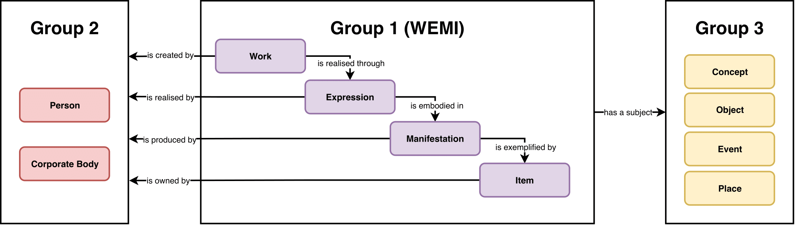
  
  <!-- Figure caption -->
  <figcaption>
    <strong>Figure 3.2:</strong> The FRBR Conceptual Framework.
    Adapted from @zou_constructing_2018 [p. 36]
  </figcaption>
</figure>

A further important standard in the field of library science is the LRM, which was introduced as a comprehensive conceptual framework. It provides a broad understanding of bibliographic data and user-centric design principles, aligning with FRBR. LRM defines key entities, attributes, and relationships important for bibliographic searches, interpretation, and navigation -- as shown in [Figure 3.3](#fig:lrm-relationships). It operates at the conceptual level and does not dictate data storage methods. Attributes in LRM can be represented as literals or URIs. The model is presented in a structured document format to support LOD applications and reduce ambiguity. During its development, a parallel process created FRBRoo (see [Subsubsection 3.2.3.3](#subsubsec:museums-metadata)), a model that extends the original FRBR model by incorporating it into CIDOC-CRM. FRBRoo focuses on CH data and is more detailed than LRM, which is designed specifically for library data and follows a high-level, user-centric approach [@riva_ifla_2017 pp. 9-13]. The LRM model, known as LRMer[^46], was released in 2020 by IFLA [@zeng_metadata_2022 p. 163].

<figure id="fig:lrm-relationships" style="text-align: center;">
  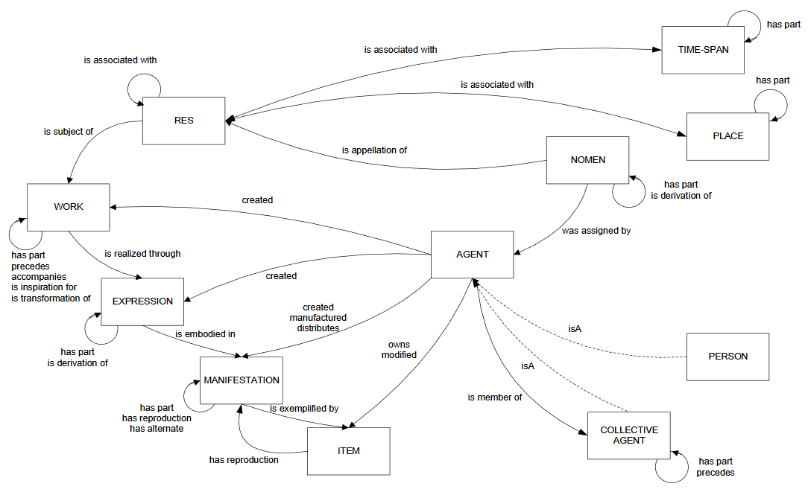
  <figcaption>
    <strong>Figure 3.3:</strong> Overview of Relationships in LRM 
    [@riva_ifla_2017 p. 86]
  </figcaption>
</figure>

BibFrame[^47] is another metadata standard in the library domain. It was initiated around 2011 by the LoC to be a successor of MARC, which had become obsolete [see @tennant_marc_2002] as well as being invisible to web crawlers and search engines preventing adequate discoverability of bibliographic resources [@sprochi_where_2016 p. 132]. BibFrame is a loosely RDF-based model [@sanderson_linked_2015], intending to improve the interoperability and discoverability of library resources. While the BibFrame model may not perfectly correspond with the WEMI entities outlined in FRBR, it is possible to effectively link BibFrame resources to FRBR entities, ensuring their compatibility [@sprochi_where_2016 p. 133]. BibFrame aims to transition from MARC by providing a more web-friendly framework, focusing on the relationships between entities, improving data sharing, and accommodating the digital environment. Conversely, @edmunds_bibframe_2023 argues that BibFrame is unaffordable and leads to elitism within libraries, with the main beneficiaries being well-funded institutions, particularly in North America, while placing a financial burden on others. This approach, endorsed by bodies such as the LoC, is criticised for its high cost, impracticality, inequity and limited benefits for cataloguers, libraries, vendors and the public they serve. In addition, the author highlights BibFrame's lack of user friendliness, regardless of the intended users, and criticises the notion of adopting Linked Data for its own sake without substantial practical benefits.

#### 3.2.3.2 Archival Metadata Standards {id="subsubsec:archives-metadata"}

For archives, metadata standards like EAD[^48] and ISAD(G)[^49] have been pivotal. EAD, introduced in the mid-1990s -- it originated in 1993 and the first version of EAD was released in 1998, provides a hierarchical structure for representing information about archival collections, offering comprehensive descriptions that aid researchers, archivists, and institutions in managing and providing access to archival records. Its goal is to create a standard for encoding finding aids to improve accessibility and understanding of archival collections [@pitti_encoded_1999 pp. 61-62]. On the other hand, ISAD(G), released in its first version in 1994 by ICA, offers a more general international standard for archival description, providing a framework for describing all types of archival materials, including fonds, sub-fonds, series, files, and items [@shepherd_application_2000 p. 57]. ISAD(G) aims to establish consistent and standardised archival description practices on a global scale, facilitating the sharing and exchange of archival information.

PREMIS[^50], is another metadata standard that was initially released in 2005 -- version 3.0 is the latest specification, published in 2016 -- and focuses on the preservation of digital objects, consisting of four interrelated entities: `Object`, `Event`, `Agent`, and `Rights` [@caplan_practical_2005 p. 111]. The main objective of PREMIS is to help institutions ensure the long-term accessibility of data by capturing key details about their creation, format, provenance, and preservation events. It is seen as an elaboration of OAIS, which categorises information required for preservation in several functional entities and types of information package [see @bates_open_2009 pp. 425-426] -- as illustrated by [Figure 3.4](#fig:oais), expressed through the mapping of preservation metadata onto the conceptual model [@zeng_metadata_2022 pp. 493-494].

<figure id="fig:oais" style="text-align: center;">
  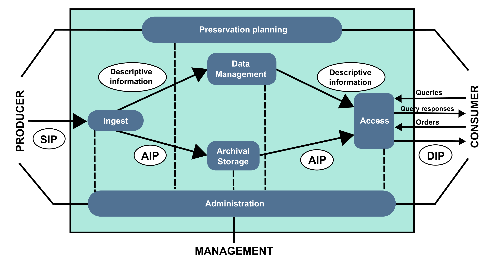
  <figcaption>
    <strong>Figure 3.4:</strong> OAIS Functional Model Diagram by @mathieualexhache_oais_2021
  </figcaption>
</figure>

The latest development in metadata standards for archives is the creation of RiC, which has been developed since 2012 by ICA [@clavaud_ica_2021 pp. 79-80]. RiC is structured into four complementary parts [@ica_expert_group_on_archival_description_records_2023 p. 1] intended to cover and replace existing archival standards such as ISAD(G):

- **RiC Foundations of Archival Description**:   A brief description of the foundational principles and purposes of     archival description.
- **RiC Conceptual Model**:   A high-level framework for archival description[^51], as shown in [Figure 3.5](#fig:ric-cm).
- **RiC-O**:   The ontology[^52], which embodies a specific implementation of the     conceptual model. It is formally expressed in     OWL to make     archival description available using LOD techniques -- which facilitating     extensions [see @mikhaylova_extending_2023] -- and adheres to a     conceptual vocabulary specific to archival description. It provides     the ability to navigate and interpret complex archival holdings and     foster meaningful research and discovery. The ontology includes     seven main groups of entities: `Record`, `Agent`, `Rule`, `Event`,     `Date`, `Place`, and `Instantiation`.
- **RiC Application Guidelines**:   A part in development at the time of writing which will provide     practitioners and software developers with guidance and examples for     implementing the conceptual model and the ontology in records and     archival management systems.

<figure id="fig:ric-cm" style="text-align: center;">
  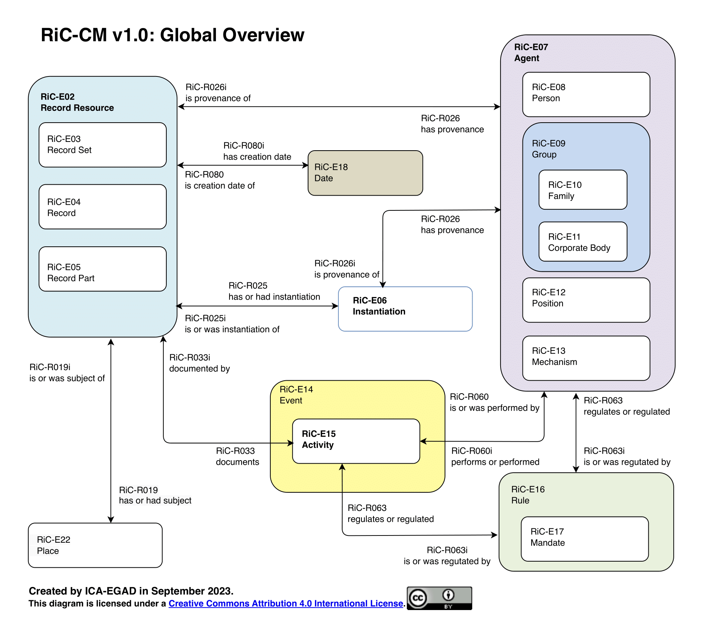
  <figcaption>
    <strong>Figure 3.5:</strong> Global Overview of the Core Entities Defined by the RiC Conceptual Model. 
    Slightly Adapted from <a href="https://github.com/ICA-EGAD/RiC-O">https://github.com/ICA-EGAD/RiC-O</a>
  </figcaption>
</figure>

#### 3.2.3.3 Museum and Gallery Metadata Standards {id="subsubsec:museums-metadata"}

In the museum and gallery domain, various metadata standards and conceptual models have significantly contributed to the management, organisation, and accessibility of CH objects and artworks. Notable among these are CDWA, CCO, LIDO, CIDOC-CRM, as well as Linked Art.

CDWA[^53], developed in the mid-1990s and maintained by the Getty Vocabulary Program, and CCO[^54] created by the VRA[^55], introduced in the early 2000s, primarily focus on describing art and cultural artefacts, providing a framework for recording essential details like artist, title, medium, date, and provenance. CDWA is a comprehensive set of guidelines for cataloguing and describing various cultural objects, including artworks, architectural elements, material culture items, collections of works, and associated images. While not a data model itself, it offers a conceptual framework for designing data models and databases, as well as for information retrieval. It then evolved into CDWA Lite, an XML schema for data harvesting purposes [@baca_categories_2017 pp. 1-2].

CCO comprises of both rules and examples of the CDWA categories and the VRA Core 4.0 for describing, documenting, and cataloguing cultural works and their visual surrogates[^56] [@coburn_cataloging_2010 pp. 17-18]. Both CCO and CDWA are standards that the CIDOC[^57] recommends and supports for museum documentation.

LIDO[^58] is a CIDOC standard introduced in the early 2000s which offers a lightweight XML-based serialisation used for describing museum-related information -- as shown in [Code Snippet 3.2](#lst:lido-xml). It provides a format for the interchange of data about art and CH objects, complementing CDWA and CCO as it integrates and extends CDWA Lite with elements of CIDOC-CRM [@stein_using_2019 p. 1025]. Ultimately, LIDO's goal is to enhance interoperability, accessibility, and the sharing of collection information, enabling institutions to connect and showcase their collections in diverse contexts [@coburn_lido_2010 p. 3]. LIDO is also a CIDOC Working Group, which are created to tackle particular issues or areas of interest[^59].

<figure id="lst:lido-xml" style="text-align: center;">
  <figcaption>
    <strong>Code 3.2:</strong> Example of a LIDO Object in XML from @lindenthal_lido_2023
  </figcaption>
  
  

```xml
<lido:lido>
    <lido:lidoRecID
        lido:source="ld.zdb-services.de/resource/organisations/DE-Mb112"
        lido:type="http://terminology.lido-schema.org/lido00099">
        ld.zdb-services.de/resource/organisations/DE-Mb112/lido/obj/00076417
    </lido:lidoRecID>
    <lido:descriptiveMetadata xml:lang="en">
        <lido:objectClassificationWrap>
            <lido:objectWorkTypeWrap>
                <lido:objectWorkType>
                    <skos:Concept
                        rdf:about="http://vocab.getty.edu/aat/300033799">
                        <skos:prefLabel
                            xml:lang="en">
                            oil paintings (visual works)
                        </skos:prefLabel>
                    </skos:Concept>
                </lido:objectWorkType>
            </lido:objectWorkTypeWrap>
        </lido:objectClassificationWrap>
        <lido:objectIdentificationWrap>
            <lido:titleWrap>
                <lido:titleSet>
                    <lido:appellationValue
                        lido:pref="http://terminology.lido-schema.org/lido00169"
                        xml:lang="en">
                        Mona Lisa
                    </lido:appellationValue>
                </lido:titleSet>
            </lido:titleWrap>
        </lido:objectIdentificationWrap>
    </lido:descriptiveMetadata>
</lido:lido>
    
```

</figure>

CIDOC-CRM[^60], developed since 1996 by the CIDOC and more specifically maintained by the CRM-SIG --- which convenes quarterly[^61], is a formal and top-level ontology that offers a comprehensive conceptual framework for describing CH resources, allowing for a deep understanding of relationships between different entities, events, and concepts for museums [@doerr_cidoc_2003 pp. 75-76]. It aims to provide a common semantic framework for information integration, supporting robust knowledge representation and fostering collaboration and interoperability within the CH sector as it can also mediate different resources from libraries and archives. The latest stable version of the conceptual model is version 7.1.2[^62], published in June 2022, and comprises of 81 classes and 160 properties[^63] [see @bekiari_cidoc_2021].

Within the base ontology of CIDOC-CRM -- or CRMBase -- and despite the emergence of new developments and gradual changes, there is a fundamental and stable core that can be succinctly outlined. This fundamental structure acts as a basic orientation for understanding the way in which data is structured within CIDOC-CRM. Examining the hierarchical structure of CIDOC-CRM, one can identify the main top-level branches, namely:

- `E18 Physical Thing`:   This class comprises all persistent physical items with a relatively     stable form, human-made or natural.
- `E28 Conceptual Object`:   This class comprises non-material products of our minds and other     human produced data that have become objects of a discourse about     their identity, circumstances of creation or historical implication.     The production of such information may have been supported by the     use of technical devices such as cameras or computers.
- `E39 Actor`:   This class comprises people, either individually or in groups, who     have the potential to perform intentional actions of kinds for which     someone may be held responsible.
- `E53 Place`:   This class comprises extents in the natural space we live in, in     particular on the surface of the Earth, in the pure sense of     physics: independent from temporal phenomena and matter. They may     serve describing the physical location of things or phenomena or     other areas of interest.
- `E2 Temporal Entity`:   This class comprises all phenomena, such as the instances of     `E4 Periods` and `E5 Events`, which happen over a limited extent in     time.

Complemented by entities tailored for the documentation of `E41 Appellation` and `E55 Type`, the structure -- as shown in [Figure 3.6](#fig:CRMbase) -- provides a potent set of means to capture a broad range of general-level CH reasoning in a holistic manner [@bruseker_cultural_2017 pp. 111-112].

<figure id="fig:CRMbase" style="text-align: center;">
  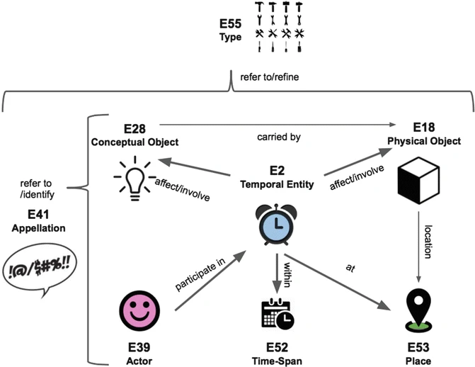
  <figcaption>
    <strong>Figure 3.6:</strong> CIDOC-CRM Top-Level Categories by @bruseker_cultural_2017 [p. 112]
  </figcaption>
</figure>

CRMBase, is supplemented by a series of extensions -- sometimes referred to as the CIDOC-CRM family of models -- intended to support various types of specialised research questions and documentation, such as bibliographic records or geographical data. These compatible models[^64], ordered alphabetically, include both works in progress and models to be reviewed by CRM-SIG[^65]. They comprise as follows:

- CRMact[^66]:    An extension that defines classes and properties for     integrating documentation records about plans for future activities     and future events.
- CRMarchaeo[^67]:    An extension of CIDOC-CRM created to support the archaeological     excavation process and all the various entities and activities     related to it.
- CRMba[^68]:    An ontology for documenting archaeological buildings. Its     primary purpose is to facilitate the recording of evidence and     material changes in archaeological structures.
- CRMdig[^69]:    An ontology to encode metadata about the steps and methods of     production (‘provenance’) of digitisation products and synthetic digital     representations such as 2D, 3D or even animated models created by     various technologies.
- CRMgeo[^70]:    An ontology intended to be used as a global schema for     integrating spatio-temporal properties of temporal entities and     persistent items. Its primary purpose is to provide a schema     consistent with the CIDOC-CRM to integrate geoinformation using the     conceptualisations, formal definitions, encoding standards and     topological relations.
- CRMinf[^71]:    An extension of CIDOC-CRM that facilitates argumentation and     inference in descriptive and historical fields. It serves as a     universal schema for merging metadata related to argumentation and     inference, primarily focusing on these disciplines.
- CRMsci[^72]:    The Scientific Observation Model is an ontology that extends     CIDOC-CRM     for scientific observation, distinguishing the process from results     and providing a formal ontology for scientific data integration and     research modelling.
- CRMsoc[^73]:    An ontology for integrating data about social phenomena and     constructs that are of interest in the humanities and social     sciences based on analysis of documentary evidence.
- CRMtex[^74]:    An extension of CIDOC-CRM created to support the study of     ancient documents by identifying relevant textual entities and by     modelling the scientific process related with the investigation of     ancient texts and their features.
- FRBRoo[^75]:    An ontology intended to capture and represent the underling     semantics of bibliographic information which interprets the     conceptualisations of the FRBR framework.
- PRESSoo[^76]:    An ontology intended to capture and reresent the underling     semantics of bibliographic information about continuing resources,     and more specifically about periodicals (journals, newspapers,     magazines, etc.). PRESSoo is also an extension of     FRBRoo.

[Figure 3.7](#fig:CRMfamily) shows CRMbase and eight of the extensions previously outlined in a pyramid shape, where the lower you go in the pyramid, the more specialised the concepts.

<figure id="fig:CRMfamily" style="text-align: center;">
  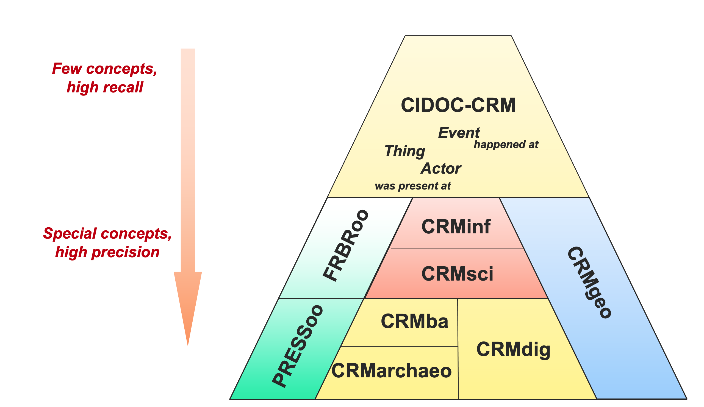
  <figcaption>
    <strong>Figure 3.7:</strong> CIDOC-CRM Family of Models. Diagram done and provided by 
    Maria Theodoridou (Institute of Computer Science, FORTH)
  </figcaption>
</figure>

Linked Art[^77], a recent addition to this landscape, is a community-driven initiative and a metadata application profile that has been in existence since the end of 2016 [@raemy_ameliorer_2022 pp. 136-137]. This community -- recognised as a CIDOC Working Group -- has created a common Linked Data model based on CIDOC-CRM for describing artworks, their relationships, and the activities around them (see [Subsection 3.5.5](#subsec:linked-art)).

#### 3.2.3.4 Cross-domain Metadata Standards {id="cross-domain-metadata"}

There are a few cross-domain standards that have been used to describe CH resources. For instance, the Dublin Core Elements, containing the original core sets of fifteen basic elements, and Dublin Core Metadata Terms[^78], its extension, are widely used metadata standards for describing CH resources. It provides metadata properties and classes that are applicable to a wide range of resources [@weibel_dublin_2000]. Another good example is the EDM that has been specified so that national, regional and thematic aggregators in Europe can deliver resources of content providers to Europeana [see @charles_enhancing_2015; @freire_technical_2019].

Despite the presence of cross-domain standards and efforts to map between standards, whether from one version to another or across different domains, reconciling metadata from various sources remains a significant challenge in the CH sector. Institutions may collect metadata in different ways, using different standards and schemas, making it difficult to merge and compare metadata from different sources. Additionally, metadata may be incomplete, inconsistent, or contain errors, further complicating data reconciliation. To address these challenges, standardised, interoperable metadata are necessary to enable data sharing and reuse. While the use of different metadata standards can present challenges for data reconciliation, the adoption of standardised, interoperable metadata can facilitate data sharing and reuse, promoting the long-term preservation and accessibility of CH resources. Controlled vocabularies -- included in what @zeng_metadata_2022 [pp. 24-25] called *‘standards for data values’* -- such as those maintained by the Getty Research Institute[^79]: the AAT, the TGN, and the ULAN, as well as various kinds of KOS (see [Subsection 3.2.4](#subsec:kos)). These vocabularies provide a common language for describing CH objects and can improve the interoperability of metadata across different institutions and communities.

Alongside metadata reconciliation comes also the question of aggregation. Apart from LIDO in museums, the general and current operating model for aggregating CH (meta)data is still the OAI-PMH [see @raemy_enabling_2020], which is an XML-based standard that was initially specified in 1999 and updated in 2002 [@lagoze_open_2002]. Alas, OAI-PMH does not align to contemporary needs [@van_de_sompel_reminiscing_2015], and there are now some alternative and web-based technologies for harvesting resources that are slowly being leveraged such as AS [@snell_activity_2017], a W3C syntax and vocabulary for representing activities and events in social media and other web application. It can also be easily extended and used in different contexts, such as it is the case with the IIIF Change Discovery API (see [Subsubsection 3.5.3.3](#subsubsec:iiif-specs)) or with ActivityPub [@lemmer-webber_activitypub_2018], a decentralised W3C protocol being leveraged by Mastodon[^80], a federated and open-source social network.

Overall, the evolution of metadata standards in the CH domain paves the way for a more interconnected and accessible digital environment, thereby providing better access to disparate collections and facilitating cross-domain reconciliation. This transformation is complemented by a growing emphasis on web-based metadata aggregation technologies that are more suited to today's needs.

### 3.2.4 Knowledge Organisation Systems {id="subsec:kos"}

KOS, also known as concept systems or concept schemes, encompass a wide range of instruments in the area of knowledge organisation. They are distinguished by their specific structures and functions [@mazzocchi_knowledge_2018 p. 54]. KOS include authority files, classification schemes, thesauri, topic maps, ontologies, and other related structures. Despite their differences in nature, scope and application, all share a common goal: to facilitate the structured organisation of knowledge and classification of information. According to @zeng_metadata_2022 [p. 284], *‘KOS have a more important function: to model the underlying semantic structure of a domain and to provide semantics, navigation, and translation through labels, definitions, typing relationships, and properties for concepts’*. This overarching intent underpins the practice of information management and retrieval.

The term KOS *‘became even more popular after the encoding standard Simple Knowledge Organization System (SKOS) was recommended by W3C’*, although the use of such systems can be traced back over 100 years, whereas others have been created in the advent of the web [@zeng_metadata_2022 p. 188]. According to @hill_integration_2002 [pp. 46-47, citing [@hodge_systems_2000]], KOS can be divided into four main groups: term lists, metadata-like models, classification and categorisation, as well as relationship models.

Term lists encompass authority files, dictionaries, and glossaries, serving as controlled sources for managing terms, definitions, and variant names within a knowledge organisation framework. Metadata-like models encompass directories and gazetteers, offering lists of names and associated contact information as well as geospatial dictionaries for named places, with can be extended for representing events and time periods. In the classification and categorisation domain, you find categorisation schemes and classification schemes that organise content, subject headings that represent controlled terms for collection items, and taxonomies that group items based on specific characteristics. Finally, relationship models feature ontologies, semantic networks, and thesauri, each capturing complex relationships between concepts and terms [@hill_integration_2002; @zeng_knowledge_2008]. [Figure 3.8](#fig:types-kos) represents an overview of the structure and functions of these four main groups, showcasing as well the subcategories of KOS previously mentioned. In this figure, the `x` characters indicate the extent to which each type of KOS embodies five key functions identified by @zeng_knowledge_2008, such as eliminating ambiguity or controlling synonyms.

In this subsection, I will explore four subcategories of KOS, each representing a continuum from a more linear to a more structured network. These include folksonomy, taxonomy, thesaurus, and ontology. These KOS have been selected due to their significant impact on the organisation and interlinking of data within the contexts of CHI practices and LOD. Furthermore, the intent of these systems is to help bridge the gap between human understanding and machine processing.

<figure id="fig:types-kos" style="text-align: center;">
  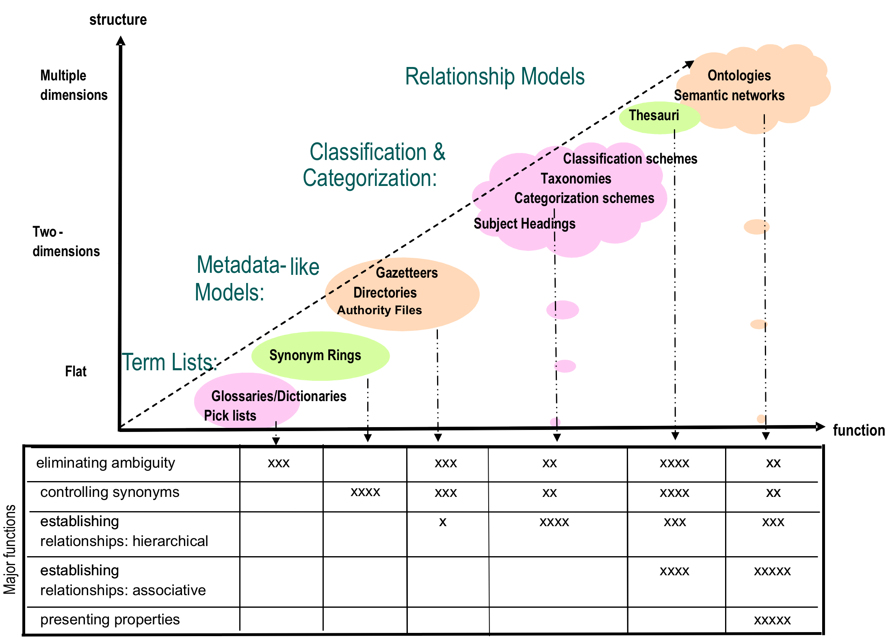
  <figcaption>
    <strong>Figure 3.8:</strong> Overview of the Structures and Functions of KOS
    [@zeng_knowledge_2008 p. 161]
  </figcaption>
</figure>

#### 3.2.4.1 Folksonomy {id="subsubsec:foklsonomy"}

Positioned at one end of the organisational spectrum, folksonomies, also known as community tagging or social bookmarking, are characterised by their user-generated nature. These systems rely on individual users' tagging of content with keywords or tags that reflect their personal perspectives and preferences. Folksonomies *‘raise a substantial challenge to the authority and effectiveness of controlled semantics’* as integration or reconciliation is often hard to achieve [@zeng_metadata_2022 p. 401]. However, they do provide a wealth of source material for studying social semantics [@zeng_metadata_2022 p. 403] and can be done in parallel to more structured KOS.


#### 3.2.4.2 Taxonomy {id="subsubsec:taxonomy"}

Moving towards the centre of the spectrum, taxonomies present a more structured approach to knowledge organisation. *‘A taxonomy is a type of KOS which consists of preferred terms, all of which are connected in a hierarchy or polyhierarchy’* [@zeng_knowledge_2008 p. 169].

Taxonomies employ hierarchical classifications to systematically categorise information into distinct classes and sub-classes, or in a parent/child relationship [@saa_dictionary_taxonomy_2023] - as shown by [Code Snippet 3.3](#lst:taxonomy) [@niso_guidelines_2010 p. 18]. Taxonomy, in this context, extends beyond mere categorisation; it also establishes relationships.

<figure id="lst:taxonomy" style="text-align: center;">
  <figcaption>
    <strong>Code Snippet 3.3:</strong> Taxonomy Hierarchy
  </figcaption>
  
  

```marc21
Chemistry
    Physical Chemistry
        Electrochemistry
            Magnetohydrodynamics
    
```

</figure>


#### 3.2.4.3 Thesaurus {id="subsubsec:thesaurus"}

Moving further along the spectrum, thesauri offer a more detailed and formalised method of organisation. They include not only hierarchical relationships but also explicit semantic connections between terms, making them valuable tools for information retrieval. As defined by @niso_guidelines_2010 [p. 9]: 

> A thesaurus is a controlled vocabulary arranged in a known order and structured so that the various relationships among terms are displayed clearly and identified by standardized relationship indicators.

For instance, consider a thesaurus related to photography, which encompasses categories for various aspects of photography, including photographic techniques, equipment, and materials. Within this taxonomy, ‘Kodachrome’ could be categorised not only as a specific type of colour film but also as a distinct photographic process. As a type, it could fall under the sub-category of ‘colour film photography’, and as a process, it would fit within the broader framework of ‘photographic techniques’.

The AAT, commonly employed in the CH domain, stands as a significant example of a thesaurus [@harpring_development_2010 p. 67]. Homosaurus[^81] is another example of a thesaurus with a distinct focus on enhancing the accessibility and discoverability of LGBTQ+ resources and related information. Leveraging Homosaurus in metadata can effectively contribute to diminishing biases present in such data, an essential step in promoting inclusivity and equity within information systems [see @hardesty_mitigating_2021].

#### 3.2.4.4 Ontology {id="subsubsec:ontology"}

At the structured end of the spectrum, ontologies define complex relationships and attributes between concepts, whereby a series of concepts have been chosen to express what we understand, so that a computer can start making sense of our world. Ontologies are formalised KOS, enabling advanced data integration and KR for more sophisticated applications. The term is drawn from philosophy, where an ontology is a discipline concerned with studying the nature of existence, as articulated by @gruber_translation_1993 [pp. 199-200]:

> An ontology is an explicit specification of a conceptualization. The term is borrowed from philosophy, where an ontology is a systematic account of Existence. For knowledge-based systems, what “exists” is exactly that which can be represented.

There are different kinds of ontologies, including axiomatic formal ontologies, foundational ontologies, and domain-specific ontologies [@beretta_interoperabilite_2022]. These different types of ontologies cater to various knowledge representation needs. Foundational ontologies, such as DOLCE [^82], provide a high-level framework for modelling knowledge and offers a comprehensive system for representing entities, qualities, and relationships [see @masolo_wonder_2003; @borgo_dolce_2022].

DLs, a family of formal KR languages, play also a key role in developing ontologies and serve as the foundation for OWL (see [Subsection 3.4.2](#sub:semanticweb)), notably by providing a logical formalism. DLs are characterised by their ability to provide substantial expressive power that goes well beyond propositional logic, while maintaining decidable reasoning [@chang_abox_2014].

In computer science, the concepts of ABox and TBox, both statements in KBs, are relevant to the structuring and enrichment of KGs [@giacomo_tbox_1996][^83]. The ABox, representing the ‘assertion’ or ‘instance’ level, encapsulates concrete data instances and their relationships, contributing to the factual knowledge of a given system. Conversely, the TBox, representing the ‘terminology’ or ‘schema’ level, defines the conceptual framework and hierarchies that govern the relationships and attributes of the instances. These two complementary components work in harmony to improve data interoperability, reasoning and knowledge sharing. [Figure 3.9](#fig:dl-system) depicts a high-level overview of a KB representation system.

<figure id="fig:dl-system" style="text-align: center;">
  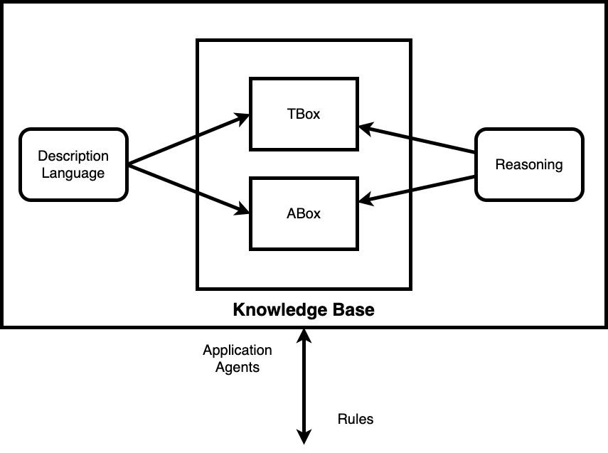
  <figcaption>
    <strong>Figure 3.9:</strong> Knowledge Base Representation System Based on @patron_embedded_2011 [p. 205]
  </figcaption>
</figure>

Consider a scenario around artwork provenance held in a museum. The ABox strives to encapsulate the rich narratives of individual artworks, tracing their journey through time, ownership transitions and exhibition travels. At the same time, the TBox creates a conceptual scaffolding, imbued with classes such as `Artwork`, `Creator`, and `Exhibition`, painting an abstract portrait that contextualises each artefact within a broader cultural tapestry. It is here that the DL comes in, harmonising the symphony with its logical relationships and axioms, i.e. a rule or principle widely accepted as obviously true [@baader_13_2007]. The DL is represented as 𝒦 = (𝒯, ℛ, 𝒜), where:

- 𝒯:   represents the TBox, defining the conceptual framework,     which encompasses the hierarchical relationships, classes, and     concepts within the KB.
- ℛ:   represents the set of binary roles, delineating the relationships     and connections between individuals or instances in the domain.     These roles facilitate the understanding of how entities relate to     one another within the KB.
- 𝒜:   represents the ABox, encompassing the specific assertions     or instances in the KB.

This symbiotic interplay ensures that the provenance of each artwork is not just a static account, but a dynamic, interconnected narrative. The ABox-TBox relationship thrives in the realm of reasoning. Imagine an axiom embedded in the TBox: ‘A work of art presented in an exhibition curated by a distinguished patron is of heightened cultural significance’, or here phrased in DL terms: ∃ `curates.Artwork.CulturalSignificance` ⊑ `true`. This axiom serves as a beacon to guide the system's reasoning. When an ABox instance of an artwork is woven into an exhibition curated by a prominent authority, the DL-informed engine responds by inferring an enriched cultural value that resonates beyond the artefact itself. This is where the TBox takes data and gives it life, producing insights that transcend the boundaries of individual instances. The KB, 𝒦, captures this orchestration, encapsulating the logical relationships for meaningful interpretation and knowledge discovery.

Overall, the relationship between ABox and TBox in DL is vital for achieving semantic clarity, enabling meaningful data integration, and facilitating advanced reasoning mechanisms. The museum provenance scenario showcases a precisely orchestrated convergence of assertion, terminology, and rigorous logical reasoning. This engenders a computational landscape where historical artefacts intricately mesh within the complex network of human history's data structures, seamlessly aligning with the underlying framework of algorithmic representation. These components enable software developers to harmonise disparate datasets, extract insightful knowledge, and support decision-making processes across a wide range of domains. In essence, the use of DL, ABox, and TBox in ontological KR enhances interoperability between different systems and allows for sophisticated reasoning and decision support.

Moving beyond these foundational concepts, it is noteworthy to consider the work of @ehrlinger_towards_2016, who address the need for a clear and standardised definition of KGs. They highlight the term's varied interpretations since its popularisation by Google in 2012 and propose a definitive, unambiguous definition to foster a common understanding and wider adoption in both academic and commercial realms. They define a KG as follows: ‘A knowledge graph acquires and integrates information into an ontology and applies a reasoner to derive new knowledge’. This definition crystallises the essence of KGs as dynamic and integrative systems that not only store but also process and enrich data through advanced reasoning. This conceptualisation underlines the transformative potential of KGs in various domains, bridging the gap between raw data and actionable insights.

Finally, it is important to recognise that the importance of ontologies extends beyond individual systems. Shared ontologies are a cornerstone of semantic interoperability, thus facilitating a paradigm shift in the way systems and applications communicate. As @sanderson_rdf_2013 argues: *’shared ontologies increases semantic interoperability’* and *‘shared identity makes it possible for graph to merge serendipitously’*. This shared understanding ensures that various entities can seamlessly connect and engage in meaningful interactions.

## 3.3 Trends, Movements, and Principles {id="sec:movements"}

Technological trends, scientific movements, and guiding principles have played a crucial role in shaping the landscape of contemporary research. In recent years, there has been an increased emphasis on the need for academic and CH practices to be more transparent, inclusive, and accountable. This shift reflects a broader trend towards integrating advanced technological solutions and open-science principles in heritage management. As such, understanding the evolution of CH becomes imperative to comprehend how these practices have adapted and transformed in response to these guiding trends.

The evolution of CH has been characterised by a series of technological and methodological shifts. Initially, the primary focus was on digitising physical artefacts to preserve information from degrading originals. This phase was crucial for transitioning tangible CH into a digital format, mitigating the risk of loss due to physical degradation. Following this, efforts shifted towards ensuring the persistence of digitised resources. This stage involved addressing challenges related to digital preservation, including data degradation and format obsolescence, to ensure the longevity of digital cultural assets.

The advent of open data principles marked the next phase in CH development. This approach facilitated broader access to information, aligning with contemporary values of transparency and inclusivity in, governmental, academic, and cultural contexts. Subsequently, the focus expanded to enhancing the utility of this data. This stage involved contextualising and enriching CH data, thereby increasing their applicability and relevance across various domains.

The current frontier in CH involves developing applications that leverage rich CH data. These applications serve not only as tools for engagement and education but also as justifications for the ongoing costs associated with data storage and archival. They illustrate the tangible benefits derived from preserving heritage resources, encompassing both cultural and economic returns. In summary, the trajectory of CH development mirrors broader technological and societal trends, transitioning from preservation to active utilisation. This progression underscores the dynamic nature of research and CH processes, highlighting the evolving requirements for transparency, inclusivity, and accountability in CH management.

While automation has significantly enhanced the efficiency of digitisation processes in CH, cataloguing and indexing remain complex challenges. The intricacies involved in accurately understanding and categorising resources necessitate more than just technological solutions; they require context-aware and culturally sensitive approaches. Here, ML offers promising perspectives. ML, particularly in its advanced forms like deep learning, can assist in cataloguing and indexing by analysing large datasets to identify patterns, categorise content, and even suggest metadata. This can be particularly useful in handling large volumes of CH data, where manual processing is time-consuming and prone to human error. Typical applications of ML in this field include image recognition for identifying and classifying visual elements in artefacts, NLP for analysing textual content, and pattern recognition for sorting and organising data based on specific characteristics. Furthermore, prospective developments may entail the refinement of metadata mapping and the enhancement of quality control mechanisms. Moreover, ML algorithms can be trained to recognise stylistic elements, historical contexts, and other nuances that are essential for accurate cataloguing in CH. However, it is crucial to note that the effectiveness of ML depends heavily on the quality and diversity of the training data. Biases in this data can lead to inaccuracies in cataloguing and indexing. Thus, a collaborative approach, where ML is supplemented by expert human oversight, is often the most effective strategy.

Overall, this section provides a comprehensive overview of ~~six~~ **three**[^400] technological trends as well as five key scientific movements and guiding principles that are shaping research and how universities and GLAMs should provide environments, services, and tools with a view to collecting and disseminating content. By exploring each of these trends, movements, and principles, we can gain a deeper understanding of how research and CH processes are permeated by dynamic movements and how resources can be made more transparent, inclusive and accountable, as well as how data can be made available to human and non-human users.

### 3.3.1 Current and Emerging Technological Trends in Cultural Heritage {id="subsec:current-emerging-trends"}

I will explore some current and emerging technological trends in CH, organised into three components: Linked Data, big data, and AI. Each represents a critical driver shaping the landscape and practices of heritage data. The three trends have been around for a few decades, with the ‘Linked Data’ principles and underlying standards coming from the late 1990s, ‘big data’ being coined in 1990 and AI in 1956.

Before considering the trends discussed hereafter, note that current technological developments do not exist in isolation, but tend to intertwine and act synergistically. A vivid example of this interplay can be seen in AI and its latent impact on the semantic web, particularly in facilitating more efficient querying and crawling processes such as the LinkedDataGPT proof-of-concept service[^84] from Liip on the City of Zurich that combines ChatGPT --- a generative AI solution --- on top of a Linked Data portal to facilitate querying open datasets [@stocker_use_2023]. Inversely AI can be fed by data on the web to learn and reason, as outlined by @gandonWebScienceArtificial2019.

#### 3.3.1.1 Linked Data {id="subsubsec:linked_data"}

Linked Data, and most precisely LOD, is a set of design principles adhering to RDF which is a significant approach to interconnect data on the web in order to make semantic queries more useful [@berners-lee_semantic_2001]. In other words, this standardisation allows data to be not only linked, but also openly accessible and reusable. As noted by @gandonWebScienceArtificial2019 [p. 115, citing [@gandon_pour_2017]]:

> The Web was initially perceived and used as a globally distributed hypertext space for humans. But from its inception, the Web has always been more: its hypermedia architecture is in fact linking programs world-wide through remote procedure calls.

This deeper understanding of the web's architecture as a conduit for linking programs on a global scale holds profound implications. It signifies that the web is not merely a medium for accessing information but a dynamic environment where data-driven programs interact, exchange data, and collaborate across geographical boundaries. In this context, Linked Data emerges as a powerful enabler, providing a structured and standardised approach for these programs to communicate and share meaningful data [@bizer_linked_2008].

In the context of CH, institutions such as museums, libraries and archives can publish their collections using Linked Data principles, enabling a web of linked information that is accessible to all. As this dissertation's main topic revolves around Linked (Open) (Usable) Data, two dedicated sections have been written within this literature review in [Section 3.4](#sec:linkeddata) and [Section 3.5](#sec:loud).

Beyond formal LOD, CHIs may also link their databases or collections in more informal ways. This interconnection may take the form of shared metadata, common identifiers, or simply hyperlinks. These links can enhance the user experience by supporting a more seamless navigation between related items or pieces of information. For instance, a parallel strategy is the use of graph-based data representation, i.e. property graph which consists of a set of objects or vertices, and a set of arrows or edges connecting the objects, that are most likely not RDF-compliant [see @bermes_modelisons_2023]. Graph databases, such as Neo4j[^85] which is quite prevalent in DH [see @webber_programmatic_2012; @drakopoulos_semantically_2019; @darmont_data_2020], allow for efficient storage and retrieval of interconnected data through nodes representing entities and relationships linking them.

#### 3.3.1.2 Big Data {id="subsubsec:big_data"}

Big Data refers to extremely large and complex datasets that exceed the capabilities of traditional data processing methods and tools. It encompasses a massive volume of structured, semi-structured and unstructured data that is currently flooding across a variety of sectors, companies and organisations [see @emmanuel_defining_2016]. The characteristics of big data are often described by the three *Vs* model [@laney_3d_2001]:

- **Volume**:   Big data refers to a massive amount of data. This can encompass a     spectrum of data sizes, extending from GB and TB, to PB[^86] and beyond. The sheer size of     the data is a key aspect of big data, making traditional database     systems inadequate for storage and analysis.
- **Velocity**:   Data is being generated and collected at an unprecedented rate.     Social media posts, sensor data, online transactions and more are     constantly being generated, requiring real-time or near real-time     processing and analysis.
- **Variety**:   Big data comes in a variety of formats, including structured data     (e.g. databases), semi-structured data (e.g.     XML,     JSON) and     unstructured data (e.g. text, images, video). The variety of data     types requires flexible processing methods.

In addition to the three *Vs* model, two more characteristics are often included [@saha_data_2014 p. 1294]:

- **Veracity**:   It refers to the quality of the data, including its accuracy,     reliability and trustworthiness. Big data sources can be inherently     uncertain or inaccurate, and addressing data quality is a critical     challenge.
- **Value**:   Extracting value and actionable insights from big data is the     ultimate goal. Analysing and interpreting Big data should lead to     better decision-making, improved business strategies, as well as     enhanced UX[^87].

Regarding the two latter dimensions, @debattista_linked_2015 argue that that Linked Data is the most suitable technology to increase the value of data over conventional formats, thus contributing towards the value challenge in Big Data. As for veracity, they describe a semantic pipeline with eight key metrics to address the veracity dimension. Building on this technological foundation, the integration of Linked Data and Big Data analytics takes centre stage.

Big data analytics can be employed on CH content to uncover insights and correlations that can be used in decision-making. @barrile_big_2022 [p. 2708] highlight the transformative potential of using big data by investigating how analytical approach can enhance conservation strategies, aid resource allocation and optimise the management of CH resources. @poulopoulos_digital_2022 [pp. 188-189] emphasise that emerging technology trends, including big data, have a significant impact on related research areas such as CH. Big data primarily originates from sources such as social media, online gaming, data lakes[^88], logs and frameworks that generate or use significant amounts of data. They stress that the incorporation of multi-faceted analytics in the CH domain is an area of active research, and present a data lake that provides essential user and data/knowledge management functionalities. However, they emphasise a crucial consideration - the need to bridge the theoretical foundations of disciplines such as cultural sociology with the technological advances of big data.

#### 3.3.1.3 Artificial Intelligence {id="subsubsec:ch_ai"}

AI has been coined for the first time by John McCarthy, an American computer scientist and cognitive scientist, during the 1956 Dartmouth Conference, which is often considered the birth of AI as an academic field [@andresen_john_2002 p. 84]. According to the @oxford_english_dictionary_artificial_2023, AI is described as follows:

> The capacity of computers or other machines to exhibit or simulate intelligent behaviour; the field of study concerned with this. In later use also: software used to perform tasks or produce output previously thought to require human intelligence, esp. by using machine learning to extrapolate from large collections of data.

While AI is not the central focus of my PhD thesis, I acknowledge its impact in several instances. As a rapidly developing technology, AI has the potential to significantly transform various aspects of society, including the way we describe, analyse, and disseminate CH resources. It is worth mentioning that I endeavour to engage in a broader discourse concerning the domain of AI. In this context, I use the acronyms AI to talk about the overarching domain or its ethics, and ML to discuss the specifics of methodologies and algorithmic approaches, while refraining from delving into the intricacies of Deep Learning, which is a distinct subdomain within ML.

AI and ML offer great potential for digitising, curating and analysing CH, leveraging the vast digital datasets from CHIs. Some of the examples include text recognition mechanisms using OCR and HTR, NLP and NER for enriching unstructured text, as well as object detection methods for finding patterns within still and moving images [@neudecker_cultural_2022; @sporleder_natural_2010]. Textual works can also be analysed, for instance for sentiment analysis [see @susnjak_applying_2023], and generated using LLM -- a variety of NLP, such as BERT or ChatGPT, which predicts the likelihood of a word given the previous words present in recorded texts. However, challenges such as data quality and biases in AI persist [@neudecker_cultural_2022].

In addition, there are still uncertainties regarding the licensing and reuse of CH datasets by ML algorithms[^89]. @neudecker_cultural_2022 emphasises the importance of well-curated digitised CH resources that are openly licensed, accompanied by relevant metadata, and accessible through APIs or download dumps in various formats. These curated resources have the potential to address the existing gap in this domain.

Building on the theme of enhancing CH through digital technologies, @mcgillivray_digital_2020 explore the synergies and challenges found at the intersection of DH and NLP. DH is aptly described as *‘a nexus of fields within which scholars use computing technologies to investigate the kinds of questions that are traditional to the humanities [...] or who ask traditional kinds of humanities-oriented questions about computing technologies’* [@fitzpatrick_reporting_2010]. This broad characterisation encapsulates the transformative potential of digital tools, including ML techniques, in enriching humanities research.

@mcgillivray_digital_2020 highlight the critical need for bridging the communication gap between DH and NLP to drive progress in both fields. They propose increased interdisciplinary collaboration, encouraging DH researchers to actively utilise NLP tools to refine their research methodologies. A primary challenge in this convergence is the application of NLP to the complex, historical, or noisy texts often encountered in DH research. They conclude by advocating for stronger cooperation between practitioners in these fields. This collaborative effort is vital for harnessing the full potential of ML in analysing and interpreting CH.

The use of ML scripts in the context of CH --- and beyond --- is inherently limited by their applicability, namely when dealing with historical photographs. In such cases, the use of algorithms that are mostly trained and grounded in contemporary image data becomes quite incongruous due to the dissimilarity in temporal contexts. This dilemma is exemplified by datasets such as Microsoft's Common Object in Context (COCO)[^90] [@fleet_microsoft_2014], where the available data are predominantly contemporary photographic content, which is misaligned with the historical nuances inherent in most of the digitised CH images. @coleman_managing_2020 corroborates that a sound approach would be for ML practitioners to collaborate with libraries as they can draw practical lessons from critical data studies and the thoughtful integration of AI into their collections, using guidelines from DH. She also advocates that as handing handing over datasets would be a disservice to library patrons and that *‘Librarians need to master the instruments of AI and employ them both to learn more about their own resources—to see and analyze them in new ways—and to help shape applications of AI with the expertise and ethos of libraries.’*

Ethical concerns, particularly regarding social biases and racism, are prevalent in technologies like ImageNet, where facial recognition may yield AI statements with strong negative connotations [@neudecker_cultural_2022]. Addressing this, @gandonWebScienceArtificial2019 suggest the production of AI services that are *‘benevolent-by-design for the good of the Web and society’*. Furthermore, @floridi_good_2023 introduces the double-charge thesis, asserting that all technology design is a moral act, challenging the neutrality thesis. He emphasises that technologies are not neutral and can be influenced by a dynamic equilibrium of values, predisposing them towards morally good or evil directions.

As mentioned previously, the ML training datasets are often not enough representative to be properly leveraged in the CH sector [@strien_introduction_2022]. Fine-tuning is now a topic though and new ground truth datasets have been created and tailored for the needs of CH, such as Viscounth[^91], a large-scale VQA dataset --- i.e a dataset containing open-ended questions about images which requires an understanding of vision, language and commonsense knowledge to answer [@goyal_making_2017] --- for CH in English and Italian [see @becattini_viscounth_2023].

@jaillant_unlocking_2022 argue that the governance of AI ought to be carried out in partnership with GLAM institutions. However, while this collaboration has been proposed as a promising way forward, it still requires further exploration and evaluation, particularly with regards to the specific challenges and opportunities that it presents. On the one hand, the involvement of GLAMs in AI governance could enhance the development of digital CH projects that promote social justice and equity. However, on the other hand, this collaboration raises several challenges, such as the need to address issues of privacy, data protection, and intellectual property rights, and to ensure that the values and perspectives of GLAM professionals are adequately represented in the development of AI algorithms and systems. Therefore, it is crucial to examine the specific challenges and opportunities of this collaboration and to develop appropriate frameworks and guidelines that enable effective and ethical governance of AI in the GLAM sector.

One of these platforms that address these issues is AI4LAM, which is an international and participatory community focused on advancing the use of AI in, for and by libraries, archives, and museums[^92]. The initiative was launched by the National Library of Norway and Stanford University Libraries in 2018 inspired by the success of the IIIF community. Another agency is the AEOLIAN Network[^93], AI for Cultural Organisations, which investigates the role that AI can play to make born-digital and digitised cultural records more accessible to users [@jaillant_applying_2023 p. 582].

As an illustrative case, the LoC's exploration into ML technologies, as highlighted by @allen_why_2023, demonstrates a strategic commitment to enhancing the accessibility and utility of its diverse collections. This initiative reflects the LoC's acknowledgement of the transformative potential of ML, balanced with a cautious approach due to the necessity for accurate and responsible information stewardship. The LoC faces several challenges in applying ML, particularly the limitations of commercial AI systems in handling its varied materials and the requirement for substantial human intervention. This cautious exploration into ML is indicative of a broader trend in CHIs, where maintaining a balance between embracing technological advancements and preserving authenticity and integrity is crucial.

The specific experiments and projects undertaken by the LoC in the realm of ML are diverse and illustrative of the institution's comprehensive approach to innovation. For instance, image recognition systems have been tested for identifying and classifying visual elements in artefacts, a task that requires a nuanced understanding of historical and cultural contexts. In another initiative, speech-to-text technology was employed to transcribe spoken word collections, confronting challenges such as accent recognition and audio quality variation. Additionally, the LoC explored the potential of ML in enhancing search and discovery capabilities through projects like Newspaper Navigator[^94], which aimed to identify and extract images from digitised newspaper pages.

These experiments not only highlight the potential of ML in transforming the way LoC manages and disseminates its collections but also reveal the complexities and limitations inherent in these technologies. As @allen_why_2023 notes, the ongoing research and experimentation in ML at the LoC are critical in revolutionising access and discovery in the cultural heritage sector. These efforts, while facing challenges, represent a diligent integration of advanced technologies, upholding principles of responsible custodianship and setting a precedent for similar institutions globally in the adoption and adaption of ML and AI in CHIs.

The integration of LLM and KG presents a groundbreaking opportunity, particularly within the realm of CHIs, where there is already considerable expertise. This is aptly demonstrated in the work of @pan_large_2023, which elucidates the harmonisation between explicit knowledge and parametric knowledge, i.e. knowledge derived from patterns in data, as learned by models such as LLMs. The authors highlight three key areas for the advancement of KR and processing:

1.  **Knowledge Extraction**, where LLMs improves the extraction of knowledge     from diverse sources for applications such as information retrieval     and KG     construction;
2.  **Knowledge Graph Construction**, which involves     LLMs in tasks     such as link prediction and triple extraction from data, albeit with     challenges in precision and management of long tail entities;
3.  **Training LLMs     Using KGs**, where     KGs provides     structured knowledge for LLMs, helping to build retrieval-augmented     models on the fly, enriching LLMs with world knowledge and increasing its     adaptability.

In a report for the University of Leeds in the UK, @pirgova-morgan_looking_2023 explores the potential and practical implications of AI in libraries. The project, forming part of the university's ambitious vision for digital transformation, aims to understand how AI can be effectively integrated into library services. This research looks at both the use of general AI for long term strategic planning and specific AI applications for improving UX, process optimisation and enhancing the discoverability of collections. The methodology used in this study involves a multi-faceted approach including desk-based assessments, a university-wide survey and expert interviews. Specifically, the study highlights the following key findings:

- **AI for UX and Process Optimisation**:   The integration of AI technologies offers substantial     opportunities for improving user experiences in libraries. This     includes optimising library processes, enhancing collections     descriptions, and improving their discoverability.
- **Challenges and Opportunities of AI Application**:   While AI     presents exciting possibilities, its practical application in     library settings faces challenges. These include evaluating specific     AI technologies     in the unique context of the University of Leeds, ensuring they     align with the institution's needs and goals.
- **Perceptions of AI in Libraries**:   The report reveals varying perceptions among librarians and users     regarding AI.     This includes views on how AI can contribute to resilience,     awareness of climate change, and practices promoting equality,     diversity, and inclusion.
- **Role of AI in Strategic Library Development**:   General AI     technologies are seen as instrumental in shaping long-term     strategies for libraries, highlighting the need for ongoing     adaptation and development in response to evolving     AI capabilities.
- **Expert Perspectives on AI in Libraries**:   Interviews with experts from around the world underscore the     importance of understanding both general and specific applications     of AI. These     insights help in identifying priority areas where AI can     significantly enhance library operations and services.

These insights from the University of Leeds report illustrate the complex impact of AI on library services, from enhancing user interaction to influencing strategic decision-making, while also emphasising the importance of adapting AI applications to specific institutional needs.

It must be also stated that AI lacks inherent intelligence and consciousness, and have been ultimately built by people. An important concern, namely with LLM, is the perceptual illusion of cognitive interaction, where the machine appears to be engaging in dialogue and reasoning, when in fact it is generating content through predictive algorithms [see @ridge_enriching_2023]. Furthermore, regarding the topic of data colonialism, poor people in underprivileged nations are often burdened with the responsibility of cleaning up the toxic repercussions of AI, shielding affluent individuals and prosperous countries from direct exposure to its harmful effects[^95].

Concluding this segment, it is essential to perceive ML algorithms as uncertain *‘socio-material configurations’*, which can be seen as both powerful and inscrutable, demanding an axiomatic and problem-oriented approach in their understanding and application. @jaton_we_2017 elaborates on this by examining how these algorithms, while technologically complex, are firmly rooted in and shaped by the social, material, and human contexts in which they are developed. Beyond their computational complexity, these algorithms are deeply embedded in the process of constructing ‘ground truths’. These ground truths are not inherent or fixed; instead, they emerge from collaborative efforts that reflect the varied inputs of actors. This process underscores the algorithms as socio-material constructs, influenced by the characteristics and contexts of their creators. Understanding algorithms in this light highlights their deep integration with human actions and societal norms, offering a more nuanced view of their design and implementation [see @jaton_assessing_2021; @jaton_groundwork_2023].


### 3.3.2 Scientific Movements and Guiding Principles {id="subsec:scientific-movements-guiding-principles"}

First, [Subsubsection 3.3.2.1](#subsubsec:open-scholarship) examines the movement towards more open and transparent forms of research. Open scholarship is a broad concept that encompasses practices such as open access publishing, open data, open source software, and open educational resources. The subsection explores the benefits and challenges of open scholarship, and how it can help to increase the accessibility and impact of research data.

Then, [Subsubsection 3.3.2.2](#subsubsec:citizen) explores the growing trend of involving members of the public in scientific research. Citizen science and citizen humanities involve collaborations between scientists and non-expert individuals, with the aim of generating new knowledge or solving complex problems. The subsubsection examines the benefits and challenges of citizen science and citizen humanities, and how they can help to democratise research.

[Subsubsection 3.3.2.3](#subsubsec:fair) examines the set of guiding principles designed to ensure that research outputs are FAIR. It explores the importance of each data principle for research integrity, reproducibility, and collaboration, and provides examples of how they can be implemented in practice.

[Subsubsection 3.3.2.4](#subsubsec:care) explores the importance of ethical and culturally sensitive data governance practices for indigenous communities that are materialised through CARE. These principles provide a framework for managing data in a way that is consistent with the values and cultural traditions of indigenous communities. This part explores as well the challenges and opportunities of implementing the CARE Principles for Indigenous Data Governance.

Finally, [Subsubsection 3.3.2.5](#subsubsec:collections-data) explores the concept of ‘Collections as Data’, a perspective that has emerged from the practical need and desire to improve decades of digital collecting practice. This approach re-conceptualises collections as ordered digital information that is inherently amenable to computational processing.

#### 3.3.2.1 Towards Open Scholarship {id="subsubsec:open-scholarship"}

According to the FOSTER[^96], Open Science can be described as *‘[...] the practice of science in such a way that others can collaborate and contribute, where research data, lab notes and other research processes are freely available, under terms that enable reuse, redistribution and reproduction of the research and its underlying data and methods.’* [@foster_open_2019].

In recent years, the principles of Open Science, that historically include Open methodology, Open source, Open data, OA, Open peer review, as well as open educational resources, have become increasingly important as they emphasise transparency, collaboration and accessibility in scientific research [@bezjak_open_2019]. Open methodology refers to the sharing of research processes and methods, allowing other researchers to reproduce and build on existing work [see @vicente-saez_open_2018]. Open source software and tools enable researchers to collaborate, while open data practices promote the sharing of research data in ways that are accessible, discoverable and reusable by others[^97]. Open access seeks to remove financial and other barriers to accessing scientific knowledge, while open peer review provides greater transparency and accountability in the publication process. Finally, open educational resources encourage the sharing of teaching and learning materials, thereby facilitating the dissemination of knowledge and skills.

@unesco_preliminary_2019 conducted a preliminary study of the technical, financial and considerations related to the promotion of Open Science. This research underscored the necessity for a holistic approach to Open Science and stressed the significance of tackling international legal matters, as well as the existing challenges stemming from unequal access to justice, which can hinder global scientific collaboration. This study laid the groundwork for a recommendation on making *‘[...] multilingual scientific knowledge openly available, accessible and reusable for everyone, to increase scientific collaborations and sharing of information for the benefits of science and society, and to open the processes of scientific knowledge creation’* [@unesco_implementation_2021 p. 7]. UNESCO identified five types of access related to Open Science: infrastructures, societal actors, as well as associated and diverse knowledge systems where dialogue is needed. This includes acknowledging the rights of indigenous peoples and local communities to govern and make decisions on the custodianship, ownership, and administration of data on traditional knowledge and on their lands and resources. [Figure 3.10](#fig:unesco-open-science) provides a visual summary of this.

<figure id="fig:unesco-open-science" style="text-align: center;">
  
  <figcaption>
    <strong>Figure 3.10:</strong> Open Science Elements, Redrawn Slide from Presentation of 
    Ana Persic [@morrison_redrawn_2021 citing [@persic_building_2021]]
  </figcaption>
</figure>

While Open Science offers numerous benefits, it also presents challenges and potential drawbacks that warrant careful consideration. One major concern is the risk of exacerbating inequities between researchers from well-resourced institutions and those from less privileged backgrounds. Open access publishing often entails significant costs in the form of article processing charges, which can disproportionately burden researchers without adequate funding support [@burchardt_researchers_2014]. Additionally, Open Science practices relying on open protocols may be vulnerable to misuse, such as automated bots excessively crawling open repositories or datasets. This can lead to overloading systems, unauthorised data extraction, or unintended uses of research outputs [see @irish_bots_2023; @li_good_2021]. These risks underscore the importance of balancing openness with safeguards that ensure equitable participation and secure, sustainable access to research materials.

These challenges are particularly relevant in the context of DH, a field that harnesses the promise and impact of digital technologies and methodologies for the study and understanding of cultural phenomena. The adoption of Open Science principles has contributed to greater collaboration, transparency and accessibility in research practices in this field. Open data practices are particularly relevant, as they allow scholars to work with large and complex datasets, including digitised archives and social media data. Open educational resources can also be used to support the dissemination of CH literacy and skills, enabling wider audiences to engage with such resources. However, ensuring that such openness does not exacerbate inequities or introduce vulnerabilities requires thoughtful implementation.

In addition to the principles of Open Science, the concept of Open Scholarship has been introduced by [@tennant_tale_2020] as a broader approach that encompasses the arts and humanities and goes beyond the research community to the wider public. Open Scholarship emphasises the importance of making research and scholarship accessible to a wider audience, including non-experts, educators and policy makers. It can be particularly relevant to the arts and humanities, as they often deal with complex cultural materials and narratives that have wider societal implications. By making their work openly accessible and engaging with non-experts, humanities researchers can contribute to public discourse, promote cultural understanding, and inform policy and decision-making. Open scholarship can also support greater collaboration and innovation within the Arts and Humanities by enabling researchers to work collaboratively across disciplines and with a wide range of constituents. For instance, open educational resources can be used to develop collaborative teaching and learning materials that draw on the expertise of scholars and practitioners from different disciplines, while open data practices can facilitate the sharing and reuse of CH materials.

Conversely, @knochelmann_open_2019 advocates for the term Open Humanities as a dedicated discourse that would *‘bring together the variety of currently disconnected endeavours and proficiencies’* within the humanities. Notably, he argues that Open Humanities should adapt key Open Science elements to the Humanities' unique context. In the case of preprints, the challenges in the humanities, such as limited discipline-specific preprint servers and linguistic diversity, require tailored solutions to encourage adoption. Open peer review in the humanities should accommodate the field's subjectivity and diverse perspectives. Concerns about liberal copyright licenses revolve around potential misrepresentation and plagiarism, highlighting the importance of maintaining scholarly integrity regardless of the chosen license. Knochelmann's proposal underscores the need for context-sensitive approaches to promote openness and collaboration while respecting humanities' distinct characteristics.

Overall, the principles of Open Science provide a framework for promoting greater collaboration, transparency and accessibility in research practices. Yet, the challenges discussed underscore the need for careful adaptation to address inequities, cybersecurity concerns, and field-specific nuances. The concept of Open Scholarship, which stresses the importance of making research and scholarship accessible to wider audiences, can be instrumental in broadening the impact of research in both natural sciences and the humanities, as Open Science encourages greater collaboration and innovation across disciplines. Ultimately, this underscores the need for adaptation and positions all academic disciplines as essential contributors to societal understanding, cultural preservation and informed decision-making, while ensuring the sustainability and integrity of open practices.

#### 3.3.2.2 Citizen Science, Citizen Humanities {id="subsubsec:citizen"}

Citizen Science and Citizen Humanities are approaches that involve the public in scientific and humanities research, respectively. They have become increasingly popular in recent years as a means of democratising research and engaging the public in academic initiatives.

Citizen Science, as articulated by @irwin_citizen_1995, embodies a fundamental commitment to sourcing knowledge beyond the confines of academia, with a deliberate focus on addressing the concerns and interests of the public. This perspective underscores the transformative power of Citizen Science, making it a catalyst for a more democratic approach to scientific endeavours.

@bonney_citizen_1996's perspective complements this vision by framing Citizen Science as a collaborative process where amateur enthusiasts actively participate in data collection for academic science, all the while gaining a deeper understanding of scientific principles and processes. In this light, Citizen Science emerges as an ideal vehicle for science education and a potent tool for enhancing public appreciation of scientific pursuits.

These viewpoints loosely align with the Oxford English Dictionary's definition, characterising Citizen Science as *‘scientific work undertaken by members of the general public, often in collaboration with or under the direction of professional scientists and scientific institutions’* and traces the earliest evidence of the term in 1989 [@oxford_english_dictionary_citizen_2023]. As such, Citizen Science stands as a harmonious intersection of public engagement, education, and scientific inquiry, amplifying the voice of non-academic contributors and democratising the scientific landscape.

The public can play a vital role in data collection, analysis, and interpretation. This involvement can take the form of participating in wildlife sightings tracking, monitoring water quality, or assessing air pollution. By participating in these activities, citizens become direct contributors to the generation of valuable scientific data. The transformative power of Citizen Science extends across a wide spectrum of scientific disciplines, emphasising its capacity to democratise and broaden the reach of scientific endeavours [see @vohland_science_2021].

Citizen Science is a form of co-creation, whether viewed as an innovation-oriented means of value creation [@jansma_co-creation_2022] or as a more radical form of empowerment, reinforces the democratisation of the research process [@metz_co-creative_2019]. It amplifies the voice of non-academic participants in scholarly pursuits, reflecting a profound shift in the way science is conducted. This collaborative model demonstrates how public engagement enriches the scientific landscape, allowing for the inclusion of different perspectives and a wider range of voices in the pursuit of knowledge. Furthermore, engaging in participatory practices also involves elements of ‘phronesis’ [^98] [see @mehlenbacher_expertise_2022], encompassing moral, affective, and care-oriented dimensions.

Trust is also a foundational and indispensable element in the landscape of participatory initiatives [see @dahlgren_diversity_2020]. The success and sustainability of projects within Citizen Science heavily rely on establishing and maintaining trust among all stakeholders involved. This trust extends in multiple directions. First and foremost, participants must trust the project organisers and platforms that host these initiatives. They must have confidence that their contributions will be used responsibly and ethically, with respect to their time and effort. When contributors are assured that their involvement is valued and that the data they provide serves a meaningful purpose, their motivation to participate and provide accurate information is bolstered. Conversely, project organisers and institutions also need to instil trust in participants. Transparency in project objectives, methodology and data use is paramount. Clear and consistent communication is essential to address participants' concerns and provide feedback on the impact of their contributions. This two-way trust is the foundation of successful participatory projects and facilitates long-term engagement.

Citizen Humanities where members of the public can participate in activities such as crowdsourced transcription, tagging, and annotation of digital CH materials. These activities can help to uncover new knowledge and insights, as well as to make CH materials more accessible to a wider audience [@strasser_citizen_2018]. It is important to note that within the context of these terms, Citizen Science is often regarded as the broader concept, encompassing both Citizen Science and Citizen Humanities. While the primary distinction between the two may, in some cases, appear to be terminological, in practice, they both exemplify the principles of open and inclusive research, akin to the concepts of Open Science and Open Humanities discussed in the preceding subsection. These approaches foster collaboration and engagement between researchers and the public, deepening the public's understanding and appreciation of the research process as a whole [@zourou_citizen_2022]. This inclusive perspective, even if those participatory activities have been more widely used in natural sciences than in the humanities [@lowry_is_2021], underscores Citizen Science as an umbrella term encompassing both scientific and humanities endeavours, each enriched by the active participation of the public.

While Citizen Science involves the public in research, they differ from crowdsourcing projects in several ways. Crowdsourcing typically involves the outsourcing of tasks to a large group of people, often through online platforms, with the aim of completing a specific task or project [@ridge_crowdsourcing_2017]. In contrast, Citizen Science focuses more on engagement and collaboration, with the goal of involving the public in the research process and generating new knowledge. That being said, there is also a convergence between Citizen Science with crowdsourcing projects. In many cases, Citizen Science initiatives may also involve crowdsourcing tasks, such as collecting or annotating data. Similarly, crowdsourcing projects may involve elements of Citizen Science, particularly when they aim to engage the public in scientific or CH research [@ridge_5_2021].

For instance, @haklay_citizen_2013 [pp. 115-116] distinguish four categories or levels of participation in Citizen Science projects, each serving as a rung on the ladder of public engagement. The levels are as follows:

- Level 1. **Crowdsourcing**:   In this level, citizens act as sensors and volunteered computing     resources.
- Level 2. **Distributed intelligence**:   Here, citizens serve as basic interpreters and volunteered thinkers.
- Level 3. **Participatory science**:   At this stage, citizens actively participate in problem definition     and data collection.
- Level 4. **Extreme Citizen Science**:   In the highest level, citizens engage in collaborative science that     encompasses problem definition, data collection, and analysis.

When applied in the context of Citizen Humanities, public participation takes diverse forms. This involvement can encompass activities such as the public's engagement in archaeological finds recording, as demonstrated by the Finnish Archaeological Finds Recording Linked Open Database (SuALT) project [@wessman_citizen_2019]. Another illustration is the case of the Citizen-Led Urban Environmental Restoration project where *‘young citizen scientists [in Jamaica and the United States] worked closely with museum scientists to restore two environmentally degraded urban sites’* [@commock_connecting_2023]. In terms of crowdsourcing of CH data or more broadly in the humanities, @owens_digital_2013 [p. 121] discusses two primary challenges associated with integrating the concept. He highlights that both the terms and pose certain problems. Successful crowdsourcing initiatives in libraries, archives, and museums, as he notes, typically do not rely on extensive crowds, and they are far from resembling traditional labour outsourcing endeavours. Furthermore, Owens emphasises that the central focus of such initiatives is not on amassing large crowds but rather on cultivating engagement and participation among individuals in the public who have a genuine interest.

As Citizen Humanities broadens its scope to encompass a wider public engagement in DH and CH research, successful collaborations between DH and relevant research infrastructures have shown promising results [@fiser_boost_2018; @simpson_zooniverse_2014]. Furthermore, the integration of scientific and curatorial knowledge plays a pivotal role in CH and humanities studies, uncovering previously unknown contextual information within original materials [@france_integrating_2014]. As illustrated by institutions like the National Library of Estonia, the shift towards human-centred approaches and the development of DH services exemplify the expansion of Citizen Humanities [@andresoo_hundred-year-old_2018].

Incorporating user-generated or user-enhanced metadata still presents several challenges [@raemy_applying_2021]. One major challenge is ensuring the quality and consistency of the data. Another challenge is managing the large volume of data generated by users. With increasing numbers of participants and contributions, it can become difficult to process and organise the data in a way that is useful for research and for the broader public. As @dahlgren_diversity_2020 argue:

> Participatory metadata production has been valued for its potential to reduce the workload of the heritage institutions and make possible speedier digitization. However, in practice, little of the resulting metadata has been reinserted into the institutions databases and used in-house by information specialists.  

This challenge is compounded by the fact that user-generated metadata may be unstructured, making it more difficult to analyse and interpret. To address these challenges, it can be helpful to have a robust data curation strategy, maintained by a team that can communicate with participants on a regular basis, as well as tools and technologies that enable efficient data processing and analysis. LOD can also be a useful approach for organising and linking diverse sources of information, enabling researchers to incorporate different perspectives and opinions into their analysis. This form of participation often involves micro-tasks, akin to ‘puzzle-like’ tasks, connecting users closely with the subjects they are describing [see @ridge_enriching_2023]. The dynamics of participatory projects are intriguing and multifaceted. As expressed by @dahlgren_diversity_2020:

> [It] is the often tightly curated top–down design of crowdsourcing platforms where participation is wide in terms of numbers of participants but small in terms of what those participants are allowed to do. The second involves the preconception that the crowd per se, because of its sheer size, in some ways represents a diversity of perspectives and experiences, an idea which is often put forward as one of the benefits of participatory metadata production.

Five recommendations outlined by [@ridge_recommendations_2023], specifically geared towards the CH domain, can serve as valuable guidance for various participatory endeavours. These recommendations encompass:

- **Infrastructure**:   ensuring platform sustainability by supporting existing tools     alongside new developments;
- **Evidencing and Evaluation**:   creating an evaluation toolkit to emphasise impact and wider     benefits;
- **Skills and Competencies**:   establishing a self-guided skills assessment tool and workshops for     upskilling;
- **CoP**:   funding international knowledge-sharing events like informal     meetups, low-cost conferences, and peer review panels, ensuring     inclusivity beyond limited regional funding projects;
- **Incorporating Emergent Technologies and Methods**:   providing support for educational resources and workshops to     anticipate the opportunities and implications of emerging     technologies.

These recommendations offer a versatile framework that can be applied to various participatory efforts, transcending the boundaries of specific domains and promoting a more inclusive and effective approach to public engagement in research and collaborative initiatives. By adhering to these measures, Citizen Science projects can better flourish, fostering a collaborative and proficient community of practitioners. Rather than creating new infrastructure, research projects should leverage and extend existing ones, such as Zooniverse[^99], a generic Citizen Science portal and FromThePage[^100], a transcribing platform. 

In summary, both Citizen Science and Citizen Humanities represent participatory methods of inquiry. While they have gained popularity, critical discussions regarding their potential limitations, notably in terms of diversity, are integral to their ongoing development. These critical discussions encompass issues like the challenge of addressing notions of volunteer --- thus unpaid -- labour, lack of diversity, and countering the dominance of traditional, often exclusive scientific practices [see @stengers_another_2018]. These conversations serve as essential drivers for the evolution of participatory approaches, prompting a reevaluation and refinement of their methodologies to ensure greater inclusivity and equity [@lewenstein_is_2022].


#### 3.3.2.3 FAIR Data Principles {id="subsubsec:fair"}

The FAIR data principles[^101] were developed to ensure that three types of entities -- namely data, metadata, as well as infrastructures -- are Findable, Accessible, Interoperable, and Reusable. The four key principles of FAIR and their underlying 15 sub-elements or facets are as follows [@wilkinson_fair_2016]:

**F. Findable** --- (Meta)data should be easy to find for both humans and computers.     Machine-readable metadata are essential for automatic discovery of     datasets and services.
- F1   (Meta)data are assigned a globally unique and         PID
- F2   Data are described with rich metadata (defined by R1)
- F3   Metadata clearly and explicitly include the identifier of the         data they describe
- F4   (Meta)data are registered or indexed in a searchable resource

**A. Accessible** --- Once the user finds the required data, she/he/they need to know how     they can be accessed, possibly including authentication and     authorisation.

- A1  (Meta)data are retrievable by their identifier using a         standardised communications protocol
    - A1.1  The protocol is open, free, and universally implementable
    - A1.2  The protocol allows for an authentication and authorisation             procedure, where necessary
- A2  Metadata are accessible, even when the data are no longer         available

**I. Interoperable** --- The data usually need to be integrated with other data. In addition,     the data need to interoperate with applications or workflows for     analysis, storage, and processing.
- I1  (Meta)data use a formal, accessible, shared, and broadly         applicable language for knowledge representation.
- I2  (Meta)data use vocabularies that follow         FAIR         principles
- I3  (Meta)data include qualified references to other (meta)data

**R. Reusable** --- The ultimate goal of FAIR is to optimise the reuse of data. To     achieve this, metadata and data should be well-described so that     they can be replicated and/or combined in different settings.
- R1  (Meta)data are richly described with a plurality of accurate and         relevant attributes
    - R1.1  (Meta)data are released with a clear and accessible data             usage license
    - R1.2  (Meta)data are associated with detailed provenance
    - R1.3  (Meta)data meet domain-relevant community standards

Originally introduced to improve data management and sharing in the life sciences, the FAIR principles have evolved into a widely adopted framework that transcends research disciplines. They have been adopted in a wide range of fields, including astronomy [@otoole_fair_2022], genomics [@corpas_fair_2018], environmental science [@crystal-ornelas_enabling_2022] and the humanities. In particular, FAIR principles have been applied to make historical archives, artworks or linguistic datasets more openly available for human users and search engines. Moreover, CHIs have embraced FAIR principles as guidelines and best practices, employing them in the deployment of repositories, virtual research environments or data platforms [@hahnel_how_2020; @beretta_challenge_2021].

Yet, the concept of FAIR data management practices in the humanities is not always straightforward as demonstrated by @gualandi_what_2022 at the University of Bologna in Italy. The study, involving 19 researchers from the Department of Classical Philology and Italian Studies were interviewed to investigate the concept of ‘data’ in the humanities, particularly in relation to the FAIR principles. The study identified 13 types of research data based on participant input, such as publications, primary sources (manuscripts, artworks), digital representations of CH resources, but also websites, events, or standards. Thus, suggesting that within FAIR, ‘data’ should encompass all inputs and outputs of humanities research. The research also emphasised the importance of methodologies and collaboration in managing research effectively, emphasising the need for clarity and consensus in applying FAIR data principles within the field.

Indeed, implementing FAIR can be complex due to the variety of data types and existing practices. Such complexity requires structured methods. As [@jacobsen_fair_2020 p. 11] point out, FAIR is not a standard, it is a guide that needs implementations based on interpretations.

Similarly, @dunning_are_2017 [pp. 187-188] emphasise the multifaceted nature of the FAIR Data Principles and the need to view compliance as an aspirational objective. Their research reveals challenges in achieving full compliance, with specific difficulty in the Interoperable and Re-usable facets. They advocate for basic policy implementation in areas like PID, metadata, licensing, and protocols, alongside transparent documentation. Additionally, the authors stress the importance of using HTTPS -- an extension of HTTP (see [Subsection 3.4.1](#sub:webarchi)) -- to ensure secure data transmission and accessibility. Finally, the authors stress the importance of collaboration between (data) archivists and researchers.

@go_fair_fairification_2016 -- an initiative that aims to implement the FAIR data principles -- outlined a seven-step FAIRification process, which includes essential stages in the transformation of data, as illustrated by [Figure 3.11](#fig:fairification). These steps begin with the retrieval of non-FAIR data, followed by in-depth analysis to understand the content and structure of the data. The process then requires the creation of a semantic model that accurately defines the meaning and relationships of the data in a computational way, often involving the integration of existing ontologies and vocabularies. The fourth step involves linking data through the application of Semantic Web technologies, thereby improving interoperability and integration with disparate data sources. In addition, the assignment of a clear licence is highlighted as a separate step, emphasising its key role in enabling data reuse and open access. As a sixth step, metadata need to be assigned in order to support data discovery and access. Finally, the FAIRified data is deployed or published with its associated metadata and licence, ensuring that it can be accessed and discovered by search engines, even if authentication and authorisation requirements are in place. As a result, the new FAIR dataset can now be more conveniently aggregated with other data sources, making it more straightforward to raise research questions across multiple sources.

<figure id="fig:fairification" style="text-align: center;">
  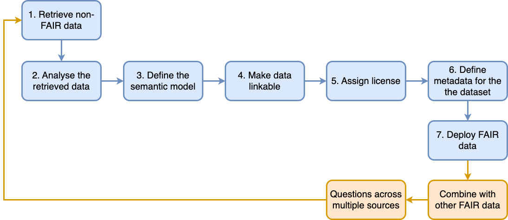
  <figcaption>
    <strong>Figure 3.11:</strong> The FAIRification Process. Adapted from 
    @go_fair_fairification_2016
  </figcaption>
</figure>


A further illustration of how FAIR can be deployed is the conceptualisation of the FDO, which includes a strong binding of various types of metadata [@schultes_fair_2019 pp. 7-9]. The members of the @european_commission_directorate_general_for_research_and_innovation_turning_2018 [p. 35] underline that the establishment of a FAIR-compliant ecosystem hinges on the FDO concept, an implementation framework to develop scalable cross-disciplinary capabilities. As illustrated in [Figure 3.12](#fig:fdo-model), data must be assigned PIDs and accompanied by detailed metadata to ensure reliable discoverability, usability and citation. They also argue to use widely accepted file formats and adhering to community-specific metadata standards as well as vocabularies to support interoperability and reuse.

<figure id="fig:fdo-model" style="text-align: center;">
  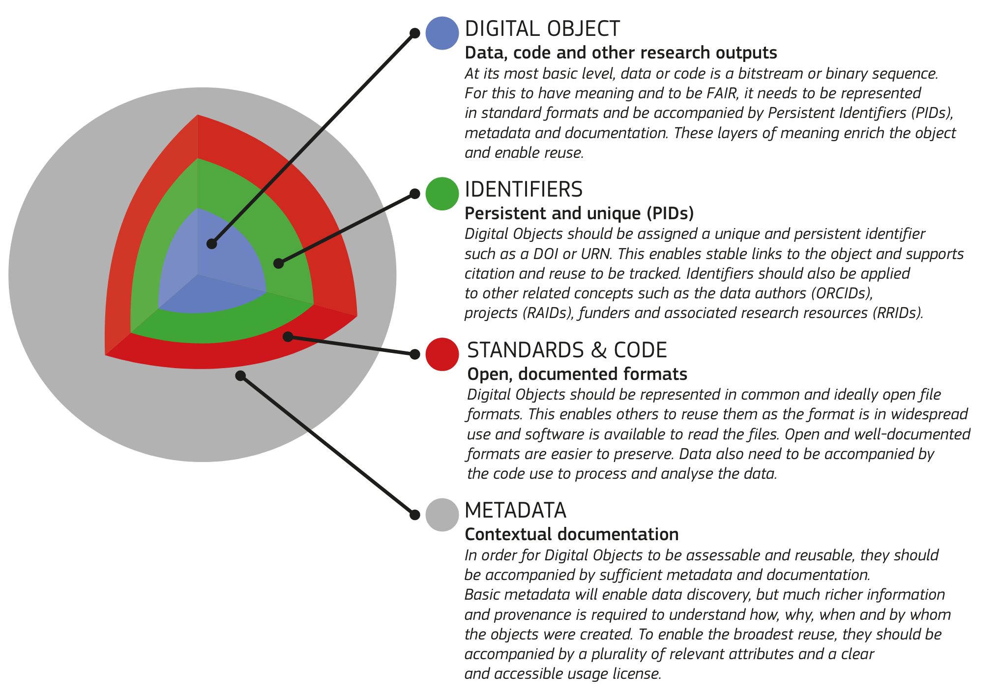
  <figcaption>
    <strong>Figure 3.12:</strong> The FDO Model 
    [@european_commission_directorate_general_for_research_and_innovation_turning_2018]
  </figcaption>
</figure>


@soiland-reyes_updating_2022 highlight the potential of LOD to drive the adoption of FDO within research infrastructures. While this approach provides specifications and tools, the proliferation of standards and metadata vocabularies poses challenges to interoperability and implementation. To address these hurdles, the authors present the use of FAIR Signposting[^103], which enables straightforward navigation to core FDO properties, without the need for complex content negotiation heuristics.

In summary, the FAIR data principles comprise four key principles or 15 facets that provide a comprehensive framework for data management and sharing. While processes are in place to facilitate their implementation, the path to FAIRness can be complex, with interoperability and compliance challenges. A key element is the thoughtful mapping of different metadata standards and the strategic incorporation of Linked Data technologies. The FDO approach is equally relevant to the CH sector, supporting the preservation, accessibility and sharing of CH data and resources. The sharing of code, accompanied by comprehensive documentation, also enhances such an ecosystem by facilitating the exchange of valuable technical knowledge and resources.


#### 3.3.2.4 CARE Principles for Indigenous Data Governance {id="subsubsec:care"}

The CARE[^104] Principles were developed to protect Indigenous data sovereignty [@carroll_care_2020] as complementary guidelines to FAIR. The principles are as follows:

- C. **Collective Benefit**:   Data should be collected and used in a way that benefits the     community as a whole, rather than just individuals or organisations.
- A. **Authority to Control**:   Indigenous communities should have control over their own data,     including how it is collected, stored, and used.
- R. **Responsibility**:   Those who collect and use Indigenous data have a responsibility to     ensure that it is used ethically and responsibly.
- E. **Ethics**:   Indigenous data governance should be guided by ethical principles     that reflect the values and beliefs of the community.

The concept of adhering to the CARE principles is vital for promoting equitable data practices. CARE are built upon existing data reuse principles like FAIR but also integrate the efforts of Indigenous-led networks focused on Indigenous data governance and research control. While FAIR emphasise data accessibility, CARE go beyond that by considering actions aligned with the needs and intentions of individuals and communities connected to the data [@carroll_operationalizing_2021]. By embedding CARE-informed data practices into project design, the ethical and responsible use of Indigenous data can be enabled to improve inclusive policies and services [@robinson_caring_2021].

#### 3.3.2.5 Collections as Data {id="subsubsec:collections-data"}

In the same vein of FAIR and CARE should be mentioned the ‘Vancouver Statement on Collections as Data’ that originated from a meeting of GLAM practitioners in Vancouver, Canada in April 2023 that builds on the ‘Santa Barbara Statement on Collections as Data’[^105] done in 2017 [@padilla_always_2017]. The statement highlights the growing global engagement with collections as data. It promotes the responsible computational use of collections to empower memory, knowledge and data practitioners. It emphasises ethical concerns, openness and participatory design, as well as the need for transparent documentation and sustainable infrastructure. The statement, comprising of ten recommendations, also recognises the potential impact of data consumption by AI, and the importance of considering climate impacts and exploitative labour [@padilla_vancouver_2023]. More specifically, the following ten principles have been established for anyone with (meta)data stewardship responsibilities:

1.  Collections as Data development aims to encourage computational use     of digitised and born digital collections.
2.  Collections as Data stewards are guided by ongoing ethical     commitments.
3.  Collections as Data stewards aim to lower barriers to use.
4.  Collections as Data designed for everyone serve no one.
5.  Shared documentation helps others find a path to doing the work.
6.  Collections as Data should be made openly accessible by default,     except in cases where ethical or legal obligations preclude it.
7.  Collections as Data development values interoperability.
8.  Collections as Data stewards work transparently in order to develop     trustworthy, long-lived collections.
9.  Data as well as the data that describe those data are considered in     scope.
10. The development of collections as data is an ongoing process and     does not necessarily conclude with a final version.

In a final report, @padilla_collections_2023 underscore the transformative potential of the Collections as Data paradigm, particularly in the context of GLAMs. The principles and case studies highlighted in the report offer a roadmap for organisations to responsibly and ethically engage with their collections in the digital era. It is imperative to recognise that the journey towards fully realising its potential is ongoing and requires a commitment to continual evaluation and adaptation. This involves not only adhering to established principles but also being responsive to emerging technological trends, societal changes, and evolving ethical considerations. The role of AI in shaping the future of Collections as Data is particularly noteworthy. As AI continues to advance, it offers both opportunities and challenges in terms of enhancing access and insights into collections while also necessitating careful consideration of ethical implications, such as bias and privacy. Furthermore, the growing emphasis on climate impacts and sustainable practices in data stewardship is a crucial aspect that aligns with global efforts towards environmental responsibility.

Building on the discussion of the principles and initiatives surrounding Collections as Data, an in-depth analysis was carried out to assess the compliance of repositories, projects and platforms from six organisations with the checklist, namely the British Library[^106], the National Library of Scotland[^107], LoC[^108], the Royal Danish Library[^109], Meemoo[^110], and the Miguel de Cervantes Virtual Library[^111] [@candelaChecklistPublishCollections2023a p. 13]. Although several institutions have opened access to their collections through APIs, such as IIIFs capabilities, challenges remain in fully embracing the Collections as Data principles. Barriers include resource limitations and the balance between making collections widely available through simplified access and downloads. In addition, different items within the checklist may require different levels of maturity and prioritisation, often requiring collaborative efforts. Initial results show that the checklist is a valuable tool for identifying relevant issues for individual institutions, although prioritisation may vary according to context and user needs. Collaborative initiatives between institutions are underway to improve the practical implementation and user experience, particularly in the structuring of datasets [@candelaChecklistPublishCollections2023a pp. 20-21].

While there are still relatively few examples of institutions that have fully adopted the Collections as Data principles, several case studies -- such as at the Royal Library of Belgium, which is materialised through DATA-KBR-BE[^112] [see @chambers_collections_2021] -- and initiatives offer valuable insights. For instance, @candelaChecklistPublishCollections2023a [p. 7] outline a checklist tailored to GLAM institutions to publish Collections as Data[^113]. They devised 11 criteria, including the provision of clear licensing for dataset reuse without restrictions, citation guidelines, comprehensive documentation, the use of public platforms, sharing examples of dataset use, structuring the data, providing machine-readable metadata, participation in collaborative edition platforms, offering API access to the repository, developing a dedicated portal page, and defining clear terms of use. These recommendations serve as a structured framework to enhance accessibility, usability, and interoperability, fostering engagement with cultural and historical collections.

A further notable advancement that has been done in the area of publishing Collections as Data is the contribution of @alkemade_datasheets_2023. They have outlined a series of recommendations for developing datasheets or modular templates designed for CH datasets. This initiative holds significant importance for GLAMs, facilitating the structured organisation of their data, notably for seamless integration with ML tools where they propose to provide a description of how content have been influenced by digitisation. Their work highlights the need for documentation, focusing on tailored metrics, biases, and system integration. The proposed datasheets aim to detail the creation, selection, and digitisation processes, enhancing transparency and addressing the distinctive challenges of digital CH data. Emphasising a narrative approach to articulating biases, the author acknowledges the complex historical context and ethical implications.

## 3.4 Open Web Platform and Linked Data {id="sec:linkeddata"}

The web, created at the CERN in 1989 by Tim Berners-Lee[^114], has enabled scholars and CH practitioners to access and analyse vast amounts of data in new ways, thereby opening the door to the creation of federated datasets and KGs. At the heart of this transformation are two pivotal concepts: the Open Web Platform and Linked Data. The Open Web Platform refers to a set of technologies and standards that allow for the creation and sharing of content on the web. Linked Data, on the other hand, refers to a set of principles and technologies that enable the publication and interlinking of data on the web, creating a web of data that can be easily navigated and used by humans and machines alike.

Recognising the Web as an environment that supports a wide range of applications beyond traditional browser-based interactions is becoming increasingly important. Platforms such as social networks like Facebook, Twitter, Instagram, and Mastodon, streaming services such as Netflix and Disney+, as well as cloud-based applications, all leverage web technologies even when not accessed via a traditional web browser. These platforms are integral to the web ecosystem, highlighting the web's role as a foundational platform for diverse digital interactions and data exchanges.

In the context of the Internet, it is important to note that much of what we know today about it is the result of developments by many individuals and organisations. However, a significant milestone was the development of the TCP/IP protocol by Vinton Cerf and Robert E. Kahn in the 1970s [see @cerf_protocol_1974]. This protocol became the standard networking protocol on the ARPANET in 1983, marking the beginning of the modern Internet [@leiner_past_1997]. Understanding the differentiation between the Internet and the web is crucial. The former is a global network of interconnected computers that communicate using Internet protocols, forming the infrastructure that enables online communication. The web, or World Wide Web, is a service built on top of the Internet, leveraging HTTP to transmit data. While the Internet provides the underlying connectivity, the web offers a way to access and share information through websites and links. This differentiation is vital in comprehending how the web, as a part of the Internet, has evolved into a versatile and ubiquitous platform supporting a wide array of applications.

This section, divided into five subsections, explores some of the key concepts underlying the Open Web Platform and Linked Data, and their applications in the CH field.

First, [Subsection 3.4.1](#sub:webarchi) examines the foundational principles and technologies that underpin the Open Web Platform. This includes an overview of principles, protocols such as HTTP, and the use of URIs to identify resources on the web. This part also explores the different types of web architectures such as the client-server model or the concept of web services, which allow for the exchange of data and functionality across different applications and systems.

[Subsection 3.4.2](#sub:semanticweb) explores the vision of the web as a giant, interconnected database of structured data that can be queried and manipulated by machines. The subsection examines the technologies and standards that make up the Semantic Web, including RDF, RDFS, OWL, and SPARQL.

[Subsection 3.4.3](#sub:ldprinciples) examines the set of principles designed to promote the publication and interlinking of data on the web. The subsection explores the four principles of Linked Data - using URIs to identify resources, using HTTP to retrieve resources, providing machine-readable data, and linking data to other data.

[Subsection 3.4.4](#sub:5star) examines the set of criteria for publishing data on the web in a way that makes it easily discoverable, accessible, and usable. The subsection describes the Five-Star and Seven-Star deployment schemes, which include criteria such as providing data in a structured format, using open standards, and providing a machine-readable license.

Finally, [Subsection 3.4.5](#sub:lodch) explores the specific application of LOD in the CH domain. The subsection provides examples of how CHIs such as museums, libraries, and archives are using Linked Data to make their datasets more accessible and discoverable on the web.

Overall, this section provides a comprehensive overview of the key concepts and technologies underlying the web as an open and linked platform, and their applications in the CH field and more broadly for any scientific endeavours as that the web started with *‘the philosophy that much academic information should be freely available to anyone’* [@nelson_d-lib_2022; @berners-lee_worldwideweb_1991]. Through exploring these concepts, we can gain a deeper understanding of how the web is evolving into a more open, interconnected, and data-driven platform, and how this evolution is transforming the way we access, use, and share information.

### 3.4.1 Web Architecture {id="sub:webarchi"}

The web architecture has played a very important role in the development of scholarly research and CH practices, enabling new forms of collaboration, data sharing and interdisciplinary research. By providing a standardised and interoperable framework based on open standards for sharing and accessing data [@berners-lee_long_2010], it has facilitated the open exchange of information, even if citation, i.e. ‘the ability to unambiguously refer to named objects’ has always been an issue, particularly for scholarly outputs [@lagoze_web-based_2012 p. 2223].

Web architecture is a conceptual framework led by the W3C that underpins and sustain the World Wide Web [@jacobs_architecture_2004], created to be ‘a pool of human knowledge’ [@berners-lee_world-wide_1994]. It encompasses the architectural bases of identification, interaction, and format -- also referred to as representation where HTTP provides the technical mechanisms for transmitting and accessing information.

The web architecture is based on a set of identifiers, such as URIs, which are used to uniquely identify resources on the web. These identifiers play a crucial role in enabling users to find, access, and share information on the web, and they help to ensure that web-based systems are both user-friendly and interoperable. Here, it is valuable to distinguish between three key concepts: URI, URL, and URN, as a URI can be further classified as a locator, a name, or both [@berners-lee_uniform_2005 p. 7] -- as shown in [Figure 3.13](#fig:uri-url-urn).

- **URI**:   It is the overarching term encompassing both     URLs and     URNs. It serves     as a generic identifier for any resource on the web.     URIs can be used     to uniquely identify resources, regardless of the specific naming or     addressing scheme employed.
- **URL**:   It is a subset of URIs and refers to web addresses that     specify not only the resource's identity but also its location or     how to access it. URLs often include the protocol (such as     HTTP) and the     resource's specific location (e.g., a domain and path).
- **URN**:   It is another subset of URIs that emphasise the resource's identity     rather than its location or how to access it.     URNs are designed     to be persistent and unique, making them suitable for resources that     are intended to be recognised and referenced over time. While URLs     may change as resources move or evolve, URNs should remain constant.

<figure id="fig:uri-url-urn" style="text-align: center;">
  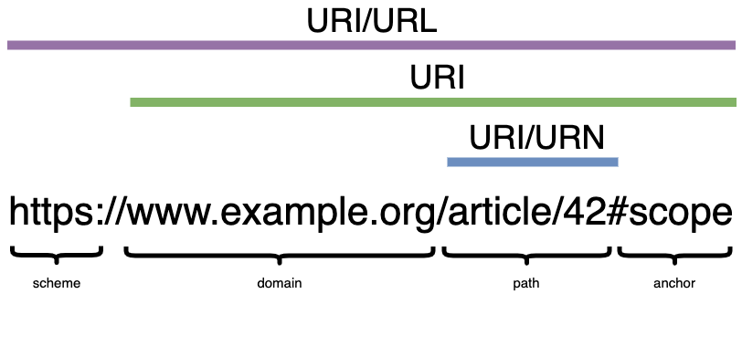
  <figcaption>
    <strong>Figure 3.13:</strong> Overlap and Difference between URI, URL, and URN
  </figcaption>
</figure>

Interaction between web agents, i.e. a person or a piece of software acting in the information space on behalf of a person, entity or process, over a network involves URIs, messages and data. Web protocols, such as HTTP, are message-based. Messages can contain data, resource metadata, message data, and even metadata about the metadata of the message, typically for integrity checking [@jacobs_architecture_2004].

The Web Architecture allows for multiple Representations of a Resource. In this context, a data format specification becomes pivotal, encapsulating an agreement on how to correctly interpret the representation of data, as articulated by [@jacobs_architecture_2004]:

> A data format specification embodies an agreement on the correct interpretation of representation data. The first data format used on the Web was Hypertext Markup Language (HTML). Since then, data formats have grown in number. Web architecture does not constrain which data formats content providers can use. This flexibility is important because there is constant evolution in applications, resulting in new data formats and refinements of existing formats. Although Web architecture allows for the deployment of new data formats, the creation and deployment of new formats (and agents able to handle them) is expensive. Thus, before inventing a new data format (or “meta” format such as XML), designers should carefully consider re-using one that is already available.

Access can also be mediated by content negotiation, which is a mechanism employed in web communication to determine the most appropriate representation of a resource to be sent to a client based on the client's preferences and the available representations [@lagoze_web-based_2012 pp. 2223-2224].

At its core, web architecture is based on a set of architectural principles that guide the design and development of web-based systems and applications. These principles include concepts such as orthogonality, extensibility, error handling, and protocol-based interoperability. Orthogonality allows the evolution of identification, interaction, and representation independently. Extensibility is key, enabling technology to adapt without compromising interoperability. Error handling addresses diverse errors, from predictable to unpredictable, ensuring seamless correction. Finally, the web's protocol-based interoperability fosters communication across varied contexts, outlasting entities and facilitating the longevity of shared technology [@jacobs_architecture_2004]. Overall, these principles help to ensure that the web remains robust, reliable, and flexible.

Web architectures can be categorised into several types, each offering a specific approach to designing and structuring web-based systems. Here, I will focus on the following three types of architectures -- shown in [Figure 3.14](#fig:webarchi-types): the client-server model, the three-tier model, and SOA.

<figure id="fig:webarchi-types" style="text-align: center;">
  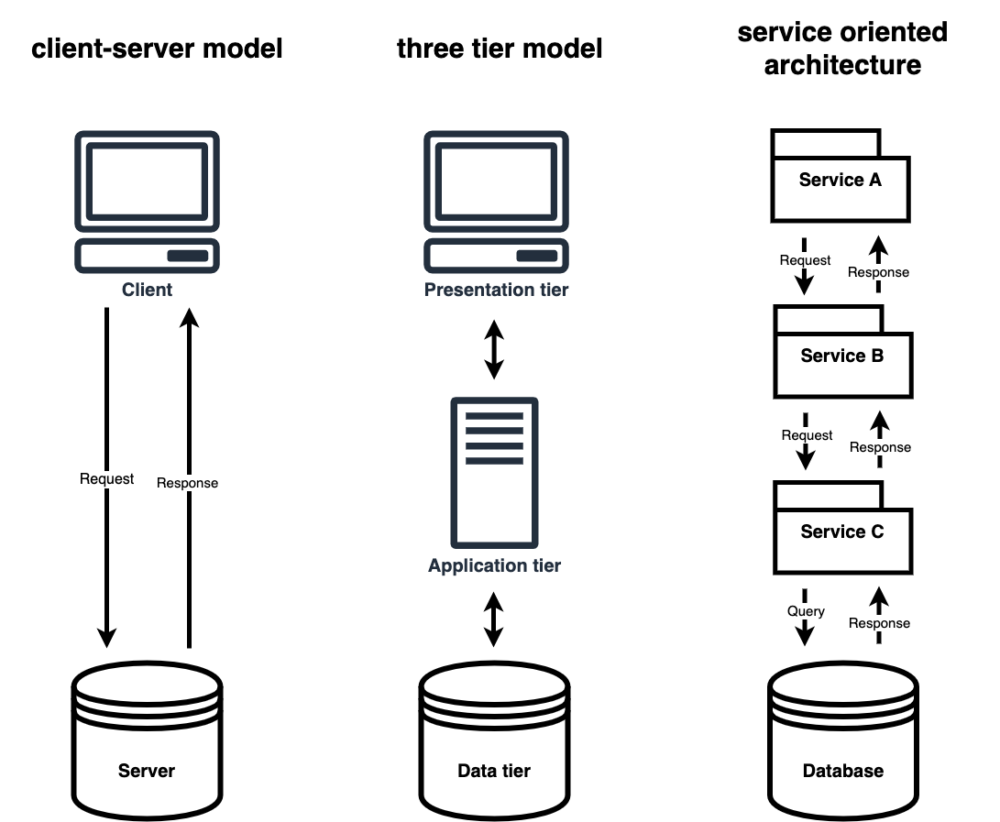
  <figcaption>
    <strong>Figure 3.14:</strong> Types of Web Architectures: Client-server Model, Three Tier Model, SOA
  </figcaption>
</figure>

The client-server model partitions the responsibilities between two key components: the client, which represents the user interface or user-facing part of the system, and the server, which is responsible for storing and serving data. In this model, clients and servers communicate to perform various functions, such as requesting and delivering information [@oluwatosin_client-server_2014 pp. 67-68].

The three-tier model is another significant web architecture that introduces an additional layer between the client and server, resulting in a three-part structure. This architecture is designed to further segregate and manage the system's components [@wijegunaratne_three-tier_1998 pp. 41-42]. The three tiers typically consist of the presentation tier (the user interface), the application tier (responsible for logic and processing), and the data tier (where data storage and retrieval occur).

SOA is a web architecture that emphasises the creation and utilisation of services as the central building blocks of a system. Services in this context are self-contained, modular units of functionality that can be accessed and used independently by various components of a web application. These services are designed to be loosely coupled, meaning they can interact with other services without a deep dependency on one another. Overall, *‘SOA is a paradigm for organizing and packaging units of functionality as distinct services, making them available across a network to be invoked via defined interfaces, and combining them into solutions to business problems.’* [@laskey_service_2009 p. 101].

SOA can encompass various communication protocols, such as REST, which is a prominent architectural style for designing networked applications [@fielding_architectural_2000], primarily leveraging HTTP. RESTful services, i.e. applications that complies with the REST constraints, are designed to work with existing capabilities rather than creating new standards, frameworks and technologies [@battle_bridging_2008 p. 62]. These services are built around a set of constraints, including statelessness, a uniform interface, resource-based identification, and the use of standard request methods such as `GET`, `POST`, `PUT`, and `DELETE` [@tilkov_brief_2017].

The following are all the specified request methods enabling clients to perform a wide range of operations on resources[^115] [@fielding_http_2022 p. 72]:

- **GET**:   Transfer a current representation of the target resource.
- **HEAD**:   Same as `GET`, but only transfer the status line and header section.
- **POST**:   Perform resource-specific processing on the request payload.
- **PUT**:   Replace all current representations of the target resource with the     request payload.
- **DELETE**:   Remove all current representations of the target resource.
- **CONNECT**:   Establish a tunnel to the server identified by the target resource.
- **OPTIONS**:   Describe the communication options for the target resource.
- **TRACE**:   Perform a message loop-back test along the path to the target     resource.

RESTful services, with their emphasis on using standardised HTTP methods and resource-based identification, offer a versatile means of designing web services and APIs. Their simplicity and compatibility with the web's core protocols make them a practical choice for implementing various web-based applications. In the context of the Semantic Web, RESTful services can serve as a crucial component for accessing and exchanging graph data [see @lee_learning_2011].


### 3.4.2 The Semantic Web {id="sub:semanticweb"}

The Semantic Web is ‘[a] form of Web content that is meaningful to computers’ [@berners-lee_semantic_2001 p. 35]. It was already in [@berners-lee_realising_1999]'s vision and prediction that the web, in its next phase, could be understood by machines, i.e. shifting from a traditional web of documents to a web of data. @bauer_linked_2012 [p. 25] articulates that *‘[t]he basic idea of a semantic web is to provide cost-efficient ways to publish information in distributed environments. To reduce costs when it comes to transferring information among systems, standards play the most crucial role.’*.

At the heart of the Semantic Web lies the foundation of RDF. The original RDF specification, known as the RDF Model and Syntax, serves as the underlying mechanism that establishes the basic framework of RDF. This framework provides the cornerstone to facilitate the exchange of data among automated processes [@lassila_resource_1999]. A fundamental component within RDF is the RDF triple as shown in [Equation 3.1](#eq:rdf-triple), comprising three essential elements: the subject (<em>s</em>), the predicate (<em>p</em>), and the object (<em>o</em>). In an RDF triple, the subject is the resource or entity about which a statement is made, the predicate is the relationship or property describing that statement, and the object is the value or resource associated with the statement. 

<div id="eq:rdf-triple" style="display: flex; flex-direction: column; align-items: center;">
  <p>
    <em>s</em>
    <span style="display: inline-flex; align-items: center;">
      <span style="position: relative; margin: 0 5px;">
        &rarr;
        <span style="position: absolute; top: -1em; left: 50%; transform: translateX(-50%); font-size: 0.8em;">
          <em>p</em>
        </span>
      </span>
    </span>
    <em>o</em>
  </p>
  <p style="margin-top: 0.5em; font-style: italic;"><strong>Equation 3.1:</strong> Triple Pattern Notation</p>
</div>

RDF statements are reminiscent of the semiotic triangle of @ogden_meaning_1930 [p. 11] --- as illustrated in [Figure 3.15](#fig:triangle) --- where the referent is tantamount to the predicate of a triple. This analogy emphasises the intrinsic relationship between communication, representation and knowledge organisation. It highlights how both language and structured data rely on the establishment of connections and relationships to effectively convey meaning.

<figure id="fig:triangle" style="text-align: center;">
  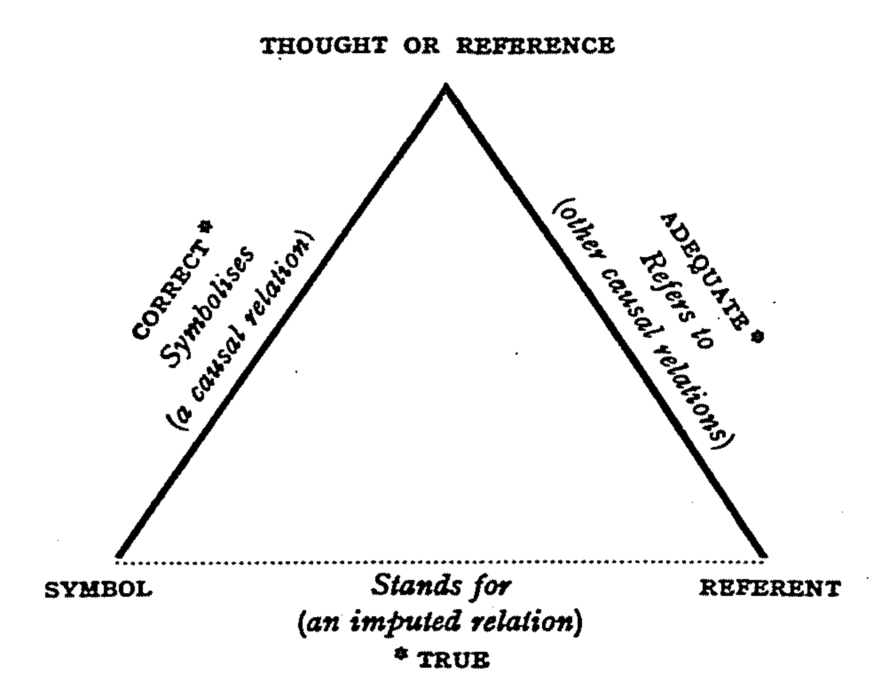
  <figcaption>
    <strong>Figure 3.15:</strong> The Semiotic Triangle by [@ogden_meaning_1930].
  </figcaption>
</figure>

[Figure 3.16](#fig:rdf-graph) is an RDF graph about myself and where I was born leveraging mostly Schema.org[^116], a collaborative project and Linked Data vocabulary used to create structured data markup on websites. This graph consists of vertices and edges, where vertices can be either URIs or literal values, and the edges represent relationships between them. In plain language, the graph asserts that there is a person represented by the URL `https://www.example.org/julien-a-raemy`, who has a given name ‘Julien Antoine’ and a family name ‘Raemy’. The person's birthplace is specified as an URL from Wikidata, which is of type `schema:Place`. Additionally, there's a statement indicating that the birthplace is named ‘Fribourg’.

<figure id="fig:rdf-graph" style="text-align: center;">
  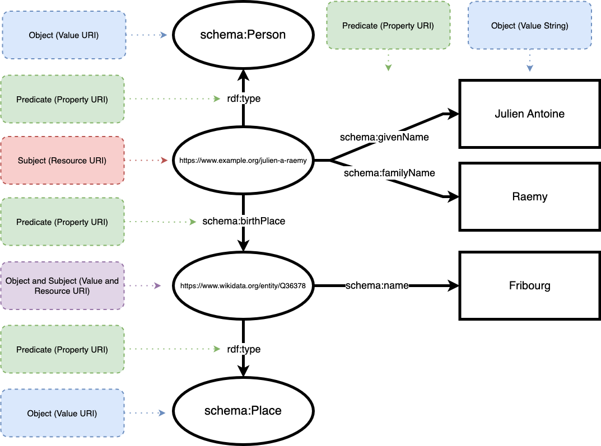
  <figcaption>
    <strong>Figure 3.16:</strong> Example of an RDF Graph
  </figcaption>
</figure>


In the subject-predicate-object syntax of RDF, the subject can be either a URI or a blank node[^117]. The predicate is an URI, like `schema:givenName`, and its aim is to establish connections between subjects and objects, describing the nature of the relationship. The object is either an URI, a blank node or a literal, such as ‘Julien Antoine’ or ‘Raemy’. Objects can also act as subjects if they are identifiable, allowing for the expansion and interconnection of RDF graphs.

The original specification proved too broad, leading to confusion and a subsequent effort yielded an updated specification and new documents such as RDF/XML [@beckett_rdfxml_2004], which express an RDF graph as XML, a syntax specification recommendation in 2004 and later revised in 2014 as part of the RDF 1.1 document set [@gandon_rdf_2014], which also introduces the notion of an RDF dataset that can represent multiple graphs [@cyganiak_rdf_2014]. [Code Snippet 3.4](#lst:rdfxml) is the RDF/XML serialisation of the earlier graph.

<figure id="lst:rdfxml" style="text-align: center;">
 <figcaption>
<strong>Code 3.4:</strong> RDF/XML Serialisation of the RDF Graph
</figcaption>
 

```xml
<?xml version="1.0" encoding="utf-8" ?>
<rdf:RDF xmlns:rdf="http://www.w3.org/1999/02/22-rdf-syntax-ns#"
         xmlns:schema="http://schema.org/">
  <schema:Person rdf:about="https://www.example.org/julien-a-raemy">
    <schema:givenName>Julien Antoine</schema:givenName>
    <schema:familyName>Raemy</schema:familyName>
    <schema:birthPlace>
      <schema:Place rdf:about="https://www.wikidata.org/entity/Q36378">
        <schema:name>Fribourg</schema:name>
      </schema:Place>
    </schema:birthPlace>
  </schema:Person>
</rdf:RDF>
```

</figure>

@idehen_semantic_2017 highlights a significant concern regarding the earlier representations of the Semantic Web and how it is portrayed. These portrayals often place undue emphasis on the pivotal role of XML as an ostensibly obligatory component in Semantic Web development. To him, this historical perspective, particularly prominent around the year 2000, erroneously positioned XML as a superior alternative to HTML for constructing the Semantic Web.

As illustrated by [Figure 3.17](#fig:semweb-cake), @idehen_semantic_2017's revision embodies a Semantic Web layer cake that encompasses several technical or conceptual components.

- **Smart Applications and Services**:   These systems are constructed declaratively, as opposed to using an     imperative approach, with a flexible integration of data models,     interaction, and visualisation.
- **Trust**:   It is established through verifiable claims regarding identity, the     source of content, and related issues.
- **Proof**:   It provides a basis for building trust, such as leveraging     authentication tiers.
- **Transmission Security**:   It pertains to safeguarding data during its transit over networks.     This protection is achieved by implementing established protocols,     such as TLS,     which includes inherent cryptographic support for ensuring the     confidentiality and integrity of data as it travels across     communication channels.
- **Unifying Logic**:   In this component, FOL[^118] assumes a central role by     providing the fundamental schema for modelling and comprehending     data. These propositions serve as the core building blocks for     problem-solving and decision-making, offering a universal and     abstract structure that can be applied across various domains and     applications[^119].
- **Rules**:   They serve as the foundation for conducting reasoning and inference,     such as using SHACL, which is used to specify integrity     constraints for data entry when constructing structured data with     RDF. At this     level, mapping languages such as R2RML and RML have a part to play.     R2RML is a     powerful language for expressing customised mappings from relational     databases to RDF datasets [see @das_r2rml_2012]. On     the other hand, RML extends these capabilities beyond     relational databases, allowing for the transformation of various     types of data sources, including CSV, XML, and JSON files, into RDF [see @dimou_rdf_2022]. Both languages     are instrumental in bridging the gap between     non-RDF data     sources and the Semantic Web.
- **Query**:   This can be achieved by employing SPARQL for retrieving and manipulating data     on structured RDF statements.
- **Dictionaries**:   Collections of formal definitions (also referred to as vocabularies     or ontologies) that describe entity and entity relationship types.     They provide a structured framework for defining and organising     concepts, properties, and relationships, which aids in modelling     knowledge in a systematic and machine-readable manner. Some of the     commonly used dictionary languages include     RDFS, which is     a simple vocabulary language used to define basic schema information     for RDF,     SKOS designed     for representing and organising some KOSs, particularly in the context of     thesauri and taxonomies, as well as OWL.
- **Abstract Language**:   It is done by leveraging the RDF syntax (as shown in [Equation 3.1](#eq:rdf-triple)) as a     basis.
- **Sentence Part Identifiers**:   To identify resources on the web, IRIs[^120] or URIs can be used.
- **Document Types**:   Different serialisations of RDF exist within the Semantic Web, such     as RDF/XML, Turtle or     JSON-LD[^121].
- **Semantic Web of Linked Data**:   The final component that holds the rest together; originating from     Tim Berners-Lee's vision (see [Subsection 3.4.3](#sub:ldprinciples)).

<figure id="fig:semweb-cake" style="text-align: center;">
  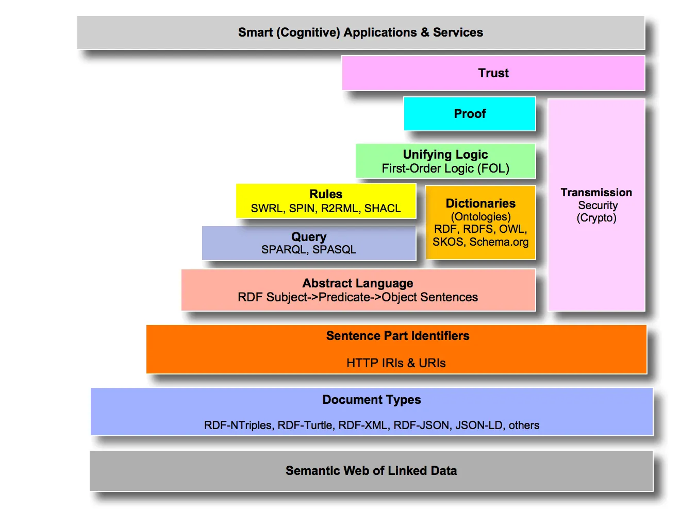
  <figcaption>
    <strong>Figure 3.17:</strong> Tweaked Semantic Web Technology Layer Cake 
    by @idehen_semantic_2017
  </figcaption>
</figure>

Following on from the components outlined in [Figure 3.17](#fig:semweb-cake), I will look in more detail at further RDF features, serialisations, and RDF-based standards for representing, querying or validating graphs. In doing so, I will touch on some considerations related to the inference and reasoning of RDF graphs.

[Code Snippet 3.5](#lst:turtle) is a Turtle serialisation of [Figure 3.16](#fig:rdf-graph). Turtle, a W3C standard, is a notation is a way to express this data in a structured and machine-readable format [@wood_linked_2014 p. 44]. It is a common syntax used for representing RDF data. It allows people to create statements in a more friendly manner than in an RDF/XML serialisation [@beckett_rdf_2014]. Here are some of the most important features:

- `@prefix`:   It is used to declare namespace prefixes at the beginning of a     Turtle document. These prefixes are used to shorten     URIs, making the     RDF data more     readable and helps to avoid repeating long     URIs.
- Resource Notation:   In Turtle, resources (URIs) are typically enclosed in angle     brackets: `< >`.
- Literals:   Literal values like strings, numbers, and dates are represented     directly without angle brackets.
- Comments:   Turtle allows for comments, which are preceded by a hash symbol.

<figure id="lst:turtle" style="text-align: center;">
 <figcaption>
<strong>Code Snippet 3.5:</strong> Turtle Serialisation of the RDF Graph
</figcaption>
 

```text
@prefix rdf: <http://www.w3.org/1999/02/22-rdf-syntax-ns#> .
@prefix schema: <http://schema.org/> .

# A small RDF graph about myself
<https://www.example.org/julien-a-raemy>
     rdf:type schema:Person ;
    schema:givenName "Julien Antoine" ;
    schema:familyName "Raemy" ;
    schema:birthPlace <https://www.wikidata.org/entity/Q36378> .

<https://www.wikidata.org/entity/Q36378>
     rdf:type schema:Place ;
    schema:name "Fribourg" .
```

</figure>

To query RDF-based graphs, SPARQL is leveraged. It is a query language as well as a protocol designed for querying and manipulating RDF data. It allows users to retrieve specific information from RDF datasets, making it a fundamental tool for working with Linked Data [@wood_linked_2014 pp. 99-100]. The SPARQL query provided in [Code Snippet 3.6](#lst:sparql) is aimed at extracting the name of a person from a given RDF graph. The query uses RDF predicates associated with the given name and family name properties, concatenating them to form the person's complete name. The answer to the query, based on the provided RDF data, would be the complete name of the person, which in this case is ‘Julien Antoine Raemy’. It showcases the versatility of SPARQL, offering a flexible and expressive means of interacting with RDF data. By specifying patterns and conditions, this query identifies and combines relevant information.

<figure id="lst:sparql" style="text-align: center;">
 <figcaption>
<strong>Code Snippet 3.6:</strong> SPARQL Query Against the RDF Graph
</figcaption>
 

```sparql
PREFIX rdf: <http://www.w3.org/1999/02/22-rdf-syntax-ns#>
PREFIX schema: <http://schema.org/>

SELECT ?name WHERE {
  <https://www.example.org/julien-a-raemy> schema:givenName ?givenName ;
                                            schema:familyName ?familyName .
  BIND(CONCAT(?givenName, " ", ?familyName) AS ?name)
}
```

</figure>

While RDF's simplicity is one of its strengths, it can also pose limitations when it comes to expressing nuanced details, tracing the origins of statements, and addressing the intricacies of logical reasoning. RDF's foundational model, which relies on triples to establish relationships between resources, may not always capture the full depth of knowledge and inferences that more complex KR languages or systems can achieve.

As such, RDF reification, as expounded by @massari_representing_2023, emerges as a pivotal mechanism to enrich RDF. It stands as a mechanism that allows for the explicit representation of statements about statements in RDF. This technique facilitates the modelling of metadata or provenance information about RDF triples. In other words, RDF reification allows you to describe when and by whom a particular statement was made, adding a layer of context and traceability to RDF data. This is particularly valuable in scenarios where data lineage, trustworthiness, and attribution need to be maintained.

Furthermore, RDF 1.2 introduces the concept of ‘quoted triples’, i.e. *‘an RDF triple that is used as the subject or object of another triple’* [@hartig_rdf_2023]. Quoted triples are a powerful extension to the RDF model, enabling the inclusion of entire RDF triples within other triples. This feature adds a layer of expressiveness to RDF, making it more versatile in representing complex relationships and data structures.

Deduction of entity class membership is an essential aspect of KR, and in this regard, RDFS plays a pivotal role [@brickley_rdf_2014]. RDFS, with its foundation in formal semantics, provides a framework for verifying properties like `rdfs:domain` and `rdfs:range` associated with given properties [@bruns_26_2023].

[Code Snippet 3.7](#lst:rdfs) showcases how RDFS can be leveraged. In this example, RDFS class and property are specified. For instance, `schema:Person` and `schema:Place` are classes using `rdf:type` `rdfs:Class`, and property characteristics, including domains and ranges, using `rdf:Property`, `rdfs:domain`, and `rdfs:range` have been defined to create basic RDFS.

<figure id="lst:rdfs" style="text-align: center;">
 <figcaption>
<strong>Code Snippet 3.7:</strong> Example of using RDFS to Determine Class Membership and Property Definitions
</figcaption>
 

```turtle
@prefix rdf: <http://www.w3.org/1999/02/22-rdf-syntax-ns> .
@prefix rdfs: <http://www.w3.org/2000/01/rdf-schema#> .
@prefix schema: <http://schema.org/> .

# RDFS Class Definitions
schema:Person rdf:type rdfs:Class .
schema:Place rdf:type rdfs:Class .

# RDFS Property Definitions
schema:givenName rdf:type rdf:Property ;
    rdfs:domain schema:Person ;
    rdfs:range rdfs:Literal .

schema:familyName rdf:type rdf:Property ;
    rdfs:domain schema:Person ;
    rdfs:range rdfs:Literal .

schema:birthPlace rdf:type rdf:Property ;
    rdfs:domain schema:Person ;
    rdfs:range schema:Place .

schema:name rdf:type rdf:Property ;
    rdfs:domain schema:Place ;
    rdfs:range rdfs:Literal .
```

</figure>

RDFS, when used in conjunction with other reasoning methods, enhances the overall inferential capabilities of RDF, enabling more profound insights and KR. For example, OWL allows authors to decide how expressive they want to be, given the computational realities involved, which is not the case with RDFS.

Indeed, for modelling ontologies in the Semantic Web, OWL is the preferred language. It is a powerful and widely used language for developing ontologies that can be leveraged as metadata vocabularies on the web [@zeng_metadata_2022 p. 63] and provides a framework for creating, sharing, and reusing ontologies. OWL is a key component in the Semantic Web, enabling the formal representation of knowledge and complex relationships. OWL possesses several key features that make it a powerful language for modelling ontologies. Firstly, it provides a well-defined formal semantics, allowing computers to infer new knowledge and make logical deductions based on the information encoded in the ontology. Additionally, OWL supports a rich vocabulary of constructs for defining classes, properties, and individuals, enabling the creation of complex and structured ontologies.

[Code Snippet 3.8](#lst:owl) is an example of an ontology using OWL in Turtle. Two classes, `ex:Person` and `ex:Place`, along with two properties: `hasName` and `hasBirthPlace` have been defined. The `ex:Person` class is constrained to have a name, which is specified as a datatype property with a string value. Additionally, each `ex:Person` is required to have a `hasBirthPlace`, which is defined as an object property with a reference to the `ex:Place` class.

<figure id="lst:owl" style="text-align: center;">
 <figcaption>
<strong>Code Snippet 3.8:</strong> Example of a OWL-based Ontology
</figcaption>
 

```turtle
@prefix rdf: <http://www.w3.org/1999/02/22-rdf-syntax-ns#> .
@prefix rdfs: <http://www.w3.org/2000/01/rdf-schema#> .
@prefix owl: <http://www.w3.org/2002/07/owl#> .
@prefix ex: <http://example.org/ontologies#> .

ex:Person rdf:type owl:Class .
ex:Place rdf:type owl:Class .

ex:hasName rdf:type owl:DatatypeProperty .
ex:hasBirthPlace rdf:type owl:ObjectProperty .

ex:Person rdfs:subClassOf [
    rdf:type owl:Restriction ;
    owl:onProperty ex:hasName ;
    owl:someValuesFrom xsd:string
] .

ex:Person rdfs:subClassOf [
    rdf:type owl:Restriction ;
    owl:onProperty ex:hasBirthPlace ;
    owl:someValuesFrom ex:Place
] .
```

</figure>

OWL is grounded in DL [@ma_paraconsistent_2009 p. 197], striking a balance between expressiveness and computational complexity, making it well-suited for automated reasoning. There are different versions of OWL, including OWL Lite, OWL DL, and OWL Full, which vary in terms of their expressive power and reasoning capabilities. OWL 2, introduced in 2009, extended the original OWL specification with additional features and improvements [@w3c_owl_working_group_owl_2012]. [Figure 3.18](#fig:owl-structure) provides an overview of OWL, highlighting its main building blocks in terms of syntax as well as semantics.

<figure id="fig:owl-structure" style="margin: 0 auto; text-align: center;">
 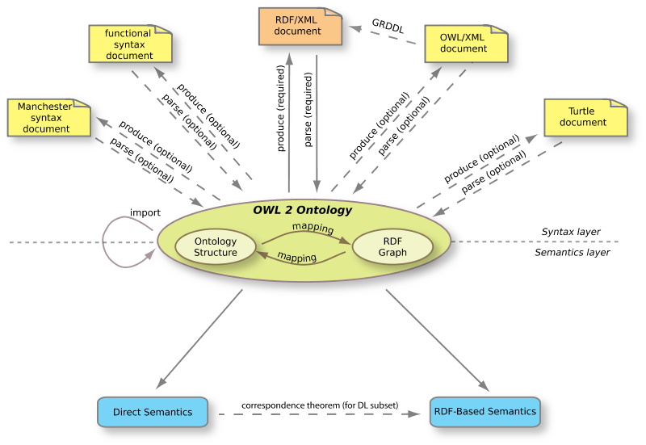
<figcaption>
<strong>Figure 3.18</strong>:
 Structure of OWL 2 [@w3c_owl_working_group_owl_2012]
</figcaption>
</figure>


Turning to SHACL, a W3C standard defined in 2017, it provides a valuable framework for validating data graphs against specific shapes and constraints. Shapes are templates that specify the expected structure, properties, and validation rules for a particular class of resources, while constraints are rules or conditions applied to data instances to ensure they conform to the structure and validation criteria defined by a shape. Overall, SHACL is primarily used for data validation and quality assessment [@knublauch_shapes_2017].

[Code Snippet 3.9](#lst:shacl) is an example of SHACL could be used to validate the RDF data graph of [Code Snippet 3.5](#lst:turtle). The following shapes and constraints have been defined:

-   `schema:PersonShape` which corresponds to `schema:Person`;
-   `schema:PlaceShape` which relates to `schema:Place`;
-   `sh:targetClass` to specify the target class;
-   `sh:path` to specify the property path;
-   `sh:minCount` to ensure that the specified properties are required;
-   `sh:nodeKind` `sh:IRI` to specify that the `schema:birthPlace`     property should have IRI values.

<figure id="lst:shacl" style="text-align: center;">
 <figcaption>
<strong>Code Snippet 3.9:</strong> Example of a SHACL Document in Turtle that can be Used to Validate the RDF Graph
</figcaption>
 

```turtle
@prefix rdf: <http://www.w3.org/1999/02/22-rdf-syntax-ns#> .
@prefix schema: <http://schema.org/> .
@prefix sh: <http://www.w3.org/ns/shacl#> .

# Define a SHACL shape for a Person
schema:PersonShape
    a sh:NodeShape ;
    sh:targetClass schema:Person ;
    sh:property [
        sh:path schema:givenName ;
        sh:minCount 1 ;
    ] ;
    sh:property [
        sh:path schema:familyName ;
        sh:minCount 1 ;
    ] ;
    sh:property [
        sh:path schema:birthPlace ;
        sh:minCount 1 ;
        sh:nodeKind sh:IRI ;
    ] .

# Define a SHACL shape for a Place
schema:PlaceShape
    a sh:NodeShape ;
    sh:targetClass schema:Place ;
    sh:property [
        sh:path schema:name ;
        sh:minCount 1 ;
    ] .
```

</figure>

One thing to realise, however, is that there are limitations when it comes to reasoning with controlled vocabularies and constraints in SHACL. While it excels in data validation and quality assurance, SHACL is not inherently a comprehensive reasoning framework. In their study, @sacramento_considering_2022 [p. 129] noted that there is still a challenge in harnessing the potential of ontologies' axioms to deduce information and derive implicit facts. While ontologies are instrumental in structuring knowledge and relationships between concepts, the efficient utilisation of axioms for reasoning remains an ongoing challenge.

### 3.4.3 Linked Data Principles {id="sub:ldprinciples"}

By exploiting the core structure of the web's architecture, Linked Data maximises its potential to enable the widespread distribution of information on a global scale. This approach makes effective use of the fundamental elements of the Web and is consistent with its principles of simplicity, decentralisation and openness. As a result, Linked Data exploits the optimal structural equilibrium of the web, allowing content from disparate servers to be assembled seamlessly into a unified repository of global knowledge. This harmonious convergence of principles has driven the remarkable growth of the Web over the past few decades, demonstrating its ability to provide an integrated platform for information exchange. The four principles of Linked Data, as outlined by [@berners-lee_linked_2006] are:

1.  Use URIs as names     for things
2.  Use HTTP     URIs so that     people can look up those names.
3.  When someone looks up a URI, provide useful information, using     the standards (e.g. RDF, RDFS, SPARQL, etc.)
4.  Include links to other URIs so that they can discover more things.

By following these principles, Linked Data enables structured data to be published and interlinked on the Web, creating a graph of data that can be accessed and navigated by both humans and machines. These principles are closely related to the Semantic Web, which is an extension of the web that aims to give information well-defined meaning, enabling computers and people to work together more effectively [@heath_principles_2011].

> The glue that holds together the traditional document Web is the hypertext links between HTML pages. The glue of the data web is RDF links. [@bizer_linked_2008 p. 1265] 

Some of the challenges highlighted by @bizer_linked_2009 as a retrospective ten years after the launch of RDF were and still remain an issue:

- **User Interfaces and Interaction Paradigms**:   Challenges persist in designing user interaction paradigms for     applications based on dynamically assembled data. These challenges     include navigating between entities and managing data sources within     an integrated view.
- **Application Architectures**:   The potential for scalability issues in on-the-fly link traversal     and federated querying suggests that extensive crawling and caching     could become the standard for timely data access.
- **Schema Mapping and Data Fusion**:   While most applications display data from diverse sources, they     often lack deeper integration. Achieving integration involves     mapping terms from different vocabularies and resolving data     conflicts. Data sources can publish correspondences to help clients     transform data between schemata.
- **Link Maintenance**:   Link maintenance in evolving sources is a research challenge.     Outdated links can affect system efficiency. Solutions include     periodic link recalculation, data source update feeds, and central     registries.
- **Licensing**:   Applications using web data need access to specifications governing     data reuse and republishing. Frameworks for publishing such     specifications are vital for encouraging data owners' participation     and providing legal assurance to data consumers.
- **Trust, Quality and Relevance**:   Representing data trustworthiness in integrated views is a research     challenge. Heuristic methods for assessing data quality should be     leveraged.
- **Privacy**:   Safeguarding privacy may require technical and legal measures, as     well user awareness.

These challenges serve as a foundation for exploring LOD practices in the subsequent subsection, where I introduce two deployment schemes.

### 3.4.4 Deployment Schemes for Open Data {id="sub:5star"}

LOD is a potent blend of Linked Data and Open Data that is both linked and uses open sources. LOD is defined as Linked Data released under an open licence that does not prevent it from being reused free of charge.

In 2010, Tim Berners-Lee introduced the Five-Star Open Data Deployment Scheme[^122], also known as Five-Star Open Data or Five-Star Linked Data, to provide a structured framework for publishing and promoting data on the web. The scheme, as illustrated by [Figure 3.19](#fig:5-star), comprises five progressively more demanding criteria that define the level of openness and accessibility of data.

<figure id="fig:5-star" style="margin: 0 auto; text-align: center;">
 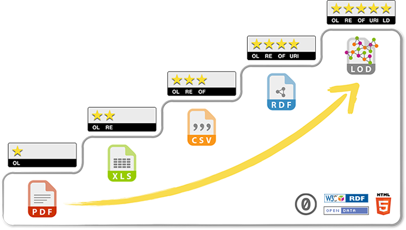
<figcaption>
<strong>Figure 3.19</strong>:
 Five-Star Deployment Scheme for Open Data
</figcaption>
</figure>

1.   The first star indicates that the data are available on the web in any     format, setting a basic level of accessibility.
2.   Moving on to the second star, data should be made available in a     machine-readable, structured format that allows for easier     processing and analysis. This eliminates the need to interpret     unstructured information and promotes efficient use of data.
3.  The third star builds on the second by emphasising the importance of using     non-proprietary formats such as CSV rather than vendor- or     platform-specific formats such as Microsoft Excel. This promotes     interoperability and avoids vendor lock-in, ensuring wider access     and use of the data.
4.  The fourth star takes the criteria further by requiring that data be     published using open standards specified by the     W3C, in     particular RDF     and SPARQL.     These standards improve the integration and linking of data across     the Web, enabling richer and more meaningful analysis.
5.  The highest standard, represented by the fifth star, incorporates all of     the previous criteria and requires that data not only be in a     non-proprietary format and conform to W3C standards, but also be linked to     other LOD. This     interconnectedness enables a broader and richer web of data,     increasing its value and utility in a global context.

By adhering to these progressively stringent criteria, data providers can contribute to a more open and connected web, fostering a collaborative environment for data consumption and analysis. The Linked Data Principles and the Five-Star Open Data Deployment Scheme share commonalities, including adherence to open standards and linking data with other sources. However, the rating system offers greater specificity and provides a well-defined path for data publishers to improve openness and interconnection of data.

Yet, @hasnain_assessing_2018 noted in their study around assessing FAIR against the Five-Star Deployment Scheme that while LOD emphasises data openness, FAIR additionally requires a stated licence for access, incorporating the concept of reusability with consideration of licensing agreements and contextual information such as provenance. As such, FAIR can be seen as an extension of LOD, focusing on user needs and incorporating aspects of separation of core data and metadata, including licensing considerations, while LOD remains an idealistic approach centred on open data.

In complement and in response to the Five-Star model, @hyvonen_linked_2014 proposed an extended Seven-Star model to address some further key challenges in dataset reuse: the difficulty in assessing how suitable the data are for a particular application purpose. They highlighted that datasets often lack clear definitions or descriptions of the schemas or vocabularies they use, making it difficult to effectively understand the characteristics of the data. Furthermore, even when both the data and its schema are available, assessing the data's conformance to the schema is hampered by the data quality issues that are prevalent in the Semantic Web. To mitigate these challenges and to encourage data publishers, they introduced two additional stars.

6.  The sixth star is awarded if the schemas or vocabularies used in the     dataset are explicitly described and published alongside the     dataset, unless these schemas are already available elsewhere on the     Web. This documentation improves the understanding of the structure     and organisation of the data.
7.  To attain the seventh star, the quality of the dataset in terms of the     schemas it uses must also be explicitly described. This information     enables users to assess whether the quality of the data meets their     specific requirements and provides a valuable tool for determining     the suitability of the dataset for their intended applications.

The Seven-Star model thus extends Berners-Lee's Five-Star Open Data Deployment Scheme to provide a comprehensive framework for improving the clarity, usability and applicability of open data on the web[^123].

### 3.4.5 Linked Open Data in the Cultural Heritage Domain {id="sub:lodch"}

In this subsection, I will present several illustrative cases of CH projects or CHIs that have engaged or are engaging with LOD, offering insights into some of the processes, benefits or challenges, such as issues related to sustainability and community engagement.

The application of LOD in the CH domain has received considerable attention due to its ability to improve the quality and visibility of data provided by institutions, especially from GLAMs [@candela_migration_2018 p. 481]. Equally, the development of DH has seen a growing interest in Linked Data, where research projects have increasingly adopted semantic enrichment approaches to improve the quality, annotation, and visibility of their data such as the Pelagios network[^124] [see @isaksen_pelagios_2014], while at the same time encouraging a more self-sustaining environment [see @zeng_semantic_2019].

According to @davis_linked_2021 [p. 21:5], the CH sector's involvement in Linked Data research began approximately a decade to 15 years ago, with a notable peak around 2015. @davis_linked_2021 [pp. 21:7-21:8] identified some key players within the CH sector that have been involved in the implementation of Linked Data, among the most prominent: universities, university libraries, national libraries, government bodies, as well as museums. Within this context, the authors identified eight prominent themes that emerged to signify the motivations behind this interest. These themes included meeting research needs, exploring Linked Data, meeting the needs of users, improving discoverability, fostering interoperability, educational initiatives, meeting the needs of GLAM institutions, as well as prioritising preservation efforts [@davis_linked_2021 pp. 21:9-21:10]. Moreover, @candela_ontological_2023 assert that LOD is also a motivation using advanced methods and techniques for publishing and reusing digital collections.

The deployment of LOD is primarily evident through publication of datasets, which I will highlight here in three different ways, ranging from the most rudimentary form of publication to the most complex. First, records may be accompanied by a representation conforming to the RDF syntax, which can be downloaded in RDF/XML or Turtle. A second approach involves establishing a content negotiation mechanism that enables both humans and machines to access metadata. Thirdly and on a more occasional basis, platforms have implemented a SPARQL service allowing for federated queries, either on a dedicated web interface or through a CLI [@raemy_ameliorer_2022 pp. 132-133, citing [@papadakis_linked_2015]].

This publication effort is carried out not only by libraries, archives, and museums but also by aggregation platforms such as Europeana[^125] [@purday_think_2009], which provides access to millions of digitised books, images, and audiovisual resources from European CHIs. Europeana uses LOD to create rich, interconnected descriptions of these resources, making it easier for users to discover and explore related resources across different institutions and collections [@poulopoulos_digital_2022 p. 6].

Europeana is a project funded by the European Union that aims to promote a sense of European identity by aggregating metadata from national and local heritage institutions onto a single digital platform [@freire_cultural_2018; @raemy_enabling_2020]. The EDM is the core of the project, which leverages standardised thesauri and vocabularies to provide semantic contextualisation for CH resources and allow for semantic operations on metadata [@charles_enhancing_2015]. However, the overarching nature of EDM may not deliver the level of granularity that all CHIs require to accurately document their resources. Despite this, memory institutions accept the sacrifice of accuracy to be part of a Europe-wide collection that promotes a sense of Europeanness. The study by @capurro_europeana_2020 traces how a standardised European metadata structure plays a role in governing local and national heritage institutions and enacting a European mindset. The EDM may allow heritage stakeholders to benefit from Europeana's online exposure while also contributing to the creation of a European identity.

The landscape of LOD research project predominantly originates from prominent institutions and national aggregators within the Europeana network. For instance, the BnF has made substantial contributions through its data service[^126] [@simon_publishing_2013]. Additionally, the Swedish National Heritage Board[^127] for metadata aggregation has played a crucial role in metadata aggregation, as outlined in the work of @smith_linked_2021 [pp. 67-69]. Furthermore, the Dutch Digital Heritage Network[^128] has been actively engaged in the management of KOSs [@scharnhorst_knowledge_2023].

Another example of LOD in the CH domain that has already been mentioned is the Getty Research Institute's controlled vocabularies, which provides access to data on art history, architecture, and related fields. The initiative uses Linked Data principles to create a network of interlinked resources, including artists, artworks, and publications, allowing researchers to explore complex relationships between different CH resources [@harpring_development_2010; @cobb_journey_2015]. Similarly, authority records such as the GND, the LCSH, or a collaborative structured service such as Wikidata, a collaboratively edited KG, have gained significance and have become hubs connecting various identifiers and promoting the use of related concepts [@thalhath_wikidata_2021; @chardonnens_gestion_2020]. Moreover, @lodi_semantic_2017 highlight that interconnected CH resources should be managed separately due to diverse definitions and classifications in the GLAM sector.

While quite a few (well-funded) libraries have played a crucial role in advancing Linked Data in the CH domain, there remain substantial challenges. @raza_application_2019 [p. 11] underline these challenges, including issues related to cataloguing, the adoption of new standards, a proliferation of vocabularies and ontologies, and the absence of data access agreements. Additionally, challenges include a scarcity of Linked Data tools and expertise, mapping difficulties, ownership disputes, and the management of multilingual and heterogeneous data. Similarly, @banerjee_linked_2020's critique of LOD highlights that Linked Data terminology often seems unnecessarily complex and obscure. He emphasises that Linked Data is most effective for technical challenges with well-maintained metadata, ontologies and vocabularies. He considered for instance that the application of Linked Data in general library use quite inappropriate due to the complexity mismatch and limited practical benefits. The author suggests that its use should be reserved for specific domains with comprehensive vocabularies, and warns against its indiscriminate adoption for tasks better suited to simpler, established methods.

For instance, in Switzerland, efforts were made to enhance data accessibility and interoperability through the development of `linked.swissbib.ch`. This platform was designed to serve as the LOD counterpart to Swissbib, a comprehensive meta-platform of bibliographic resources [@prongue_modelling_2015 pp. 125-126]. The initial process of creating this data complement involved transforming bibliographic MARC/XML records into JSON-LD, a structured data format conducive to Linked Data integration [@keller_swissbib_2018 p. 166]. This transformation played a foundational role in preparing the data for inclusion in `linked.swissbib.ch`. However, it is important to note that the meta-platform Swissbib, along with its envisioned Linked Data service, `linked.swissbib.ch`, is no longer in existence and at the time of writing, there is no active Linked Data service directly equivalent to `linked.swissbib.ch` for libraries in Switzerland.

Transitioning from the conventional logic of data publication, @hyvonen_using_2020 [p. 187-190] suggests that there is a need for a transition in the use of Semantic Web portals, shifting from a data publication logic to one of analysis and the serendipitous discovery of knowledge. He categorises three generations of portals:

1.  Portals for search and browsing which can handle data harmonisation,     aggregation, search, and navigation.
2.  Portals with tools for distant reading that provides users with an     integrated set of tools for interactive research problem-solving.
3.  Portals for serendipitous knowledge discovery based on     AI and which may     automatically address research queries based on constraints set by     scholars and savvy users.

While @hyvonen_using_2020 asserts that while DH and CHIs have contributed to the deployment of second-generation systems, the path forward necessitates a greater emphasis on source criticism and the proficient use of sophisticated computing tools to reach the third stage. This progression is essential to expand the scope and capabilities of DH and beyond.

@bernasconi_linked_2023 [p. 12] corroborate this viewpoint some extent as they assert that  LOD-driven GUIs should be able to integrate different interaction paradigms *‘to support the creation and exploration for data models by domain experts who may not pose a strong technical background on ontologies and RDF’*. For example, the LOD4Culture project[^129] is an initiative aimed at accessing CH data. LOD4Culture has implemented a RESTful API as detailed by @vega-gorgojo_lod4culture_2023. However, it is important to note that, even though an API is used, the underlying technology driving the system remains SPARQL.

As highlighted earlier, Linked Data's journey in the CH domain has witnessed significant attention, with its potential benefits and capabilities as well as its limitations. @davis_linked_2021 [p. 21:2, citing [@linden_hype_2015]] discuss that Gartner's 2015 Hype Cycle[^130] placed Linked Data in the ‘trough of disillusionment’ and predicted that it would reach the ‘plateau of productivity’ within the next 5 to 10 years. Linked data has the potential to improve interoperability, information sharing and standard practices in the CH sector, in line with its goals of sharing resources and advancing knowledge.

Furthermore, @davis_linked_2021 [pp. 21:13-21:14]'s literature review on CH leveraging LOD reflects the alignment of collaboration, research needs, education, discoverability and interoperability with the ideals of the Linked Data movement and the overarching vision of the Semantic Web. However, their emphasis on the need for CHIs to prioritise collaboration for effective Linked Data project implementation underscores a critical aspect of this landscape.

In the context of my literature review, a notable research gap emerges, highlighting the importance of interactions with the data and the paramount role of collaboration. Furthermore, it is crucial to acknowledge that a number of LOD projects or platforms have not been actively maintained, and those that have are more likely to belong to wealthy institutions. Therefore, a comprehensive exploration of the LOUD design principles and their underlying specifications, is necessary. This exploration is particularly valuable because beneath the surface of LOUD standards lies the potential for community-driven practices enabling different degrees of semantic interoperability, ranging from basic to sophisticated.

## 3.5 Linked Open Usable Data {id="sec:loud"}

According to @sanderson_community_2016, the Semantic Web remains a compelling concept, with RDF graphs offering powerful capabilities for modelling reality, enabling computers to infer novel information more effectively. However, Sanderson contends that querying RDF graphs is complex, requiring a prior understanding of the structure. He notes that ‘data [is] currently treated as [a] second class citizen’, highlighting challenges such as the lack of a clear start and end in XML serialisation compared to graphs, the difficulty of handling documents in triplestore storage, and sub-optimal visualisation practices. This aligns with @target_whatever_2018's argument that achieving the Semantic Web on a global scale is quite challenging. Yet, despite these challenges, some of the Semantic Web's intent is now achievable thanks to the creation and deployment of JSON-LD. Notably, this serialisation can be treated as regular JSON, a lightweight data interchange format heavily used by software developers, or as a graph [@raemy_analysis_2023], providing flexibility in representation and addressing some of the issues mentioned previously.

Transitioning into the domain of community-driven and JSON-LD-based specifications and their transformative potential, LOUD emerges as a key player. It is a term coined by @sanderson_keynote_2019, who has been involved in the conception and maintenance of the standards discussed in this section, which is organised into six parts.

Beginning with [Subsection 3.5.1](#subsec:loud-principles), I explore the five core design principles or characteristics of LOUD. Then, [Subsection 3.5.2](#subsec:loud-review) presents a systematic review of LOUD. [Subsection 3.5.3](#subsec:iiif) provides an overview of IIIF, encompassing its inception, community, specifications, and the IIIF ecosystem. [Subsection 3.5.4](#subsec:wadm) delves into the specifics of WADM, a W3C standard provides a structured framework for representing annotations on the web. Then, [Subsection 3.5.5](#subsec:linked-art) goes into the history, conceptual model, API and standards for Linked Art. It also explores the community around Linked Art and its current or planned implementations. Finally, [Subsection 3.5.6](#subsec:loud-implications) discusses the implications and opportunity that LOUD brings to the field of CH and the humanities at large.

### 3.5.1 LOUD Design Principles {id="subsec:loud-principles"}

One of the main purposes of LOUD is to make the data more easily accessible to software developers, who play a key role in interacting with the data and building software and services on top of it, and to some extent to academics. As such, striking a delicate balance between the dual imperatives of data completeness and accuracy, which depend on the underlying ontological construct, and the pragmatic considerations of scalability and usability, becomes imperative. Similar to Tim-Berners Lee's Five Star Open Data Deployment Scheme, five design principles underpin LOUD[^131].

<ol type="a">
    <li><b>The right Abstraction for the audience</b>: Developers do not need the same level of access to data as     ontologists, in the same way that a driver does not need the same     level of access to the inner workings of their car as a mechanic.     Use cases and requirements should drive the interoperability layer     between systems, not ontological purity.</li>
    <li><b>Few Barriers to entry</b>: It should be easy to get started with the data and build something.     If it takes a long time to understand the model, ontology,     SPARQL query     syntax and so forth, then developers will look for easier targets.     Conversely, if it is easy to start and incrementally improve, then     more people will use the data.</li>
    <li><b>Comprehensible by introspection</b>:   The data should be understandable to a large degree simply by     looking at it, rather than requiring the developer to read the     ontology and vocabularies. Using JSON-LD lets us to talk to the developer in     their language, which they already understand. In other words, the     data can be treated as a document serialised in     JSON and/or as     a graph.</li>
    <li><b>Documentation with working examples</b>:   You can never intuit all of the rules for the data. Documentation     clarifies the patterns that the developer can expect to encounter,     such that they can implement robustly. Example use cases allow     contextualisation for when the pattern will be encountered, and     working examples let you drop the data into the system to see if it     implements that pattern correctly.</li>
    <li><b>Few exceptions, instead many consistent patterns</b>:   Every exception that you have in an API (and hence ontology) is another rule     that the developer needs to learn in order to use the system. Every     exception is jarring, and requires additional code to manage. While     not everything is homogeneous, a set of patterns that manage     exceptions well is better than many custom fields.</li>
</ol>

The concerns articulated by @hyvonen_linked_2014 in their Seven-Star Model in terms of schema and data validation are also indirectly addressed by the LOUD design principles. Conceptualisations of LOUD specifications and their representation, mostly through usable APIs -- echoing human-centred approach for developing them as articulated by [@myers_improving_2016], address schema concerns. For data validation, best practices and validators developed by the IIIF and Linked Art communities come into play. Moreover, LOUD indirectly respond to the needs of scientists who advocate that ‘Linked Data wasn’t enough’ and emphasise treating research objects, data, as first class citizens for reproducibility purposes [see @bechhofer_why_2013].

Highlighting the success of the practices that guided IIIF, @sanderson_importance_2020 identifies three systems adhering to the LOUD design principles: IIIF and specifically the third version of the Presentation API, WADM, and Linked Art. These three systems are complementary and can be used either separately or in conjunction. [Figure 3.20](#fig:loud_infra) illustrates an high-level overview of an infrastructure combining all three of the LOUD specifications.

<figure id="fig:loud_infra" style="margin: 0 auto; text-align: center;">
 
<figcaption>
<strong>Figure 3.20</strong>:
 Example of a LOUD-Driven Infrastructure [@felsing_community_2023 p. 43]
</figcaption>
</figure>

In summary, the LOUD design principles, guided by considerations of accessibility, ease of use, comprehensibility, documentation, and consistency, not only address crucial concerns raised by Linked Data practitioners but also respond to the evolving needs of the CH and scientific communities emphasising data reproducibility. In the following subsection, I will explore the presence and impact of LOUD and their underlying principles in the scholarly landscape.

### 3.5.2 LOUD: Systematic Review {id="subsec:loud-review"}

This subsection deals with a systematic review of academic references and ongoing projects related to LOUD. It examines how the concept is mentioned in the academic literature.

To conduct this systematic review, I employed the weight of evidence framework[^132] developed by @gough_weight_2007 [p. 218-219]. This framework consists of nine criteria, starting with formulating the review question and developing a protocol. In this case, the review question was formulated as a Boolean query, as shown in [Equation 3.2](#eq:boolean), due to the absence of an existing systematic review for LOUD. The criteria also include defining inclusion and exclusion criteria for papers and conducting a systematic search strategy across academic databases. Screening, mapping, data extraction, quality and relevance appraisal, synthesis, and communication and engagement are other essential steps in this framework.

For the systematic review, I used a specific Boolean search query[^133] to identify relevant research papers and resources. The query, as presented in [Equation 3.2](#eq:boolean), was applied across academic databases, including Google Scholar[^134], Semantic Scholar[^135], Web of Science, and Scopus. Specifically, the query seeks references containing either ‘Linked Open Usable Data’ or ‘LOUD Design Principles’ or ‘LOUD Principles’ or instances of ‘LOUD’ combined with any of the three recognised standards adhering to its design principles: IIIF, Linked Art, and WADM.

<div id="eq:boolean" style="display: flex; flex-direction: column; align-items: center;">
<p>     <strong>Q</strong> = “Linked Open Usable Data” &or; “LOUD Design Principles” &or; “LOUD Principles” <br>     &nbsp;&nbsp;&nbsp;&nbsp; “LOUD” &and; “IIIF” &or; “LOUD” &and; “Linked Art” &or; “LOUD” &and; “Web Annotation”   </p> 
  <p style="margin-top: 0.5em; font-style: italic;"><strong>Equation 3.2:</strong> Executed Boolean Query</p>
</div>

In Google Scholar, 60 results were returned, with 41 deemed relevant. Semantic Scholar's results were not available due to difficulties with the search process as it yielded more than 800k results. Web of Science returned no relevant results, and Scopus provided four results, of which three were unique items. I also queried the Zenodo repository[^136], resulting in 25 hits, including two conference papers, one journal article, and one working paper. The remaining results included presentations or datasets, mostly associated with my own work.

<figure id="tab:loud-review" style="text-align: center;">
 <figcaption><strong>Table 3.2</strong>: Summary of Database Search Results on LOUD</figcaption>
<table style="margin: 1em auto;">
<thead>
<tr>
<th><strong>Database</strong></th>
<th><strong>Total Items</strong></th>
<th><strong>Relevant Entries</strong></th>
<th><strong>Unique Entries</strong></th>
</tr>
</thead>
<tbody>
<tr>
<td>Google Scholar</td>
<td>60</td>
<td>41</td>
<td>41</td>
</tr>
<tr>
<td>Semantic Scholar</td>
<td>N/A</td>
<td>N/A</td>
<td>N/A</td>
</tr>
<tr>
<td>Web of Science</td>
<td>0</td>
<td>0</td>
<td>0</td>
</tr>
<tr>
<td>Scopus</td>
<td>4</td>
<td>4</td>
<td>3</td>
</tr>
<tr>
<td>Zenodo</td>
<td>25</td>
<td>4</td>
<td>2</td>
</tr>
<tr style="border-top: 2px solid #000; font-weight: bold; background-color: #f5f5f5;">
<td>Total</td>
<td>89</td>
<td>48</td>
<td>46</td>
</tr>
</tbody>
</table>
</figure>

As of mid-November 2023, the systematic review yielded a total of 46 results, covering the period between 2018 and 2023. These results are summarised in [Table 3.2](#tab:loud-review). For more detailed information about each reference, including their type, language, source database, and categorisation, refer to [Table 3.3](#tab:loud-paper). For instance, the references were predominantly written in English (37), with additional contributions in German (5), French (2), and one reference being bilingual in German and French. Additionally, one paper was in Japanese. I also highlighted in yellow the nine references I took part in.

<figure id="tab:loud-paper" style="text-align: center;">
 <figcaption><strong>Table 3.3</strong>: Summary of the LOUD Systematic Review</figcaption>
<table style="margin: 1em auto;">
<thead>
<tr>
<th><strong>Reference</strong></th>
<th><strong>Type</strong></th>
<th><strong>Lang.</strong></th>
<th><strong>DB</strong></th>
<th><strong>Cat.</strong></th>
</tr>
</thead>
<tbody>
<tr>
<td>[@alexiev_museum_2018]</td>
<td>Journal Article</td>
<td>eng</td>
<td>Google Scholar</td>
<td>&alpha;<sub>1</sub></td>
</tr>
<tr>
<td>[@harpring_linking_2018]</td>
<td>Conference Paper</td>
<td>eng</td>
<td>Scopus</td>
<td>&alpha;<sub>1</sub></td>
</tr>
<tr>
<td>[@newbury_loud_2018]</td>
<td>Conference Paper</td>
<td>eng</td>
<td>Google Scholar</td>
<td>&alpha;<sub>3</sub>, &beta;</td>
</tr>
<tr>
<td>[@pohl_lobid_2018]</td>
<td>Journal Article</td>
<td>ger</td>
<td>Google Scholar</td>
<td>&alpha;<sub>4</sub>, &gamma;</td>
</tr>
<tr>
<td>[@cossu_labours_2019]</td>
<td>Journal Article</td>
<td>eng</td>
<td>Google Scholar</td>
<td>&alpha;<sub>1</sub>, &beta;</td>
</tr>
<tr>
<td>[@france_linked_2019]</td>
<td>Conference Paper</td>
<td>eng</td>
<td>Scopus</td>
<td>&alpha;<sub>1</sub>, &beta;</td>
</tr>
<tr>
<td>[@hofmann_ding-editionen_2019]</td>
<td>Journal Article</td>
<td>ger</td>
<td>Google Scholar</td>
<td>&alpha;<sub>1</sub></td>
</tr>
<tr>
<td>[@klammt_loud_2019]</td>
<td>Journal Article</td>
<td>ger, fre</td>
<td>Google Scholar</td>
<td>&alpha;<sub>2</sub></td>
</tr>
<tr>
<td>[@klic_digital_2019]</td>
<td>PhD Thesis</td>
<td>eng</td>
<td>Google Scholar</td>
<td>&alpha;<sub>1</sub>, &beta;</td>
</tr>
<tr>
<td>[@nakamura_open_2019]</td>
<td>Conference Paper</td>
<td>jpn</td>
<td>Google Scholar</td>
<td>&alpha;<sub>1</sub>, &beta;</td>
</tr>
<tr>
<td>[@sanderson_keynote_2019]</td>
<td>Conference Paper</td>
<td>eng</td>
<td>Google Scholar</td>
<td>&alpha;<sub>3</sub>, &beta;</td>
</tr>
<tr>
<td>[@thiery_sphere_2019]</td>
<td>Working Paper</td>
<td>eng</td>
<td>Zenodo</td>
<td>&alpha;<sub>4</sub></td>
</tr>
<tr>
<td>[@van_ginhoven_art_2019]</td>
<td>Journal Article</td>
<td>eng</td>
<td>Google Scholar</td>
<td>&alpha;<sub>1</sub></td>
</tr>
<tr>
<td>[@brown_towards_2020]</td>
<td>Conference Paper</td>
<td>eng</td>
<td>Google Scholar</td>
<td>&alpha;<sub>1</sub></td>
</tr>
<tr>
<td>[@delmas-glass_fostering_2020]</td>
<td>Journal Article</td>
<td>eng</td>
<td>Google Scholar</td>
<td>&alpha;<sub>3</sub>, &beta;</td>
</tr>
<tr>
<td>[@paquet_linked_2020]</td>
<td>Journal Article</td>
<td>eng</td>
<td>Google Scholar</td>
<td>&alpha;<sub>2</sub></td>
</tr>
<tr>
<td>[@romein_state_2020]</td>
<td>Journal Article</td>
<td>eng</td>
<td>Google Scholar</td>
<td>&alpha;<sub>1</sub></td>
</tr>
<tr>
<td>[@schmidt_sparqling_2020]</td>
<td>Conference Paper</td>
<td>eng</td>
<td>Google Scholar</td>
<td>&alpha;<sub>1</sub></td>
</tr>
<tr>
<td>[@thiery_linked_2020]</td>
<td>Journal Article</td>
<td>ger</td>
<td>Google Scholar</td>
<td>&alpha;<sub>1</sub></td>
</tr>
<tr>
<td>[@thiery_sparqling_2020]</td>
<td>Conference Paper</td>
<td>eng</td>
<td>Google Scholar</td>
<td>&alpha;<sub>1</sub>, &gamma;</td>
</tr>
<tr>
<td>[@bogdani_sparqling_2020]</td>
<td>Conference Paper</td>
<td>eng</td>
<td>Google Scholar</td>
<td>&alpha;<sub>1</sub>, &gamma;</td>
</tr>
<tr>
<td>[@brown_linking_2021]</td>
<td>Conference Paper</td>
<td>eng</td>
<td>Google Scholar</td>
<td>&alpha;<sub>1</sub></td>
</tr>
<tr>
<td>[@delmas-glass_lessons_2021]</td>
<td>Book Chapter</td>
<td>eng</td>
<td>Google Scholar</td>
<td>&alpha;<sub>2</sub>, &beta;</td>
</tr>
<tr>
<td>[@pohl_how_2021]</td>
<td>Journal Article</td>
<td>eng</td>
<td>Google Scholar</td>
<td>&alpha;<sub>1</sub></td>
</tr>
<tr style="background-color: #FFFFCC;">
<td>[@raemy_applying_2021]</td>
<td>Conference Paper</td>
<td>eng</td>
<td>Google Scholar</td>
<td>&alpha;<sub>1</sub>, &beta;</td>
</tr>
<tr>
<td>[@roberts_paper_2021]</td>
<td>Journal Article</td>
<td>eng</td>
<td>Google Scholar</td>
<td>&alpha;<sub>1</sub></td>
</tr>
<tr>
<td>[@adamou_shout_2022]</td>
<td>Journal Article</td>
<td>eng</td>
<td>Google Scholar</td>
<td>&alpha;<sub>3</sub></td>
</tr>
<tr>
<td>[@binding_linked_2022]</td>
<td>Journal Article</td>
<td>eng</td>
<td>Google Scholar</td>
<td>&alpha;<sub>1</sub></td>
</tr>
<tr>
<td>[@hopkins_glossary_2022]</td>
<td>Journal Article</td>
<td>eng</td>
<td>Google Scholar</td>
<td>&alpha;<sub>1</sub></td>
</tr>
<tr>
<td>[@lemos_proposal_2022]</td>
<td>Journal Article</td>
<td>eng</td>
<td>Scopus</td>
<td>&alpha;<sub>1</sub></td>
</tr>
<tr>
<td>[@middle_investigating_2022]</td>
<td>PhD Thesis</td>
<td>eng</td>
<td>Google Scholar</td>
<td>&alpha;<sub>4</sub></td>
</tr>
<tr style="background-color: #FFFFCC;">
<td>[@raemy_ameliorer_2022]</td>
<td>Conference Paper</td>
<td>fre</td>
<td>Google Scholar</td>
<td>&alpha;<sub>3</sub>, &beta;</td>
</tr>
<tr>
<td>[@roke_pragmatic_2022]</td>
<td>Journal Article</td>
<td>eng</td>
<td>Google Scholar</td>
<td>&alpha;<sub>1</sub></td>
</tr>
<tr>
<td>[@schmidtPracticesLinkedOpen2022a]</td>
<td>Journal Article</td>
<td>eng</td>
<td>Google Scholar</td>
<td>&alpha;<sub>2</sub>, &beta;</td>
</tr>
<tr>
<td>[@wigg-wolf_frankfurt_2022]</td>
<td>Journal Article</td>
<td>ger</td>
<td>Google Scholar</td>
<td>&alpha;<sub>1</sub></td>
</tr>
<tr style="background-color: #FFFFCC;">
<td>@cornut_annotations_2023</td>
<td>Journal Article</td>
<td>eng</td>
<td>Google Scholar</td>
<td>&alpha;<sub>3</sub>, &beta;</td>
</tr>
<tr style="background-color: #FFFFCC;">
<td>[@felsing_community_2023]</td>
<td>Conference Paper</td>
<td>eng</td>
<td>Google Scholar</td>
<td>&alpha;<sub>2</sub>, &beta;</td>
</tr>
<tr>
<td>[@llewellyn_enriching_2023]</td>
<td>Conference Paper</td>
<td>eng</td>
<td>Zenodo</td>
<td>&alpha;<sub>1</sub></td>
</tr>
<tr style="background-color: #FFFFCC;">
<td>[@manz_recommended_2023]</td>
<td>Conference Paper</td>
<td>eng</td>
<td>Google Scholar</td>
<td>&alpha;<sub>3</sub>, &beta;</td>
</tr>
<tr>
<td>[@petz_linked_2023]</td>
<td>Journal Article</td>
<td>ger</td>
<td>Google Scholar</td>
<td>&alpha;<sub>3</sub></td>
</tr>
<tr style="background-color: #FFFFCC;">
<td>[@raemy_characterising_2023]</td>
<td>Report</td>
<td>eng</td>
<td>Google Scholar</td>
<td>&alpha;<sub>2</sub>, &beta;</td>
</tr>
<tr style="background-color: #FFFFCC;">
<td>[@raemy_elaboration_2023]</td>
<td>Conference Paper</td>
<td>fre</td>
<td>Google Scholar</td>
<td>&alpha;<sub>1</sub>, &beta;</td>
</tr>
<tr style="background-color: #FFFFCC;">
<td>[@raemy_enabling_2023]</td>
<td>Conference Paper</td>
<td>eng</td>
<td>Google Scholar</td>
<td>&alpha;<sub>1</sub>, &beta;</td>
</tr>
<tr style="background-color: #FFFFCC;">
<td>[@raemy_analysis_2023]</td>
<td>Pre-print</td>
<td>eng</td>
<td>Google Scholar</td>
<td>&alpha;<sub>4</sub>, &beta;</td>
</tr>
<tr>
<td>[@toth-czifra_research_2023]</td>
<td>Report</td>
<td>eng</td>
<td>Google Scholar</td>
<td>&alpha;<sub>1</sub>, &beta;</td>
</tr>
<tr>
<td>[@brughmans_linked_2023]</td>
<td>Book Chapter</td>
<td>eng</td>
<td>Google Scholar</td>
<td>&alpha;<sub>1</sub></td>
</tr>
</tbody>
</table>
</figure>

To categorise the papers, I employed a classification scheme with three main categories: &alpha;, &beta;, and &gamma;. Within α, there are four subcategories: &alpha;<sub>1</sub> (**Mention**) for papers mentioning LOUD, &alpha;<sub>2</sub>  (**Description**) for those providing descriptions, &alpha;<sub>3</sub> (**Principles**) for explanations of the design principles, and &alpha;<sub>4</sub> (**Analysis**) for comparative analyses. &beta; (**Standards**) represents papers mentioning recognised LOUD standards, i.e. IIIF, WADM, and Linked Art, while &gamma; (**Application**) covers LOUD applications or reflection to other standards. Some papers fall into multiple categories. [Figure 3.21](#fig:loud-references-stacked) displays the distribution of references across these categories, categorised by year. 

<figure id="fig:loud-references-stacked" style="margin: 0 auto; text-align: center;">
 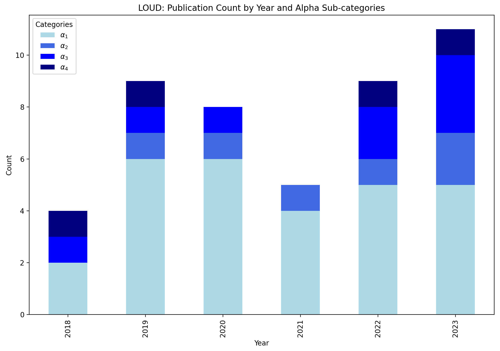
<figcaption>
<strong>Figure 3.21</strong>:
 LOUD References Ordered by Year and &alpha; Sub-categories
</figcaption>
</figure>

- &alpha;<sub>1</sub> -- **Mention**:   Papers that mention LOUD as a new concept, accounting for 30     out of 46 papers. For instance, @alexiev_museum_2018 introduced     LOUD as a     novel moniker or approach to Linked Data.
- &alpha;<sub>2</sub> -- **Description**:   Papers providing descriptions of what LOUD is, including varying perspectives on     its target audience, such as human-readability or data practitioners     [@schmidtPracticesLinkedOpen2022a; @adamou_shout_2022].
- &alpha;<sub>3</sub> -- **Principles**:   Papers explaining LOUD design principles, often authored by     a small group that know each other such as     @delmas-glass_fostering_2020 or myself. They also frequently     referenced IIIF and Linked Art.
- &alpha;<sub>4</sub> -- **Analysis**:   Papers that interpret and reuse LOUD design principles for diverse     applications, offering comparative analyses or presenting case     studies. For instance, @thiery_sphere_2019 proposed a model of seven     data spheres, with LOUD as the 6<sup>th</sup> sphere and     LOUD and     FAIR together     in the 7<sup>th</sup> sphere. In another case, @pohl_lobid_2018 highlights the     importance of the principles for lobid[^137], a     LOD service in     Germany that consists of GUIs and APIs.

[Figure 3.22](#fig:loud-references-venn) depicts Venn diagrams illustrating all six intersections of these categories, revealing how different aspects of LOUD are covered in the literature.

<figure id="fig:loud-references-venn" style="margin: 0 auto; text-align: center;">
 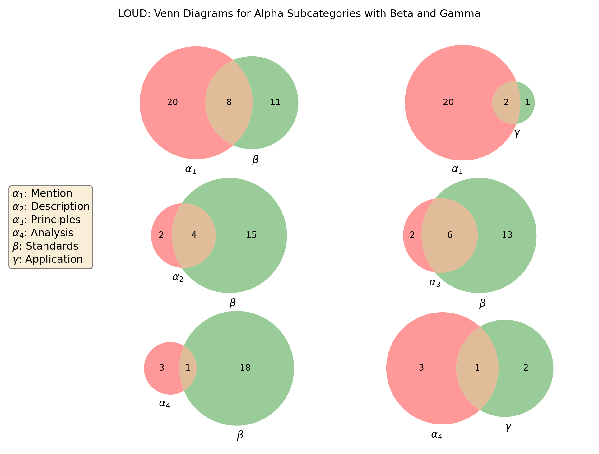
<figcaption>
<strong>Figure 3.22</strong>:
 LOUD References as Venn Diagrams for Each of the Six Intersections
</figcaption>
</figure>

Several papers related to archaeology also made references to LOUD in the context of the CAA Data Dragons Interest Group's work on semantics and LOUD[^138]. Furthermore, a search on popular search engines, specifically Bing and Google, revealed the existence of a research project named simply LOUD. This project, initiated in 2019 by the Royal Museum for Central Africa in Belgium[^139], was delayed due to the COVID-19 pandemic and is now being considered for future re-initiation.

Further research should explore projects that implement a combination of the above standards, without necessarily mentioning LOUD. It is important to note that a quick search will show many IIIF implementations that reference WADM, but it is mainly due to the Presentation API data model's dependence on this specification. However, such mentions of WADM often do not indicate active adoption of web annotations for broader purposes. In these cases, while these projects still adhere to the design principles of LOUD by implementing IIIF, I would argue that the full potential of LOUD is realised through a combination of specifications, especially when it comes to achieving semantic interoperability[^140].

As I move on to explore IIIF, WADM, and Linked Art in the following subsequent subsections, it is worth noting that these systems, as exemplified by @sanderson_importance_2020, embody and adhere to the foundational principles of LOUD, showcasing their practical applicability in diverse contexts.

### 3.5.3 International Image Interoperability Framework (IIIF) {id="subsec:iiif"}

In essence, the IIIF[^141] serves as both a model for presenting and annotating content, as well as a global community that develops shared APIs, implements them in software, and exposes interoperable content.

To explore these aspects, this subsection on IIIF is divided into four parts. First, in [Subsubsection 3.5.3.1](#subsubsec:iiif-inception), I look at the genesis of the framework. Next, [Subsubsection 3.5.3.2](#subsubsec:iiif-community) unravels the IIIF community. Moving forward, [Subsubsection 3.5.3.3](#subsubsec:iiif-specs) offers an overview of the existing and forthcoming APIs, extensions, and the development process of IIIF standards. Finally, in [Subsubsection 3.5.3.4](#subsubsec:iiif-ecosystem), I outline the ecosystem, encompassing some of the compliant software, as well as the institutions and projects that have implemented IIIF specifications -- sometimes referred to as the IIIF universe.

#### 3.5.3.1 Inception {id="subsubsec:iiif-inception"}

IIIF was initially established in 2011. Its birth emerged as a community-based initiative that crystallised from the convergence of two pivotal endeavours. One strand of this narrative revolved around the imperative to facilitate the seamless exchange of high-definition images over the internet [@snydman_international_2015 p. 16]. This aspiration arose as a practical solution to mitigate the proliferation of duplicated images required for distinct projects. The desire to avert the necessity of sending substantial volumes of image data via conventional methods, such as mailing TB of data on hard drives, led to the contemplation of a web-based approach for sharing images that could break down silos.

In his talk during the 2019 IIIF Annual Conference, @cramer_iiif_2019 underscored the genesis of this facet of IIIF's inception, also highlighting the ‘paper tablecloth story’[^142] where a plan was hatched informally in 2011 over dinner between technologists from the Stanford University Library, Oxford University and the British Library [@raemy_international_2017 p. 13] for distributing at scale image-based resources. As @emanuel_chapter_2018 [p. 125] asserts: *‘a clear, focused emphasis on collaboration and interoperability, between both institutions and technical approaches, can provide significant relief from this conundrum[^143], and can provide value for organisational members and technological end-users alike’* .

The second strand, interwoven with the first, emanated from the explorations and experiments surrounding the interoperability of digitised medieval manuscripts. The DMSTech at Stanford, operational from 2010 to 2013, provided the fertile ground for these reflections [@robineau_introduction_2019]. These deliberations ultimately coalesced into the formulation of the Shared Canvas Data Model[^144], a model which employs a Linked Data approach based on Open Annotations and OAI-ORE[^145] [see @sanderson_sharedcanvas_2011] -- a set of standards and protocols to facilitate the description and exchange of aggregations of web resources -- to collaboratively describe digital facsimiles of physical objects, primarily in the CH domain where instances of the model are consumed by rendering platforms with a view to *‘understanding the relationships between the constituent text, image, audio or other resources’* [@sanderson_shared_2013]. The roots of this modelling effort can be traced back to @sanderson_linking_2003's PhD thesis, where the first manuscript description was crafted based on an electronic edition of Froissart's Chronicles, a prose history of the Hundred Years' War written in the 14<sup>th</sup> century.

Robert Sanderson's recollections, shared on the IIIF Slack Workspace[^146] in April 2022, provide an invaluable account of the early phases. The narrative unfolds in the mid-2000s when discussions between Tom Cramer, Stuart Snydman (both at Stanford University at the time), and himself at conferences such as the DLF Forum commenced. This discourse centred on the challenges and prospects of interoperability for medieval manuscripts. Concurrently, LANL was engaged in developing Djatoka, an image server leveraging JPEG2000 and an OpenURL-based API[^147] [@chute_introducing_2008]. Sanderson's move to Los Alamos in 2008 marked a turning point, as the convergence of ideas and resources paved the way for tangible progress. Funding from the Mellon Foundation[^148] catalysed the evolution of IIIF. A parallel Mellon grant bolstered the development of Open Annotation, a precursor to the Web Annotation standard. This confluence set the stage for IIIF's embryonic phase. As the project progressed, collaboration expanded to include a wide range of partners. Lessons learned from manuscript interoperability were extrapolated and refined, culminating in pragmatic adjustments. The evolution included key refinements, including the adoption of JSON-LD as the sole manifest format and the establishment of a coherent API structure [@snydman_international_2015 p. 18].

Tracing the development of IIIF, as highlighted in this timeline[^149], reveals a sequence of pivotal milestones. Among these, the establishment of the Shared Canvas Data Model, a subject previously touched upon, stands out as a significant step. This timeline, while informative, is not all-encompassing but effectively underscores the essential moments shaping IIIF. The journey from visionary dialogues to the concerted collaborative efforts showcases the collective ingenuity pivotal in enhancing digital image accessibility and interoperability. A notable milestone in this journey was the first officially listed IIIF working meeting, which took place in Cambridge, England, in September 2011. This event symbolises the global commitment and the evolutionary stride of the IIIF initiative.

Stanford University played a pivotal role in rebuilding the Mirador viewer[^150], a key milestone that exemplifies the spirit of community-driven effort in the IIIF initiative [@zundert_not_2018 p. 2]. This endeavour, later augmented through a collaborative partnership with Harvard University Library, highlights the cooperative dynamics and collective contributions that have been fundamental to the success and advancement of IIIF. The UV[^151] served as an additional client, validating IIIF's interoperability aspirations [@raemy_international_2017 p. 30]. The availability of the people behind OSD[^152], facilitated these advancements [@raemyAnalysisUsabilityAutomatically2024 p. 76].

The maturation of IIIF was marked by incremental achievements, with Stanford's active stewardship from 2014 to 2016 playing a pivotal role. The project's multifaceted requirements found a harmonious synthesis within a supportive community. Financial resources, technical infrastructure, a coherent data model, and the collective dedication of engaged participants converged to transform IIIF from an abstract concept into a tangible reality [@hadro_introduction_2019].

#### 3.5.3.2 IIIF Community {id="subsubsec:iiif-community"}

The IIIF community stands as the cornerstone of the framework's ongoing development and widespread adoption. It encompasses a broad spectrum of institutions and individuals. Their collaborative efforts are pivotal in crafting, upholding, and advocating for the IIIF specifications and tools. This community-led approach guarantees that IIIF aligns with the dynamic requirements of CH entities and the wider DH sphere.

While the majority of IIIF participants hail from North America, the United Kingdom, and Western Europe, the framework's reach is continually extending globally, with new adopters implementing IIIF-compliant solutions worldwide [@raemy_international_2017 pp. 14-15]. Initially centred around GLAMs, IIIF is increasingly garnering interest from various domains, including organisations in the STEM sector [see @moutsatsos_devops_2017; @kiley_publishing_2016], such as delivering digital pathology data by leveraging the IIIF Image API behind the scenes through an in-browser tiling mechanism [@bhawsar_imagebox3_2023] or by converting tiles from storage instances compliant with the DICOM[^153] standard [@jodogne_use_2023].

Within the IIIF community, several dedicated groups focus on both community engagement and technical specifications[^154]. These groups, fundamental to the discourse and evolution of IIIF-related matters, convene regularly and welcome participation from all interested parties [@hadro_newcomers_2022].

The structure of these groups falls into two categories. Community Groups engage in discussions on themes and topics pertinent to their focus areas, often showcasing demos of related work and recent implementations. Current active groups include 3D, Archives, A/V, Maps, Museums, and Outreach, with the Manuscripts, Design, and Newspapers groups currently on hiatus. TSGs are concentrated on collaborative efforts towards specific objectives related to the IIIF APIs. Current active TSGs are the 3D TSG, Maps TSG, Authorization Flow, and Content Search. Furthermore, IIIF has witnessed the successful completion of several TSGs. The Discovery TSG completed its work in 2023, leaving behind a number of specifications and deliverables. The Text Granularity TSG completed its mission in 2019 with the publication of the Text Granularity Extension. The A/V TSG concluded its work with the release of the Presentation API 3.0 in June 2020, and subsequently evolved into the A/V Community Group. Both group types thrive on an ethos of open community interaction, encouraging active involvement from all members of the IIIF community. New groups can emerge in accordance with the IIIF Groups Framework[^155].

IIIF has also orchestrated various events[^156], including working group meetings, training sessions, online gatherings, and annual in-person conferences rotating amongst continents (at the moment, IIIF conferences have only been held in either North America or Europe), to facilitate ongoing development and broaden institutional engagement.

The IIIF-C[^157], established in 2015 by 11 founding institutions --- including the initial three original institutions --- aims to achieve several objectives to steer and sustain the IIIF initiative [@cramer_iiif_2015]: providing uniform and rich access to digitised resources, defining and maintaining APIs that support interoperability, and developing shared technologies for an enhanced UX in handling digitised materials. Although originating within libraries, the IIIF community has expanded to encompass museums, archives, CH aggregators, commercial entities, and technology companies, thereby fostering novel opportunities for interaction and collaboration across different sectors.

The IIIF community's structure also includes key committees for editing the specifications and coordinating community processes, each playing a vital role in the framework's governance and progress.

-   Editorial Committee[^158]: This committee convenes on a regular     basis, working closely with both group types. Their primary     responsibility involves proposing new technical specifications and     updating existing ones.
-   CoCo[^159]:     This committee is instrumental in ensuring the     IIIF community     advances in a sustainable, coordinated manner, driven by community     consensus. Comprising both members and non-members of     IIIF-C,     CoCo     represents a broad spectrum of the community. It advises on various     IIIF     activities, including policy development, formation of new groups,     and maintaining the overall health of community groups.

Although originating within libraries, the IIIF community has expanded to encompass museums, archives, commercial entities, and technology companies, thereby fostering novel opportunities for interaction and collaboration across different sectors. As of the current writing, the IIIF-C consists of 67 members, illustrating the growing global interest and investment in the IIIF initiative. The governance of the IIIF-C is overseen by three key committees, each playing a distinct role in the consortium's operations:

-   Exec: Tasked     with steering the strategic direction and overseeing budgetary     decisions, this committee convenes biannually. Initially, it     comprised representatives from the first 11 founding members of the     Consortium, augmented by two additional elected members. Since 2021,     Exec positions     are elected annually by the consortium membership, with terms being     staggered.
-   Operating Committee: This committee, drawn from staff of     Exec, includes     roles such as a Chair, Vice-Chair, and Treasurer, along with three     at-large members. Meeting monthly, the Operating Committee works to     ensure that the strategic directives set by     Exec are     effectively implemented.
-   TRC[^160]:     Composed of appointees from IIIF-C member institutions with technical     expertise, this committee convenes monthly. Their primary function     is to vote on the approval or rejection of proposed amendments to     the specifications, cookbook recipes, and TSG initiatives.

These committees, through their collective efforts, play a crucial role in the structured and effective governance of IIIF-C. Their guidance and strategic decision-making are instrumental in steering the mission of IIIF and ensuring the fulfilment of its overarching goals. This foundation of leadership and collaboration within the consortium sets the stage for the development and refinement of IIIF specifications, the subject of the next subsection. As I transition to this topic, I will explore the technical backbone of the framework, highlighting how these specifications have become essential in advancing interoperability across CH platforms.


#### 3.5.3.3 IIIF Specifications {id="subsubsec:iiif-specs"}

Currently, IIIF has defined six APIs[^161]. The most prominent are the Image and Presentation APIs, both updated to version 3 in June 2020, often referred to as the core IIIF APIs. Complementing these are the Content Search and Authorization Flow APIs, both in version 2 (released in 2022 and 2023, respectively), and slated for future updates to align with the core APIs. In addition, the Change Discovery and Content State APIs, both in version 1.0, are relevant to the discovery and aggregation and/or sharing of IIIF resources. All (recent) specifications are working with JSON-LD 1.1., which is for instance consistent with i18n language[^162].

The development of the IIIF specifications is firmly rooted in the IIIF design principles [@applebyIIIFDesignPrinciples2018]. These principles, which have influenced similar methodologies such as the LOUD design principles, are articulated across 13 main components. They encapsulate a methodology that prioritises clear, practical goals, aligning with shared use cases to ensure the specifications meet the developer's needs effectively. This approach, focusing on simplicity, minimal barriers to entry, and adherence to good web and Linked Data practices, has been crucial in making the APIs both user-friendly and technically sound. Notably, the design principles advocate for ease of implementation and internationalisation, promoting a flexible yet cohesive structure. These principles do not directly express usability but rather represent objective constructs that naturally lead to usable and accessible data[^163] [@raemy_analysis_2023 pp. 7-8].

The Editorial Committee of IIIF, responsible for writing these specifications, adheres to these principles and a specific process[^164], ensuring that the resulting APIs are not only performant but also seamlessly integrate within existing technologies and standards. The IIIF Editorial Process encompasses two primary components: the Community Process and the Editorial Committee Process. The Community Process involves open discussions on IIIF-Discuss[^165], GitHub[^166], and various group meetings for proposals and feedback. Essential to this process is the demonstration of use cases by at least two institutions, rigorous evaluation and testing of new features, and a thorough community review overseen by TRC. Specifications are subject to continuous revision with a release frequency guided by semantic versioning, balancing community input with the need for stability.

The editors make use of web best practices, including terminologies as defined in RFC 2119 [see @bradner_key_1997] of the IETF, a standards organisation mainly responsible for the Internet protocol suite. Additionally, the process involves clear documentation of editorial participation, with a structured approach for suggesting changes primarily via GitHub. Changes undergo strict acceptance criteria, requiring consensus among editors before merging. Regular meetings, both in-person and virtual, are crucial for editors to discuss ongoing work and coordinate efforts. This dual-component process ensures thoughtful, inclusive, and responsive evolution of IIIF specifications, catering to the diverse needs of the community.

In the following paragraphs I will undertake an exploration of each of the IIIF APIs. Special emphasis will be placed on the core APIs due to their integral role in the IIIF ecosystem. While providing a rich insight into the Image and Presentation APIs, I will also discuss the particularities of the Content Search, Authorization Flow, Change Discovery, and Content State APIs, highlighting their contributions to the overall breadth of the IIIF specifications.

The IIIF Image API, defined as a RESTful web service, responds to standard HTTPS requests with an image [@applebyIIIFImageAPI2020], in other words, it is an agreement between an image client and an image server to get the pixels [@robson_bl_2021].

The API uses its own URI syntax and offers two primary modes of interaction -- both of which are hereafter exemplified with the syntax and an URL working with the specification -- so that users can easily pan, deep zoom, manipulate, cite, and share regions of interest of an image.

The two modes of interaction are as follows:

- Retrieving an image derived from the underlying image content. The parameters define the characteristics of the returned image, all separated by a slash. <br/>`scheme://server/prefix/identifier/region/size/rotation/quality.format` <br/>
<https://iiif.dasch.swiss/0801/3eIbRgj63JP-CrShE6LBcTB.jpx/full/max/0/default.jpg>

- Requesting details about the image service, including characteristics and available functionality. It is serialised as a JSON-LD document.<br/> `scheme://server/prefix/identifier/info.json` <br/> <https://iiif.dasch.swiss/0801/3eIbRgj63JP-CrShE6LBcTB.jpx/info.json>

[Figure 3.23](#fig:imageapi-transformation) shows the sequence of parameters of the URI syntax that needs to be interpreted by compliant software (`region` then `size` then `rotation` then `quality` then `format`), as well as showcasing different manipulations that are available. In this case, the image has been cropped to *125,15,120,140* as its coordinate, has a width of *90* pixels, is mirrored and then rotated by *345* degrees, and returned in a *grey* -- or rather ‘gray’ according to the specification -- quality. This would give the following URL: `https://example.org/image42/125,15,120,140/90,/!345/gray.jpg`

<figure id="fig:imageapi-transformation" style="margin: 0 auto; text-align: center;">
 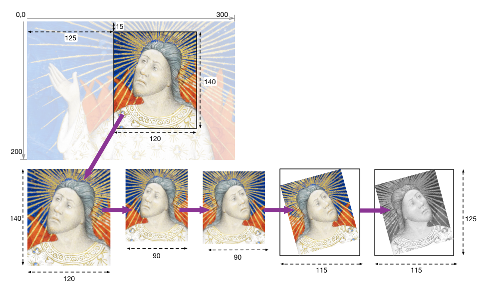
<figcaption>
<strong>Figure 3.23</strong>:
 IIIF Image API Order of Implementation [@applebyIIIFImageAPI2020]
</figcaption>
</figure>

Furthermore, it is mandatory for the image information document to delineate the extent of API support, i.e. the set of parameters and features that are supported by the image service, by denoting the compliance level as the value of the profile property. This compliance level must align with one of the three levels (*0*, *1*, or *2*) outlined in the Image API Compliance document[^167].

The chosen compliance level should represent the highest level that meets all the requirements. Some of these go beyond image manipulation and include HTTP features such as server response behaviours and CORS, which is a mechanism that allows or restricts resources on a web page to be requested from another domain outside the domain from which the first resource was served. CORS is a protocol that is particularly relevant for IIIF services, as it involves accessing and displaying images hosted on different servers or domains, necessitating careful management to ensure seamless access while maintaining web security protocols [see @van_kesteren_fetch_2023]. To assist in achieving or verifying compliance with the IIIF Image API, an image service can refer to the Image API Validator[^168], a tool designed to assist service providers in achieving compliance with the specification.

The result is that the IIIF Image API provides a well-defined image retrieval format that is easy to implement. It provides sufficient detail to drive zoomable image viewers. The URLs are designed to be intuitive, allowing easy manipulation by users. In addition, these URLs are optimised for caching and scalability, improving performance and efficiency.

As for the IIIF Presentation API, based on JSON-LD, it provides the necessary information about the structure and layout of objects or collections to drive a remove viewing experience. As such, its primary purpose is to display human-readable descriptive information, i.e. some minimal descriptive and legal metadata, rather than offering semantic metadata for search engines[^169] [@applebyIIIFPresentationAPI2020]. Loosely based on the Shared Canvas Data Model, it incorporates four main resource types: Collection, Manifest, Canvas, and Range, each serving distinct functions within the API framework. In addition, the specification make use of types that are defined by WADM, such as `AnnotationCollection`, `AnnotationPage`, `Annotation`, and `Content` (see [Subsection 3.5.4](#subsec:wadm)). A diagram of the Presentation API data model is shown in [Figure 3.24](#fig:prezi3-model).

<figure id="fig:prezi3-model" style="margin: 0 auto; text-align: center;">
 
<figcaption>
<strong>Figure 3.24</strong>:
 IIIF Presentation API Data Model [@applebyIIIFPresentationAPI2020]
</figcaption>
</figure>

The IIIF Manifest plays a key role as it encapsulates the structure and attributes of a compound object. It contains essential data required for a client application to accurately display the content to users. Typically, each Manifest is dedicated to delineating the presentation of a single complex entity, which could be diverse in nature, ranging from a book or a sculpture to a musical album. The Manifest thus serves as a crucial intermediary, translating complex object properties into a format that is both accessible and comprehensible to users engaging with digital representations of these objects. In the context of the Presentation API, the Manifest is perhaps one of the most important resource types, acting as the cornerstone for how digital content is structured and presented within the IIIF ecosystem. [Code Snippet 3.10](#lst:iiifmanifestexample) shows an example of a basic Manifest from the cookbook recipes[^170], which are published by the community to encourage publishers to adopt common patterns when modelling IIIF resources. To provide a clearer understanding, the following is a detailed breakdown of the structure this IIIF Manifest.

- `@context`:   This defines the context for interpreting the     JSON-LD     document. In this case, it points to the IIIF Presentation     API 3 context.
- `id`:   This is the unique identifier of the Manifest, pointing to its     location on the web.
- `type`:   Specifies that this JSON-LD document represents a     IIIF Manifest.
- `label`:   It provides a human-readable label for the manifest in different     languages. Here, it is labelled in English as ‘Picture of Göttingen taken during the 2019 IIIF Conference’.
- `items`:   An array of items within the Manifest. This Manifest contains one     `item`, a Canvas.
- `Canvas`:   Represents a single canvas that can contain one or more images or     content resources. It includes its own `id`, `type`, `label`,     `height`, and `width`. The `items` array within the Canvas contains     an `AnnotationPage`.
- `AnnotationPage`:   Represents a page within the canvas that can contain annotations. It     has its own `id`, `type`, and contains an array of `items`, each an     Annotation.
- `Annotation`:   An annotation associates a region of an image with descriptive or     interpretive information. It has its own `id`, `type`, `motivation`     (here as ‘painting’), and `body` which contains detailed information about the     image being annotated, including `id`, `type`, `format`, `height`,     `width`, and `service`.
- `service`:   It contains information about the IIIF Image Service for the image.
- `target`:   It specifies the target Canvas to which the annotation is     associated.

<figure id="lst:iiifmanifestexample" style="text-align: center;">
 <figcaption>
<strong>Code Snippet 3.10:</strong> Example of a IIIF Manifest
</figcaption>
 

```json
{
  "@context": "http://iiif.io/api/presentation/3/context.json",
  "id": "https://iiif.io/api/cookbook/recipe/0005-image-service/manifest.json",
  "type": "Manifest",
  "label": {
    "en": [
      "Picture of Göttingen taken during the 2019 IIIF Conference"
    ]
  },
  "items": [
    {
      "id": "https://iiif.io/api/cookbook/recipe/0005-image-service/canvas/p1",
      "type": "Canvas",
      "label": {
        "en": [
          "Canvas with a single IIIF image"
        ]
      },
      "height": 3024,
      "width": 4032,
      "items": [
        {
          "id": "https://iiif.io/api/cookbook/recipe/0005-image-service/page/p1/1",
          "type": "Annotation",
          "items": [
            {
              "id": "https://iiif.io/api/cookbook/recipe/0005-image-service/annotation/p0001-image",
              "type": "Annotation",
              "motivation": "painting",
              "body": {
                "id": "https://iiif.io/api/image/3.0/example/reference/918ecd18c2592080851777620de9bcb5-gottingen/full/max/0/default.jpg",
                "type": "Image",
                "format": "image/jpeg",
                "height": 3024,
                "width": 4032,
                "service": [
                  {
                    "id": "https://iiif.io/api/image/3.0/example/reference/918ecd18c2592080851777620de9bcb5-gottingen",
                    "profile": "level1",
                    "type": "ImageService3"
                  }
                ]
              },
              "target": "https://iiif.io/api/cookbook/recipe/0005-image-service/canvas/p1"
            }
          ]
        }
      ]
    }
  ]
}
```

</figure>

In summary, this IIIF Manifest describes a Canvas with a single IIIF image, and the image is associated with an an `Annotation` that provides additional information about the image. The Manifest also includes metadata such as a label and unique identifiers for various components.

In addition to the core functionalities, the IIIF Presentation API is augmented by three formally approved extensions:

- navPlace Extension:   Enhancing the IIIF Presentation     API with the     `navPlace` property, defined using GeoJSON-LD[^171] for geographic     coordinates.
- Text Granularity Extension:   This extension offers a standard for indicating text granularity     levels in annotations, especially useful for     OCR software,     manual transcriptions, or existing digitised text.
- Georeference Extension:   Leveraging WADM, it provides a pattern for     georeferencing IIIF Presentation 3     API `Canvases`     and images from the IIIF Image API.

IIIF Presentation API resources such as Manifest and Collection can be validated against a dedicated Presentation API Validator[^172]. This tool ensures that these resources conform to the specification, guaranteeing their correctness within the framework.

If Version 3.0 of the Presentation API was released only a few years ago, the need for a specification that can formally display and disseminate 3D objects has been widely recognised across various domains. Addressing this demand, ongoing work on an upgraded version of the IIIF Presentation API (Version 4.0) to accommodate 3D resources holds great promise [@haynes_evolving_2023]. While particularly relevant to the CH sector, as highlighted by @raemy_elaboration_2023 and @manz_recommended_2023 where conventional dissemination approaches struggle to effectively convey the depth and complexity of 3D artefacts, there are specific challenges beyond visual representation. These challenges include accurately representing the lighting conditions that affect the object's appearance and capturing the spatial orientation, such as handedness (defining the coordinate system: where does the coordinate _x_, _y_, _z_ have to be and in which direction). Such enhancements of the forthcoming IIIF Presentation API have the potential to empower institutions and industries beyond CH.

Certain key features have already been firmly established, particularly in regard to the integration of 3D content. A new resource type known as a `Scene` will be introduced to better accommodate 3D content and sits besides Canvas in the updated data model. This `Scene` is characterised by an infinite boundless space, where the origin (_0_,_0_,_0_) is at the centre rather than on the top-left corner as it is the case with still images, and is structured around a right-handed coordinate system. Within this system, movement along the Y-axis is interpreted as upward, while movement along the Z-axis signifies forward progression. Importantly, `Canvases` can be effectively nested within these `Scenes`, and likewise, `Scenes` have the capacity to be nested within other `Scenes` [@haynes_iiif_2023]. As @rossenova_iiif_2023 importantly argues, *‘the 3D specification would need to ensure that viewers can both implement a “minimum viable product” for user interaction and remain interoperable, as well as include more complex interactions and still specify those in a standards-compliant way’*. This advancement could potentially enable the presentation of collections in immersive formats, transforming access, engagement and cross-platform interoperability.

[Figure 3.25](#fig:iiif-core-apis-viewer) illustrates the integration of the core APIs within Mirador. Elements highlighted in blue are rendered via the Image API, while those in red are facilitated by the Presentation API. It is important to note that the Image API can function independently or in conjunction with the Presentation API for additional viewing capabilities. Additionally, there is no direct counterpart to the Image API for A/V content; instead, A/V specifics are conveyed using the `duration` property of the Presentation API.

<figure id="fig:iiif-core-apis-viewer" style="margin: 0 auto; text-align: center;">
 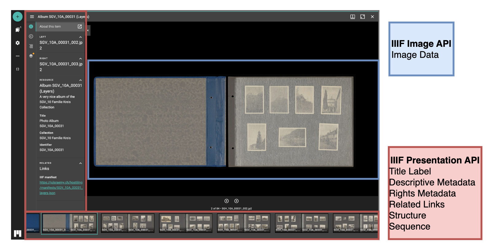
<figcaption>
<strong>Figure 3.25</strong>:
 The Interaction of the Core IIIF APIs in Mirador
</figcaption>
</figure>

Shifting focus to the additional IIIF APIs, the Content Search API plays a vital role in enhancing the framework's functionality. The specification facilitates searching within textual annotations and provides the mechanism for performing these searches within the IIIF context [@applebyIIIFContentSearch2022]. To add a Content Search service to a IIIF Manifest, an URI must be provided through the `service` property. Then the client, such as Mirador or the UV, will use it to create a valid query. An auto-complete service can also be embedded, further enriching the UX by streamlining the search process.

The Authorization Flow API outlines four mechanisms for accessing restricted content to either initiate an interaction with an access control system or to give a client enough information bout the user's state with respect to the content provider. These mechanisms are: access service, token service, probe service, as well as logout service. The access service typically manifests as a user interface provided by the content host, which the client opens in a new tab, usually leading to the provider's login page. The token service plays a crucial role wherein the client acquires an access token, necessitating presentation of the same authorising credentials to the token service as the browser would to the related access-controlled resource. The probe service, as defined in this specification, is an endpoint used by the client to ascertain the user's association with the access-controlled resource it represents. This is applicable for both access-controlled content resources and image information documents (`info.json`) that produce access-controlled image responses. Additionally, there is an optional logout service, designed to facilitate user logout [@applebyIIIFAuthorizationFlow2023].

The Change Discovery API is designed for machine-to-machine interfaces, primarily serving IIIF-aware systems. It enables content providers to efficiently publish lists of links to their content, which facilitates easy discovery and synchronisation for consuming systems [@appleby_iiif_2021]. The API is based on the W3C AS standard, ensuring a consistent and universally understandable pattern for publishing content changes. The API designates IIIF Collections and Manifests as primary access points for published content. Activities describing changes to these resources, and potentially to other types like IIIF Image API endpoints.

Central to the API's utility is its ability to allow content providers to articulate the specifics of how their content has evolved. This includes providing details on content that has been deleted or is no longer available. This optimisation significantly helps consuming systems in retrieving only those resources that have been modified since their last update, thereby streamlining the update process. The specification defines three distinct levels of conformance, each offering a different depth of information about the changes to IIIF resources.

- Level 0:   It offers a straightforward list of resources along with their     URIs, focusing on     basic interoperability.
- Level 1:   It enhances the list by adding timestamps and ordering, allowing     consuming applications to process changes more efficiently.
- Level 2:   It provides comprehensive information about the types of activities     undertaken, such as the creation, modification, and deletion of     resources, thus giving a detailed insight into the content changes. [Code Snippet 3.11](#lst:iiifchangediscovery) shows an example of a Level 2 `Activity`.

<figure id="lst:iiifchangediscovery" style="text-align: center;">
 <figcaption>
<strong>Code Snippet 3.11:</strong> Example of a Level 2 Activity Compliant with the IIIF Change Discovery API @appleby_iiif_2021
</figcaption>

```json
{
  "type": "Create",
  "object": {
    "id": "https://example.org/iiif/1/manifest",
    "type": "Manifest"
  },
  "endTime": "2017-09-20T00:00:00Z"
}
```

</figure>

In the Change Discovery API, the `rdfs:seeAlso` property from the Presentation API is a vital feature that enhances the discoverability and understanding of IIIF resources [@raemy_enabling_2020 p. 16]. This property is used to reference external documents containing richer and more detailed information about the content being presented. The specification also provides a structured approach for the organisation and processing of `OrderedCollection` and `OrderedCollectionPage`. This includes clear directives on how activities within these structures are managed and accessed.

In terms of network considerations, the Change Discovery API addresses critical aspects such as handling media types and activities for access-restricted content. These considerations ensure that the network interactions remain efficient and reliable, even in scenarios where content accessibility is dynamically changing. Additionally, the IIIF community deployed a IIIF Registry[^173] to give access to IIIF resources and streams that are compatible with the Change Discovery API.


Finally, the Content State API enables deep-linking into objects and annotations from search results, aiding users in sharing specific IIIF content [@appleby_iiif_2022]. Specifically, a content state is a JSON-LD data structure that can be leveraged by IIIF clients to load and present a particular part of a resource, such as region of a Canvas in a Manifest, playing a particular point in a recording, displaying multiple targets from a comparison view, and embedding search results. Because the content states are serialised in JSON, these must be encoded in the base64url format, a variant of the base64 encoding designed to be safe for use in URLs as it avoids using special characters [see @josefsson_base16_2006]. In summary, as @crane_what_2020 argues, the specification is ‘how we point at things in IIIF’.

[Figure 3.26](#fig:contentstate-buddha) displays a IIIF Manifest, specifically of *The Life of Buddha, first book (Shaka no Honji, jō)*, hosted by e-codices[^174]. This resource is accessed through Jalava[^175], a directory tree-based interface that aggregates IIIF-compliant repositories. It also includes a custom viewer, which enables the sharing of resources based on the IIIF Content State API in JSON and base64url formats.

<figure id="fig:contentstate-buddha" style="margin: 0 auto; text-align: center;">
 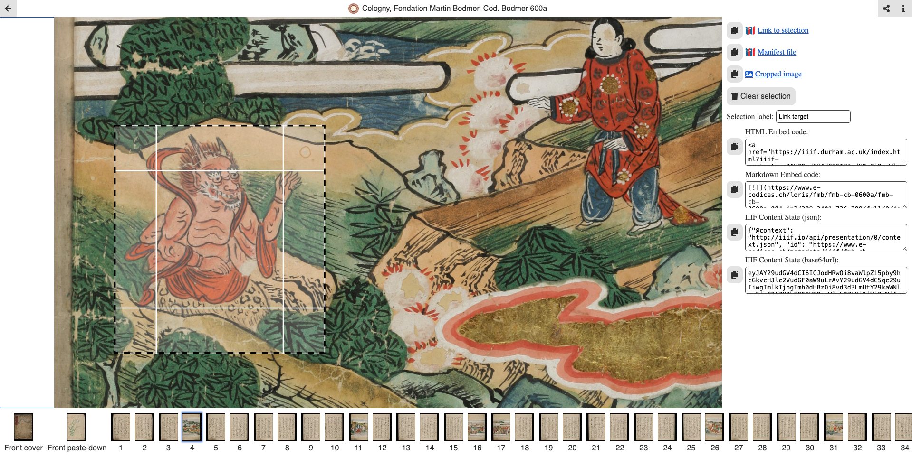
<figcaption>
<strong>Figure 3.26</strong>:
 <em>Cologny, Fondation Martin Bodmer, Cod. Bodmer 600a: The Life of Buddha, First Book (Shaka no Honji, jō)</em> Embedded in Jalava, a Customised Client from Durham University Compliant with the IIIF Content State API
</figcaption>
</figure>

Collectively, these APIs, extensions and validators are not only fundamental components that enable the framework, they are also anchored by a set of well-defined design principles and an editorial process. This combination ensures improved interoperability and utility across different digital platforms, while maintaining consistent and usable standards that reflect the evolving needs of the community.

In order to effectively deploy IIIF, it is important for the system building blocks to have a comprehensive understanding of the different APIs involved. For a basic IIIF solution, the images need to be delivered in compliance with the Image APIs through a web service. Then, a series of scripts can be used to generate IIIF resources, which combine the relevant metadata and data structure. These can be displayed within IIIF-compliant viewers. Deploying a more advanced IIIF architecture that can manage and save annotations, restrict access to certain objects, inform the IIIF community of changes made within its own collection, or search for OCR text requires a more complex environment. This involves deploying multiple types of servers and different libraries. [Figure 3.27](#fig:iiif-archi) illustrates an example of a IIIF architecture with the six APIs.

<figure id="fig:iiif-archi" style="margin: 0 auto; text-align: center;">
 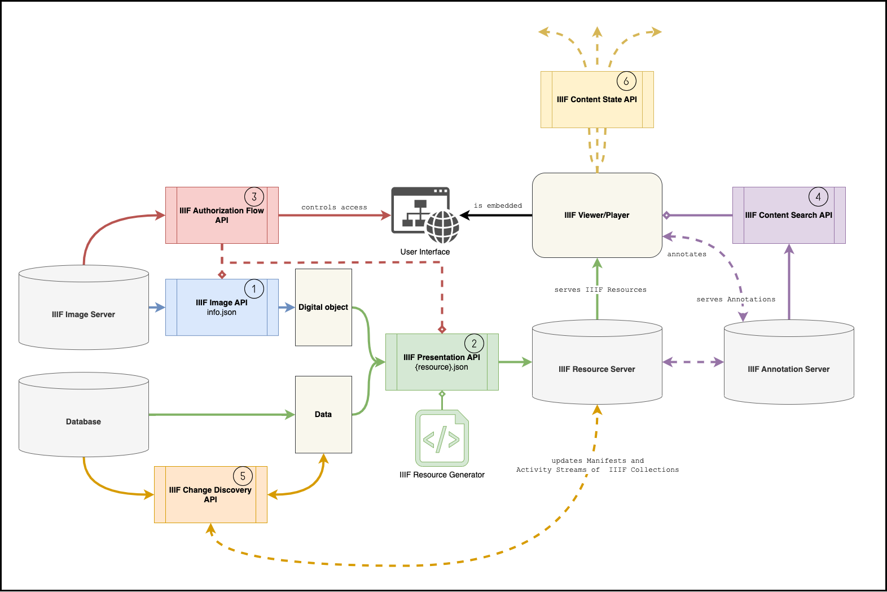
<figcaption>
<strong>Figure 3.27</strong>:
 Example of a IIIF Architecture Implementing the Six APIs
</figcaption>
</figure>

As I move from the underlying technical structure to its practical application, the next subsection takes a closer look at the IIIF ecosystem. This includes a diverse range of compliant software and implementations, each contributing to the widespread adoption and versatility of IIIF. By exploring these elements, it is possible to gain a comprehensive understanding of how IIIF is being operationalised and integrated into various environments.

#### 3.5.3.4 IIIF Ecosystem {id="subsubsec:iiif-ecosystem"}

This segment explores the composition of the IIIF ecosystem, particularly focusing on how its suite of shared APIs has been integrated into software and the institutions that have made their resources compliant with the specifications.

The adoption of IIIF by diverse organisations marks a significant turning point plays a crucial role in dismantling silos. This fosters enhanced communication and interoperability between various software platforms. As a result, users gain access to a richer array of options for viewing and interacting with digital resources. This transformation, catalysed by the widespread adoption of IIIF, is illustrated in [Figure 3.28](#fig:iiif-ecosystem), showcasing the dynamic and interconnected nature of the IIIF ecosystem.

<figure id="fig:iiif-ecosystem" style="margin: 0 auto; text-align: center;">
 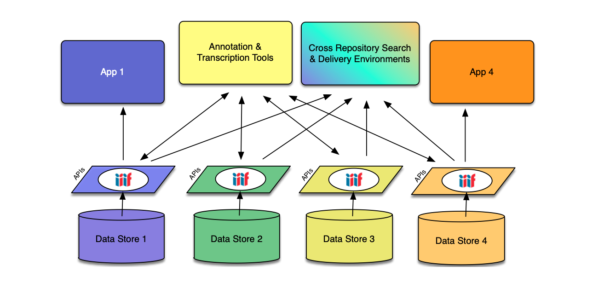
<figcaption>
<strong>Figure 3.28</strong>:
 Example of a IIIF Ecosystem of Software
</figcaption>
</figure>

The suite of IIIF-compliant software encompasses a diverse range of tools, each catering to specific aspects of the framework. Central to this suite are image servers, predominantly tailored to align with the IIIF Image API, such as IIPImage[^177], Cantaloupe[^178], or SIPI[^179]. Complementing these servers are image viewers, designed to be compatible with either the Image API alone, like OSD and Leaflet-IIIF[^180], or with both of the core IIIF APIs. With the release of the version 3.0 of the Presentation API, A/V players have also been developed, which frequently comply with the Image API as well. Examples of known clients that support the Image and Presentations APIs 3.0 are Mirador, the UV, Annona[^181], Clover[^182], and Ramp[^183]. As the support and behaviour vary, a dedicated viewer matrix[^184] was created by Glen Robson, the IIIF-C Technical Coordinator.

Additionally, the ecosystem includes an array of tools and libraries which offer pre-written code segments essential for constructing and manipulating IIIF resources. For narrative and website creation, there are specialised exhibition and guided viewing tools such as Storiiies[^185] and Exhibit[^186], adding a storytelling dimension to the experience. Moreover, validators play a critical role in ensuring compliance and accuracy, while annotation servers and clients offer advanced functionalities for enriching digital resources with contextual and interpretive information. Together, these components form a comprehensive and versatile toolkit, enabling a wide range of applications and enhancing the utility of IIIF resources.

The evolving software landscape has witnessed a notable expansion in IIIF compatibility, where a larger number of software applications now align with the IIIF specifications. This shift is evident in the growing support for one or more of the IIIF APIs, with a particular emphasis on the Image API or both core APIs [@rabun_scoping_2016]. In May 2016, recognising the need to provide guidance and support to both newcomers and software developers within the IIIF community, a curated collection titled ‘Awesome IIIF’[^187] was initiated. This resource compiles a comprehensive array of IIIF-compliant tools, tutorials, and descriptive links, organised to facilitate easy navigation and understanding of the IIIF ecosystem. It serves as an invaluable resource, offering insights and directions for those embarking on their journey with IIIF, as well as helping developers in finding the necessary tools and information to integrate IIIF specifications effectively into their projects.

IIIF has been embraced by a variety of institutions worldwide, spanning from state and national libraries to aggregators, museums, archives, and universities. Examples include Austria's national library, the British Library, BnF, Israel's national library, aggregators like Europeana, the Digital Public Library of America, and the Wikimedia Foundation, museums such as the Victoria & Albert Museum, the alters Art Museum, and the YCBA, archives such as the Swiss Federal Archives, the Blavatnik Foundation Archive, and the National Film and Sound Archive of Australia, as well as academic institutions such as Leiden University, University of Edinburgh, and Université Paris Cité. These implementations showcase the versatility of IIIF, illustrating its ability to cater to a wide spectrum of CH needs.

In Switzerland, IIIF has seen significant uptake, primarily within the library and academic sectors. Institutions like DaSCH, e-manuscripta, e-rara, Kunstmuseum Basel, the Swiss Federal Archives, and the University of Geneva have all adopted IIIF to some extent. Notably, both core IIIF APIs, in their Version 2.0, saw their initial implementation by e-codices[^188], the Virtual Manuscript Library of Switzerland, in December 2014 [@raemy_international_2017 p. 24]. It marked a strategic shift towards integrating modern open-source technologies, such as OSD, in the overhaul of their digital platform [@fritschi_e-codicesvirtual_2017 pp. 245-246]. This early adoption not only demonstrated e-codices' commitment to using the latest state-of-the-art digital tools, but also paved the way for the wider adoption of IIIF standards in digital libraries.

Scoping the whole so-called IIIF universe is complex as there is no mandatory requirement -- and there probably shouldn't be one -- to tell the IIIF community that you have implemented the APIs or that you have developed tools that are compliant with the specifications. In terms of specifications, mostly the core IIIF APIs are implemented, such as shown in different investigations [see @raemy_daschcon_2023; @raemy_suggested_2019]. The IIIF community has also carried out several surveys, targeted at institutions implementing the standards in 2017, 2020, and 2023 [@raemy_characterising_2023 p. 2]. In 2017, the number of images compatible with the IIIF Image API was estimated to be over 335 million [@raemy_international_2017 p. 27], probably under-representing the real number. At the time of writing, it is likely that there are over 2 billion images compliant with the Image API, as the Internet Archive alone hosts over 1 billion of them.

The latest 2023 IIIF Implementation Survey, receiving 80 responses, showcased a diverse range of institutions including 26 libraries, 11 museums (some encompassing combinations like museum and research library), 16 universities or research institutions, seven archives, five service providers, as well as four software providers. It is quite representative to what is known to IIIF-C and the wider community, with participation and implementations mostly from libraries, museums, and universities from North America and Europe. Most surveyed institutions currently support IIIF, with a few in the planning stage. The number of IIIF-compatible resources varies widely, ranging from fewer than a thousand to over a million in some cases. Popular IIIF-compliant image servers include Cantaloupe and IIIPImage. Mirador and UV are commonly used viewers. JPEG2000 and TIFF are the predominant image formats used across the surveyed institutions. A portion of the institutions actively contribute staff time or funding to shared IIIF tools and projects, highlighting a collaborative approach within the IIIF community.

Navigating the world of IIIF resources can be a challenging endeavour, given their vast and varied nature. To assist in this task, a comprehensive guide has been developed, providing valuable insights and directions on how to locate IIIF resources effectively[^189]. As an illustration, [Figure 3.29](#fig:cultural-japan) presents the entry of the Cultural Japan platform[^190], which aggregates IIIF-compliant of and about Japan [see @machiya_improvement_2023].

<figure id="fig:cultural-japan" style="margin: 0 auto; text-align: center;">
 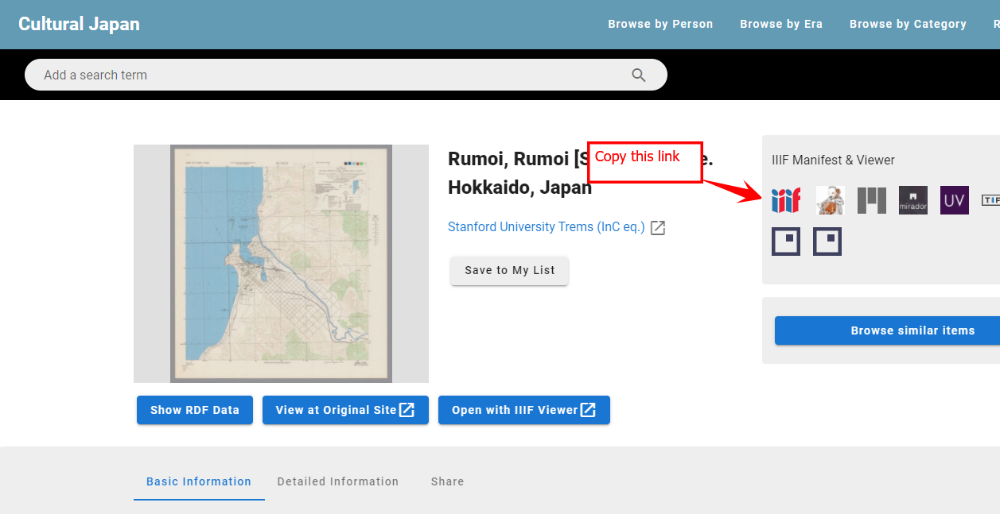
<figcaption>
<strong>Figure 3.29</strong>:
 Screenshot of the Cultural Japan Platform in the IIIF Guides
</figcaption>
</figure>

While the IIIF ecosystem is dynamic and evolving, it is important to note that its expansion and development are predominantly observed within GLAM and academic institutions, mostly in wealthy countries. This skew indicates that while IIIF specifications have gained traction and proving to be influential in the DH and CH domains, their adoption is not uniformly distributed globally. The concentration of IIIF tools and implementations in certain regions underscores the need for broader outreach and support to enable more diverse and widespread adoption. Despite its current geographical and sectoral concentration, the framework's capability to enhance access, interaction, and preservation of digital resources remains significant, offering a promising avenue for the future of digital archival work on an international scale.


### 3.5.4 Web Annotation Data Model {id="subsec:wadm"}

The WADM[^191], a W3C standard established in 2017 and influenced by the outcomes of the OAC[^192] resulting from several years of effort [see @haslhofer_open_2011], provides an extensible and interoperable framework for creating and sharing annotations across various platforms.

WADM is designed to support both simple and complex use cases, such as linking content to specific data points or multimedia resources. It standardises annotations for interoperability and easy integration into existing collections, using JSON-LD for serialisation, which integrates annotations into the web's structured data ecosystem. The model adopts Linked Data principles, emphasising interoperable and flexible structures for annotations [@sanderson_designing_2013].

Annotations in WADM link resources, referred to as `body` and `target`. The `target` is the resource being annotated, while the `body` contains the annotation content, which can be text, images, or other media. This structure allows a single annotation to relate to multiple resources, ensuring compatibility with web architecture and facilitating cross-platform sharing [@sanderson_web_2017]. [Figure 3.30](#fig:wadm-model) illustrates this three-part model.

<figure id="fig:wadm-model" style="margin: 0 auto; text-align: center;">
 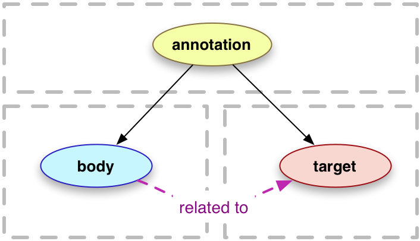
<figcaption>
<strong>Figure 3.30</strong>:
 WADM High-level Overview [@sanderson_web_2017]
</figcaption>
</figure>

The model outlines various components of an annotation [@sanderson_web_2017]:

- `@context`:   A property defining the JSON's meaning as an `Annotation`. Each     `Annotation` must include one or more `@context` values, with     <http://www.w3.org/ns/anno.jsonld> as a mandatory inclusion. If only     one value is present, it should be a string.
- id:   A property identifying the `Annotation` with a unique     IRI. Each     `Annotation` must have exactly one identifying     IRI.
- type:   A relationship specifying the `Annotation`'s type. Each `Annotation`     should have one or more types, including the `Annotation` class.
- Annotation:   A class representing web annotations. Each `Annotation` must be     specified with `type`.
- body:   A relationship linking the `Annotation` to its `body`. An     `Annotation` can have one or more `body` relationships, but it is     possible to have none.
- target:   A relationship linking the `Annotation` to its `target`. Each     `Annotation` must have one or more `target` relationships.

[Code Snippet 3.12](#lst:wadm1) is an example of a basic annotation.

<figure id="lst:wadm1" style="text-align: center;">
 <figcaption>
<strong>Code Snippet 3.12:</strong> Example of Basic Annotation According to WADM @sanderson_web_2017
</figcaption>

```json
{
  "@context": "http://www.w3.org/ns/anno.jsonld",
  "id": "http://example.org/anno1",
  "type": "Annotation",
  "body": "http://example.org/post1",
  "target": "http://example.com/page1"
}
```

</figure>

Annotations can link to different types of resources, including external web resources, embedded text, or specific segments of a resource. They can also include lifecycle information, agent details, intended audience, accessibility features, motivations, rights information and other identities.

[Code Snippet 3.13](#lst:wadm2) shows an example of an annotation with a `motivation` and a `purpose`.

<figure id="lst:wadm2" style="text-align: center;">
 <figcaption>
<strong>Code Snippet 3.13:</strong> Example of an Annotation According to WADM with a motivation and a purpose @sanderson_web_2017
</figcaption>

```json
{
  "@context": "http://www.w3.org/ns/anno.jsonld",
  "id": "http://example.org/anno15",
  "type": "Annotation",
  "motivation": "bookmarking",
  "body": [
    {
      "type": "TextualBody",
      "value": "readme",
      "purpose": "tagging"
    },
    {
      "type": "TextualBody",
      "value": "A good description of the topic that bears further investigation",
      "purpose": "describing"
    }
  ],
  "target": "http://example.com/page1"
}
```

</figure>

Annotations can be organised into collections or pages for easy reference and management. An `AnnotationCollection` manages a potentially large number of annotations, maintaining its own descriptive and creation information, and includes references to the first page of annotations. Each `AnnotationPage` contains an ordered list of some or all annotations within the collection.

WADM has played a key role in several areas, particularly in extending the functionality of the IIIF Presentation API data model. Beyond the IIIF space, the influence of WADM extends into other areas, demonstrating its versatility and wide applicability.

In the field of knowledge management, [@rossenova_wikidata_2022 p. 10] uses WADM to annotate 3D content within an instance of Wikibase[^193], a suite of KB software used by Wikidata for managing LOD. Additionally, WADM finds application in the field of musicology, where it aids in the annotation of musical notes, thus enriching the study and understanding of music through a digital lens [@weigl_notes_2021 pp. 26-27]. The importance of WADM has been also important in the domain of data quality assessment [@wei_dqaf_2016 p. 24]. Moreover, the VR gaming industry has also embraced WADM to enrich the generated KGs [@rousi_supporting_2021 pp. 100-101]. This application demonstrates the standard's potential in creating immersive and interactive digital experiences.

Incorporating all the discussed aspects of WADM, it is evident that this model offers a comprehensive and flexible framework for web annotations. The WADM's capacity to handle diverse annotation types, from simple text to complex multimedia segments, and its consideration of aspects like resource lifecycle, rights information, and accessibility, make it a robust tool for web-based annotations. Envisioning WADM-driven storytelling, it could serve as a potent means to convey *hypotyposes* --- picturesque descriptions of scenes or events. This aligns with the concept of multimedia assemblage of archival objects, as discussed by @bachimont_archive_2021 and revisited in the context of web annotations[^194], highlighting the potential of WADM in transforming the presentation and interpretation of content into dynamic, contemporary narratives.

In contrast to IIIF and Linked Art, WADM stands out as the only recognised LOUD standard that doesn't concurrently function as an active community. In the event that updates to WADM are required, a dedicated W3C working group would need to be re-established or revamped[^195]. This necessity contrasts with the community-driven evolution seen in IIIF and Linked Art, where ongoing community engagement and collaboration play a crucial role in their development and updating processes.


### 3.5.5 Linked Art {id="subsec:linked-art"}

Linked Art[^196] is a community-driven initiative working together to define a LOUD specification for describing CH, primarily artworks, designed to operate across CHIs, facilitating the publication and use of a common body of knowledge. As such, Linked Art presents itself as *‘providing a standards based metadata profile, which consistently solves problems from real data, is designed for usability and ease of implementation, which are prerequisites for sustainability’* [@sanderson_understanding_2023]. Specifically, the community develops and maintains a shared data model, or profile, based on CIDOC-CRM as well as a JSON-LD-based API to interact with the data [@cornut_annotations_2023, p. 10].

Linked Art presents a layered framework that distinguishes between the conceptual and implementation aspects of its model. This stratification is key to understanding how the Linked Art profile and its API are situated within a broader context of shared abstractions and sustainable implementations [@sanderson_cultural_2020].

- **Shared Abstraction Level**:   The conceptual model is encoded by the ontology, which is refined by     vocabularies.
    - Conceptual Model:   This represents an abstract way of conceptualising the world in         a holistic, consistent, and coherent manner. A conceptual model         can express just about anything anyone wishes to document.         Linked Art is based on CIDOC-CRM, an event-based framework.
    - Ontology:   This involves a shared set of terms that encode the conceptual         model in a logical and machine-actionable way. This layer aims         for the correctness of data. Linked Art uses the         RDF         encoding of CIDOC-CRM 7.1.3, with a few other         extensions like CRMdig and properties and classes created by the         Linked Art community, as well as other commonly used         RDF         namespaces such as Dublin Core and RDFS for disambiguating closely         related property names.
    - Vocabulary:   A curated set of terms specific to sub-domains, making the         ontology more concrete and applicable. The Getty Vocabularies         are used in Linked Art to further classify the main core         entities from CIDOC-CRM.
- **Sustainable Implementations Level**:   The shared abstraction level is specialised by a profile and     available through an API.
    - Profile:   It entails a selection of appropriate abstractions from the         conceptual model, aimed at encoding the scope of what can be         described. In the case of Linked Art, its profile is mainly         focused on describing artworks.
    - API:   This involves a selection of appropriate technologies to provide         access to data managed using the profile. Like the other         LOUD         specifications, the Linked Art API is serialised in         JSON-LD         and follows the REST architectural principles.

[Figure 3.31](#fig:la-overview) illustrates these layers, delineating the transition from shared abstractions (in blue) to their sustainable implementations (in green) in the Linked Art ecosystem.

<figure id="fig:la-overview" style="margin: 0 auto; text-align: center;">
 
<figcaption>
<strong>Figure 3.31</strong>:
 Abstraction and Implementation Level of Linked Art. Adapted from @sanderson_linked_2021
</figcaption>
</figure>

Embarking on an exploration of Linked Art, this subsection unfolds in four distinct yet interconnected segments. First, [Subsubsection 3.5.5.1](#subsubsec:la-history) offers a historical perspective on the development and evolution of Linked Art. This is followed by [Subsubsection 3.5.5.2](#subsubsec:la-model), which provides an in-depth examination overview of the model, detailing its structure and patterns. Subsequently, [Subsubsection 3.5.5.3](#subsubsec:la-api) explores the architectural and design principles of the Linked Art API, including its protocol, core constructs, and the array of entity endpoints it recommends. The subsection culminates with [Subsubsection 3.5.5.4](#subsubsec:la-implementations), where I look at the community dynamics surrounding Linked Art and how the specification has been, or will be, implemented.

#### 3.5.5.1 History {id="subsubsec:la-history"}

Linked Art officially came into existence in 2017 [@raemy_characterising_2023 pp. 1-2]. However, its roots can be traced back to November 2016 with the creation of its first GitHub repository[^197], marking the beginning of the community. The initiative gained significant momentum in January 2019, when it commenced hosting open community calls, inviting broader participation and engagement[^198].

In the same year, Linked Art received financial support in the form of grants from both the Kress Foundation[^199], known for its dedication to advancing the field of art history, and the AHRC[^200], a major funding body in the United Kingdom. This support from two esteemed organisations has strengthened Linked Art's capabilities and resources, allowing it to expand its scope and organise five face-to-face meetings; three in 2019 and two in 2023 -- delayed due to the COVID-19 pandemic.

The official recognition of Linked Art as a CIDOC Working Group in 2020 marks another milestone in its development. This recognition not only confirms the importance and relevance of Linked Art within the international museum sector, but also increases its visibility.

The evolution of Linked Art was significantly influenced by two key precedents: the AAC[^201] and Pharos[^202], the International Consortium of Photo Archives. AAC, a consortium of fourteen American art museums, played a critical role in promoting the adoption of agreed-upon LOD practices for artworks [@knoblock_lessons_2017]. On the other hand, Pharos brought together a network of photographic archives [@delmas-glass_fostering_2020].

@fink_american_2018 [p. 35] highlights the philosophical alignment between Linked Art and AAC. She notes that *‘[Linked Art] describes the philosophy that shaped the AAC target model. It indicates the model will be updated by applying it to other data sets, such as the Getty Museum and Pharos, The International Consortium of Photo Archives, with the intention of having it serve as a resource for the broad museum community’*. While AAC's alignment with Linked Art's philosophy is evident, Pharos' engagement with the community has followed a distinct path. Initially closely aligned with Linked Art, Pharos eventually branched off, adopting unique modelling practices and decided to deploy their own instance of ResearchSpace[^203], an open source semantic web platform, to aggregate and align data from partner institutions.

The creation of AAC's dates back to 2014, and in 2016 it published its target model based on CIDOC-CRM. This model embodied a design philosophy similar to that of Linked Art, characterised by its adaptability to different museum infrastructures. The well-structured and strategic design of the AAC target model laid a solid foundation for the development of functional applications and influenced the approach and methodology adopted by Linked Art in its subsequent evolution.

Linked Art's development and growth are also significantly intertwined with the trajectory of IIIF [see @daga_integrating_2022]. This connection is evident in the way Linked Art has emulated IIIF's principles and methodologies. In addition, a few core people collaborate in both initiatives [@raemy_characterising_2023 p. 11].

The release of the Linked Art API V1.0, scheduled for the course of ~~December 2024~~[^400] February 2025[^500], represents a significant turning point in the evolution of the standard, but it is worth noting that several earlier implementations had already laid the groundwork for its adoption. These implementations not only provided valuable insights into the data model and the API's potential but also served as a catalyst for its refinement and enhancement.

#### 3.5.5.2 Linked Art Data Model {id="subsubsec:la-model"}

At its core, Linked Art is a data model[^204] or metadata application profile[^205] that draws extensively from the RDF implementation of the version 7.1.3 of CIDOC-CRM [see @bekiari_cidoc_2024]. The Getty Vocabularies -- namely AAT, ULAN, and TGN -- are leveraged as core sources of identity for domain-specific terminology. JSON-LD 1.1 is chosen as the preferred serialisation format, promoting clarity and interoperability. This framework constructs common patterns, integrating conceptual models, ontologies, and vocabulary terms. These elements are derived from real-world scenarios and contributions from the diverse participants and institutions within the Linked Art community [@sanderson_introduction_2019].

In the area of data provenance, the work of @ram_new_2009 on the W7 model stands as an example. This ontological framework conceptualises data provenance through seven interconnected facets: ‘what’, ‘when’, ‘where’, ‘how’, ‘who’, ‘which’, and ‘why’. Each of these elements serves as a means to monitor and understand events impacting data throughout its existence. Importantly, the W7 model demonstrates flexibility and adaptability in capturing the nuances of provenance for data across diverse domains. The Linked Art data model, in its domain-specific application, particularly resonates with five of these facets: ‘what’, ‘where’, ‘who’, ‘who’, and ‘when’ [@sanderson_importance_2020]. This focus facilitates a nuanced tracking and interpretation of the key aspects of data provenance, as visually captured in [Figure 3.32](#fig:linkedart_50k) [^206].

<figure id="fig:linkedart_50k" style="margin: 0 auto; text-align: center;">
 
<figcaption>
<strong>Figure 3.32</strong>:
 Linked Art from 50,000 Feet [@raemyEnablingParticipatoryData2023Poster adapted from [@sanderson_importance_2020]]
</figcaption>
</figure>

There are a few base patterns[^207] that every resource should have for it to be a useful part of the world of Linked Data [@raemy_analysis_2023 p. 11]. The core properties, types and classifications are listed hereafter.

- `@context`:   It contains a reference to the context mapping. It is a property of     the document pointing to <https://linked.art/ns/v1/linked-art.json>.
- `id`:   It captures the URI that identifies the object. Every     resource must have exactly one `id`, and it must be an     HTTP     URI.
- `type`:   It captures the class of the object, or `rdf:type` in     RDF. Every     resource must have exactly one class. This allows software to align     the data model with an internal, object oriented class based     implementation.
- `_label`:   It captures a human readable label as a string, intended for     developers or other people reading the data to understand what they     are looking at. Every resource should have exactly one label, and     must not have more than one. It is just a string, and does not have     a language associated with it -- if multiple languages are available     for the content, then implementations can choose which is most     likely to be valuable for a developer looking at the data.
- `classified_as`:   CIDOC-CRM     needs to be extended for effective application. To facilitate this,     Linked Art employs the `classified_as` property, which is designed     to link to a term within a controlled vocabulary, offering a     mechanism for expansion and customisation. Specifically, it is     `P2_has_type` with a different mapping in the `@context` document to     avoid the collision with `rdf:type`.

The JSON-LD serialisation displayed in [Code Snippet 3.14](#lst:nightwatch1) represents a practical application of the properties previously discussed, exemplifying the modelling of Rembrandt's *The Night Watch*[^208]. This particular use case was not only a central focus during the Linked Art face-to-face meeting held in Amsterdam in October 2023 [@sanderson_understanding_2023] but also serves as an illustrative example in various core scenario modellings highlighted here. This extract and the ones that follow offer a glimpse of how Linked Art effectively captures artwork metadata and presents it in a structured format.

<figure id="lst:nightwatch1" style="text-align: center;">
 <figcaption>
<strong>Code Snippet 3.14:</strong> The Night Watch: Representation in the Linked Art Data Model Including URI; Class; Label; and Classification
</figcaption>
 

```json
{
  "@context": "https://linked.art/ns/v1/linked-art.json",
  "id": "https://example.org/object/42",
  "type": "HumanMadeObject",
  "_label": "The Night Watch",
  "classified_as": [
    {
      "id": "http://vocab.getty.edu/aat/300033618",
      "type": "Type",
      "_label": "Painting"
    },
    {
      "id": "http://vocab.getty.edu/aat/300133025",
      "type": "Type",
      "_label": "Work of Art"
    }
  ]
}
```

</figure>

Linked Art categorises controlled vocabulary terms[^209] into three distinct classes to facilitate validation and interoperability. This classification is key to ensuring that data adheres to consistent rules across different implementations.

- Required:   These terms must be used to be considered valid, as they form the     bedrock of classification.
- Recommended:   Terms in this category are strongly suggested for use. They     contribute significantly to the quality and coherence of data. While     their usage is encouraged, there may be valid reasons for opting     out.
- Listed:   These terms are put forward to promote uniformity and wider adoption     of common practices. While their use is not mandatory, employing     them aligns with the established practices of the Linked Art     community.

[Code Snippet 3.15](#lst:nightwatch2) shows how names, identifiers and statements are represented in Linked Art. Names, distinct from the `_label` property which serves as internal documentation, are essential for user-facing resources. Every entity that should be visible to an end-user, be it an object, person, group, or event, is recommended to have at least one specific name. This is achieved using the `identified_by` property with a `Name` resource, where the actual name is specified in the `content` property. Identifiers are handled similarly but employ the `Identifier` class. They are often classified to distinguish between various types, like internal system numbers and accession numbers. This classification helps in differentiating and understanding the origins and nature of each identifier. Statements come into play where data does not support the specificity that the full ontology allows or when information is best conveyed in human-readable form. This could include descriptions like medium or materials, rights or usage statements, dimensions, or edition statements. In scenarios where there is descriptive text about the resource, regardless of the type of description, the `referred_to_by` property is used to record this textual information.

<figure id="lst:nightwatch2" style="text-align: center;">
 <figcaption>
<strong>Code Snippet 3.15:</strong> The Night Watch: Representation in the Linked Art Data Model Including Names; Identifiers; and Statements
</figcaption>

```json
{
  "@context": "https://linked.art/ns/v1/linked-art.json",
  "id": "https://example.org/object/42",
  "type": "HumanMadeObject",
  "_label": "The Night Watch",
  (...),
  "identified_by": [
    {
      "type": "Name",
      "_label": "The Night Watch (English)",
      "content": "The Night Watch",
      "classified_as": [
        {
          "id": "http://vocab.getty.edu/aat/300404670",
          "type": "Type",
          "_label": "Primary Name"
        }
      ],
      "language": [
        {
          "id": "http://vocab.getty.edu/aat/300388277",
          "type": "Language",
          "_label": "English"
        }
      ]
    },
    {
      "type": "Identifier",
      "_label": "Night Watch Object Identifier",
      "content": "SK-C-5",
      "classified_as": [
        {
          "id": "http://vocab.getty.edu/aat/300404621",
          "type": "Type",
          "_label": "Repository number"
        }
      ]
    }
  ],
  "referred_to_by": [
    {
      "type": "LinguisticObject",
      "classified_as": [
        {
          "id": "http://vocab.getty.edu/aat/300435429",
          "type": "Type",
          "_label": "Material Statement",
          "classified_as": [
            {
              "id": "http://vocab.getty.edu/aat/300418049",
              "type": "Type",
              "_label": "Brief Text"
            }
          ]
        }
      ],
      "content": "Oil on Canvas",
      "language": [
        {
          "id": "http://vocab.getty.edu/aat/300388277",
          "type": "Language",
          "_label": "English"
        }
      ]
    }
  ]
}
```

</figure>

The use of an intermediate `Activity` entity, rather than direct links, allows for richer descriptions and associations. This approach enables linking multiple actors, places, techniques, and timespans to a single activity, enhancing the depth of cultural heritage data representation. Here are the following properties:

- `carried_out_by`:   It identifies who carried out the activity, linking it to people or     groups.
- `took_place_at`:   It specifies where the activity occurred, associating it with     specific locations.
- `technique`:   It describes how the activity was carried out, detailing methods or     techniques used.

Furthermore, Linked Art incorporates a minimal `TimeSpan` model for activities, utilising properties `begin_of_the_begin` and `end_of_the_end`. These properties record the beginning and end of the `TimeSpan`, respectively. Both activities, all encapsulated within the `produced_by` property, and timespans are exemplified in [Code Snippet 3.16](#lst:nightwatch3).

<figure id="lst:nightwatch3" style="text-align: center;">
 <figcaption>
<strong>Code Snippet 3.16:</strong> The Night Watch: Representation in the Linked Art Data Model Including Activities and Timespans
</figcaption>

```json
{
  "@context": "https://linked.art/ns/v1/linked-art.json",
  "id": "https://example.org/object/42",
  "type": "HumanMadeObject",
  "_label": "The Night Watch",
  (...),
  "produced_by": {
    "type": "Production",
    "carried_out_by": [
      {
        "id": "http://vocab.getty.edu/ulan/500011051",
        "type": "Person",
        "_label": "Rembrandt, Harmensz van Rijn"
      }
    ],
    "took_place_at": [
      {
        "id": "http://vocab.getty.edu/tgn/7006952",
        "type": "Place",
        "_label": "Amsterdam"
      }
    ],
    "technique": [
      {
        "id": "http://vocab.getty.edu/aat/300053343",
        "type": "Type",
        "_label": "Painting"
      }
    ],
    "timespan": {
      "type": "TimeSpan",
      "begin_of_the_begin": "1642-01-01",
      "end_of_the_end": "1642-12-31",
      "identified_by": [
        {
          "type": "Name",
          "content": "1642",
          "classified_as": [
            {
              "id": "http://vocab.getty.edu/aat/300404669",
              "type": "Type",
              "_label": "Display Label"
            }
          ]
        }
      ]
    }
  }
}
```

</figure>

In essence, Linked Art's basic patterns revolve around a few principles: URIs for web identification of entities and records, a small yet impactful set of classes (ontology) coupled with an extensive array of classifications (vocabulary). Core elements such as names, identifiers, statements, and classifications are universally applicable to every entity. The concepts of activities and partitioning enable connections and detailed specificity between entities.

Within the data model, further key patterns have been recognised and established. These include object descriptions, people and organisations, places, digital integration (such as describing IIIF-compliant resources and pointing to their JSON-LD API context -- as shown in [Figure 3.33](#fig:linkedart_iiif)), provenance of objects, collections and sets, exhibitions of objects, primary sources of information, assertion level metadata, and dataset level metadata [@raemy_analysis_2023 p. 12]. This classification provides a robust framework to distinguish between the physicality of objects, the abstract nature of works, and the human or collective agents involved.

<figure id="fig:linkedart_iiif" style="margin: 0 auto; text-align: center;">
 
<figcaption>
<strong>Figure 3.33</strong>:
 Linked Art Digital Integration: Possible Description of Available IIIF resources
</figcaption>
</figure>

Particularly, objects are differentiated as `HumanMadeObject`[^211], physical entities with tangible presence, and `DigitalObject`, representing digital files. Works include `PropositionalObject` (abstract concepts not tied to text or visuals), `LinguisticObject` (textual works like ‘The Lord of the Rings’), and `VisualItem` (visual works, such as ‘The Night Watch’). Actors are classified as `Person` (individuals with intentional action) or `Group` (collectives).

Linked Art extends the notion of actors to non-humans who are responsible, albeit temporarily, for activities under the category of persons. `Place` entities are defined as fixed geographical locations with identifiable coordinates. For concepts, `Type` represents broad categories or classifications, supplemented by specific concepts such as `Language`, `Material`, `Currency` and `MeasurementUnit`. The `Set` class is defined as an unordered group that is unique to Linked Art, as opposed to `E78 Curated Holding` in CIDOC-CRM, which emphasises physical and purposefully preserved sets.

Furthermore, `Activity` in Linked Art, especially `Provenance` and `Exhibition`, offer explicit connections between entities, setting Linked Art apart from other data models. Here, objects are distinct from works and provide a context, while people, groups, and places are entities in their own right [@sanderson_understanding_2023].

Each of these patterns has an essential function in the structured representation and organisation of a wide range of data. This includes data about artworks, the artists who created them, the places associated with those artworks, digital representations, historical background, as well as information about collections, exhibitions and the rich metadata that supports this rich tapestry of CH [@raemy_analysis_2023 p. 12].

#### 3.5.5.3 Linked Art API and Standards for Linked Art {id="subsubsec:la-api"}

In Linked Art, a clear distinction exists between the model and the API. The model is inherently flexible, allowing for a wide range of representations, while the API is tailored for software developers, providing a more defined and structured interaction mechanism. In this section I will look at the characteristics of the Linked Art API and other specifications relevant to Linked Art, such as HAL or AS.

Linked Art, drawing inspiration from IIIF, espouses a set of design principles[^212] aimed at fostering usability and interoperability [@sanderson_semantic_2023]. These principles emphasise the importance of defining scope through shared use cases and designing for internal utility, while adhering to the axiom of simplicity. They advocate for making easy tasks straightforward and complex tasks achievable, without over-reliance on specific technologies. Embracing REST and leveraging the benefits of web caching, these guidelines are grounded in RESTful architecture and the efficient use of network resources. As such, the Linked Art API revolves around the use of URIs as both identifiers and locators. It is also important not to infer information about the publisher based on the URI structure and to prefer HTTPS for security. Additionally, the principles prioritise designing for JSON-LD, employing LOD methodologies, and adhering to established standards and best practices wherever feasible. A key focus is on defining criteria for success to facilitate extensibility, thereby ensuring a robust and adaptable framework for Linked Art's implementation.

Further delving into the specifics of the Linked Art API in terms of requirements, four key areas are listed: trivial to implement, consistency across representations, division of information, and URI requirements [@raemy_analysis_2023 p. 13].

Linked Art advocates for trivial implementation. The framework is designed such that even hand-crafted files on disk are feasible for deployment, though automation may be preferred for managing larger data volumes. A key aspect is the consistency across representations, ensuring that each relationship is contained within a single document. This approach aids in maintaining clarity and coherence in data structuring. Moreover, Linked Art emphasises the division of information across different representations, adopting a structured approach that scales from many to few. For example, in the context of a book, the structure would flow from the page level to the book, and eventually to the collection, delineating a clear hierarchy of information. Additionally, the identity and URI requirements in Linked Art are strategically designed. One-to-one relationships are embedded directly and do not necessitate separate URIs. This simplifies the data model and enhances its accessibility. Furthermore, the URIs for records are devoid of any internal structure, adhering to a principle of simplicity and straightforward usability. This approach ensures that the model remains user-friendly and easily navigable, making it an efficient tool for representing and managing CH data.

The division of the graph in Linked Art ensures no duplication of definitions across records. Full URIs are used for references, simplifying client processing. Embedded structures, even if potentially identifiable, do not carry URIs to avoid unnecessary complexity. At the moment, there are eleven endpoints[^213] in the Linked Art API, loosely based on the conceptual model presented previously:

1.  **Concepts**: Types, Materials, Languages, and others, as full     records rather than external references
2.  **Digital Objects**: Images, services and other digital objects
3.  **Events**: Events and other non-specific activities that are     related but not part of other entities
4.  **Groups**: Groups and Organisations
5.  **People**: Individuals
6.  **Physical Objects**: Physical things, including artworks, buildings     or other architecture, books, parts of objects, and more
7.  **Places**: Geographic places
8.  **Provenance Activities**: The various events that take place during     the history of a physical thing
9.  **Sets**: Sets, including Collections and sets of objects used for     exhibitions
10. **Textual Works**: Texts worthy of description as distinct entities,     such as the content carried by a book or journal article
11. **Visual Works**: Image content worthy of description as distinct     entities, such as the image shown by a painting or drawing

Each of these endpoints is accompanied by detailed documentation outlining the required and permitted patterns, complemented by a corresponding JSON schema[^214].

Linked Art has investigated to use of both HAL, an IETF RFC, and AS for managing back-links and harvesting content. HAL links, which are media types for representing resources and their relations with hyperlinks [see @kelly_json_2023], are simple and reliable, with existing tooling including validation. It should play a fundamental role in addressing redundancy for Linked Art by mitigating response bloating between API responses. They are placed at the top level of JSON-LD documents, not treated as properties but as part of the API [@raemy_analysis_2023 p. 17][^215]. AS, already implemented by the IIIF Change Discovery API, provides a common paging model across various standards, allowing for flexible data aggregation.

Overall, APIs for the Linked Art prioritise JSON for syntax, appealing to the software developer audience. By implementing Linked Art records in JSON-LD and using HAL links for back-links, along with HAL for search and aggregation, the specifications offer consistency, usability, and ease of implementation without the need for specialised technologies, yet retaining semantic richness. Essentially, implementing those specifications means adopting the model itself.

#### 3.5.5.4 Community and Implementations {id="subsubsec:la-implementations"}

The Linked Art community[^216] boasts a diverse and international membership primarily from museums and universities in North America and Europe. Key institutions such as The National Gallery of Art (USA), The J. Paul Getty Trust, the Museum of Modern Art, the Frick, the Rijksmuseum, and the Victoria and Albert Museum, alongside universities and research centres like Oxford, Yale, FORTH, DHLab, and ETH Zurich, are among the earlier and active participating institution in the community. Other organisations such as Europeana and the American Numismatics Society have also been involved.

Linked Art has seen significant project-based support and investigation, notably from the University of Oxford e-Research Centre[^217]. This includes initiatives like the ‘Linked Art: Networking Digital Collections and Scholarship’[^218] and ‘Linked Art II: Developing Community, Practice, and Scholarship’[^219], both supported by AHRC funding. These projects exemplify the collaborative and research-focused ethos at the heart of the Linked Art initiative. In the area of collaborative projects, Linked Art lists partners such as Pre-Raphaelites Online[^220] and Linked Conservation Data[^221] on its website. These partnerships highlight the diverse applications of Linked Art across different domains, from art history to conservation practices, underlining its adaptability and relevance to a wide range of CH endeavours.

From a library and archives perspective, the LD4 Art & Design Affinity Group in the USA[^222], extending beyond museums to encompass libraries and archives, has listed Linked Art as a relevant initiative emphasising its cross-disciplinary appeal.

Several institutions have already adopted various implementations of Linked Art, each tailoring it to their specific needs and due to the release of Version 1.0 being delayed. Yale's LUX Collection Discovery platform (see [Chapter 8](#cha:lux-consistency)) stands out as a flagship implementation [@raemy_characterising_2023 p. 26]. Additionally, digital platforms like The Art and Life of Georgia O'Keeffe, the Getty Museum Collection, the Getty Vocabularies, Van Gogh Worldwide, and the Rijksmuseum have either implemented or are planning to implement Linked Art.

However, the adoption of Linked Data in European museums and beyond remains limited, with few institutions displaying digital objects online. For instance, @france_addressing_2021 argued that structuring data internally using the Linked Art model might be premature due to its ongoing development. This highlights the importance of establishing a stable implementation of Linked Art to facilitate broader adoption and unlock its full potential in the CH sector. Moreover, while @klic_digital_2019 [p. 23] mentions that Linked Art utilises the CIDOC-CRM ontology to its full expressiveness, there appears to be a lack of clarity or common understanding among readers regarding the precise nature and characteristics of Linked Art, which is a streamlined profile.

One potential driver for wider implementation is the integration of Linked Art with existing standards, akin to the EODEM[^223], a framework that enables museum databases to export an import object data more easily. Establishing standardised mechanisms for data exchange could enhance the accessibility and applicability of Linked Art for more institutions. Additionally, the SARI Reference Models[^224] and platforms like Arches[^225], developed by the Getty Conservation Institute[^226] and World Monuments Fund[^227], present promising opportunities for implementing Linked Art in various software and partnership settings.

Overall, while Linked Art does not aim for perfect semantic interoperability, it strives for practical generalisation, positioning itself as a potential benchmark for accessing and aggregating digital collections. Its development and implementation across a spectrum of CHIs underscore its role as a transformative tool in the field, as suggested by @raemy_enabling_2023. As the community continues to grow and evolve, Linked Art holds the promise of shaping the future of digital CH, fostering greater connectivity and understanding across diverse collections and practices.


### 3.5.6 Implications and Opportunities for the Cultural Heritage Domain and the Humanities {id="subsec:loud-implications"}

In envisioning the ideal scenario for the CH domain and the humanities, the integration of LOUD technologies presents unprecedented opportunities. While IIIF has laid a foundational path, the full spectrum of LOUD specifications potentially catalyses a more profound transformation in how we interact with and understand CH data. This transformation prompts us to ponder two critical questions:

-   *How are LOUD     technologies reshaping traditional humanities?* This question probes     into the ways LOUD is influencing human interaction,     societal communication, and the broader fabric of our cultural     discourse. It challenges us to consider the evolving role of     technology in mediating our understanding of history, culture, and     the arts.
-   *As new data becomes increasingly accessible and novel tools for     data analysis emerge, how will LOUD enable the formulation of new     research questions?* This inquiry looks at the potential of     LOUD to unlock     uncharted territories of knowledge, offering researchers ways to     interrogate and interpret the vast expanse of human history and     cultural expression.

The implications of LOUD extend beyond technological innovation; they invite a reexamination of our methodologies, perspectives, and frameworks. KR is inherently subjective, influenced by the context and intent behind data collection and modelling. While it is crucial to understand the epistemic underpinnings of knowledge, the LOUD principles advocate a balanced approach with usability at the forefront.

Does LOUD, and its precursor LOD, represent a paradigm shift in the CH domain and for DH at large, akin to the transformative changes described by Thomas Kuhn in his seminal work on the structure of scientific revolutions [@kuhn_structure_1994]? This ecosystem of models suggests a substantial shift not only in technological capabilities but also in epistemological frameworks. LOUD serves as a unifying common denominator, simplifying the complex landscape of digital CH to hopefully making it more accessible for exploration and interconnection.

## 3.6 Characterising Community Practices and Semantic Interoperability {id="sec:semantics-interoperability"} 

In this section, I will define the two main axes or perspectives of my thesis, chiefly in [Subsection 3.6.1](#subsec:community-practices) and in [Subsection 3.6.2](#subsec:semantic-interoperability). These two concepts, while distinct, are deeply interwoven, each playing a critical role in the advancement and application of CH.

Community practices in CH are foundational to the collaborative and collective efforts that drive the field, ranging across various stakeholders, from DH practitioners, librarians, archivists, and curators to CHIs. This focus on community practices leads us to consider how these collaborative networks communicate and operate effectively on a technical level, which brings us to the concept of semantic interoperability.

Semantic interoperability is crucial in elevating community practices to a higher intellectual plane. It represents the technical backbone that enables these diverse communities to not only share data but also to understand and interpret data consistently and accurately across different systems. This seamless integration and interpretation of semantic data are what allow community practices to transcend beyond simple data exchange to more meaningful and impactful collaborations. By bridging these communal aspects of collaboration with the technical necessities of data exchange, semantic interoperability ensures that the collective efforts in CH are not only shared but also effectively leveraged and understood.

Thus, the transition from community practices to the intricacies of semantic interoperability reflects a natural progression from collaborative engagement to the technical enablers that make such sophisticated interactions possible.

### 3.6.1 Community Practices {id="subsec:community-practices"}

This subsection explores the concepts of community, practices, and community practices, as well as explores the distinctions and overlaps between community practices and CoP. To fully grasp the nuances of community practices, it is essential first to understand what constitutes a ‘community’ and what is meant by ‘practices’. Following this, I will examine how these elements synergies within community practices. Lastly, this exploration will contrast these practices with CoP, highlighting both their characteristics and areas of intersection.

A community is a group of people who share common interests, values, goals or characteristics and come together to form a social unit. Communities can be based on geographical location, shared hobbies, cultural background or any other common factor. In an effort to capture the multifaceted nature of communities, I have selected three definitions from the @oxford_english_dictionary_community_2023, each highlighting a different aspect of what constitutes a community. These definitions reflect the diversity and complexity inherent in the concept of a community.

Community is:

- *‘A body of people who live in the same place, usually sharing a common cultural or ethnic identity’*
- *‘A group of people who share the same interests, pursuits, or occupation, esp. when distinct from those of the society in which they live.’*
- *‘An online facility, such as an electronic bulletin board, forum, or chat room, where users can share information or discuss topics of mutual interest.‘*

The first definition emphasises the traditional, geographical-based community, often bound by a shared cultural or ethnic identity. This perspective, rooted in the physical coexistence of individuals within a specific locale, aligns with the observations by @jewkes_meanings_1996 that can be variably interpreted, often constructed differently by its members and external observers. They argue that these varied interpretations, although they may not be consistent, are nonetheless meaningful, as each interpreter gives the concept of community a specific, albeit subjective, significance.

The second definition broadens the scope to include groups formed around shared interests, pursuits, or occupations. This acknowledges that communities are not solely confined to geographic boundaries but can be formed around any shared interest or activity, regardless of physical proximity. @mcmillan_sense_1986 expand on this by emphasising the psychological aspects of community, such as a sense of belonging, influence, and shared emotional connection. They highlight the critical role of boundaries, personal investment, and shared symbols in fostering a strong sense of community, illustrating how these elements contribute to the formation and sustenance of community ties.

Lastly, the third definition brings in the contemporary dimension of online communities. Here, @hammond_what_2017 points out that online communities are distinguished by their reliance on technology for interaction, yet share fundamental aspects with traditional communities, such as a sense of connection, trust, and reciprocal interaction. Hammond underscores that online communities vary in strength and depth, reflecting the evolving nature of community in the digital age. This perspective highlights the complexity of communities in today's world, where interactions transcend physical boundaries and are increasingly mediated by digital platforms.

Looking at practices, it becomes apparent that they encompass a wide range of activities, including routines, habits, skills, methods and regular activities undertaken by individuals. These elements are deeply influenced by a potent combination of cultural, social and personal factors that play a key role in shaping both individual behaviour and societal norms. The @oxford_english_dictionary_practice_2023 provides insightful definitions of practice that illuminate its multifaceted nature.

Practice is:

- *‘The actual application or use of an idea, belief, or method, as opposed to the theory or principles of it; performance, execution, achievement; working, operation.’*
- *‘The habitual doing or carrying on of something; usual, customary, or constant action or performance; conduct.’*

Building upon the earlier discussion of practices, @foucault_subject_1982 [pp. 780-781]'s theory offers a critical lens through which to further examine their societal impact. Foucault's perspective suggests that practices are not simply personal or cultural habits but are deeply embedded within, and influenced by, broader societal power structures and knowledge systems [@haugaard_foucault_2022 p. 345]. In this light, the definitions provided previously by the @oxford_english_dictionary_practice_2023 acquire additional layers of meaning. The first definition, which views practice as the practical application of ideas, beliefs, or methods, resonates with Foucault's idea that practices are where theoretical concepts materialise into actions that both reflect and reinforce existing power dynamics and knowledge paradigms. These practices are not merely acts of execution or operation; they are instrumental in the embodiment of power relations within everyday activities. The second definition, highlighting the habitual nature of practices, aligns with Foucault's view on the subtlety of power. Here, routine behaviours and customary actions are seen as vehicles through which power is exerted and normalised, subtly shaping individual behaviours and societal norms. This habitual aspect of practices contributes to the ongoing process of subject formation, subtly guiding the normalisation of certain discourses and power structures. Thus, from a Foucauldian perspective, practices bridge the theoretical and the habitual, playing a pivotal role in the dynamics of power and knowledge within society [see @demenchonok_michel_2018].

As for community practices, they encompass a diverse array of shared activities, behaviours, and rituals that play a key role in strengthening the bonds among community members and defining their collective identity. These practices serve as the fabric that weaves individuals together within a particular community, shaping its character and reinforcing its sense of belonging. Moreover, community practices are not static but rather dynamic, evolving over time to adapt to changing needs, values, and goals of the community. Communities formed around shared interests, pursuits, or occupations, such as hobbyist groups, professional associations, or activist collectives, engage in practices that are geared toward collaborative efforts and the advancement of common goals.

In line with @weil_community_1996, building community practices involves reinforcing the connections among individuals, groups, organisations, and communities in both geographic and functional terms. The author emphasises the need for activities and policies that foster positive relationships and support problem-solving resources within communities. This is particularly relevant in addressing the challenges posed by socio-economic disparities, racial tensions, and the disappearance of jobs for low-skilled workers. Weil's approach to community building advocates for proactive social work at grassroots and inter-organisational levels, focusing on empowerment and social development. These practices are aimed at enabling communities to not only cope with their problems but also to create sustainable solutions that align with the values of social justice and participatory democracy. Especially pertinent is the emphasis on economic development strategies that can provide communities, particularly those on the economic margins, with greater security and sustainability. This aligns with the broader social work goal of fostering inclusive, equitable, and non-discriminatory communities.

CoP represent a distinct form of community characterised by their members sharing a common professional or intellectual interest. In such communities, individuals collaborate with the goal of advancing their expertise within the specific domain they are passionate about. Key features of CoP include a shared body of knowledge, a cohesive community of people who actively engage in interaction and collective learning, and the presence of shared practices that organically evolve over time, as described by @wenger_communities_2011. Notably, the entire DH community has been likened to a CoP [see @siemens_communities_2016] and specific initiatives, such as the LINCS[^228] recognised themselves as such [@brown_linking_2021 p. 1], highlighting @wenger_communities_2011's description on people that *‘share a concern or a passion for something they do and learn how to do it better as they interact regularly’*.

Evolution of CoP, as critiqued by @li_evolution_2009, reveals a journey from a focus on situated learning and the novice-expert dynamic to broader applications in organisational development and competitiveness. Initially, CoP centred on the development of professional identity through interactions in social environments. This focus shifted to personal growth, trajectories of participation (peripheral versus core), and eventually, to CoP as tools for enhancing organisational effectiveness. The adaptability and evolving interpretation of CoP, however, present challenges in defining and maximising their effectiveness. This evolution suggests a need for strategies that balance personal growth with organisational goals and optimise the CoP characteristics, such as fostering interactions, knowledge sharing, and a sense of belonging. Interventions that enhance relationship building and promote knowledge exchange are essential for optimising the function of CoP in various settings.

According to @bishop_transparency_2003, the convergence of information artefacts and communities of practice, especially in library science, is a dynamic and reciprocal process. Information artefacts not only shape but are also shaped by the practices and needs of these communities. The interaction between CoP and information systems, as discussed, is crucial for the development of effective and transparent information systems. This is similar to the collaborative practices seen in groups like IIIF, where shared standards and open communication among diverse institutions enhance access and interaction with digital collections. For library science, understanding and supporting CoP and these collaborative practices is essential for adapting to technological advancements and evolving user needs. The socio-technical perspective offered highlights the importance of considering both social interactions and technical aspects in designing and managing information systems within libraries.

To provide a comprehensive understanding, let's examine the essence of the concepts of ‘community practices’ and CoP:

- **Community practices**:   are shared activities and rituals that strengthen bonds among     members, define identity, and adapt over time to serve common goals,     shaping the character of the community.
- **CoP**:   represent a specific type of community where individuals engage in     collaborative learning and knowledge-sharing practices centred     around a shared professional domain or interest. While     CoP are a     subset of community practices, community practices encompass a wider     range of shared activities and rituals that can extend beyond the     boundaries of professional or interest-based groups.

Within this context, it is essential to assess the mechanisms by which actors become entangled in consensus-making processes. Community practices often serve as a foundational framework for consensus-building, providing the common ground upon which diverse stakeholders converge. These practices not only define a community's identity but also shape the way decisions are made, knowledge is shared, and values are upheld.

The next subsection explores the second axis of this thesis, which is intricately intertwined with community practices. LOUD specifications, especially IIIF and Linked Art standards, represent community-driven endeavours that hold the key to achieving semantic interoperability. These standards provide a shared foundation upon which organisations, individuals, and apparatuses can build, facilitating more effective communication, and reinforcing the consensus-making processes that has been discussed.

### 3.6.2 Semantic Interoperability {id="subsec:semantic-interoperability"}

This subsection serves as a baseline exploration of the concepts of semantics, interoperability, and the powerful synergy they form in the space of information exchange known as semantic interoperability.

To begin, semantics can range from simple, general definitions of data elements to highly specific and complex definitions that fully describe the context, relationships, and constraints of the data within a particular domain or system. According to the @oxford_english_dictionary_semantics_2023, semantics in linguistics are the *‘the meaning of signs; the interpretation or description of such meaning; (chiefly Semiotics) the study of the meaning of signs, and of the relationship of sign vehicles to referents’*, as well as the branch of linguistics or philosophy concerned with meaning in language. Whereas in computing, it relates *‘to the meaning of the strings in a programming language’*. It is essential to recognise that semantics provide the basis for shared understanding, both in language and technology.

In terms of a more formal definition, the SDI can serves as a basis for what semantic information is. @floridi_is_2005 [p. 367] describes semantic information as *‘well-formed, meaningful, and truthful data’* This definition can be formally represented using FOL as:

<div id="eq:sdi_fol" style="display: flex; flex-direction: column; align-items: center;">
<p>    &forall;x [W(x) &and; M(x) &and; T(x)] &rarr; S(x)</p> 
  <p style="margin-top: 0.5em; font-style: italic;"><strong>Equation 3.3:</strong> Semantic Information</p>
</div>

Here is a breakdown of [Equation 3.3](#eq:sdi_fol) and the three criteria that data *(x)* must satisfied to be considered as representing semantic information *S(x)*:
<ol>
    <li>x must be well-formed, denoted as W(x).</li>
    <li>x must be meaningful, denoted as M(x).</li>
    <li>x must be truthful, denoted as T(x).</li>
</ol>

In simpler terms, ‘for all data x, if x is well-formed, meaningful, and truthful, then x represents semantic information’. 

Transitioning to interoperability, it extends beyond basic compatibility, ranging from systems that can exchange data without errors [@fafalios_workflow_2023] to more sophisticated levels of interoperability where systems can effectively use the data being exchanged to support a wide range of tasks and operations.

Shedding light on the perspective of the W3C [see @etemad_w3c_2023 6.3.2.], @raemy_analysis_2023 [p. 22] have taken a stance in positioning LOUD through the prism of interoperability: *‘Interoperability is a state in which two or more tested, independently developed technological systems can interact successfully according to their scope through the implementation of agreed-upon standards’*.

To delve deeper into the nuances of interoperability, it is important to understand that it can take various forms, as outlined by @ouksel_semantic_1999. These forms manifest in different ways, and some examples and descriptions, drawing insights from various sources, are being explored here:

- **System interoperability**:   which provides interactions between distributed objects and     components.
- **Syntactic interoperability**:   is accomplished when several systems of information discover and     access information within transmitted objects. As examples of     protocols to enable syntactic interoperability between institutional     repositories that have been widely used in the     CH field are     OAI-PMH and     OAI-ORE     [see @van_de_sompel_reminiscing_2015; @freire_aggregation_2018].
- **Structural interoperability**:   involves using standardised data formats to enable seamless     communication between systems, such as RDF in the Semantic Web.
- **Semantic interoperability**:   which will be discussed hereafter.

Exploring the practical application of interoperability in the STEM, the HIMMS[^229] - an American non-profit organisation founded in 1961 dedicated to transforming the global health ecosystem through information and technology -- outlines four levels of interoperability [@himss_interoperability_2020]:

- Foundational (Level 1):   This first level establishes the inter-connectivity requirements     needed for one system or application to securely communicate data to     and receive data from another.
- Structural (Level 2):   It defines the format, syntax and organisation of data exchange     including at the data field level for interpretation.
- Semantic (Level 3):   It provides for common underlying models and codification of the     data including the use of data elements with standardised     definitions from publicly available value sets and coding     vocabularies, providing shared understanding and meaning to the     user.
- Organisational (Level 4):   It includes governance, policy, social, legal and organisational     considerations to facilitate the secure, seamless and timely     communication and use of data both within and between organisations,     entities and individuals. These components enable shared consent,     trust and integrated end-user processes and workflows.

These levels illustrate the multifaceted nature of interoperability and its role in enhancing data exchange in common models.

Moreover, open standards play a pivotal role in fostering interoperability, aligning with the enrichments policy of Europeana [@manguinhas_enrichments_2023 p. 7]. Yet, the openness of a standard alone may not guarantee widespread adoption. As highlighted by @nelson_25_2020 [@nelson_d-lib_2022], successful interoperability often depends on having a significant platform, whether through commercial influence or active community engagement. In essence, a core ingredient for successful interoperability specifications is a substantial presence, either in the form of commercial influence or engaged communities. In their words:

> Because of [the growing global adoption of open standards] by GLAM institutions, especially [IIIF specifications stand] as a testimony that rich interoperability for distributed resource collections is effectively achievable. But other promising specifications that aim for the same holy grail are struggling for adoption, and, many times, lack of resources is mentioned as a reason. While that undoubtedly plays a role, it did not stand in the way of rapid adoption of protocols that have emerged from large corporations, such as the Google-dominated schema.org. This consideration re-emphasizes that a core ingredient of a successful interoperability specification, and hence of achieving an interoperable global information web, is a large megaphone, either in the guise of commercial power or active community engagement. [@nelson_d-lib_2022 pp. 8-9]

In the context of semantic interoperability, CIDOC-CRM defines it as *‘the capability of different information systems to communicate information consistent with the intended meaning’*. More specifically, the intended meaning comprises of the following elements [@bekiari_cidoc_2021 p. 18]:

1.  the data structure elements involved;
2.  the terminology appearing as data;
3.  the identifiers used in the data for factual items such as places,     people, objects, etc.

Furthermore, @sacramento_considering_2022 [p. 124] provides a comprehensive definition of semantic or content interoperability, emphasising the simultaneous exchange of data and meaning. This is achieved through metadata and controlled, shared vocabularies.

> Semantic (content) interoperability is the ability of computer systems to unambiguously exchange data using a shared meaning, independently of their hardware, software, or platforms. It is concerned not just with the packaging of data (syntax), but the simultaneous transmission of the meaning with the data (semantics). This is accomplished by adding data about the data (metadata) and linking each data element to a controlled, shared vocabulary (ontology).

As such, by following @floridi_is_2005 [@floridi_philosophy_2011]'s logic of SDI, semantic interoperability can be defined as the seamless exchange of well-formed, meaningful, and truthful data between distinct systems.

The principle that governs the exchange of data between entities needs to be defined. It ensures that when two entities, represented by *y* and *z*, exhibit semantic interoperability denoted as *I(y)* and *I(z)* respectively, and there exists a seamless exchange mechanism *E* between them, then certain conditions must hold true for the exchanged data *x*. In FOL, it can be formally expressed as follows:

<div id="eq:exchange_fol" style="display: flex; flex-direction: column; align-items: center;">
<p>&forall;y &forall;z [I(y) &and; I(z) &and; E(y,z)]</p> 
  <p style="margin-top: 0.5em; font-style: italic;"><strong>Equation 3.4:</strong> Information Exchange</p>
</div>

[Equation 3.4](#eq:exchange_fol) asserts that for all entities *y* and *z*, if they exhibit semantic interoperability and there is a seamless exchange mechanism between them, certain criteria regarding the exchanged data must be met. Specifically, it implies that for any data "x" being exchanged between *y* and *z*, the three conditions of SDI presented in [Equation 3.3](#eq:sdi_fol) must also be satisfied.

The complete implication can be expressed as:

<div id="eq:semanticinteroperability_fol" style="display: flex; flex-direction: column; align-items: center;">
<p>&forall;y &forall;z [I(y) &and; I(z) &and; E(y,z)] &rarr; [&forall;x (W(x) &and; M(x) &and; T(x)) &rarr; E(y,z) &and; S(x)]</p> 
  <p style="margin-top: 0.5em; font-style: italic;"><strong>Equation 3.5:</strong> Semantic Interoperability</p>
</div>

Simply put, [Equation 3.5](#eq:semanticinteroperability_fol) can be summarised it this way: ‘For all *y*, for all *z*, if both *y* and *z* exhibit Semantic Interoperability *I* and there is a seamless exchange *E* between *y* and *z*, then for any data *x* being exchanged between them, *x* must be well-formed, meaningful, and truthful’.

Moreover, building upon this definition of semantic interoperability, it is crucial to recognise that the exchange of well-formed or meaningful data hinges on specific constructs within information systems. Delving into this relationship, @scharnhorst_knowledge_2023 [p. 1115] emphasise the close connection between the creation of controlled vocabularies and the paradigms emerging within research. They articulate that:

> The creation of specific KOS is intrinsically connected to the innovativeness of new systems of thought in research and inherently non-interoperable. For service providers supporting humanities research and providing access to cultural heritage data the challenge lies in a balance between accommodating specific communities and their needs and fostering data exchange across communities. Part of this balance is realized via an emerging network of connected services. This problem is actually shared by all knowledge domains, and not specific to the humanities. What is needed to further foster the implementation of semantic interoperability is to explicitly discuss the context in which it is introduced, including its main target (findability, accessibility, or re-use), its function for research and beyond, and levels of maturity and sustainability when it comes to new technological solutions.

This observation underscores the imperative nature of addressing these socio-technical requirements to enhance semantic interoperability. Achieving this capability enables different systems to communicate information consistently with the intended meaning, thereby promoting seamless and meaningful data exchange.

In conclusion, the concept of semantic interoperability, encompassing semantics and interoperability, forms a crucial axis of my research. The synergy between these elements and their profound influence on data exchange will be central to my exploration of LOUD through various lenses.

## 3.7 Summary and Preliminary Insights {id="sec:review-summary-insights"} 

This section provides a summary of what has been discussed in this literature review as well as some preliminary insights with regard to the LOUD ecosystem, chiefly the design principles, communities, standards, and the implementations. It follows the flow of the present chapter and is organised into five subsequent parts. Finally, in [Subsection 3.7.7](#subsec:summary-why-we-care), I end with a few reflections on why we ought to care about CH data in the wider sense.

### 3.7.1 Cultural Heritage Data {id="subsec:summary-ch-data"}

CH data are unique and require different --- or adjacent -- methods of analysis than quantitative scientific data. The diversity of CH data, including tangible, intangible, and natural heritage, presents a challenge in preserving and promoting these resources effectively. Representing CH data in digital form can also be challenging, as it may lead to a loss of context and complexity. To address these challenges, a comprehensive understanding of the various types of heritage resources, their meanings, and values is necessary, along with an effective preservation and valorisation strategy that considers their heterogeneity. For this, I find that we need a vision that takes into account the diversity of human and non-human entities, entangled in community-based socio-technical activities, whether local, interdisciplinary or global. The following provides a concise summary of the key aspects explored in the first section, addressing the distinctive nature of CH data.

- **The dimensions of CH data**:   I argue that three key dimensions need to be taken into consideration for CH data: heterogeneity, knowledge     latency, and custodianship.

- **Representing and embodying CH data**:   I discuss that the faithful recreation of materiality in digitised     and digital-born resources appears to be a significant issue and     that it needs to be treated as new types of affordances or     surrogates. Moreover, while achieving a high degree of digital     material fidelity may be challenging, it is important to acknowledge     that accessibility remains a paramount concern in this context.

- **Collectives and apparatuses are entangled**:   Actors, encompassing individuals, institutions, local and global     communities, along with the (digital) infrastructures and their     components, are deeply interwoven. These human and non-human     entities collaboratively shape and navigate the complex networks of     interactions and technologies that form society. Within this     context, ANT     emerges as a valuable theoretical framework for understanding these     close relationships and interdependencies.

### 3.7.2 Cultural Heritage Metadata {id="subsec:summary-metadata"}

A variety of different metadata standards have emerged, tailored to different functions and purposes, with some dating back to the 1960s, particularly in library settings. However, the majority of other traditional CH metadata standards have emerged between the 1990s and the 2000s. In terms of descriptive metadata standards and conceptual models, MARC, ISAD(G), CDWA, CIDOC-CRM are being supplemented -- or gradually substituted -- by models and profiles like LRM, RiC, and Linked Art, which -- to some extent -- align with Linked Data principles, enabling richer relationships and enhancing access to vast and diverse collections.

These evolving metadata standards support a more interconnected, open, and accessible information landscape, enabling researchers, practitioners, and the public that should hopefully navigate and explore CH resources more effectively[^230], especially when they are used in conjunction with controlled vocabularies, facilitating cross-domain reconciliation. As for aggregation of CH (meta)data, alternative web-based technologies to OAI-PMH appear to be viable options, using AS in particular.

### 3.7.3 Trends, Movements, and Principles {id="subsec:summary-movements"}

CH data is intrinsically intertwined with broader trends including Big Data and AI, serving as both a reflection and a product of these influences. Yet it is vital to recognise that CHIs and DH practitioners are -- or should be -- instrumental in shaping and curating such data. They not only shape and curate them, but also inform and drive the very trends that permeate across our data landscape. Their values, actions and methodologies represent critical drivers in the process, guiding the collection, preservation, and interpretation of CH data.

The scientific movements and guiding principles of Open Science/Open Scholarship, Citizen Science/Citizen Humanities, FAIR, CARE, and Collections as Data collectively permeate and shape CH data. While the first two represent dynamic movements actively involving scholarly practices or the public, the other three are more concerned with the system in which data is situated. LOUD design principles and standards, which are more content-centric, bolster the effectiveness of these principles and movements, fostering open and accessible CH data through their real-world applicability.

### 3.7.4 Linked Open Data {id="subsec:summary-lod"}

The Open Web Platform and Linked Data are foundational to the evolution of scholarly research and CH practices, enabling the creation of federated datasets and KGs. The section explores these concepts and their applications in the CH domain.

The web architecture, underpinned by principles, protocols, and identifiers like URI, URL, and URN, facilitates the exchange of data and functionality across applications and systems. It emphasises architectural principles such as orthogonality and protocol-based interoperability and explores various web architectures, including the client-server model and SOA.

The Semantic Web, a vision for a web understood by machines, relies on standards like RDF, RDFS, OWL, and SPARQL. The limitations of RDF in complex KR can be mitigated to some extent with RDF reification and quoted triples. SHACL is also introduced for data graph validation.

Linked data principles promote the publication and interlinking of data on the web, creating a web of data that is navigable and usable. Challenges in Linked Data implementation include GUIs, application architectures, schema mapping, link maintenance, licensing, trust, quality, relevance, and privacy, enhancing the web's potential as an open, interconnected platform.

Deployment schemes like the Five-Star and Seven-Star models provide criteria for publishing open data. These models address the clarity, usability, and applicability of open data, emphasising schema documentation and data quality.

Finally, the application of LOD in the CH sector is explored through examples like Europeana. Despite its potential in improving data quality and visibility, challenges persist, including issues related to cataloguing, adoption of new standards, and the complexity of Linked Data terminology. The section underscores the need for collaboration and community-driven practices for effective LOD implementation.

### 3.7.5 LOUD: Design Principles, Communities, Standards {id="subsec:summary-loud"}

LOUD focuses on improving data accessibility primarily for software developers. It balances data completeness and practical considerations like scalability and usability. Its design principles are:

<ol type="a">
    <li>Right Abstraction for the Audience: Tailoring data access to specific user needs.</li>
    <li>Few Barriers to Entry: Simplifying initial engagement with the data.</li>
    <li>Comprehensibility by Introspection: Ensuring data is largely self-explanatory.</li>
    <li>Documentation with Working Examples: Providing clear guidelines and practical use cases.</li>
    <li>Consistent Patterns Over Exceptions: Reducing complexity through uniform patterns.</li>
</ol>

The systematic review of LOUD in scholarly literature employed the weight of evidence framework. A Boolean query identified relevant papers, with findings showing 46 relevant references from 2018-2023, mainly in English. These papers were categorised into four main categories: mentions of LOUD, descriptions of LOUD, explanations of LOUD design principles, and comparative analyses where theLOUD principles have been reused in various applications.

LOUD integrates technologies, mostly community-driven, like IIIF, WADM, and Linked Art. IIIF facilitates the sharing of high-resolution images and audiovisual content through a series of specifications, WADM provides a standard for creating and sharing annotations across various platforms, and Linked Art provides a model and an API specification for semantically describing CH. Together, they demonstrate a transformative potential in how CH data is interacted with and understood, reshaping traditional humanities and opening new research opportunities.

### 3.7.6 Community Practices and Semantic Interoperability {id="subsec:summary-perspectives"}

In the exploration of community dynamics and the intricacies of data exchange, two axes or perspectives come into focus in my PhD: community practices and semantic interoperability. These axes represent not just isolated concepts but comprehensive frameworks that influence how communities function and thrive in an interconnected world. Community practices, as shared activities and rituals, weave the fabric of collective identity within communities, while semantic interoperability acts as the bridge for meaningful and truthful data exchange between different systems.

Both community practices and semantic interoperability will permeate the empirical parts of the thesis as I explore LOUD for CH through different prisms. These axes serve as critical lenses through which we can dissect and analyse the dynamics, challenges, and opportunities that arise within this landscape.

### 3.7.7 The Case for Cultural Heritage Data {id="subsec:summary-why-we-care"}

One thing that has been partially touched upon but not strongly asserted in this chapter is *‘why do we really care about cultural heritage?’*

The importance of CH data as primary and secondary sources for DH practitioners transcends the mere definition, interlinking, and preservation of these sources. The undertaking, notwithstanding technological assistance, can be inherently challenging, contingent upon numerous interdependencies.

Moreover, it is deeply rooted in our response to many pressing global challenges, including the far-reaching consequences of climate change largely caused and accelerated by human activities. In an era characterised by profound disruptions, exemplified by events such as heatwaves, fires, droughts, floods, rising sea levels, and the resultant migrations driven by these environmental changes, which affect not only humans but the entire biosphere, it becomes increasingly important to emphasise the societal responsibilities that accompany our engagement with CH as well as DH practices in the Anthropocene [see @nowviskie_digital_2015].

[^21]: Van Gogh, Vincent. (1889). *Irises* \[Oil on canvas\]. Getty
    Museum, Los Angeles, CA, USA. <https://www.getty.edu/art/collection/object/103JNH>

[^22]: Giacometti, Alberto. (1956). *L'homme qui marche I*
    \[Sculpture\]. Carnegie Museum of Art, Pittsburg, PA, USA.
    <https://www.wikidata.org/entity/Q706964>

[^23]: UNESCO
    World Heritage List: <https://whc.unesco.org/en/list/>

[^24]: Blue Shield International: <https://theblueshield.org/>

[^25]: The ICBS
    was founded by the ICA, ICOM, ICOMOS, and IFLA.

[^26]: Guro. (1900-1950). *Male Face Mask (Zamble)* \[Wood and
    pigment\]. Art Institute of Chicago, Chicago, IL, USA.
    <https://www.artic.edu/artworks/239464>

[^27]: I have opted for the term ‘affordance’ and not ‘representation’ as my intention is to maintain
    a comprehensive scope that encompasses various modalities such as
    modelling endeavours.

[^28]: To some degree, parallels can be drawn between the distinctions
    of cultural and digital heritage with those drawn between the
    humanities and DH.

[^29]: Inicio - Museos Comunitarios de América:
    <https://www.museoscomunitarios.org/>

[^30]: The descriptions of each of these nine dimensions are selected excerpts from @star_ethnography_1999.

[^31]: A PID is a long-lasting reference to a digital resource. It usually has two components: a unique identifier and a service that locates the resource over time, even if its location changes. The first helps to ensure the provenance of a digital resource (that it is what it purports to be), whilst the second will ensure that the identifier resolves to the correct current location [@digital_preservation_coalition_persistent_2017]

[^32]: Rijksmuseum: <https://www.rijksmuseum.nl/>

[^33]: @zeng_metadata_2022 [p. 11] articulate that *‘as with “data”, metadata can be either singular or plural. It is used as singular in the sense of a kind of data; however, in plural form, the term refers to things one can count’*. In the context of this thesis, I have chosen to favour the plural form of (meta)data. However, I acknowledge that I may occasionally use the singular form when referring to the overarching concepts or when quoting references verbatim.

[^34]: The snapshot of this bibliographic record was taken from
    <https://swisscovery.slsp.ch/permalink/41SLSP_UBS/11jfr6m/alma991170746542405501>.

[^35]: Seeing Standards: A Visualization of the Metadata Universe.
    2009-2010. Jenn Riley. <https://jennriley.com/metadatamap/seeingstandards.pdf>

[^36]: A widespread example in the CH domain is the serialisation of
    metadata in XML,
    a W3C standard.

[^37]: It is noteworthy that the diversity of metadata standards in the
    heritage domain, characterised primarily by a common emphasis on
    descriptive attributes, is not counter-intuitive. This variation
    reflects the diverse nature of CH resources and the nuanced needs of
    GLAMs.

[^38]: MARC
    Standards: <https://www.loc.gov/marc/>

[^39]: RDA:
    <https://www.loc.gov/aba/rda/>

[^40]: If RDA was
    initially envisioned as the third edition of
    AACR, it faces
    the challenge of maintaining a delicate balance between preserving
    the AACR
    tradition while embracing the necessary shifts required for a
    successful and relevant future for library catalogues that can
    easily be interconnected with standards from archives, museums, and
    other communities [see @coyle_resource_2007].

[^41]: MODS:
    <https://www.loc.gov/standards/mods/>

[^42]: METS:
    <https://www.loc.gov/standards/mets/>

[^44]: People might even argue that FRBR is only interesting as an *‘intellectual exercise’* [@zumer_functional_2007 p. 27].

[^46]: LRMer:
    <https://www.iflastandards.info/lrm/lrmer>

[^47]: BibFrame: <https://www.loc.gov/bibframe/>

[^48]: EAD:
    <https://www.loc.gov/ead/>

[^49]: ISAD(G):
    General International Standard Archival Description - Second
    edition\
    <https://www.ica.org/en/isadg-general-international-standard-archival-description-second-edition>

[^50]: PREMIS:
    <https://www.loc.gov/standards/premis/>

[^51]: RiC
    Conceptual Model:
    <https://www.ica.org/en/records-in-contexts-conceptual-model>

[^52]: RiC-O:
    <https://www.ica.org/standards/RiC/ontology>

[^53]: CDWA:
    <https://www.getty.edu/research/publications/electronic_publications/cdwa/>

[^54]: CCO:
    <https://www.vraweb.org/cco>

[^55]: VRA:
    <https://www.vraweb.org/>

[^56]: VRA Core 4.0
    and CCO have a
    symbiotic relationship, with CCO providing data content guidelines and
    incorporating the VRA Core 4.0 methodology. The latter also
    been leveraged in other contexts to form the basis for more granular
    Linked Data vocabularies [see @mixter_using_2014].

[^57]: In French, the original language used for this acronym,
    CIDOC stands
    for *Comité international pour la documentation du Conseil
    international des musées*.

[^58]: LIDO:
    <https://cidoc.mini.icom.museum/working-groups/lido/>

[^59]: CIDOC
    Working Groups: <https://cidoc.mini.icom.museum/working-groups/>

[^60]: CIDOC-CRM: <https://cidoc-crm.org/>

[^61]: CRM-SIG
    Meetings: <https://www.cidoc-crm.org/meetings_all>

[^62]: CIDOC-CRM V7.1.2:
    <https://www.cidoc-crm.org/html/cidoc_crm_v7.1.2.html>

[^63]: For a quick overview of the classes and properties of
    CIDOC-CRM, I recommend visiting the dynamic
    periodic table created by Remo Grillo (Digital Humanities Research
    Associate at *I Tatti*, Harvard University Center for Italian
    Renaissance Studies): <https://remogrillo.github.io/cidoc-crm_periodic_table/>

[^64]: CIDOC-CRM compatible models and collaborations:
    <https://www.cidoc-crm.org/collaborations>

[^65]: At the time of writing none of these
    CIDOC-CRM
    extensions have been formally approved by
    CRM-SIG. It
    is also worth mentioning that other extensions based on
    CIDOC-CRM
    have been developed by the wider community, such as Bio CRM, a data
    model for representing biographical data for prosopographical
    research [see @tuominen_bio_2017] or ArchOnto, which is a model
    created for archives [see @hall_archonto_2020].

[^66]: CRMact: <https://www.cidoc-crm.org/crmact/>

[^67]: CRMarchaeo: <https://cidoc-crm.org/crmarchaeo/>

[^68]: CRMba: <https://www.cidoc-crm.org/crmba/>

[^69]: CRMdig: <https://www.cidoc-crm.org/crmdig/>

[^70]: CRMgeo: <https://www.cidoc-crm.org/crmgeo/>

[^71]: CRMinf: <https://www.cidoc-crm.org/crminf/>

[^72]: CRMsci: <https://www.cidoc-crm.org/crmsci/>

[^73]: CRMsoc: <https://www.cidoc-crm.org/crmsoc/>

[^74]: CRMtex: <https://www.cidoc-crm.org/crmtex/>

[^75]: FRBRoo:
    <https://www.cidoc-crm.org/frbroo/>

[^76]: PRESSoo: <https://www.cidoc-crm.org/pressoo/>

[^77]: Linked Art: <https://linked.art>

[^78]: DCMI Metadata Terms:
    <https://www.dublincore.org/specifications/dublin-core/dcmi-terms/>

[^79]: Getty Vocabularies:
    <https://www.getty.edu/research/tools/vocabularies/>

[^80]: Mastodon: <https://joinmastodon.org/>

[^81]: Homosaurus: <https://homosaurus.org/>

[^82]: DOLCE:
    <https://www.loa.istc.cnr.it/dolce/overview.html>

[^83]: It must be noted though that the use of DLs in KR predates the emergence of ontological
    modelling in the context of the Web, with its origins going back to
    the creation of the first DL modelling languages in the mid-1980s
    [@krotzsch_description_2013].

[^84]: LinkedDataGPT: <https://ld.gpt.liip.ch/>

[^85]: Neo4j: <https://neo4j.com/>

[^86]: GB and
    PB are units of
    digital information storage capacity. 1 GB is equal to 1,000,000,000 ($10^{9}$)
    bytes, 1 TB is
    equal to 1,000,000,000,000 ($10^{12}$) bytes, and 1
    PB, is equal to
    1,000,000,000,000,000 ($10^{15}$) bytes. If a standard
    high-definition movie is around 4-5 GB, then 1 PB could store tens of thousands of
    movies. In 2011, @gomes_survey_2011 [p. 414] reported that the
    Internet Archive held 150,000 million contents of archived websites
    -- crawled through the Wayback Machine -- or approximately 5.5
    PB. As of
    December 2021, it was about 57 PB of archived websites and a total used
    storage of 212 PB, see
    <https://archive.org/web/petabox.php>.

[^87]: In this context, UX is understood as an umbrella term
    encompassing both user and/or customer service, emphasising that the
    focus is on individuals who need or use a given service, regardless
    of their categorisation as users or customers.

[^88]: According to @nargesian_data_2019 [p. 1986], a data lake is a
    vast collection of datasets that has four characteristics. It can be
    stored in different storage systems, exhibit varying formats, may
    lack useful metadata or use differing metadata formats, and can
    change autonomously over time.

[^89]: An interesting initiative in this area is the use of
    RAIL, which
    empower developers to restrict the use of AI on the software they develop to
    prevent irresponsible and harmful applications:
    <https://www.licenses.ai/>

[^90]: Common Objects in Context: <https://cocodataset.org/>

[^91]: Viscounth -- A Large Dataset for Visual Question Answering for Cultural Heritage: <https://github.com/misaelmongiovi/IDEHAdataset>

[^92]: Artificial Intelligence for Libraries, Archives & Museums:
    <https://sites.google.com/view/ai4lam>

[^93]: AEOLIAN Network: <https://www.aeolian-network.net/>

[^94]: Newspaper Navigator: <https://news-navigator.labs.loc.gov/>

[^95]: @perrigo_exclusive_2023 investigated that Kenyan workers made
    less than USD 2 an hour to identify and filter out harmful content
    for ChatGPT.

[^96]: FOSTER Plus (Fostering the practical implementation of Open
    Science in Horizon 2020 and beyond) was a 2-year EU-funded project
    initiated in 2017 with 11 partners across 6 countries. Its main goal
    was to promote a lasting shift in European researchers' behaviour
    towards Open Science becoming the norm.

[^97]: According to the Open Knowledge Foundation, a non-profit network established in 2004 in the U.K., which aims to promote the idea of open knowledge, sets out some some principles around the concept of openness and defines it as follows: *‘Open means anyone can freely access, use, modify, and share for any purpose (subject, at most, to requirements that preserve provenance and openness)’*. <https://opendefinition.org/>

[^98]: ~~Phrenosis~~ **phronesis**[^400] in philosophy is related to *‘practical understanding; wisdom, prudence; sound judgement’* [@oxford_english_dictionary_phronesis_2023]

[^99]: Zooniverse: <https://www.zooniverse.org/>

[^100]: FromThePage: <https://fromthepage.com/>

[^101]: FAIR
    Principles: <https://www.go-fair.org/fair-principles/>

[^103]: FAIR
    Signposting: <https://signposting.org/FAIR/>. Signposting focuses on
    expressing the topology of digital objects on the web with a view to
    increasing the FAIRness of scholarly objects in a
    distributed manner [@van_de_sompel_fair_2023].

[^104]: CARE
    Principles for Indigenous Data Governance:
    <https://www.gida-global.org/care>

[^105]: The Santa Barbara Statement on Collections as Data:
    <https://collectionsasdata.github.io/statement/>

[^106]: British Library's Research Repository: <https://bl.iro.bl.uk/>

[^107]: Data Foundry -- Data collections from the National Library of
    Scotland: <https://data.nls.uk/>

[^108]: LoC Labs
    Data Sandbox: <https://data.labs.loc.gov/>

[^109]: Royal Danish Library's Mediestream:
    <https://www2.statsbiblioteket.dk/mediestream/avis>

[^110]: Meemoo's Art in Flanders: <https://artinflanders.be/>

[^111]: BVMC Labs: <https://data.cervantesvirtual.com/>

[^112]: DATA-KBR-BE: <https://www.kbr.be/en/projects/data-kbr-be/>

[^113]: A Checklist to Publish Collections as Data in
    GLAM
    Institutions: <https://glamlabs.io/checklist/>

[^114]: The birth of the Web:
    <https://home.cern/science/computing/birth-web>

[^115]: All general-purpose servers must support the methods `GET` and
    `HEAD`. All other methods are optional.

[^116]: Schema.org: <https://schema.org/>

[^117]: *‘A blank node is like a URI without a name and is also sometimes called an anonymous resource. They can be useful when you need to link to a collection of items but don’t want to bother making up a URI for it.’* [@wood_linked_2014 p. 35]

[^118]: FOL, also known as first-order predicate logic or first-order predicate calculus, is a formal system of symbolic logic used in mathematics, philosophy, and computer science. It is a logical framework for expressing and reasoning about statements involving objects and their properties and relationships. In FOL, statements are represented using variables, constants, functions, and predicates. It allows for the quantification of variables and the formulation of statements such as ∀ (for all) and ∃ (there exists), which enable the expression of universal and existential quantification. As such, FOL can express facts concerning some or all of the objects in the universe. Its epistemological commitment, i.e. what an agent believes about facts, is concentrated of what is true, false, or unknown [see @russell_artificial_2010 pp. 285 ff.]

[^119]: It must be noted that DL, a subset of FOL -- briefly introduced in [Subsubsection 3.2.4.4](#subsubsec:ontology), has a more restricted syntax and semantics tailored for ontology modelling.

[^120]: IRI is an
    extension of URI that allows for the use of
    international characters and symbols in web addresses.

[^121]: JSON-LD
    will be discussed through examples in [Section 3.5](#sec:loud).

[^122]: 5-star Open Data: <https://5stardata.info/>

[^123]: It is worth mentioning a related initiative to illustrate all
    datasets available as LOD in a so-called
    LOD cloud,
    which attempts to show the extent of LOD by domain or type on the web, but the
    website (<https://lod-cloud.net/>) is sometimes inaccessible. The
    sequence of diagrams, from 2007 up to 2020, can still be accessed on
    Wikidata: <https://www.wikidata.org/entity/Q43984865>

[^124]: Pelagios network: <https://pelagios.org>

[^125]: Europeana: <https://www.europeana.eu/>

[^126]: BnF Data:
    <https://data.bnf.fr/>

[^127]: Swedish National Heritage Board: <https://www.raa.se/>

[^128]: Dutch Digital Heritage Network:
    <https://netwerkdigitaalerfgoed.nl>

[^129]: LOD4Culture: <https://lod4culture.gsic.uva.es/>

[^130]: *‘Gartner’s Hype Cycle, introduced in 1995, characterizes the typical progression of an emerging technology from overenthusiasm through a period of disillusionment to an eventual understanding of the technology’s relevance and role in a market or domain’* [@linden_understanding_2003 p. 5]. The *x* axis is concerned with maturity and the *y* axis with visibility. The five phases of the curve, on the *y* axis, are as follows: technology trigger, peak of inflated expectations, trough of disillusionment, slope of enlightenment, and plateau of productivity.

[^131]: Desgin Principles of LOUD: <https://linked.art/loud/>

[^132]: Initially, a snowballing method was considered to find
    additional references [see @wohlin_guidelines_2014], but it yielded
    limited results. Most papers referred to only one or two references
    related to LOUD, primarily citing
    @sanderson_shout_2018 and the design principles on the Linked Art
    website.

[^133]: &or; stands for OR and &and; for AND.

[^134]: Google Scholar: <https://scholar.google.com/>

[^135]: Semantic Scholar: <https://semanticscholar.org/>

[^136]: Zenodo: <https://zenodo.org/>

[^137]: lobid: <https://lobid.org>

[^138]: CAA Data Dragons: <https://datadragon.link/>

[^139]: Project at the Royal Museum for Central Africa:
    <https://fine-arts-museum.be/en/research/research-projects/loud>

[^140]: A good example of projects combining different specifications
    without explicitly mentioning LOUD is the O'Keefee Museum, where
    IIIF and
    Linked Art have been applied for cross-collection exploration [see
    @degler_georgia_2020].

[^141]: IIIF:
    <https://iiif.io> -- the acronym is pronounced ‘triple-eye-eff’.

[^142]: No, it wasn't a napkin.

[^143]: The conundrum refers to the challenge of information and effort being compartmentalised within organisations or repositories.

[^144]: Shared Canvas Data Model:
    <https://iiif.io/api/model/shared-canvas/1.0/>

[^145]: OAI-ORE: <https://www.openarchives.org/ore/>

[^146]: IIIF
    Slack: <https://iiif.slack.com>

[^147]: OpenURL:
    <https://developers.exlibrisgroup.com/sfx/apis/web_services/openurl/>

[^148]: Grants allocated to Stanford University by the Mellon Foundation
    to support the development of IIIF: <https://www.mellon.org/grant-details/international-image-interoperability-framework-9268> and <https://www.mellon.org/grant-details/lam-convergence-via-iiif-shared-canvas-devconx-and-bumblebee-10319>

[^149]: See
    <https://training.iiif.io/time_machine/iiif_intro/timeline.html>

[^150]: Mirador: <https://projectmirador.org/>

[^151]: UV:
    <https://universalviewer.io/>

[^152]: OSD:
    <https://openseadragon.github.io/>

[^153]: DICOM:
    <https://www.dicomstandard.org/>

[^154]: IIIF
    Groups: <https://iiif.io/community/groups/>

[^155]: IIIF
    Groups Framework: <https://iiif.io/community/groups/framework/>

[^156]: Past IIIF-Hosted Events:
    <https://iiif.io/event/>

[^157]: IIIF-C:
    <https://iiif.io/community/consortium/>

[^158]: IIIF
    Editorial Committee: <https://iiif.io/community/editors/>

[^159]: CoCo:
    <https://iiif.io/community/coordinating-committee/>

[^160]: TRC:
    <https://iiif.io/community/trc/>

[^161]: IIIF
    Specifications: <https://iiif.io/api/>

[^162]: i18n: <https://jsonforms.io/docs/i18n/> *‘The term internationalisation is often represented as i18n, where 18 is the number of letters between the word’s opening “i” and closing “n”’* -- [@sheldon_what_2023].

[^163]: For instance, if all IIIF APIs try to avoid dependencies on
    technology, per the fourth IIIF design principle, there are still
    individuals and institutions from the wider community that have done
    research on the current and best options in terms of image formats
    (JPEG2000 versus pyramidal TIFF), types of conversion, storage, and
    optimal software [see
    @gomez_iiif_2020; @robson_evaluating_2023; @cossu_getty_2019; @rosenthaler_long-term_2023].

[^164]: IIIF
    Editorial Process: <https://iiif.io/community/policy/editorial/>

[^165]: IIIF-Discuss (mailing list):
    <https://groups.google.com/g/iiif-discuss>

[^166]: IIIF on
    GitHub: <https://github.com/iiif>

[^167]: IIIF Image
    API Compliance,
    Version 3: <https://iiif.io/api/image/3.0/compliance/>

[^168]: IIIF Image
    API Validator:
    <https://iiif.io/api/image/validator/>

[^169]: However, to provide such semantic metadata,
    IIIF adopters
    can leverage the `rdfs:seeAlso` property and point to structured
    metadata for aggregation and discovery purposes
    [@raemy_enabling_2020 pp. 15-16]. A registry of profiles is
    available for this specific use case:
    <https://iiif.io/api/registry/profiles/>.

[^170]: IIIF
    Cookbook: <https://iiif.io/api/cookbook/>

[^171]: GeoJSON-LD: <https://geojson.org/geojson-ld/>

[^172]: IIIF
    Presentation API Validator:
    <https://presentation-validator.iiif.io/>

[^173]: IIIF
    Registry: <https://registry.iiif.io/>

[^174]: Cologny, Fondation Martin Bodmer, Cod. Bodmer 600a: The Life of
    Buddha, first book (Shaka no Honji, jō).
    <https://doi.org/10.5076/e-codices-fmb-cb-0600a>

[^175]: Durham University's Jalava:
    <https://iiif.durham.ac.uk/jalava/universe.html>

[^177]: IIPImage: <https://iipimage.sourceforge.io/>

[^178]: Cantaloupe: <https://cantaloupe-project.github.io/>

[^179]: SIPI:
    <https://sipi.io/>

[^180]: Leaflet-IIIF:
    <https://github.com/mejackreed/Leaflet-IIIF>

[^181]: Annona:
    <https://ncsu-libraries.github.io/annona/multistoryboard/>

[^182]: Clover: <https://samvera-labs.github.io/clover-iiif/>

[^183]: Ramp: <https://iiif-react-media-player.netlify.app/>

[^184]: IIIF 3.0
    Viewer Matrix: <https://iiif.io/api/cookbook/recipe/matrix/>

[^185]: Storiiies: <https://www.cogapp.com/storiiies>

[^186]: Exhibit: <https://www.exhibit.so/>

[^187]: Awesome IIIF:
    <https://github.com/IIIF/awesome-iiif>

[^188]: e-codices: <https://www.e-codices.ch/>

[^189]: Guides to finding IIIF resources:
    <https://iiif.io/guides/finding_resources/>

[^190]: Cultural Japan: <https://cultural.jp/>

[^191]: WADM:
    <https://www.w3.org/TR/annotation-model/>

[^192]: OAC
    specified the Open Annotation Data Model, a precursor of
    WADM: <https://web.archive.org/web/20230328030315/http://www.openannotation.org/spec/core/>

[^193]: Wikibase: <https://wikiba.se/>

[^194]: The idea for such formulation is not mine and can be credited to
    [@kembellec_je_2023] on his tweet about Bruno Bachimont and
    IIIF. I have
    revisited this thought to discuss Web Annotations.

[^195]: The Web Annotation Working Group was chartered from August 2014
    to October 2016, and was extended to February 2017 when
    WADM was
    officially vetted as a standard. <https://www.w3.org/groups/wg/annotation/>.

[^196]: Linked Art: <https://linked.art>

[^197]: Linked Art on GitHub: <https://github.com/linked-art/linked.art>

[^198]: Linked Art Call, 8am Pacific, 11am Eastern on 2019-01-30 --
    Message on the Linked Art Google Group by Robert Sanderson:
    <https://groups.google.com/g/linked-art/c/OCoz0lEdpYY>

[^199]: Kress Foundation: <https://www.kressfoundation.org/>

[^200]: AHRC:
    <https://www.ukri.org/councils/ahrc/>

[^201]: AAC:
    <https://americanart.si.edu/about/american-art-collaborative>

[^202]: Pharos: <http://pharosartresearch.org/>

[^203]: ResearchSpace: <https://researchspace.org/>

[^204]: Linked Art Data Model: <https://linked.art/model/>

[^205]: Linked Art Profile of CIDOC-CRM: <https://linked.art/model/profile/>

[^206]: Notes on colours for data visualisation purposes: brown is used
    for physical objects, purple for digital objects, green for place,
    yellow and orange for conceptual entities, blue for activity, teal
    for timespan, and red for agents.

[^207]: Linked Art Baseline Patterns: <https://linked.art/model/base/>

[^208]: Van Rijn, Rembrandt (1642). *De Nachtwacht* \[Oil on canvas\].
    Amsterdam Museum on permanent loan to Rijksmuseum, Amsterdam, The
    Netherlands. <http://hdl.handle.net/10934/RM0001.COLLECT.5216>

[^209]: Vocabulary Terms in Linked Art:
    <https://linked.art/model/vocab/>

[^211]: The CIDOC-CRM namespaces from classes and
    properties, their prefix numbers, inconsistencies (`is_`, `was_`,
    etc.), as well as most dashes are removed in Linked Art. `CamelCase`
    is also used as common practice for classes.

[^212]: Linked Art API Design Principles and Requirements:
    <https://linked.art/api/1.0/principles/>

[^213]: Linked Art API Endpoints:
    <https://linked.art/api/1.0/endpoint/>

[^214]: Linked Art Schema Definitions:
    <https://linked.art/api/1.0/schema_docs/>

[^215]: Linked Art HAL Links:
    <https://linked.art/api/rels/1/>

[^216]: Linked Art Community: <https://linked.art/community/>

[^217]: Oxford e-Research Centre: <https://oerc.ox.ac.uk/>

[^218]: First AHRC
    grant associated with Linked Art:\
    <https://linked.art/community/projects/researchnetwork/>

[^219]: Second AHRC grant associated with Linked Art:
    <https://linked.art/community/projects/linkedartii/>

[^220]: Pre-Raphaelites Online: <https://preraphaelitesonline.org/>

[^221]: Linked Conservation Data:
    <https://www.ligatus.org.uk/project/linked-conservation-data>

[^222]: LD4 Art & Design Affinity Group:
    <https://ld4.github.io/art-design/>

[^223]: EODEM:
    <https://cidoc.mini.icom.museum/working-groups/documentation-standards/eodem-home/>

[^224]: SARI
    Documentation: <https://docs.swissartresearch.net/>

[^225]: Arches: <https://www.archesproject.org/>

[^226]: Getty Conservation Institute:
    <https://www.getty.edu/conservation/>

[^227]: World Monuments Fund: <https://www.wmf.org/>

[^228]: LINCS:
    <https://lincsproject.ca/>

[^229]: HIMMS:
    <https://www.himss.org>

[^230]: It is worth noting that although archives and museums have
    standardised their metadata practices later than libraries, they
    seem to have identified core models that can be more easily
    implemented to meet Linked Data principles.

[^400]: In the original version, these instances contained typographical 
  or factual errors. They have been struck through and corrected here.

[^500]: Linked Art V1.0 was finally released on 19 February 2025: <https://linked.art/about/1.0/>
