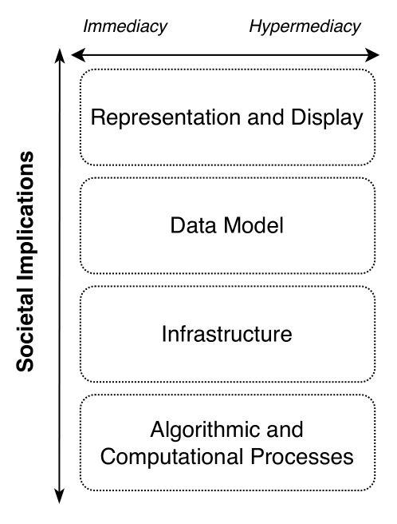
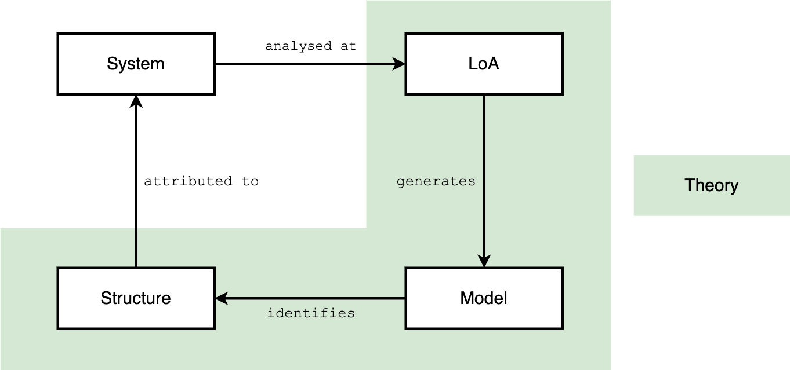

# 4. Exploring Relationships through an Actor-Network Theory Lens {id="cha:theoretical"}

> As Jim Clifford taught me, we need stories (and theories) that are just big enough to gather up the complexities and keep the edges open and greedy for surprising new and old connections. [@haraway_staying_2016 p. 101]

This chapter serves as the theoretical framework of the dissertation, and its primary goals are to elucidate the theoretical underpinnings and provide a comprehensive toolbox for addressing the identified problem. In the preceding literature review chapter, I highlighted the issue that necessitates attention around interlinking {{ "CH" | abbr | safe }}. The theoretical framework, sometimes referred to as the ‘toolbox’, which can be likened to ‘tools’ the that will be employed to understand and address this problem.

Here, the primary purpose of this chapter is to offer an in-depth exploration of the tools -- which comprises various theories, propositions, and concepts -- delineating their characteristics, behaviours, historical applications, interrelationships, relevance to the study's objectives, and potential limitations. Subsequently, the next chapter will elucidate how these tools will be operationalised in the research process.

The theoretical framework of this study is firmly rooted in {{ "ANT" | abbr | safe }}, which will be pursued systematically throughout the research. {{ "ANT" | abbr | safe }} is a constructivist approach that seeks to elucidate the fundamental dynamics of societies. Unlike traditional perspectives that restrict the concept of an ‘actor’ -- or ‘actant’ -- to individual humans, {{ "ANT" | abbr | safe }} expands this notion to encompass non-human and non-individual entities [see @callon_actor-network_1999; @callon_actor_2001; @latour_actor-network_1996; @latour_reassembling_2005].

{{ "ANT" | abbr | safe }} goes beyond the mere identification of actors and networks; it embodies a comprehensive methodology for exploring the intricate interplay of socio-technical systems. {{ "ANT" | abbr | safe }} distinguishes itself not only by recognising both human and non-human entities - from individuals and technological artefacts to organisations and standards - as actors (or actants), but also by examining their roles within heterogeneous networks of aligned interests. This approach facilitates a nuanced understanding of enrolment and translation processes, where diverse interests are aligned to form cohesive networks, and the concept of irreversibility, which describes the stabilisation of these networks over time. In addition, {{ "ANT" | abbr | safe }} introduces the concepts of black boxes and immutable mobiles, highlighting the persistent yet mobile nature of network elements such as software standards that transcend spatial and temporal boundaries [@lee_actor-network_1997 pp. 468-470]. These concepts are instrumental in dissecting the dynamics of {{ "IIIF" | abbr | safe }} and Linked Art specifications, which can be considered either full-fledged actors or immutable mobiles, depending on the context of the network under consideration. This dual perspective underscores {{ "ANT" | abbr | safe }}'s role as both a theoretical lens and a methodological tool, providing a robust framework for dissecting the fabric of socio-technical assemblages and enriching our understanding of {{ "DH" | abbr | safe }} and {{ "CH" | abbr | safe }} interconnections.

Additionally, the theoretical framework is enriched by integrating complementary perspectives from Donna Haraway's {{ "SK" | abbr | safe }}, Susan Leigh Star's {{ "BO" | abbr | safe }}, and Luciano Floridi's {{ "PI" | abbr | safe }}. Each of these frameworks contributes uniquely to our understanding of {{ "LOUD" | abbr | safe }} and its socio-technical landscape. Haraway's approach emphasises the contextually-embedded nature of knowledge, underscoring the importance of diverse perspectives in shaping our understanding of technological phenomena [see @haraway_situated_1988]. The concept of {{ "BO" | abbr | safe }} provides a framework for examining the role of {{ "LOUD" | abbr | safe }} technologies as mediators among varied groups, highlighting the importance of flexibility and adaptability in technological systems [see @star_institutional_1989; @star_this_2010]. Meanwhile, {{ "PI" | abbr | safe }} offers a foundational perspective, viewing information as an intrinsic part of the reality that shapes and is shaped by technologies [see @floridi_philosophy_2011]. Collectively, these theories complement the {{ "ANT" | abbr | safe }}-based approach by providing a multi-faceted understanding of the complexities inherent in {{ "LOUD" | abbr | safe }}, its technologies, and the communities involved.

This {{ "ANT" | abbr | safe }}-grounded toolbox is composed of three elements:

1.  Demonstrating how non-human entities exert agency.
2.  Identifying the human and non-human actors involved in these     processes.
3.  Investigating the concept of translation and the process by which a     network can be represented by a single entity.

For example, when considering the design of the {{ "PIA" | abbr | safe }} data model, a full-fledged actor in its own right, and more broadly for any {{ "KR" | abbr | safe }} system, pertinent questions arise about the influences exerted by the various groups of individuals involved in the process. These questions concern not only their interactions with each other but also their impact on the manifestation of the model and, consequently, how {{ "KR" | abbr | safe }}s can influence the various actors, both during its implementation and throughout its creation. In addition, the data model is composed of parts always bigger than the sum of their individual characteristics, as each part not only contributes to the overall functionality but also embodies a complex network of relationships and interactions. This viewpoint, inspired by @latour_whole_2012, asserts that in the realm of social connections, following Gabriel Tarde's monadological approach -- i.e., viewing each individual or element as a self-contained universe or 'monad' with its own unique properties and relations [see @tarde_social_2000] -- individual elements (such as stakeholders or data points) often carry more information and potential than what is apparent when they are viewed solely as components of a larger system. In this perspective, the complexity and richness of each individual element often surpasses the aggregate. Thus, the model, potentially acting as a boundary object when not aligned with standardised processes, serves as a site of negotiation and alignment among different stakeholders. As @haraway_staying_2016 [p. 104] poetically puts it, software could also be defined as *‘imploded entities, dense material semiotic “things”’*, a notion that underscores the entanglement of information, technology, and materiality.

This chapter is organised into four sections, corresponding to the three aforementioned aspects and an additional section focusing on the revised epistemological foundations.

First, [Section 4.1](#sec:implosion) explores the dissolution of rigid distinctions between human and non-human actors, emphasising the dynamic and interdependent nature of such relationships. This exploration is fundamental in understanding the broader implications of standards and community engagements in any field.

Then, [Section 4.2](#sec:collective) examines how collectives composed of differing actors can be assembled into a cohesive network where each entity's agency and influence are recognised. In this section, the concepts of quasi-object of {{ "BO" | abbr | safe }} are introduced to elucidate the role of shared objects and concepts in mediating and facilitating interactions among diverse groups within a network.

[Section 4.3](#sec:translation) investigates the translation process where actors negotiate, modify, influence, and align their interests and identities in the formation and maintenance of networks. Additionally, {{ "PI" | abbr | safe }}, particularly the {{ "SLMS" | abbr | safe }} approach, is introduced here to provide a structured understanding of how information and knowledge are conceptualised, managed, and communicated within these networks, offering a deeper insight into the dynamics of standard adoption and community interaction in collaborative efforts.

Finally, [Section 4.4](#sec:epistemo) revises the epistemological foundations to address the nuanced inquiries presented later in the empirical chapters. In this section, {{ "SK" | abbr | safe }} is introduced, emphasising the importance of context-specific and perspective-driven knowledge in shaping our understanding of technological and cultural phenomena. This concept, developed by Donna Haraway, advocates for a more critical and reflexive view of knowledge, recognising that all knowledge is situated within specific cultural, historical, and personal contexts. This approach challenges the notion of objective or universal knowledge, asserting that all understanding is partial, located, and contingent. The incorporation of {{ "SK" | abbr | safe }} is crucial for comprehending how different actors' perspectives and experiences influence the implementation and interpretation of {{ "LOUD" | abbr | safe }} standards. It helps in examining how these standards and community participation in {{ "IIIF" | abbr | safe }} and Linked Art are perceived and enacted differently across various social fabrics, particularly contrasting settings where these standards and communities are not engaged. Central to this discussion is the question, This question serves as a common thread, leading into the main research question: ‘How to situate Linked Open Usable Data and to what extent has {{ "LOUD" | abbr | safe }} shaped or will shape the perception of Linked Data in the broader context of cultural heritage and digital humanities’. Throughout these sections, {{ "ANT" | abbr | safe }} forms the underlying common thread, with the other theories augmenting and enriching this comprehensive theoretical framework.

Overall, the theoretical framework will be drawn upon to explore what @manovich_cultural_2017 [pp. 60-61] refers to as *‘everything and everybody’*. Borrowing from Haraway's concept of Tentacular Thinking, this approach recognises the interconnectedness and interdependence of all elements within the research scope, from the minutiae of technical details to the broader societal implications [see @haraway_tentacular_2016]. This comprehensive view is essential for addressing the detailed nuances of technical implementations, yet it is also crucial for understanding their wider societal implications, and for considering the multi-layered complexities involved in the implementation and perception of {{ "LOUD" | abbr | safe }}.

## 4.1 Implosion of the Boundaries: Non-humans have Agency {id="sec:implosion"} 

The @oxford_english_dictionary_agency_2023 assigns two primary sets of meanings to the term ‘agency’. The first pertains to *‘a person or organisation acting on behalf of another, or providing a particular service’*. The second, of greater relevance to this discussion, relates to an *‘action, capacity to act or exert power’*. This second definition is further elaborated as an *‘action or intervention producing a particular effect; means, instrumentality, mediation’*.

The concept of agency has been a central theme in various philosophical and sociological discourses. In ancient philosophy, both Plato and Aristotle contributed foundational ideas to the concept of agency, each offering distinct perspectives that have significantly influenced subsequent thought.

Plato, known for his theory of ideal forms, presented a dualistic view of reality, distinguishing between the world of forms (ideas) and the physical world. Within this framework, he saw agency as the soul's ability to recognise and conform to these ideal forms [@watson_free_1975 p. 209]. For Plato, true agency involved transcending the physical and sensory world and directing one's actions according to reason and intellect. This pursuit of knowledge and truth was seen as the highest form of agency, with actions aimed at realising eternal and immutable truths. Plato's vision of agency is closely tied to knowledge, virtue and the pursuit of the good, as seen in his portrayal of the philosopher-king in , who governs himself and the state with wisdom and insight [see @plato_republic_360bce].

Aristotle, Plato's student, offered a more practical and empirical approach. He incorporated agency into his broader ethical framework, placing emphasis on the ability to act virtuously and to make decisions in accordance with a *telos* or purpose. Aristotle regarded every action and choice as directed towards an end, and this teleological approach is key to understanding his concept of agency. Agency in Aristotle's philosophy is deeply intertwined with the notions of potentiality and actuality, where potentiality represents inherent capabilities and actuality is their realisation through action. This perspective reinforces the importance of rational deliberation, moral virtue, and the realisation of potentiality in human life. In addition, Aristotle emphasised the role of choice (*prohairesis*) and practical wisdom (*phronesis*) in guiding deliberate, rational and virtuous action [see @charles_aristotle_2017].

These ancient philosophical perspectives, with Plato's focus on reason and alignment with the ideal, and Aristotle's emphasis on practical wisdom and virtue, set the stage for later philosophical explorations of agency by modern thinkers such as David Hume (1711-1776), Immanuel Kant (1724-1804), and Georg Wilhelm Friedrich Hegel (1770-1831). In their perspectives, agency is understood as an individual's capacity to act in the world, based on intentionality and rationality [@pippin_idealism_1991]. Hume's empiricist approach saw agency as closely tied to the experiences and perceptions of the individual, underlining the role of personal choices and mental states [see @schier_hume_1986]. Kant's critical philosophy stressed the importance of autonomy and moral law in agency, which he understood as the capacity of individuals to act according to universal moral principles derived from reason. Hegel offered a more dialectical approach, seeing agency as part of a broader historical and social process in which the actions of the individual are interwoven with the unfolding of rational will in history. These classical views of agency focus primarily on human agents and their conscious, intentional actions.

In contrast to these traditional perspectives, the advent of {{ "ANT" | abbr | safe }} and the works of Bruno Latour, John Law, Madeleine Akrich, and Michel Callon, mark a significant shift. These academics argue for a more inclusive understanding of agency, where non-human entities --- ranging from technological artefacts to animals and even ideas --- can also be agents that influence and shape the course of social events. This perspective is a departure from the anthropocentric view of agency and opens up new ways of understanding social dynamics and networks.

The concept of the , as introduced by Algirdas Julien Greimas (1917-1992), is pivotal in this context. In Greimas' semiotic theory, an actant can be any entity, human or non-human, that contributes to the progress of a narrative. This concept significantly expands the traditional narrative framework established by Vladimir Propp (1895-1970), which focused mainly on human characters and their roles in folk tales. Propp's analysis focused on the actions and roles of these character types, which he categorised into a standardised framework. Greimas' approach to narratives, as referenced by @boullier_medialab_2018, emphasises the potential of any entity to play a role in a story, thereby expanding the narrative scope.

> The agency’s move is based on a well-known but seldom mentioned loan from Greimas’ 1966 semiotics. The concept of “actant” allowed the potential arrangement of any entity that populated the narratives to be aligned beyond Propp’s tradition. While Greimas’ formalism was certainly not preserved, the principle allowed for more open stories to be told and the concept of “allies” to be formalised, in particular, which extended the idea of “adjuvants” and “opponents” (without this being done from a strategic perspective, contrary to some interpretations). @boullier_medialab_2018

This idea of actant resonates strongly within {{ "ANT" | abbr | safe }}, as it aligns with the theory's aim to dissolve the strict dichotomy between human and non-human actors. In {{ "ANT" | abbr | safe }}, actants are not limited to individuals or even sentient beings; they include any entity that can affect or be affected by the network. This redefinition of agency through the lens of {{ "ANT" | abbr | safe }} and the concept of the actant is a cornerstone in understanding the complex, interconnected networks that constitute social and technological realms. It allows for a broader and more nuanced understanding of how various elements within a network interact and influence one another, regardless of their traditional classification as human or non-human.

{{ "ANT" | abbr | safe }} provides a radical redefinition of agency, challenging the modernist and post-modernist interpretations. It proposes an viewpoint [@latour_postmodern_1990], dissolving the dichotomy between human and non-human agency, and focusing on the network dynamics in a society where *‘contemporary
techno-science consist of intersections or “hybrids” of the human subject, language, and the external world of things, and these hybrids are as real as their constituent’* [@bolter_remediation_1999 p. 57]. Agency, in {{ "ANT" | abbr | safe }}, includes not just intentional actions but the capacity of any entity to affect or be affected in a relational network [@latour_actor-network_1996]. This expansive view of agency, influenced by the concept of the actant and informed by Greimas' semiotics, offers a more holistic understanding of actors within networks.

Adopting a Latourian approach, researchers such as anthropologists and sociologists are encouraged to observe the balance between human and non-human properties within networks. This balanced observation is crucial for a full understanding of the dynamics within these structures [@latour_we_1993 p. 96]. By acknowledging the agency of both human and non-human agents, and by recognising the blurred boundaries between subjects and objects, researchers can gain deeper insights into the complex interplay of forces that shape social realities.

## 4.2 Assembling the Collective {id="sec:collective"}

Following the exploration of agency in the previous section, the assembly of collectives is examined. This process involves identifying a myriad of actors, both human and non-human, and understanding how they coalesce into actor-networks. The assembly of such a collective, a differing cosmos of socio-technical agents, is predicated on the recognition of each actor's unique agency and the dynamic interplay of relationships that bind them together.

The transformation challenges of tools for {{ "DH" | abbr | safe }} and object knowledge, as discussed by @camus_digital_2013, highlight the complexities involved in integrating {{ "DH" | abbr | safe }} with traditional scholarly practices. The author emphasises the need for a nuanced approach to the digitisation and dissemination of {{ "CH" | abbr | safe }} resources, underscoring the pivotal role of collaborative efforts in bridging the gap between technology and humanities scholarship. This analysis aligns with the {{ "ANT" | abbr | safe }} perspective, which advocates for recognising the contributions of diverse actors within the wider {{ "DH" | abbr | safe }} ecosystem.

Within the {{ "LOUD" | abbr | safe }} ecosystem, a diverse set of actors comprises individual contributors, institutions, and several groups and committees, each with its own set of objectives. This ensemble also includes specifications and compatible software that facilitate interoperability, as well as end users. Interestingly, the majority of these end users remain unaware --- whether through seamless integration or simply because their interaction does not require conscious recognition --- that their digital interactions are often mediated by or compliant with {{ "LOUD" | abbr | safe }} standards. This diversity underscores the importance of understanding how different actors, their objectives, and their contributions shape the development and adoption of {{ "LOUD" | abbr | safe }} specifications and practices.

Transitioning from the depiction of the {{ "LOUD" | abbr | safe }} ecosystem's varied participants, the concept put forth by @gandon_web_2019 for an envisioned web architecture introduces a composed of diverse natural intelligences -- such as humans, connected animals and plants -- and artificial intelligences, including entities capable of reasoning and learning. This shift marks a deeper recognition of the layered interactions that form the backbone of digital platforms, and points to a future where technology adapts to embrace a wider range of intelligences within the structure of the web.

Classifying these diverse actors involves understanding their roles and interactions within the network. Quasi-objects and {{ "BO" | abbr | safe }}s provide frameworks for this classification, enabling a nuanced understanding of the socio-technical assemblage and facilitating communication among its varied components.

The foundation established by {{ "ANT" | abbr | safe }}, incorporating the concept of from @serres_parasite_2014 challenges traditional categorisations by embodying characteristics of both subjects and objects. This conceptual framework is crucial for appreciating how non-human entities can exhibit agency and actively participate in social networks, thus broadening our understanding of actor-network dynamics.

Quasi-objects, existing in a state of flux and embodying characteristics of both subjects and objects, challenge our conventional understanding of agency. Concurrently, the concept of {{ "BO" | abbr | safe }}s is introduced, enriching the {{ "ANT" | abbr | safe }}-grounded toolbox by highlighting the role of shared objects and concepts in mediating and facilitating interactions among diverse groups within the network. Unlike quasi-objects, which symbolise a hybrid state between subjectivity and objectivity, {{ "BO" | abbr | safe }}s focus on interaction and communication. They are crucial in collaborative efforts, especially in diverse and interdisciplinary settings, by maintaining a common identity across various contexts while being interpreted differently in each. Understanding the distinction and the interplay between quasi-objects and {{ "BO" | abbr | safe }}s is vital for comprehending the dynamics of actor-networks. The introduction of {{ "BO" | abbr | safe }} in this section elucidates their role in mediating complex socio-technical interactions, highlighting the importance of {{ "BO" | abbr | safe }} in community-based initiatives and their broader impact. Star's reflection on {{ "BO" | abbr | safe }}s underscores their significance:

> Boundary objects are objects which are both plastic enough to adapt to local needs and constraints of the several parties employing them, yet robust enough to maintain a common identity across sites. They are weakly structured in common use, and become strongly structured in individual-site use. They may be abstract or concrete. They have different meanings in different social worlds but their structure is common enough to more than one world to make them recognizable, a means of translation. The creation and management of boundary objects is key in developing and maintaining coherence across intersecting social worlds [@star_ethnography_1999 p. 393]

The relevance of {{ "BO" | abbr | safe }} extends to the restructuring of residual categories through cycles of standardisation attempts that create said boundary objects as illustrated in [Figure 4.1](#fig:bo-residual). This cycle emphasises the negotiation and alignment among different stakeholders, underscoring the adaptive and flexible nature of {{ "BO" | abbr | safe }} in managing the complexities of standardisation and the varied interpretations across social worlds [see @star_this_2010].

<figure id="fig:bo-residual" style="text-align: center;">
  
  <figcaption>
    <strong>Figure 4.1:</strong> Relationships Between Residual Categories, BOs, and 
    Standardisation Attempts. Adapted from @star_this_2010
  </figcaption>
</figure>

The integration of concepts such as quasi-objects and {{ "BO" | abbr | safe }}s within the {{ "ANT" | abbr | safe }}-based toolbox necessitates a reevaluation of existing ontological frameworks. This shift leads to a more interconnected understanding of societal dynamics, recognising the central role of diverse actors in forming networks.

The adoption of these concepts in {{ "ANT" | abbr | safe }} requires a re-evaluation of existing ontologies. This re-evaluation involves redefining our understanding of agency, action and influence to include a wide range of actors, both human and non-human. This approach leads to a more nuanced and interconnected understanding of society, where traditional boundaries between different types of actors are actively re-imagined. In this way, {{ "ANT" | abbr | safe }} argues for a network-like ontology and social theory that can fully integrate the influence and interactions of disparate actors within society [@latour_actor-network_1996 p. 370].

In engaging with the complexities of assembling the collective, we encounter the necessity to cease replicating the , as discussed by @derrida_mal_2008. This principle, which dictates the preservation and accumulation of knowledge under a single authority or location, is challenged by the fluid and distributed nature of {{ "ANT" | abbr | safe }}'s networks. Derrida's critique invites a rethinking of how knowledge and information are curated and disseminated, echoing the {{ "ANT" | abbr | safe }} perspective that stresses the distributed, multifaceted interactions of actors within a network. The dialogue with Derrida's deconstruction of the archive complements the {{ "ANT" | abbr | safe }} approach by advocating a more open, inclusive understanding of how socio-technical collectives are formed and maintained.

For instance, the examination of {{ "BO" | abbr | safe }}s in the context of queer identities illustrates the potential of these concepts to challenge and redefine traditional typologies, offering new perspectives on identity and community formation within socio-technical networks [see @junginger_categorizing_2021].

Having assembled our collective and identified the diverse actor-networks, the focus shifts to exploring the relationships and communication mechanisms among them. This exploration, conducted in the subsequent section, is crucial for understanding how different actors -- ranging from quasi-objects to boundary objects -- contribute to and shape the collective narrative and functionality of a given network.

## 4.3 The Translation Process {id="sec:translation"}

The translation process within {{ "ANT" | abbr | safe }} refers to the dynamics of establishing associations and networks among diverse actors. Latour describes translation as a specialised relation that transforms mediators into coexistent entities without directly transferring causality. This concept underscores the complexity of interactions within networks, emphasising the creation and maintenance of associations that extend beyond mere causal relationships.

> [The] word “translation” now takes on a somewhat specialised meaning: a relation that does not transport causality but induces two mediators into coexisting [@latour_reassembling_2005 p. 119]

Associations within {{ "ANT" | abbr | safe }} evolve continuously, demonstrating the ongoing and emergent nature of actor-networks. They materialise through the interactions and negotiations among actors. This perspective broadens the understanding of networks by stressing their fluid nature.

Understanding the dynamics of actor-networks requires an exploration of the ways in which actors influence each other. This is especially important in order to capture the nuanced roles and interactions within these networks. A key contribution in this area has been made by Latour, who suggests a compelling structure for disentangling these interactions as ‘mediation’. Latour's conceptualisation is particularly insightful in that it breaks down the nature of influence into distinct yet interrelated processes. The essence of his argument can be summarised as follows:

> This capacity of actors to influence each other was defined by @latour_reassembling_2005 as mediation, further broken down into four types: interference, composition, black boxing, and delegation. Interference appears when one actor interferes with the goal of another. In composition, the actors influence the common goal of the network together. Black-boxing is when gradual complexification of actors (and their interrelations) reaches a point where treating the constellation as a single actor becomes more meaningful, and delegation is when meaning and expression is delegated to non-human objects.  [@czahajda_live_2022 p. 3]

In the context of the {{ "LOUD" | abbr | safe }} space, treating a constellation of actors necessitates a focus on delegation, a process pivotal for understanding how meanings and functions are assigned within networks. This emphasis on delegation underscores the necessity of expanding our epistemological horizons to encompass {{ "PI" | abbr | safe }}. Integrating {{ "PI" | abbr | safe }} offers a comprehensive framework for analysing how information not only mediates relationships within these networks but also influences the reality of digital ecosystems. Such an expanded perspective is essential for a thorough understanding of the dynamics within the {{ "LOUD" | abbr | safe }} ecosystem and its broader implications.

{{ "PI" | abbr | safe }} is conceived as a groundbreaking approach that examines the nature and dynamics of information. It explores how information fundamentally structures reality and thereby shapes the entities within it, termed or informational organisms. These entities are embedded in information environments where they engage and interact in a vast information ecosystem. @floridi_information_2010's work illuminates the ways in which information underpins and transforms our understanding of reality, and suggests that living in the information age means recognising our role and identity as part of a complex, interconnected informational world. This perspective invites a deeper reflection on the implications of living in the midst of vast information networks, and urges a re-evaluation of how information influences human identity, society and our wider interaction with the digital and natural worlds.

Diving deeper into Floridi's {{ "PI" | abbr | safe }}, the {{ "LoA" | abbr | safe }} concept emerges as a critical tool for dissecting the intricacies of complex computational systems, including {{ "LOUD" | abbr | safe }}-compliant ecosystems. This approach, fundamental to {{ "PI" | abbr | safe }} [@ganascia_abstraction_2015], aids in navigating the multifaceted layers and perspectives inherent in these systems [@angius_philosophy_2021], particularly those structured around client-server architectures. {{ "LoA" | abbr | safe }} provide a structured way to analyse and understand complex systems by breaking them down into different layers or perspectives. Each level focuses on specific aspects of the system, allowing for a clearer analysis of its components and their interactions. By advocating for a separation of concerns, the {{ "LoA" | abbr | safe }} framework equips us with a strategic method to manage and simplify complexity, enabling a focused examination of distinct abstraction levels within digital ecosystems [@van_leeuwen_floridis_2014].

Building on the foundation laid by Floridi's {{ "LoA" | abbr | safe }}, @selbst_fairness_2019 critique the fair {{ "ML" | abbr | safe }} field's reliance on abstraction and modular design for achieving fairness, identifying five abstraction traps that highlight the challenges of applying computational interventions to societal contexts without considering the interplay between social context and technical systems. This critique underscores the relevance of incorporating a socio-technical perspective in this thesis, emphasising the need to make use of {{ "STS" | abbr | safe }} methodologies in the design process to avoid these abstraction traps.

Considering the insights from @selbst_fairness_2019, this thesis will explore four levels of {{ "LoA" | abbr | safe }} and one transversal dimension within {{ "LOUD" | abbr | safe }} ecosystems, acknowledging that each can act as its own actor-network or collectively form a singular network. These levels, from low to higher abstraction, include Algorithmic and Computational Processes, Infrastructure, Data Model, and Representation and Display. Societal implications, integrated across all levels, will address the broader cultural and social impacts.

- **Algorithmic and Computational Processes**:   This level explores the specific algorithms, such as image     conversion scripts or sorting algorithms, and computational     frameworks leveraged within the {{ "LOUD" | abbr | safe }} ecosystem. For example, analysing how     a recommendation algorithm influences the accessibility of digital     resources.
- **Infrastructure**:   It focuses on the servers, cloud-based services, and micro-services     that support the ecosystem. This includes assessing the deployment     of server architectures that facilitate scalable data storage and     retrieval, like using Amazon Web service or GitHub Pages for hosting     {{ "LOUD" | abbr | safe }} data.
- **Data Model**:   It covers the organisation and structuring of data, including     metadata standards and {{ "LOUD" | abbr | safe }} specifications. An example would be     examining how {{ "CIDOC-CRM" | abbr | safe }} is used in Linked Art.
- **Representation and Display**:   This level not only encompasses the     {{ "JSON-LD" | abbr | safe }}     outputs for effective data sharing and interlinking but also focuses     on how users see and interact with {{ "LOUD" | abbr | safe }} representations across different     platforms -- browsers, viewers, and players. It examines the     {{ "GUI" | abbr | safe }} that make     digital collections accessible and engaging. For example, how a     virtual gallery allows users to explore a digital exhibit.

In the exploration of {{ "LOUD" | abbr | safe }} ecosystems, the concepts of ‘immediacy’ and ‘hypermediacy’, as delineated by @bolter_remediation_1999, provide additional insightful perspectives on the role of interfaces as {{ "LoA" | abbr | safe }}. Immediacy refers to the design of interfaces that aim to create a seamless, transparent {{ "UX" | abbr | safe }}, making the technology invisible and allowing for direct interaction with the content. This is evident in interfaces such as {{ "OSD" | abbr | safe }}, which displays high-resolution images and strives to provide a smooth and immersive viewing experience by minimising the perceptibility of the {{ "API" | abbr | safe }}-compliant resource. On the other hand, hypermediacy emphasises the presence and visibility of the medium, drawing attention to the various forms of mediation. Interfaces embodying hypermediacy offer a multi-layered, heterogeneous presentation, making users aware of the different media elements and their interactions, e.g. Exhibit for storytelling purposes. This duality enriches the user's digital encounter, underscoring the need for {{ "LOUD" | abbr | safe }}-compliant tools and services to mediate these experiences effectively. By embracing these concepts, the framework can strategically leverage interfaces to either conceal or reveal the intricacies of the digital medium, facilitating a nuanced engagement with information ecosystems. [Figure 4.2](#fig:LoA-LOUD) presents a comprehensive view of the {{ "LOUD" | abbr | safe }} ecosystem's {{ "LoA" | abbr | safe }}, enriched by the inclusion of societal implications as a cross-cutting dimension and the incorporation of immediacy and hypermediacy as critical concepts at the representation and display level for understanding user interaction and interface design.

<figure id="fig:LoA-LOUD" style="text-align: center;">
  
  <figcaption>
    <strong>Figure 4.2:</strong> Exploring Levels of Abstraction in LOUD Ecosystems: Integrating Societal
    Implications with the Concepts of Immediacy and Hypermediacy
  </figcaption>
</figure>

The {{ "SLMS" | abbr | safe }} scheme, which includes a framework for each identified {{ "LoA" | abbr | safe }}, equips this research with a comprehensive lens for analysing computational systems, revealing how they can be effectively combined with {{ "ANT" | abbr | safe }}. This methodology, as depicted in [Figure 4.3](#fig:slms), enriches the exploration of digital ecosystems. This combination offers a unique perspective on understanding the interplay between computational entities and the broader networks they inhabit. The {{ "SLMS" | abbr | safe }} scheme can be summarised as follows:

- **System**:   This refers to any entity or collection of entities that can be     studied. It could be anything from a physical object, a biological     entity, to a social or computational system.
- **{{ "LoA" | abbr | safe }}**:   Floridi emphasises the importance of levels of abstraction in     understanding and analysing systems. A level of abstraction is a way     of observing a system, focusing on certain aspects while ignoring     others. It's a conceptual framework or lens through which we can     understand complex systems.
- **Model**:   At each level of abstraction, we create models of the system. These     models are simplifications or representations of the system that     highlight certain features while omitting others, based on the     chosen level of abstraction.
- **Structure**:   This refers to the organisation or arrangement of the components     within the system, as understood or represented at a given level of     abstraction.

<figure id="fig:slms" style="text-align: center;">
  
  <figcaption>
    <strong>Figure 4.3:</strong> The SLMS According to [@floridi_method_2008]
  </figcaption>
</figure>

@gobbo_what_2016 expand on the {{ "SLMS" | abbr | safe }} scheme by highlighting the challenges and intricacies of quantifying and qualifying computational information. They advocate for a comprehensive methodology that appreciates both the physical and conceptual dimensions of data, facilitating a deeper understanding of programmable artefacts and their informational content. This perspective not only complements the analytical capabilities of {{ "ANT" | abbr | safe }} but also opens new avenues for investigating the dynamics of information and technology.

As I venture to revise the epistemological foundations and introduce Haraway's concept of {{ "SK" | abbr | safe }}, it becomes increasingly manifest that the integration of {{ "ANT" | abbr | safe }} with Floridi's {{ "PI" | abbr | safe }} and the insights of computational information theory provides a robust framework for exploring the complexities of digital and networked environments. This interdisciplinary approach lays the groundwork for a comprehensive exploration of the digital world, emphasising the importance of situated, contextual knowledge in understanding and navigating the digital landscape.

## 4.4 Epistemological Foundations {id="sec:epistemo"}

This section establishes the epistemological foundations, presenting {{ "ANT" | abbr | safe }}, {{ "BO" | abbr | safe }}, and {{ "PI" | abbr | safe }}, alongside Donna Haraway's {{ "SK" | abbr | safe }}. Rather than synthesising these theories, this chapter places an emphasis on situating {{ "LOUD" | abbr | safe }} within a feminist perspective to construct a new materialistic foundation reminiscent of Haraway's ‘alignment in tentacular worlding’ [@haraway_staying_2016 p. 42]. This assemblage seeks to navigate the controversies and mappings within {{ "LOUD" | abbr | safe }}-like communities, applying a Tardian approach to trace the spreadability of ideas @latour_whole_2012.

To analyse the relevant actor-networks effectively, especially being part of both the {{ "IIIF" | abbr | safe }} and Linked Art communities, a particular lens is required. {{ "ANT" | abbr | safe }}, while expansive, has faced criticism for its perceived flatness in analysing networks. Here, Haraway's {{ "SK" | abbr | safe }} becomes instrumental, providing a stance that enriches the {{ "ANT" | abbr | safe }}-grounded theoretical framework with a comprehensive lens that prioritises context in shaping knowledge. {{ "SK" | abbr | safe }} emphasises that knowledge is always situated, partial, and contextually produced, offering a critical perspective on determining relevance within networks. {{ "SK" | abbr | safe }} complements {{ "ANT" | abbr | safe }} by adding depth to the analysis of actor-networks. It highlights the significance of context -- both human and non-human -- in the production of knowledge, thereby enriching the theoretical framework with a nuanced lens for exploring the dynamics within the {{ "LOUD" | abbr | safe }} space.

{{ "SK" | abbr | safe }}, as articulated by @haraway_situated_1988, emphasises the contextual nature of knowledge and challenges the pursuit of an objective, universal truth divorced from the position of the knower. Haraway's framework, which integrates standpoint theory, concedes that knowledge is inherently shaped by its social, cultural and historical context, and supports an understanding of knowledge as partial and situated. This approach, noting the influence of epistemological privilege and intersectionality, argues against universalism by stressing the importance of being conscious of the specific perspectives and biases that inform one's understanding. The relevance of {{ "SK" | abbr | safe }} to {{ "ANT" | abbr | safe }} lies in its complementary perspective of acknowledging the diverse, context-specific factors that influence knowledge production within networks, enriching {{ "ANT" | abbr | safe }}'s analysis of actor-networks by incorporating a critical, reflexive lens on the situatedness of knowledge.

In forging this theoretical framework, I seek to transcend the notion of merely ‘cobbling together’ disparate ideas. Instead, I aim to weave their contributions into a coherent web of thought, ensuring a seamless and comprehensive framework that embodies the essence of their respective insights, one that transcends disciplinary boundaries. The theoretical framework can be synthesised as follows, elegantly interweaving distinct yet complementary perspectives to enrich our understanding of socio-technical ecosystems:

- {{ "SK" | abbr | safe }}, by     advocating for an understanding of knowledge as inherently partial     and situated, complements {{ "ANT" | abbr | safe }} by adding depth to the analysis of     actor-networks. It enriches the theoretical framework with a nuanced     lens for exploring the dynamics within the     {{ "LOUD" | abbr | safe }} space.
- {{ "BO" | abbr | safe }} further     refine this framework by offering a means to characterise actors and     mediate interactions within the network, facilitating connectivity     and translation among diverse groups.
- {{ "PI" | abbr | safe }} enriches     {{ "ANT" | abbr | safe }} by framing     information as a fundamental element in actor-network interactions.     It offers insights into the different {{ "LoA" | abbr | safe }}, or different actor-networks, each     with a different perspective or granularity, and how information is     created, shared, and used, and how these processes influence the     relationships and dynamics within networks.

[Figure 4.4](#fig:sympoiesis) illustrates how these theories intertwine to form the epistemological foundation of this research, demonstrating the synergistic potential of combining {{ "ANT" | abbr | safe }} with {{ "SK" | abbr | safe }}, {{ "BO" | abbr | safe }}, and {{ "PI" | abbr | safe }} to navigate the complexities of digital ecosystems in the {{ "CH" | abbr | safe }} field.

<figure id="fig:sympoiesis" style="text-align: center;">
  
  <figcaption>
    <strong>Figure 4.4:</strong> A Sympoiesis of Theories: 
    ANT Entangled with SK, BO, and PI
  </figcaption>
</figure>

Concluding this chapter, the developed toolbox lays a coherent foundation for empirical research, poised to explore the dynamics within actor-networks. This exploration is not entirely novel in the context of {{ "CH" | abbr | safe }}, as exemplified by @guillem_faire_2023's use of {{ "ANT" | abbr | safe }} to spotlight the keystones that were destroyed by the fire at Notre-Dame de Paris. As this narrative unfolds into [Chapter 5](#cha:scope), the {{ "ANT" | abbr | safe }}-based toolbox, enriched with amodern and feminist perspectives, will be instrumental in navigating the forthcoming empirical landscapes.
