# 5. Research Scope and Methodology {id="cha:scope"}

This chapter delineates the Research Scope and Methodology, laying the groundwork for the empirical exploration within this thesis.

Structured into five key sections, this chapter outlines the methodological framework adopted to explore the purposes of the research and specifies the systematic approach used to consider the outcomes. It initiates with the presentation of research questions in [Section 5.1](#sec:rq) and hypotheses in [Section 5.2](#sec:hyp) that are crucial for evaluating LOUD within the CH context. Following this, [Section 5.3](#sec:obj) details the objectives aimed to be achieved based on the research findings. The methodology, elaborated in [Section 5.4](#sec:methodo), encompasses the research methods, data creation, collection, curation, modelling, analysis, alongside considerations of limitations and ethics. The final section, [5.5](#sec:contribution-dh), defines some of the scholarly implications of the thesis, highlighting its substantial contributions to DH and the broader field of the humanities. This discourse encapsulates the implications of the research, affirming its value and positioning within the scholarly community.

Throughout this thesis, the two pivotal perspectives, *Community Practices* and *Semantic Interoperability*, serve as threads interwoven across chapters. While certain research questions, hypotheses, and objectives are specifically aligned with one perspective, others bridge both, showcasing their interconnected relevance.

## 5.1 Research Questions {id="sec:rq"}

Within this thesis, the primary research question seeks to critically evaluate the role and impact of LOUD, exploring how it influences and integrates within the fields of CH and DH. This research seeks, in part, to uncover the depth of LOUD's contribution to these disciplines, and to explore its potential to reshape the perception and use of Linked Data. Framing the central inquiry of this investigation, the primary research question is articulated as follows:

*How can the concept of Linked Open Usable Data be situated within the broader framework of cultural heritage and digital humanities, and to what extent has it influenced -- or is likely to influence -- the perception and use of Linked Data in these fields?*

In order to explore this overarching question, three specific research questions have been formulated to probe deeper into the socio-technical dynamics of LOUD:

- RQ01:   What are the socio-technical requirements for developing     specifications in line with the LOUD design principles?
- RQ02:   How does the implementation of LOUD standards within the     PIA research     project contribute to understanding their potential benefits and     limitations in terms of facilitating data reuse and broader     participation?
- RQ03:   What are the implementation strategies, challenges and outcomes of     Yale's large-scale deployment of LOUD standards, and how does ensuring the     consistency of Linked Art and IIIF resources within the LUX platform     contribute to the CH domain?

These questions collectively aim to illuminate the multifaceted implications of LOUD, paving the way for a nuanced understanding of its benefits and challenges. The subsequent section will transition into the hypotheses derived from these research inquiries, further delineating the expected insights and contributions of this investigation.

## 5.2 Hypotheses {id="sec:hyp"}

Transitioning from the research questions, this section posits a main assumption based on the expectation that LOUD design principles, being grassroots-driven and based on consensus and transparency, will foster greater acceptance within CH and DH fields. Despite the nascent recognition of LOUD as a distinct entity and its perception as a technical utility rather than part of a broader socio-technical ecosystem, these hypotheses aim to explore the multifaceted impacts of LOUD standards on these disciplines.

The hypotheses outlined below seek to elucidate the dynamics and potential outcomes identified in the research questions:

- HYP01:   Grassroots initiatives to establish functional communities take     significant commitment from all sides and are frequently developed     slowly since the majority of those participating or interested can     only be extensively committed for brief periods of time. However,     the efforts undertaken within these initiatives, such as the     development of LOUD-compatible standards, are generally     successful in the medium to long term.
- HYP02:   The PIA     research project's implementation of LOUD standards, leveraging shared     APIs such as the     IIIF and     Linked Art specifications, will shed light on the potential benefits     and limitations of these standards in facilitating data reuse and     wider participation in the context of CH and DH. We anticipate that digital     infrastructures using LOUD standards should be able to improve     the long-term accessibility and re-usability of     CH data, thereby     encouraging active participation and engagement by diverse user     communities.
- HYP03: The research aims to demonstrate that Yale's large-scale     implementation of LOUD standards involves a variety of     practices. It is expected that while LOUD standards such as the     IIIF     APIs have become     more accessible for implementation, challenges remain due to     specific skills and resource constraints within     CHIs. It also     aims to showcase how overcoming these challenges and ensuring the     consistency of Linked Art and IIIF resources within the LUX platform     contributes significantly to the advancement of shared processes and     accessibility within the CH domain, ultimately facilitating more     widespread and effective use of CH data.

In summary, these hypotheses underpin the aim of the thesis to examine the influence and operationalisation of LOUD, setting the stage for a detailed exploration of the objectives in the following section.

## 5.3 Objectives {id="sec:obj"}

This section aims to define the concrete objectives that guide the empirical exploration of LOUD. Through leveraging ANT epistemological foundations, these objectives are crafted to dissect various aspects of LOUD's integration, adoption, and impact. Each objective targets a specific dimension, from community consensus and participation to the practical implementation within PIA and evaluation of LOUD standards in Yale. More specifically, five objectives have been identified. They do not maintain a 1:1 relationship with what was being presented earlier as two objectives are linked for the first and the third hypothesis and research question.

- OBJ01.1:   Analysing consensus building and advocacy initiatives across the     IIIF and     Linked Art communities
- OBJ01.2: Examining community participation, the evolutionary adoption of     LOUD standards     and their potential with regard to scientific movements and     principles
- OBJ02: Implementing and evaluating LOUD standards in an explorative setting
- OBJ03.1: Reporting how Yale has rolled out LOUD standards on a large scale
- OBJ03.2: Verifying Linked Art and IIIF consistency across the LUX platform

These objectives are explored extensively in three empirical chapters, offering a detailed insight into the operationalisation and impact of LOUD standards. In the following section, the methodology used to achieve these objectives is discussed in greater detail.

## 5.4 Methodology {id="sec:methodo"}

This section is designed to rigorously address several pivotal questions that underpin the research approach, reflecting on the epistemological and ontological stances guiding this study. It explores the selection and application of data collection tools, detailing their relevance and the implications of their use, alongside the timing and demographic details of data collection. This section also looks at the analytical tools used, discussing their significance, implications and any ethical considerations that arose.

The methodology of this research is streamlined into three parts. This consolidation provides a holistic overview, starting with an outline of the research methods presented in each of the empirical chapters in [5.4.1](#subsec:outline), through a combined exploration of data creation, collection, curation and modelling, to an examination of data analysis. The section concludes by addressing the overall limitations and ethical considerations of the research in [5.4.2](#subsec:overall-limitations) and [5.4.3](#subsec:ethical-considerations), ensuring a careful and ethically sound approach to the study of LOUD.

### 5.4.1 Outline of the Research Methods {id="subsec:outline"}

This subsection clarifies the multifaceted approach to data collection, creation, curation, modelling and analysis that is central to the empirical chapters that follow. By interweaving quantitative and qualitative methods, this research not only navigates the landscapes of cultural processes, but also bridges the micro-macro divide in the study of cultural constellations. Each empirical pursuit is dissected in detail, spotlighting the ways and means used to unveil the underlying dynamics at play.

At its core, this thesis seeks to unravel the intricate web of cultural processes and constellations through a lens that is both micro in perspective and rich in empirical evidence. It emphasises an actor and practice-centred inquiry, as articulated by @bischoff_historische_2014 [p. 160]. This study aligns with such a perspective, aiming to dissect and understand cultural phenomena through a detailed examination of specific cosmologies, like those of LOUD-driven communities, the PIA research project, and Yale's LUX.

The attempt to understand a particular cosmology requires immersion in the practices and dynamics of the communities at its heart. Inspired by @latour_laboratory_1986, this research situates itself within the vibrant ecosystems of the IIIF and Linked Art communities. As an active participant, the research reflects the intricacies of a laboratory where the fusion of practices unfolds, providing a rich tapestry of insights into the research objectives.

Embracing the role of a ‘praxiographer’ [^228], in the vein of @mol_body_2002, this exploration goes beyond mere observation. It addresses the ‘doing’ of research, emphasising the situated, embodied practices that shape knowledge production. This praxiographic lens foregrounds the complex, often tacit, processes through which the communities' cosmologies are enacted and understood. It acknowledges that these practices are not just observed but are actively participated in, thereby crafting a nuanced narrative of the research landscape. This approach aligns with Mol's advocacy for a more embodied and engaged form of inquiry, one that recognises the researcher as an integral component of the knowledge ecosystem, contributing to and being shaped by the evolving dynamics of community practices.

Recognising the transformative potential of digital methods, this study echoes @venturini_social_2009's call as well for a paradigm shift. It emphasises the need to fuse digital tools and data with traditional approaches, thereby enriching micro-analyses of interactions with insights into broader macro-structures. This not only challenges existing methodologies, but also invites a reappraisal of the dichotomies that have long governed the social sciences and humanities at large, and argues for a deeper engagement with the complexities of the digital sphere.

As outlined in [Table 5.1](#tab:research-axes), the empirical chapters are meticulously aligned with the research's overarching axes, offering a panoramic view of the questions, hypotheses, and objectives steering this inquiry. This segmentation underscores the nuanced exploration of community practices, semantic interoperability, and their intersections, paving the way for a comprehensive understanding of the cultural and technological fabrics under investigation.

<figure id="tab:research-axes" style="text-align: center;">
 <figcaption><strong>Table 5.1</strong>: Empirical Chapters: Research Axes and Scope Overview</figcaption>
<table style="margin: 1em auto;">
<thead>
<tr>
<th><strong>Chapter</strong></th>
<th><strong>Empirical Research</strong></th>
<th><strong>Community Practices</strong></th>
<th><strong>Semantic Inter-operability</strong></th>
<th><strong>Research Scope</strong></th>
</tr>
</thead>
<tbody>
<tr>
<td>Chapter 6</td>
<td>Assessment of Practices in IIIF and Linked Art Communities</td>
<td>YES</td>
<td>To some extent</td>
<td>RQ01/HYP01 – OBJ01.1, OBJ01.2</td>
</tr>
<tr>
<td>Chapter 7</td>
<td>Deployment of LOUD within PIA</td>
<td>To some extent</td>
<td>YES</td>
<td>RQ02/HYP02 – OBJ02</td>
</tr>
<tr>
<td>Chapter 8</td>
<td>Review of a Large-Scale LOUD Implementation and Data Consistency within LUX</td>
<td>YES</td>
<td>YES</td>
<td>RQ03/HYP03 – OBJ03.1, OBJ03.2</td>
</tr>
</tbody>
</table>
</figure>

Embarking on this research journey requires a versatile approach that encompasses data creation, collection, curation, modelling and analysis. This approach not only ensures a robust empirical foundation, but also fosters a dynamic interaction with the data, allowing new insights and perspectives to emerge. The following narrative will explore these dimensions, highlighting the central role of each in shaping the contours of this scholarly enterprise. Through this lens, the research not only contributes to academic discourse, but also navigates the challenges and opportunities presented by LOUD in the CH field.

- **Data Creation and Collection**:   This includes an in-depth look at the types of data collected from     different sources and the strategies adopted to create either new     datasets or workflows. The process combines the collection of     existing data relevant to the analysis of     LOUD     ecosystems and the creation of new datasets to explore     under-researched areas, thereby ensuring a strong empirical base for     the study.
- **Data Curation and Modelling**:   Data curation is essential for ensuring data integrity and     usability, which are essential for reliable analysis and improved     user satisfaction. This process involves the rigorous management of     data, including essential components such as data cleansing,     matching and conversion, to ensure that data remains accurate,     accessible and meaningful for its intended use. Furthermore, data     modelling is characterised as a rich process involving the     definition of domain ontologies, the schema mapping, and the     transformation of data into semantic graphs. This process is crucial     for the effective integration and interpretation of data     [@ciula_modelling_2016; @fafalios_workflow_2023].     @andraschke_virtuelle_2020 [p. 132] emphasises the crucial role of     data modelling in facilitating insightful interpretations of reality     and extending datasets for more in-depth analysis. In addition,     @meunier_humanites_2017 [pp. 40-42] highlights the widespread     application of (conceptual) modelling within DH, stressing its necessity, stemming     from the semiotic complexity of the field's diverse subjects, which     conceptual modelling skilfully navigates, thus enabling a deeper     understanding and exploration of interdisciplinary domains.
- **Data Analysis**:   Drawing on @bischoff_historische_2014 [p. 163], it emphasises the     necessity of critical source evaluation through consistent criticism     and heuristic classification, transforming historical fragments into     meaningful sources by posing insightful inquiries. This foundational     approach underscores the importance of evaluating sources within     their historical and heuristic contexts, ensuring that the data     analysis remains grounded in a comprehensive understanding of the     source material. Incorporating the reflective process of considering     the researcher's own position, as advised by historical ethnography,     enriches the data analysis further. This methodology serves a dual     purpose: it acts as an epistemological guide for achieving a dense     description of actors, practices, and situations, and it aids in the     reflection of the research process itself by acknowledging the     researcher's situated knowledge [@bischoff_historische_2014 p.     164-165]. Such an approach not only deepens the cognitive objectives     of the research but also enhances the transparency and reflexivity     of the analytical process.
- **Research Outcomes**:   This research aims to produce a range of outputs, from raw data to     highly structured analyses. These outcomes are intended to serve not     only as a testament to the empirical rigour applied, but also as a     beacon for further scholarly inquiry. Raw outputs provide unmediated     insights into the data collection and generation processes, while     more structured outputs will provide deep dives into the nuances of     LOUD     ecosystems, underpinned by robust data curation, modelling and     comprehensive analysis.

In the following three parts (sub-subsections [5.4.1.1](#subsubsec:outline-chap1), [5.4.1.2](#subsubsec:outline-chap2), and [5.4.1.3](#subsubsec:outline-chap3)), dealing with the empirical research, a diagram is provided to illustrate the process from data collection or generation to the results that will be explored in later chapters. [Figure 5.1](#fig:scope-template) provides a visual template detailing the specific shapes and colours used to represent different stages and components of the research process. This schematic representation helps to fully understand the progression from initial data gathering to the analytical findings that form the basis of subsequent discussions.

<figure id="fig:scope-template" style="margin: 0 auto; text-align: center;">
 
<figcaption>
<strong>Figure 5.1</strong>:
 Research Outline Visual Template
</figcaption>
</figure>

#### 5.4.1.1 Assessment of Practices in IIIF and Linked Art Communities {id="subsubsec:outline-chap1"}

[Chapter 6](#cha:social-fabrics) engages with the social fabrics of IIIF and Linked Art, aiming to achieve two objectives through a mixed-methods approach. The research process and steps undertaken are detailed in [Figure 5.2](#fig:scope-social-fabrics).

<figure id="fig:scope-social-fabrics" style="margin: 0 auto; text-align: center;">
 
<figcaption>
<strong>Figure 5.2</strong>:
 Research Outline for Assessing the IIIF and Linked Art Practices
</figcaption>
</figure>

For the first objective, which is to analyse capacity-building and advocacy initiatives within the IIIF and Linked Art communities, data was collected from - generically referred to here as - guidelines on each initiative's website, such as cookbook recipes to help create resources and principles, as well as meeting minutes produced in Google Docs and GitHub issues. The meeting minutes from Google Docs were extracted with the help of a tool and a series of Python scripts. As for the guidelines, a matrix was prepared for the qualitative data, while the more quantitative data was extracted using the GitHub API. A first analysis was performed by aggregating and structuring all the data in CSV files according to the levels of abstraction discussed in the previous chapter, here in terms of category (e.g. viewer, type of support, JSON similarity, etc.). Further analysis was carried out using NetworkX[^229], a sophisticated Python library designed for the analysis of networks between social entities and their information exchange [@hagberg_exploring_2008]. This tool allows the generation of visual representations that aim to achieve the goals of SNA. SNA is understood here more as an analytical goal realised through visual means than as a methodological tool [see @akhtar_social_2014]. It complements the theoretical framework based on ANT, enriching it with a quantitative and visual approach to studying the interconnectedness of actors and the influence of these connections on the distribution of information and resources. By incorporating SNA, this research seeks to uncover the rich network of relationships and patterns between actors within LOUD ecosystems, with visualisations that can be effectively realised through tools such as Gephi[^230], a network analysis and visualisation software [@bastian_gephi_2009]. For GitHub issues, a case study was conducted to show how an issue going through the IIIF review process works.

As for the second objective, it consists of analysing the adoption surveys that have been carried out within the IIIF community over the years on the adoption of its specifications and creating my own survey on LOUD's socio-technical characteristics. For the latter, Google Forms was used and the raw data has been made available after a pseudonymisation stage. Graphs and statistics were created using Python, in particular using its pandas library[^231], as well as employing RStudio[^232] to produce various files for publication in a final report. 

Finally, the main scripts and outcomes of this empirical research were made available through a GitHub repository[^233].

#### 5.4.1.2 Deployment of LOUD within PIA {id="subsubsec:outline-chap2"}

The deployment of LOUD standards and the underlying tools and software required to implement them within the PIA project is covered in [Chapter 7](#cha:pia-laboratory). The implementation and analysis process has a single objective, captured in [Figure 5.3](#fig:scope-pia).

<figure id="fig:scope-pia" style="margin: 0 auto; text-align: center;">
 
<figcaption>
<strong>Figure 5.3</strong>:
 Research Outline for Deploying LOUD Standards in the PIA Project
</figcaption>
</figure>

In keeping with the chapter's title, it describes a laboratory effort focused on creating and transforming data into resources that conform to LOUD standards. Initially, data was extracted from Salsah[^234], a digital platform developed by DaSCH that stores images and metadata from the CAS photographic archives. This involved using a Python script to extract CSV, JSON and TIFF files. The process required specific image conversion steps -- TIFF to JPEG2000 -- to facilitate their distribution via SIPI, a IIIF Image API server developed by the DHLab. In addition, the IIIF Presentation API 3.0 and Change Discovery API 1.0 resources were generated by an early-stage micro service. In parallel with the development of Linked Art data, a workflow prototype[^235] was created in collaboration with members of the University of Oxford, based on a preliminary JSON API designed for the PIA project. At the same time, a revised data model was developed to ensure compatibility with the requirements of DSP, setting the stage for the migration of (meta)data from Salsah. This foundational work enabled the subsequent updating of resources to conform to the Linked Art standard, taking advantage of the established workflow.

#### 5.4.1.3 Review of a Large-Scale LOUD Implementation and Data Consistency within LUX {id="subsubsec:outline-chap3"}

The aims of [Chapter 8](#cha:lux-consistency) are to analyse how the Yale University has rolled out the LOUD specifications as part of LUX, Yale Collections Discovery, and also to assess the consistency of Linked Art and IIIF resources within the LUX platform. These two objectives are depicted in [Figure 5.4](#fig:scope-lux).

<figure id="fig:scope-lux" style="margin: 0 auto; text-align: center;">
 
<figcaption>
<strong>Figure 5.4</strong>:
 Research Outline for Reviewing LOUD Implementation and Data Consistency within LUX
</figcaption>
</figure>

The first objective was to document the collaborative efforts of Yale employees involved in the development of LUX. To achieve this, I conducted both group and one-on-one interviews and recorded these discussions. These recordings were first transcribed using Whisper[^236], an advanced speech recognition tool developed by OpenAI. To ensure accuracy, I meticulously checked and amended the transcriptions. I then performed thematic analysis on the transcripts, now formatted as CSV files, and consolidated the revised verbatim transcripts into a Markdown document. This extensive process provided the basis for writing a report comprising selected quotes, as well as an analysis using simple topic modelling to extract key themes [see @benabdelkrim_opening_2020], which provides distant reading insights.

The second objective was to verify the consistency of Linked Art and IIIF resources. Once the data had been collected, an effort was made templating the identified patterns by selecting various resources qualitatively and validating them quantitatively using a JSON validator. For IIIF resources, the Presentation API Validator[^237] designed by IIIF-C was leveraged. All of this data, along with the scripts, was compiled and analysed onto a GitHub repository[^238].

### 5.4.2 Overall Limitations {id="subsec:overall-limitations"}

The overall limitations of this thesis cover several key areas, reflecting the constraints encountered in the study of LOUD.

The extent of initiatives and infrastructure supporting LOUD standards is another critical limitation. The variability in support and implementation across platforms and projects may affect the generalisation of the study's findings, suggesting the need for broader engagement and standardisation efforts amongst CH practitioners. Moreover, the influence of platforms' formatting power on the dissemination and reception of LOUD standards cannot be overlooked @boullier_medialab_2018, highlighting the need for a nuanced understanding of how platform-specific affordances shape scholarly communication and knowledge exchange. Moreover, according to @nyhan_pursuing_2023, at ‘a low-tech end of scholarship’, the integration of LOUD within DH faces challenges despite its seemingly low-tech orientation in practice and tool adoption. This situation echoes McCarty's discussion of the need for a ‘combinatorial habit of mind and machine’, suggesting that while some of the tools developed by the wider IIIF community are accessible, they still require a significant level of technical expertise. It emphasises the importance of harmonising traditional scholarly methods with digital tools to enrich humanistic research, and urges a critical evaluation of the limitations and potential of digital tools to ensure that they complement rather than constrain scholarly inquiry.

Obtaining data from individuals and their CHIs through generic investigation echoes @bourdieu_homo_1988's theory of fields[^239] and therefore may not capture the full socio-technical landscape of LOUD ecosystems. This approach may overlook the wider range of actors and their interactions that are crucial for a holistic understanding of the impact of LOUD.

The implementation of LOUD standards and practices within the PIA project served as an experimental ground for testing the semantic model and data reuse in a participatory manner, revealing the gap between theoretical constructs and their practical implementation. This discrepancy underscores the challenges of deploying layered data models in real-world interfaces, and highlights potential limitations in empirical validation and UX insights.

Digital methods, while instrumental, may not fully capture the nuanced diffusion of ideas, a central tenet in ANT where non-humans are given agency. This gap points to the need for methodological innovations that can better account for the dynamics of idea diffusion within and across networks. In addition, the *‘zooming effect’* introduces methodological constraints, demonstrating that the depth of analysis is often limited by the computational resources available. This limitation affects the scale at which data can be analysed, potentially distorting the understanding of network dynamics and interaction patterns [see @boullier_medialab_2018].

In summary, while these identified areas represent the primary limitations of this research, it is important to acknowledge that the range of limitations may not be exhaustive. The intrinsic multilayered nature of LOUD necessitates ongoing review and negotiation across modes of research that bridges theoretical frameworks with empirical realities.

### 5.4.3 Ethical Considerations {id="subsec:ethical-considerations"}

Moving on from exploring general limitations, it is equally essential to address the ethical considerations inherent in undertaking such research. The LOUD community, predominantly composed of members from the Global North and characterised by a lack of diversity in terms of gender and ethnicity, presents specific ethical challenges. This composition raises concerns about inclusivity and representation, and points to the need for conscious efforts to ensure that the development and application of LOUD standards do not inadvertently perpetuate existing inequalities or biases.

Furthermore, the dominance of privileged circles within the LOUD community underscores the importance of adopting ethical research practices that actively seek to amplify underrepresented voices. Engaging with a wider range of stakeholders, including those from marginalised communities, is crucial to fostering a more inclusive and equitable DH and CH landscape. This approach not only enriches research with diverse perspectives, but also aligns with broader ethical commitments to social justice and equality.

Ultimately, ethical considerations extend to the methods used to analyse and interpret data within LOUD ecosystems. Ensuring transparency, respecting privacy and acknowledging the limitations of one's own research stance are fundamental to ethical scholarship. By addressing these ethical dimensions, the thesis aims to contribute thoughtfully and responsibly to the ongoing discourse around LOUD in the heritage domain and to advocate for practices that promote diversity, inclusivity and equity.

While this thesis navigates the realities of LOUD for CH and addresses overarching limitations and ethical considerations, it's paramount to acknowledge the inherent privilege of conducting such research as PhD Candidate in DH in Switzerland. While this work aims to highlight and mitigate issues of inclusivity and representation, the ability to address all facets of marginalisation is limited. This recognition serves as a basis for advocating for a more inclusive and equitable approach in future research endeavours.

## 5.5 Contribution to the (Digital) Humanities {id="sec:contribution-dh"} 

My thesis aims to contribute to the humanities, increasingly digital, by situating itself at the intersection of DH and STS. Addressing the disillusionment with digital methods identified by [@venturini_methodes_2015;@venturini_reality_2018], my research addresses issues such as the overly narrow yet ambitious notions of digital traces, the fluctuating levels of awareness and confidence in their production, the misconception of equating digital methods with mere automation, and the misplaced hope of easily applying traditional quantitative methods to digital traces.

CH resources, documented and preserved by cross-border memory institutions, are increasingly interconnected through digital platforms. The role of web architecture, in particular LOD technologies and henceforth standards conforming to LOUD design principles, is central in this context. The incorporation of shared methodologies, as seen in the IIIF community, exemplifies the socio-technical interactions that are central to the scholarly and heritage domains. These community-driven technologies facilitate not only the description and contextualisation of CH records, but also their integration into scholarly discourse, thus underlining the vital role of community practices and semantic interoperability in improving accessibility, interoperability and engagement within the humanities.

In an effort to transcend the conventional boundaries of academic dissemination, I have decided to produce both a PDF version of the thesis intended for the university's repository and an HTML version of the thesis, and I plan to make the structured data of the dissertation available via Linked Art API endpoints, time permitting. This endeavour not only embraces the ethos of open scholarship and self-publishing as discussed by @capadisli_linked_2020, but also ventures into experimental territories of knowledge representation. By considering diverse and niche use cases, this work seeks to extend the methodological framework of DH and encourage a broader and more nuanced engagement with LOUD.

[^228]: *‘Praxiography is a concept that describes the particular methodology of practice theory–driven research.’ ‘Praxiography is a concept that describes the particular methodology of practice theory–driven research.’* [@bueger_praxiography_2019]

[^229]: NetworkX: <https://networkx.org/>

[^230]: Gephi: <https://gephi.org/>

[^231]: pandas -- Python Data Analysis Library:
    <https://pandas.pydata.org/>

[^232]: RStudio: <https://posit.co/download/rstudio-desktop/>

[^233]: The LOUD
    Social Fabrics: <https://github.com/julsraemy/loud-socialfabrics>

[^234]: Salsah:
    <https://web.archive.org/web/20240229093041/https://www.salsah.org/>

[^235]: Linked Art Collection Data Workflow:
    <https://github.com/tgra/Linked-Art-Collection-Data-Workflow>

[^236]: Whisper: <https://github.com/openai/whisper>

[^237]: IIIF
    Presentation API Validator:
    <https://presentation-validator.iiif.io/>

[^238]: LOUD
    Consistency: <https://github.com/julsraemy/loud-consistency>

[^239]: Bourdieu's theory of fields conceptualises social life as a series of distinct but interrelated arenas or ‘fields’, each with its own rules, structures and forms of capital. Actors within these fields compete for dominance, status and resources, guided by both their ‘habitus’ and the specific capital they possess.
