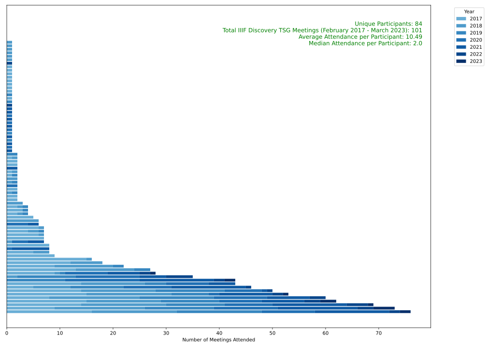
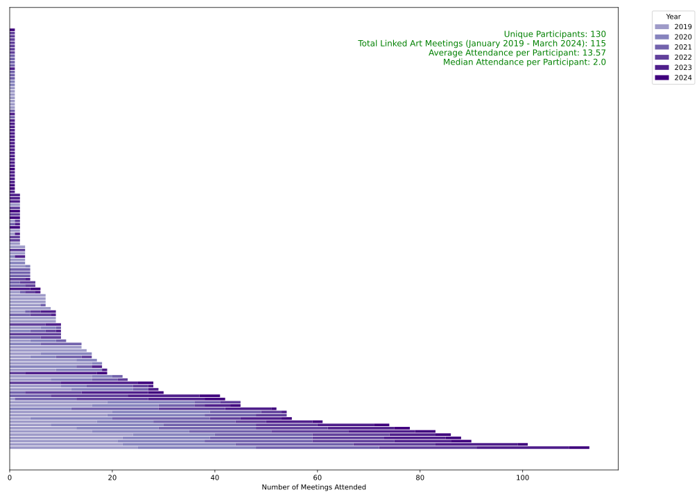
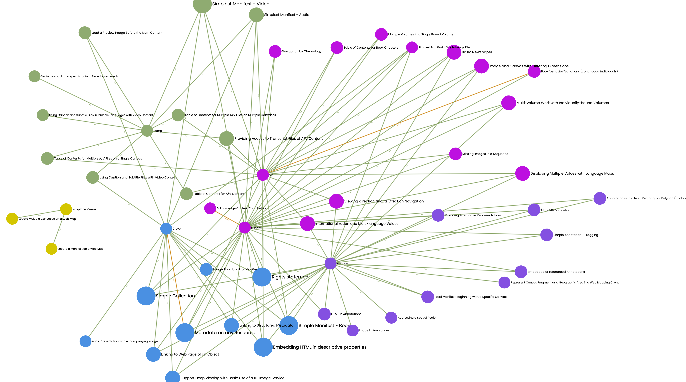
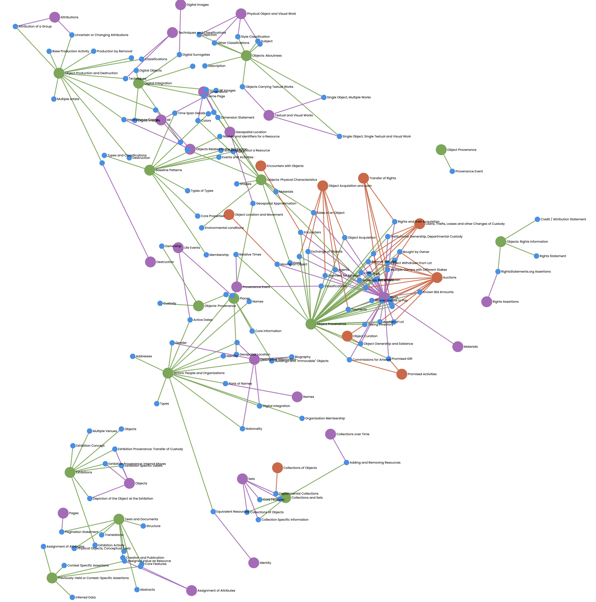

# 6. The Social Fabrics of IIIF and Linked Art {id="cha:social-fabrics"}

This chapter unfolds as a foray into the social fabrics of the IIIF and Linked Art communities, and represents the first of three empirical chapters within this doctoral thesis. In this endeavour, I seek to disentangle the many threads that make up these communities, with the aim of identifying the essential strands that contribute to their collective weave. Drawing on [@haraway_staying_2016 p. 116], this investigation explores the extent to which their fabric encompasses an entanglement of *‘people, critters and apparatuses’* [@haraway_staying_2016 pp. 128-129], examining dependencies as highlighted by [@latour_habiter_2022 p. 71]. In doing so, I attempt to shed light on the interplay of relationships that form the backbone of IIIF and Linked Art, unveiling the complex tapestry of collaboration and interconnectedness that defines them.

With respect to scope, this chapter considers the socio-technical dynamics required to produce specifications that are aligned with the LOUD design principles. The central hypothesis is that although grassroots efforts to forge active communities require substantial and sustained commitment, these efforts typically succeed in the medium to long term. The analysis focuses on how consensus building and advocacy within the IIIF and Linked Art communities promote the adoption of LOUD. It also examines the role of community participation in the evolutionary adoption of these standards.

Most of the (technical) documentation related to this empirical investigation, such as Python scripts, raw data, and diagrams, is made accessible through GitHub[^244]. This open repository serves not only as a resource for replicating and verifying the findings but also exemplifies a commitment to transparency, in keeping with the ethos of the IIIF and Linked Art communities.

The chapter begins in [Section 6.1](#sec:iiif-la-foundations), where I delve into some of the foundations of the IIIF and Linked Art communities. The first objective, concerning consensus building and advocacy within these digital communities, is addressed in more detail in [Section 6.2](#sec:consensus). This section unpacks the collaborative strategies and initiatives that are central to promoting standards adoption and community cohesion. Following this, [Section 6.3](#sec:community-participation-loud) focuses on the second objective by analysing community participation and adoption of LOUD standards.

In [Section 6.4](#sec:synthesis-insights-6), the chapter synthesises the findings from the previous analyses, weaving together the threads of the research to provide a comprehensive overview of the terrain explored. The chapter concludes in [Section 6.5](#sec:perspectives-6), where reflections and forward-looking perspectives consider the wider implications of the study's findings for the future of the IIIF and Linked Art communities, anticipating the challenges and opportunities on the horizon.

## 6.1 Exploring the Foundations {id="sec:iiif-la-foundations"}

The core objective of the IIIF and Linked Art communities is the creation and maintenance of specifications. Through these specifications, which act as mediators, there is the potential for a harmonious symphony of technology and purpose. At the heart of this ecosystem is the API, mediated by the JSON-LD's API `@context`, which provides clarity and cohesion to the standards being developed and implemented. Validators ensure compliance with the specifications, with software conforming to these standards and encapsulating the layered abstractions that define the technological landscape.

For this potential to be fully realised, however, it is imperative that those within these communities possess resources that not only comply with these shared APIs, but also embody them. This embodiment is facilitated by an underlying infrastructure that includes servers, scripts, micro-services and other technological components, as well as viewers, players and browsers that render compliant (meta)data.

In this respect, while specifications serve as the foundational goal, the broader vision of achieving harmony through technology and purpose requires the active participation of community members. They are tasked with fostering an ecosystem where specifications are not only developed and maintained, but brought to life through practical implementation. This requires a commitment to true collaboration within and across community boundaries, and a concerted effort to implement best practices, especially in user interface design. Such a commitment ensures that the integration of vision and execution is not just a theoretical ideal, but a lived reality that reflects the shared aspirations of both IIIF and Linked Art and their respective constituencies.

The complexity of the IIIF community provides a rich area for exploration, in contrast to Linked Art, where community interactions are more streamlined and occur primarily through fortnightly calls[^245]. This complexity is vividly illustrated in [Figure 6.1](#fig:iiif-community-overview), which describes the range of entities within the framework. The decision to focus on IIIF is motivated by its rich constellation of committees, working groups and supporting institutions, providing a deeper dive into the development of digital standards in a robust community setting.

<figure id="fig:iiif-community-overview" style="margin: 0 auto; text-align: center;">
 
<figcaption>
<strong>Figure 6.1</strong>:
 Overview of the IIIF Community
</figcaption>
</figure>

In the diagram, a colour scheme helps to identify the different components of the IIIF ecosystem: entities in purple represent people, resources and institutions that are part of the IIIF-C. Light pink highlights the committees associated with the consortium, reflecting the structural elements that support the governance and operational dynamics of the consortium. Soft blue denotes the community committees, including the CoCo and the Editorial Committee, which are central to guiding community initiatives and maintaining specifications. Green identifies the community and TSGs, highlighting the collaborative spirit that drives the development of IIIF. Finally, yellow identifies essential resources and tools, such as the specifications or cookbook recipes, highlighting the practical outputs that enable the adoption and implementation of the APIs.

This visual representation serves not only as a guide to the organisational structure of the IIIF community, but also as a representation of the vibrant interaction between disparate entities. It highlights the integral role of both the formal IIIF-C bodies and the wider community in fostering a culture around interoperability, facilitating collaboration and sharing best practice. This comprehensive approach to community engagement and standards development underscores the concerted effort needed to move the digital scholarship and CH fields forward. The interconnectedness depicted underscores the role of essential platforms, facilitating their evolution. For instance, both the IIIF and Linked Art communities maintain accessible Google Drives, where meeting minutes on Google Docs, often linking to GitHub issues, underscore the technical discourse within these initiatives. In addition, the use of dedicated Slack workspaces for continuous conversations further reinforces the importance of regular engagement.

The following sections explore in more depth the processes of consensus building and the advocacy initiatives as well as the engagement of the community that not only promote adherence to specifications, but also encourage best practices. Such endeavours are foundational to fostering a LOUD ecosystem characterised by community-driven commitment to a few standards, yet embracing a multitude of implementations. This rich tapestry of connected knowledge and practices ensures the digital heritage domain is both universally accessible and deeply engaging.

## 6.2 Consensus Building and Advocacy Initiatives {id="sec:consensus"} 

The analysis examines the mechanisms of capacity building and advocacy within the IIIF and Linked Art communities, focusing on three key areas.

Initial research centres on [Subsection 6.2.1](#subsec:meetings), exploring the different types of meetings that play a crucial role in both community engagement and the wider collaborative process, with illustrations from the IIIF Discovery TSG and Linked Art meeting minutes. Attention then shifts to [Subsection 6.2.2](#subsec:gh-issues), highlighting the role of GitHub in facilitating code and use case documentation, particularly within TRC, as a testament to the community's collaborative spirit and commitment to transparency. Finally, [Subsection 6.2.3](#subsec:guidelines) examines community guidelines and best practice efforts, discussing how each community provides resources that transcend the standards, such as the IIIF cookbook recipes and Linked Art patterns, to guide and encourage further community contributions and foster interoperability.

### 6.2.1 Types of Meetings and Engagement Opportunities {id="subsec:meetings"}

Meetings within the IIIF and Linked Art communities are essential for collaboration, sharing insights and steering the direction of projects and standards. These predominantly virtual meetings are orchestrated by designated chairs and follow structured agendas to maximise productivity and inclusivity. IIIF meetings vary in frequency - fortnightly, monthly or quarterly - reflecting the dynamic needs of different parties. Linked Art, which maintains a consistent rhythm, meets fortnightly. Each meeting begins with a roll call, which allows participants to register their presence or send their regrets in advance, a gesture that underlines their interest even if they are absent. To further enhance the collaborative nature of these discussions, one or more participants are asked to take the role of note-taker for each meeting.

A foundational element of these meetings is the ongoing, mostly asynchronous, collection of use cases, primarily facilitated through GitHub. Although the initial sessions heavily focus on gathering these use cases, the practice continues across all stages of development and discussion. Each meeting is structured around a predefined agenda, ensuring focused and productive sessions that typically span one hour. Additionally, meetings are announced at least a day in advance. This process ensures that discussions about the implications of use cases and their potential integration into documents -- such as specifications, early drafts or recipes -- are grounded in a broad and inclusive collection of community inputs, pending subsequent approval or implementation.

In addition to virtual sessions, face-to-face meetings provide invaluable opportunities for deeper engagement. Within IIIF, the annual conference acts as a catalyst for stakeholders to meet -- whether as part of the official programme or in parallel sessions. In addition, ad-hoc in-person meetings have also been instrumental in driving significant progress, such as the inclusion of audiovisual resources in the Presentation API 3.0 and the ongoing efforts to include 3D materials in the forthcoming version of this specification.

The Linked Art initiative, although newer, has held five major face-to-face meetings, three before the COVID-19 pandemic and two in 2023. The fourth meeting, held in New Haven, CT, USA, focused on resolving outstanding issues to finalise the first version of the standard. The practical implications of developing the Linked Art API, alongside the deployment of the LUX platform, illustrate the tangible outcomes of these meetings. Many discussed issues were long-standing, exacerbated by the pandemic. For instance, discussions around rights statements[^247] and API Displacements and/or Transclusions[^248] have highlighted the evolving requirements and challenges faced by the community. It also became clear that discussions on identity -- encompassing nationality, gender, and ethnicity -- had matured, enabling new insights and considerations. These discussions are delicate, often challenged by inherent biases and assumptions in metadata assignment, highlighting the need for a more inclusive and diverse approach to identity representation within CH.

Furthermore, while discussions about extending the CIDOC-CRM hierarchy to include new properties or classes - such as the `Transfer` class and the inclusion of non-human actors - take place within the broader CRM-SIG, Linked Art approaches these considerations from a different perspective[^249]. Unlike CRM-SIG, where ontological purity is a major concern, Linked Art prioritises more practical applicability and flexibility in modelling CH data. This leads to decisions where Linked Art has, for pragmatic reasons, created its own classes and leveraged existing classes designed for human entities to encompass non-human actors. This approach, while departing from strict ontological standards, aims to address immediate modelling needs within the community, recognising that it may occasionally compromise semantic interoperability for the sake of broader and more inclusive data representation practices.

Transitioning from these theoretical and practical considerations, I delve into detailed case studies of community interactions as this section explores specific series of meetings by looking at the notes taken during them -- in [Subsubsection 6.2.1.1](#subsubsec:iiif-tsg-meetings) meetings from the IIIF Discovery TSG[^250], a completed IIIF group, and in [Subsubsection 6.2.1.2](#subsubsec:la-meetings) the ongoing fortnightly meetings of the Linked Art initiative.

This exploration provides a lens into the number of meetings, the people involved and the outcomes that shape the evolving landscapes of both communities. Meeting minutes from both groups were extracted using a tool developed by @bainbridge_extract_2021 to streamline the process of extracting texts from Google Docs into organised spreadsheets. This data then underwent a cleaning and curation process to ensure accuracy and consistency for analysis and visualisation[^251].

#### 6.2.1.1 IIIF Discovery TSG Meetings {id="subsubsec:iiif-tsg-meetings"}

The IIIF Discovery TSG formally ended its work in summer 2022, but continued to meet several times until March 2023. The purpose of the Discovery TSG was to address the critical need for interoperable resources to be easily discoverable. Recognising the importance of standardised discovery processes, the group aimed to develop specifications to improve the findability and reusability of IIIF resources. This initiative focused on adopting existing techniques and tools, facilitating their widespread use within the community, and supporting the creation of infrastructure such as registries. Key deliverables from the group comprise the Change Discovery API and the Content State API.

In addition to these APIs, the TSG focused its efforts on producing essential documentation and support materials to facilitate the wider adoption and implementation of these standards. This includes the creation of a Registry of (Metadata) Profiles[^252], which serve as a mechanism for discovery-related metadata profiles to leverage through the `seeAlso` property in IIIF Manifests. A note on SEO guidelines was also produced[^253], with a view to improving search engine ranking of web pages containing IIIF resources.

[Figure 6.2](#fig:barchart-tsg-meeting-attendance) shows that 84 people, represented as individual horizontal bars, attended a total of 101 Discovery TSG meetings. Each person attended an average of 10.49 meetings, but the median attendance was 2. This illustrates a significant imbalance in participation: a small core group was highly active and contributed to the majority of discussions, while a larger number of participants attended less frequently.

<figure id="fig:barchart-tsg-meeting-attendance" style="margin: 0 auto; text-align: center;">
 
<figcaption>
<strong>Figure 6.2</strong>:
 Stacked Bar Chart Showing IIIF Discovery TSG Meeting Attendance
</figcaption>
</figure>

A closer look at meeting attendance over the years reveals a gradual decline in participation, providing insights into the operational dynamics of the Discovery TSG and engagement trends. Initially, in 2017, there were 20 meetings with 42 unique participants and an average attendance of 12.35 per meeting. In 2018, while the number of meetings increased to 22, the number of unique participants decreased to 35 and the average attendance decreased to 8.73.

In 2019, the number of meetings decreased to 18 with 26 unique participants, and the average attendance further decreased to 7.78. The trend continued in 2020 with 15 meetings, 20 unique participants and an average attendance of 8.2. In 2021, there were 17 meetings with a slightly higher pool of 23 unique participants and an average attendance of 7.94.

The most significant decline occurred in 2022, when only 6 meetings were held, with 13 unique participants and an average attendance of 5. This decline continued in 2023, with only 3 meetings, 7 unique participants and an average attendance of 4.67. This significant reduction in engagement can be explained by the fact that the majority of the group's objectives and outputs had been achieved by the summer of 2022, leading to a natural reduction in the need and frequency of meetings as the project neared completion.

The data also highlights the centrality of `github.com` in discussions and collaborations, as evidenced by over 400 hyperlinks to GitHub issues, pull requests and other GitHub-related content mentioned during meetings. In addition to GitHub, other frequently referenced domains include `iiif.io` with 169 mentions and `docs.google.com` with 139 mentions, reflecting the use of official documentation and shared documents for referencing standards. In addition, `www.w3.org` was mentioned 60 times, demonstrating its relevance for W3C standards aligned with IIIF practices. This frequency underscores GitHub's essential role as a central platform for facilitating communication and project development within the IIIF Discovery TSG, alongside these other critical resources.

As the Discovery TSG wrapped up its active phase, its contributions to the IIIF community proved significant, setting critical standards for interoperability. However, the full impact of its work remains to be seen. To date, only a limited number of institutions have implemented the Change Discovery API, and while some viewers support the basics of the Content State API, the full intent of the standard has been realised predominantly through demo clients. This scenario underscores the ongoing challenge within the community: not only to develop these capabilities, but also to deploy and use them widely.

#### 6.2.1.2 Linked Art Meetings {id="subsubsec:la-meetings"}

Now transitioning into the Linked Art meeting minutes, some parallels with the IIIF Discovery TSG meetings can be observed, yet with distinct dynamics reflective of its ongoing activity. This analysis provides a snapshot of the Linked Art meetings from January 2019 to March 2024. The group convenes fortnightly to deliberate on refining the model and the API, with a strong emphasis on releasing the first stable version and integrating the patterns and specification into various platforms.

[Figure 6.3](#fig:barchart-la-meeting-attendance) indicates participation trends over this period, showing that 130 different individuals attended the 115 meetings held, predominantly in a virtual format, with five of these meetings being face-to-face[^256]. Each participant attended an average of 13.57 of sessions, but the median attendance was only 2, indicating a very long tail of participation. This suggests a core group of highly engaged members who contribute consistently, while a larger number of participants engage more sporadically. This distribution highlights the challenges and successes of sustaining engagement over time, particularly in a volunteer-driven context where continuous engagement can be difficult to maintain.

<figure id="fig:barchart-la-meeting-attendance" style="margin: 0 auto; text-align: center;">
 
<figcaption>
<strong>Figure 6.3</strong>:
 Stacked Bar Chart Showing Linked Art Meeting Attendance
</figcaption>
</figure>

A detailed examination of meeting attendance over the years for the Linked Art initiative reveals an active yet fluctuating participant engagement. In 2019, the year began with 26 meetings and included 53 unique participants, each attending an average of 17.88 sessions. This high level of involvement suggests robust initial interest and active participation in the foundational phases of the initiative.

However, subsequent years showed a slight decrease in engagement: 2020 hosted 23 meetings with 34 unique participants and an average attendance dropping to 15.48. In 2021, the meetings slightly increased to 25 with 48 unique participants, averaging 13.92 attendees per session. The year 2022 saw 19 meetings with 46 participants and an average of 14.74, showing a stabilisation in engagement levels despite fewer meetings.

The year 2023 continued with 18 meetings, and an increase in unique participants to 57, suggesting a widening of the community base, with an average attendance of 14.11 per meeting. The early data for 2024 shows 4 meetings with 25 unique participants and a relatively high attendance rate of 15.25, indicating sustained, albeit selective, engagement.

The data also underscores the significance of `github.com` as a pivotal platform for discussion and collaboration within the Linked Art meetings, with over 431 links pointing to GitHub highlighting its use for project management and technical discussions. Other frequently mentioned domains include `docs.google.com` with 35 references and `linked.art` with 44 mentions, reflecting their roles in documentation and project-specific discussions, respectively. Domains such as `www.getty.edu` and `vocab.getty.edu` were also significant, cited 10 and 9 times respectively, indicating the integration of controlled vocabularies in standardising terminologies within the Linked Art context.

While the Linked Art group originally had optimistic goals of releasing the first stable version of the specifications by 2020 and then 2021, the actual release is now expected to occur in 2024. This extended timeline, while longer than originally planned, has had an unforeseen benefit: it has allowed various platforms to experiment more extensively with implementing the evolving model, even in the absence of a finalised standard. Such experimental implementations have not only helped to refine the specifications through practical application, but have also fostered a richer understanding among actors of how the model can be adapted and used. Although Linked Art focuses primarily on museum artworks and their relationships, treating them as first-class citizen resources within the digital representation sphere, there is an observable shift towards embracing the broader GLAM domain. This broadening of scope suggests significant potential for Linked Art to impact a wider range of CHIs, improving cross-domain semantic interoperability while maintaining a hands-on orientation.

### 6.2.2 Collaborative Development through GitHub Documentation {id="subsec:gh-issues"}

Within IIIF and Linked Art, GitHub has solidified its position as a central hub for collaboration across both communities, further illustrating the pragmatic approach adopted towards research and development [see @scroggie_github_2023]. This preference for GitHub, complemented by the use of universally accessible tools like Google Drive for documentation, illustrates a pragmatic shift towards platforms that facilitate broad participation and collaboration. Such practices are integral to the collaborative process, enhancing transparency, and efficiency in addressing and resolving issues [@escamilla_its_2023].

[Figure 6.4](#fig:use-case-api-1) illustrates the journey from a conceptual use case to its technical realisation within both the IIIF and Linked Art communities, highlighting the shared methodologies despite the different governance structures. The diagram begins with the community's identification and documentation of a use case, which leads to the creation of a corresponding GitHub issue. This issue acts as a nexus for collaborative discussion, leading to the creation of a GitHub pull request proposing specific changes or additions to the specifications. The figure highlights the critical role that community editors and reviewers play in this sequence, and the collaborative vetting process that ensures that proposals are consistent with the technical and philosophical ethos of the communities. For IIIF, this process extends to formal review mechanisms involving the TRC, which ensures adherence to established standards and eventually validation against a validator if needed. In contrast, Linked Art, while using a similar collaborative and open platform for discussion and documentation, manages this process without a formal TRC, relying on broader community engagement and consensus, especially from its Editorial Board.

<figure id="fig:use-case-api-1" style="margin: 0 auto; text-align: center;">
 
<figcaption>
<strong>Figure 6.4</strong>:
 Illustrative Diagram of the GitHub-Based Process for Approving and Integrating Use Cases
</figcaption>
</figure>

[Figure 6.5](#fig:use-case-api-2) details the process undertaken by the IIIF community to review and integrate a specific GitHub issue[^257], the validation of the Image and Presentation APIs 3.0 that happened in May 2020[^258]. This detailed illustration shows the relationships and interactions between the various actors, and highlights the structured approach to consensus building, specification development and implementation by compatible software. The process begins with a human collective, such as the IIIF Editorial Committee, identifying and proposing changes, which are then carefully discussed and voted on by TRC members using platforms such as GitHub and Zoom. The involvement of the TRC is critical, providing the formal review and approval necessary for the adoption of changes, marked by key milestones such as the release of the API 3.0 Release Candidate. This figure emphasises the essential role of compliance and compatibility checks against the JSON-LD API `@context` and the relevant validators, ensuring that updates are seamlessly integrated into the wider IIIF ecosystem, supporting a wide range of compliant clients.

<figure id="fig:use-case-api-2" style="margin: 0 auto; text-align: center;">
 
<figcaption>
<strong>Figure 6.5</strong>:
 Detailed Illustration of the GitHub-Enabled Approval Process by the TRC for the Image and Presentation APIs 3.0
</figcaption>
</figure>

The approval of both specifications by 30 members of the TRC marks a significant milestone, reflecting a substantial level of consensus for such a key initiative. While this level of participation is remarkable in the context of other use cases, it also demonstrates the difficulty of achieving widespread participation. The fact that not all TRC members were present or voted on these crucial specifications, and that not every institution within the IIIF-C consistently sends a representative, suggests areas for improvement in engagement and representation within the decision-making processes of the community[^259].

Despite these challenges, there's a great deal of trust within the community in those who manage the development and implementation of the specifications. Many institutions and developers are diligently adapting their content and software to meet or upgrade to the latest specifications. However, without a concentrated authority to enforce compliance, deviations occur. These range from instances where cross-institutional interoperability remains achievable despite unorthodox approaches, to scenarios where outright anti-patterns are deployed, underscoring the diverse adherence to the APIs[^260].

While there is no ‘policing’ of implementations within the IIIF or Linked Art community, understanding and addressing these deviations is crucial for the ecosystem's health. Moreover, as both communities maintain open and shared specifications, the responsibility falls on the community itself to oversee and assess how the standards are leveraged across different settings.

### 6.2.3 Community Guidelines and Best Practice Efforts {id="subsec:guidelines"}

As highlighted in the literature review, IIIF and to some extent Linked Art publish guidelines, primarily on their website. These resources are designed to facilitate the discovery of standards-compliant resources across different platforms and to assist individuals, projects and organisations in implementing these standards. This dissemination of knowledge plays a key role in enabling a wide range of users to effectively engage with and use IIIF and Linked Art specifications, in many cases mediated by external interfaces.

These best practices are critical as they demonstrate the full potential of the specifications and, in the case of Linked Art, demonstrate the full promise of the model. However, when moving from one client to another, one often encounters BOs, as parts of a resource may be supported differently or not at all [see @raemy_back_2022]. In the context of Linked Art, starting with the model before considering the implementation of API endpoints can lead to complex situations. This complexity arises when considering cases of transclusion, as the rigidity of the API requires careful consideration of how different aspects of the model are represented and accessed across endpoints, necessitating a nuanced approach to integrating the model with API capability.

To further understand the nuances of these guidelines and best practices, in March 2024 I undertook an in-depth exploration of the IIIF cookbook recipes in [Subsubsection 6.2.3.1](#subsubsec:iiif-cookbook) and Linked Art patterns in [Subsubsection 6.2.3.2](#subsubsec:la-patterns). This exploration was done to be reasonably grounded in SNA using NetworkX and Gephi Lite, allowing commonalities within this set of guidelines to be discovered and visualised.

#### 6.2.3.1 IIIF Cookbook Recipes {id="subsubsec:iiif-cookbook"}

[Figure 6.6](#fig:iiif-cookbook-gephi) illustrates a network derived from the IIIF cookbook recipes and their support across various viewer clients, including UV, Mirador, Annona, Ramp, Clover, and the navPlace Viewer[^262]. In this graph, nodes represent either specific IIIF Cookbook Recipes, identified by unique slugs and labelled with descriptive titles, or viewer clients, serving as the primary agents interacting with these recipes. The edges between nodes are colour-coded to signify the degree of support -- ‘yes’ for full support or ‘partial’ -- for each recipe by the respective client.

<figure id="fig:iiif-cookbook-gephi" style="margin: 0 auto; text-align: center;">
 
<figcaption>
<strong>Figure 6.6</strong>:
 Exploring IIIF Cookbook Recipes by Support with Gephi Lite
</figcaption>
</figure>

The allocation of node colours, predicated on their modularity class, categorises the recipes, elucidating their thematic relevance and grouping within the IIIF ecosystem. This classification sheds light on the recipes' roles and their significance to the community, from simple manifest creation to more complex implementations like audio, video, and multi-volume work representations. The size of each recipe node quantitatively reflects the extent of client support, visually emphasising recipes that have garnered widespread adoption or those that may require further advocacy. In a more analytical lens, the graph unveils the pivotal roles of Mirador and UV within the framework, underscoring their centrality and indispensability in the broad spectrum of implementing the core APIs. Concurrently, it delineates specific trajectories, such as Annona and Mirador's inclination towards annotations, and Ramp's association with audiovisual content.

In terms of JSON Path analysis, a thorough examination was conducted to discern patterns and insights regarding the structure and use of properties across the IIIF Cookbook Recipes. Although this analysis was meticulously performed, it did not yield any particularly striking results or unexpected insights[^263].

For content similarity, leveraging the cosine similarity scores from the analysis, two pairs of recipes emerged as notably identical, showcasing the closest thematic and content-based connections within the dataset. The recipes ‘Embedding HTML in descriptive properties’[^264] and ‘Rights statement’[^265] shared the highest similarity score of 0.672318, indicating a significant overlap in their content and approach. This high degree of similarity suggests that these recipes, while distinct in their focus, employ comparable structures or narratives. Another pair, ‘Support Deep Viewing with Basic Use of a IIIF Image API Service’[^266] and ‘Image in Annotations’[^267], also demonstrated a notable similarity score of 0.541640.

Additionally, the examination sheds light on the significant re-use of fixtures or content links across the recipes, which underscores the foundational role of these materials within the IIIF ecosystem. The repeated utilisation of specific resources, such as the image captured during the 2019 IIIF Conference in Göttingen, Germany[^268], which appears 41 times across various guides, exemplifies how readily available and central these resources have become in demonstrating IIIF capabilities. Similarly, audio and video fixtures from Indiana, such as the Mahler Symphony Audio[^269] and the Lunchroom Manners Video[^270], highlight the framework's adaptability and richness in managing a diverse range of multimedia content. However, it also highlights a certain tendency towards using readily available or well-known resources, often those directly provided by the IIIF community or known to be in the public domain. This practice, while practical, sometimes leads to a lack of diversity in the resources used, underscoring an opportunity for the IIIF Cookbook authors to explore and integrate a wider array of materials.

#### 6.2.3.2 Linked Art Patterns {id="subsubsec:la-patterns"}

Turning the analytical gaze to Linked Art, I extend my exploration to the patterns that underpin this vibrant ecosystem. This progression makes it possible to discern the web of relationships that animate the Linked Art data model, mirroring here the methodological approach through graphs with the IIIF cookbook recipes.

[Figure 6.7](#fig:la-patterns-gephi) presents a graph where nodes symbolise Linked Art patterns[^271]. The edges in this visualisation represent the relationships derived from the patterns' data, notably in terms of model components and their (sub)category. The colour of each node is determined by the pattern's category, signifying the thematic or functional group to which it belongs. Meanwhile, the edge colour is informed by the source nodes, providing insight into the directionality and origin of each relationship.

<figure id="fig:la-patterns-gephi" style="margin: 0 auto; text-align: center;">
 
<figcaption>
<strong>Figure 6.7</strong>:
 Exploring Linked Art Patterns by Category with Gephi Lite
</figcaption>
</figure>

A diverse array of 136 patterns emerges, categorised under themes such as ‘Baseline Patterns’[^272], which serve as the foundation for resource description and interaction. The analysis identifies a comprehensive list of patterns, each addressing specific aspects of CH data modelling. Notably, some patterns function as sub-patterns, inheriting their parent name as one of their categories. Exploration of pattern similarity within the Linked Art model reveals noteworthy connections[^273], reflecting the integrated and comprehensive nature of the model. While these findings underscore the versatility and depth of the framework, its true value extends to practical applications. The insights gained from these similarities provide a rich resource for optimising Linked Art implementations in real-world scenarios, suggesting a broad potential for reuse in various CH contexts.

It's important to recognise that, like the IIIF cookbook recipes, this graph represents a snapshot in time, reflecting the entities and relationships documented up to a certain point. While this visualisation provides a window into the modelling efforts within Linked Art, other examples using different entities could be explored, recognising the dynamic and evolving nature of the initiative.

## 6.3 Community Participation and LOUD Standards: Adoption and Impact {id="sec:community-participation-loud"} 

This section addresses the objective of examining community participation, alongside the evolutionary adoption of LOUD standards and their potential impact with respect to scientific movements and principles. In pursuit of this objective, data were collected from adoption surveys conducted within the IIIF community, enriched further by insights drawn specifically for this study on the socio-technical characteristics of both IIIF and the Linked Art community. This comprehensive dataset [see @raemy_pseudonymised_2023] serves as a foundation for our exploration, offering a unique lens through which the dynamics of community engagement, technological adoption, and the overarching influence of LOUD standards.

Following the publication of a detailed survey report on the characteristics of IIIF and Linked Art [see @raemy_characterising_2023], this section presents a comprehensive summary of its findings. The survey has provided insightful revelations into the dynamics of community engagement, preferred practices and tools, barriers to wider participation and the resulting implications for the CH sector. These findings underscore the central role of open standards and collaborative efforts in shaping practices, and provide a nuanced understanding of how these communities contribute to the development and adoption of LOUD standards.

Conducted between 24th March and 7th May 2023[^274], the online survey attracted 79 participants from 20 countries[^275]. It was targeted to individuals involved in IIIF and Linked Art, but also people that have heard of the communities or the specifications. The survey's structure included sections tailored to gauge involvement in either or both communities, with branching logic to ensure relevance to participants' experiences. It captured data on socio-demographics, organisational affiliation, and the extent of participants' involvement in community events, activities, and calls, offering a window into the communities' composition and engagement patterns.

Results highlighted a global distribution of participants, with a noticeable concentration in the Global North, and indicated a wide range of engagement levels, from passive awareness to active participation in community events and activities. The findings underscore the communities' commitment to fostering global collaboration, despite challenges such as geographical and institutional representation biases. The survey serves as a foundational effort to map the landscape of these communities, identifying areas for growth and increased inclusivity.

The survey findings reveal a core group of individuals actively involved in both the IIIF and Linked Art communities, underscoring the depth of engagement among key members. This involvement reflects a collaborative spirit and a shared dedication to advancing the digital cultural heritage landscape.

[Figure 6.8](#fig:iiif_calls_engagement) illustrates the dynamics of this engagement within the IIIF community, mapping out the timeline of involvement and highlighting the active participation in community calls. It shows the year of IIIF involvement along the `x`-axis against participant IDs on the `y`-axis, representing engagement through point size for IIIF call participation over the past year. It highlights a pattern of greater participation from members involved since 2016 or earlier, with one instance of engagement traced back to 2009, demonstrating the impact of long-term involvement and hinting at early contributions to the IIIF community's evolution. Participants who are only involved in the Linked Art community are not included in this plot.

<figure id="fig:iiif_calls_engagement" style="margin: 0 auto; text-align: center;">
 
<figcaption>
<strong>Figure 6.8</strong>:
 Year of Involvement in the IIIF Community [@raemy_characterising_2023 p. 20]
</figcaption>
</figure>

Following on from the visualisation of IIIF's community engagement, the responses of 52 participants are analysed in [Figure 6.9](#fig:iiif_principles), which situates IIIF's contributions within broader scientific and data governance movements. The data reveals a strong recognition of IIIF's pivotal role in several areas: a substantial majority affirm its importance to Open Science and Citizen Science initiatives, illustrating its far-reaching benefits. Participants also highlighted IIIF's substantial contribution to the FAIR principles, particularly in the areas of interoperability and reusability, demonstrating its effectiveness in promoting a more connected and accessible digital research environment. However, further research is needed to fully assess IIIF's adherence to the CARE Principles for Indigenous Data Governance, suggesting a potential area for future developmental focus.

<figure id="fig:iiif_principles" style="margin: 0 auto; text-align: center;">
 
<figcaption>
<strong>Figure 6.9</strong>:
 Situating IIIF to Movements and Principles [@raemy_characterising_2023 p. 21]
</figcaption>
</figure>

Shifting the emphasis to Linked Art, analysis of the engagement of 16 participants in [Figure 6.10](#fig:linked_art_principles) provides a nuanced view of the role of Linked Art in relation to the same scientific and governance movements. Although the pool of participants is smaller, resulting in a more limited data set, the responses still provide useful insights. Participants recognise Linked Art's potential contributions to Open Science and Citizen Science, albeit to a lesser extent than IIIF. In addition, the feedback highlights Linked Art's strong capabilities in interoperability, in line with the FAIR principles, particularly in the areas of discoverability, accessibility and reusability. These findings highlight the need for further empirical studies to validate and refine Linked Art's alignment with CARE, and provide a clear direction for future research and community engagement strategies.

<figure id="fig:linked_art_principles" style="margin: 0 auto; text-align: center;">
 
<figcaption>
<strong>Figure 6.10</strong>:
 Situating Linked Art to Movements and Principles [@raemy_characterising_2023 p. 22]
</figcaption>
</figure>

Following the survey's broad findings on participant distribution and engagement, we transition to a focused exploration of the IIIF and Linked Art communities' characteristics. Through this research, I seek to gain a better understanding of the contributions and challenges faced by these communities.

- Community Engagement:   The survey revealed a vibrant ecosystem of practitioners committed     to the ideals of IIIF and Linked Art. A significant     proportion of respondents actively contribute to both initiatives,     embodying a spirit of cross-community collaboration. This strong     commitment is indicative of a shared vision for the future of     digital cultural heritage, where collective effort and knowledge     sharing are fundamental pillars.
- Practices and tools:   Looking at the communities' technological preferences, there is a     strong trend towards open standards and interoperable tools. This     trend is not only a testament to the technical rigour of the     communities, but also aligns with the FAIR and CARE principles. Such adherence ensures     that digital artefacts and the frameworks used to manage them are     accessible, interoperable, reusable and ethically managed, fostering     a digital ecosystem that is inclusive and equitable.
- Barriers to Involvement:   Despite the thriving community and progressive adoption of open     standards, the survey identifies critical barriers to wider     participation. The most prominent of these is the need for more     inclusive outreach and comprehensive support for newcomers. This     challenge highlights an area of opportunity for community growth,     requiring initiatives aimed at lowering barriers to entry and     fostering an environment that welcomes diverse perspectives and     expertise.
- Impact on CH:   The contribution of IIIF and Linked Art to the heritage domain     is profound, particularly in enhancing accessibility,     interoperability, and reusability. The survey highlights the central     role that IIIF     and Linked Art play in democratising access to heritage data,     enabling richer, more connected narratives that span time and     geography. IIIF has expanded into various domains,     while Linked Art remains focused on art-related objects for a     smaller audience.

## 6.4 Synthesis and Insights {id="sec:synthesis-insights-6"}

This section synthesises the present chapter and provides some and insights that can be learned from the social fabrics of IIIF and Linked Art.

Behind the visible activities like meetings lies a preponderance of preparatory work managed by co-chairs, editorial boards, or driven by community-generated use cases. This foundational work often predetermines the direction and outcomes of formal gatherings. Meeting patterns indicate initial high attendance, which peaks at certain project milestones before declining. Scheduling meetings to accommodate broader global participation, particularly from Asia and Oceania, should be considered to enhance inclusivity, although the primary interaction remains asynchronous.

GitHub serves as a critical hub for community engagement, with a core group of active contributors who often consistently attend meetings. This platform lowers the barrier to decision-making within the community, although it also reflects biases similar to those found in FLOSS communities in terms of inclusiveness. The assertion that *‘standards are made by the people who show up, and not nearly enough people are showing up’* as posited by @cramer_w3c_2016, underscores the critical role of active participants in shaping these standards. However, when individuals from privileged backgrounds wield disproportionate influence in these participatory roles, the issue of over-representation comes into sharp focus.

This demographic homogeneity can give rise to several challenges, including the perpetuation of biases and the neglect of pivotal issues of relevance to underrepresented or marginalised groups. Such imbalances can lead to standards that inadequately reflect the comprehensive spectrum of societal needs and realities. Furthermore, participation in these standardisation processes is itself a privilege, a point underscored by @capadisli_social_2023, suggesting the need for greater inclusivity in these influential roles. Moreover, the assumption that internet access and digital devices are universally available is critically examined in works such as @czahajda_live_2022, which uses ANT to reveal key actors in the digital landscape. This echoes the issues of the IIIF community, where the generation of IIIF resources presupposes means that may not be accessible to all, particularly outside the Global North and among non-English speakers.

The IIIF Cookbook recipes and Linked Art patterns demonstrate the tension between the creation of advanced specifications and their practical implementation by platforms. While new recipes and patterns continue to emerge, actual implementation in software and tools lags behind, reflecting a gap between ideation and practical application. For instance, the IIIF community is actively developing customised tools, particularly for annotations, aimed at catering to users with advanced needs. These tools are designed to enhance usability and functionality but have yet to achieve widespread deployment. This ongoing development indicates that the community is still navigating the optimal routes to broad adoption and interoperability, striving to balance sophisticated requirements with general usability. As another example, the question of how digital frameworks represent non-human entities remains a point of discussion within Linked Art, reflecting wider societal challenges in ensuring that diverse perspectives are included in digital and cultural narratives.

Survey findings also underscore the need for ongoing efforts to develop LOUD standards that foster an inclusive, dynamic digital ecosystem. Future strategies should include creating educational resources and frameworks that support interdisciplinary collaboration and reduce barriers to participation.

In summary, as the IIIF and Linked Art communities progress, their continued relevance will increasingly depend on their ability to embrace diverse perspectives and adapt to changing technological and cultural landscapes. The concept of *sympoietic collaboration*, inspired by Donna Haraway's ideas in @haraway_staying_2016 [pp. 86-87], illustrates this path forward. ‘Sympoiesis‘, or making-with, in contrast to ‘autopoiesis’, or self-making, portrays these communities not just as isolated entities but as interdependent networks. This interdependence must extend to incorporating new voices into ideas, meetings, and implementations, fostering vibrant ecosystems where diverse contributions enrich the shared narrative. By prioritising mutual collaboration over individual autonomy, sympoietic collaboration aims to enrich the field, ensuring that digital heritage remains dynamic and inclusive. Pragmatically, this discussion will be continued in the following section, where I will explore specific perspectives and suggest potential pathways forward.

## 6.5 Perspectives {id="sec:perspectives-6"}

This section reflects on the empirical findings of this chapter and outlines prospective avenues for both the IIIF and Linked Art communities, emphasising strategic steps forward in community engagement, technical innovation, and culminating in discussing integration practices.

### 6.5.1 Enhancing Community Engagement {id="subsec:community-engagement"}

Both the IIIF and Linked Art communities face challenges in transforming increased membership into active participation. Despite a tenfold increase in members on platforms like IIIF Slack workspace over the past 7-8 years, this has not translated into proportional growth in contributions. Advocacy efforts need to focus on making these platforms more welcoming and integrating passive members into active roles. One of these efforts in the IIIF community is the Ambassadors programme[^276], which could be expanded. For Linked Art, it is essential to increase engagement through clear role definitions and regular interactive sessions that go beyond the technicalities of the model, including workshops and webinars. These efforts should aim to demystify the participation process and encourage more diverse community involvement.

While the primary tools for collaboration in the IIIF and Linked Art communities are hosted by GAFAM -- namely GitHub and Google Drive -- there are growing calls to consider alternatives that may better align with open-source values and data sovereignty concerns. Codeberg[^277], as an alternative to GitHub, represents one such possibility. However, transitioning to new platforms could be a significant undertaking, requiring considerable effort and adaptation. Exploring these options could help mitigate the risks associated with reliance on major tech conglomerates and foster a more decentralised approach to digital resource management, though the change would be quite tremendous and involve significant logistics.

### 6.5.2 Technical Development {id="subsec:technical-development"}

The technical backbone of both the IIIF and Linked Art communities relies on the continuous development and maintenance of essential tools.

For IIIF, this includes servers and clients such as Cantaloupe, Mirador, and UV. These tools not only need regular updates to stay compliant with evolving standards but also require careful management of dependencies, such as upgrading to the latest versions of underlying technologies like React for Mirador, to avoid security vulnerabilities [see @white_10_2023]. Similarly, Linked Art's integration efforts must focus on enhancing interoperability with broader standards like RiC and Schema.org, which will improve its usability across various DAMs. This effort should be supported by the development of targeted guidelines that cater to different technical levels and user groups, and the creation or availability of comprehensive workflows and tools essential for the uptake of the standard.

These measures are crucial for ensuring the broader adoption and sustainability of IIIF and Linked Art. By keeping technological infrastructure up-to-date and secure, and by enhancing interoperability with other standards, the communities can accommodate a wider range of platforms and users. Additionally, providing clear guidelines and accessible tools is essential for lowering entry barriers, thereby facilitating a more widespread and effective implementation of these standards across diverse environments.

### 6.5.3 Integration Practices {id="subsec:integration-practices"}

Robust governance is essential for sustaining the technical infrastructure and community cohesion in both IIIF and Linked Art. Establishing diverse expert governance bodies can guide strategic developments and ensure adherence to best practices. These bodies should also address the preservation of institutional knowledge to maintain continuity amidst changes. The role of initiatives like iiif-commons[^278] is critical here, as they lower barriers to entry and support the development of both general-purpose and specialised tools, accommodating a wide range of community needs[^279].

LOUD entities, in the context of this analysis, can be perceived as *‘[a construction of] new properties to perceive in the world’* [p.251 @nyhan_pursuing_2023 citing [@anderson_after_2014]], suggesting that these entities do more than just exist; they actively shape our understanding and engagement with CH. By rearranging data and metadata in unprecedented ways, LOUD instances allow us to see connections and interactions that were previously obscured. This conceptual framework not only enriches our interaction with digital archives, but also challenges us to rethink how these technologies can be used to foster a more inclusive and dynamically interconnected cultural landscape.

Ultimately, the synthesis of insights from the IIIF and Linked Art initiatives provides a robust framework for future growth. By fostering an environment that encourages sympoietic collaboration and integrates diverse perspectives, these communities can continue to thrive and lead in the creation of open ecosystems. Integrating new voices and adapting to the shifting technological landscape will be crucial for the continued relevance of the IIIF and Linked Art communities.

The following two chapters look at the practical implementation of their respective APIs in a research project and on larger systems, illustrating their versatility and implications in a number of different settings.

[^244]: The LOUD
    Social Fabrics: <https://github.com/julsraemy/loud-socialfabrics/>

[^245]: In the earlier days of the IIIF community, there was much more
    fluidity in terms of roles and responsibilities, especially within
    the Editorial Board, something Linked Art is still experiencing.

[^247]: Do we have a documented example for expressing image rights?:
    <https://github.com/linked-art/linked.art/issues/311>

[^248]: API
    Displacements and/or Transclusions:
    <https://github.com/linked-art/linked.art/issues/411>

[^249]: Inject classes/properties into the CRM hierarchy?:
    <https://github.com/linked-art/linked.art/issues/479>

[^250]: IIIF
    Discovery TSG:
    <https://iiif.io/community/groups/discovery/>

[^251]: Cf. The LOUD Social Fabrics -- Meeting Minutes:
    <https://github.com/julsraemy/loud-socialfabrics/tree/main/01_consensus-advocacy/meeting-minutes>

[^252]: Registry of Profiles: <https://iiif.io/api/registry/profiles/>

[^253]: Thinking about IIIF and SEO:
    <https://guides.iiif.io/IIIF-and-SEO/>

[^256]: For one of these face-to-face meetings, documentation was
    produced daily over four days, resulting in four distinct meeting
    records. Therefore, while only five face-to-face gatherings
    occurred, they account for eight entries in the total of 115
    meetings documented.

[^257]: Release Image API and Presentation API 3.0:
    <https://github.com/IIIF/trc/issues/37>

[^258]: Further details can be found in the official announcement of the
    final release of the third version of the core
    IIIF
    specifications, available at
    <https://iiif.io/news/2020/06/04/IIIF-C-Announces-Final-Release-of-3.0-Specifications/>

[^259]: The TRC
    includes a distinct group of *ex officio* members alongside IIIF-C
    representatives and up to five community representatives. As of May
    2020, IIIF-C
    comprised 58 member institutions. Despite the significance of the
    issue at hand, less than half of the eligible voting members,
    totalling 30, participated in this decision-making process, which
    can take place asynchronously and as late as two weeks after the
    meeting.

[^260]: An example of deviation from the IIIF specifications can be seen in the
    *Digitaler Lesesaal* of the archives of Basel-Stadt and St. Gallen.
    Despite their efforts to implement IIIF within their systems [see
    @kansy_going_2022], there are technical challenges that could hinder
    the accessibility of IIIF Manifests beyond their portals. Key
    issues include non-compliant IIIF Manifests, problematic
    CORS header
    configurations, and the way in which URIs are minted, which prevent their use in
    external IIIF
    clients. Such practices not only challenge the core tenets of
    interoperability, but also suggest the need for greater adherence to
    the IIIF
    design principles and the exploration of alternatives that would
    still ensure compliance.

[^262]: A few months after this investigation, Aviary, the Glycerine
    Viewer, Theseus, and the Curation Viewer have been added to the
    support matrix.

[^263]: More information can be found at
    <https://github.com/julsraemy/loud-socialfabrics/tree/main/01_consensus-advocacy/guidelines>.

[^264]: Embedding HTML in descriptive properties:
    <https://iiif.io/api/cookbook/recipe/0007-string-formats/>

[^265]: Rigths statement:
    <https://iiif.io/api/cookbook/recipe/0008-rights/>

[^266]: Support Deep Viewing with Basic Use of a
    IIIF Image API
    Service: <https://iiif.io/api/cookbook/recipe/0005-image-service/>

[^267]: Image in Annotations:
    <https://iiif.io/api/cookbook/recipe/0377-image-in-annotation/>

[^268]: Image of the Gänseliesel in Göttingen taken at the 2019
    IIIF
    Conference:
    <https://iiif.io/api/image/3.0/example/reference/918ecd18c2592080851777620de9bcb5-gottingen/full/max/0/default.jpg>

[^269]: Mahler Symphony Audio:
    <https://fixtures.iiif.io/audio/indiana/mahler-symphony-3/CD1/medium/128Kbps.mp4>

[^270]: Lunchroom Manners Video:
    <https://fixtures.iiif.io/video/indiana/lunchroom_manners/high/lunchroom_manners_1024kb.mp4>

[^271]: It must be said that each time a new pattern is created or
    modified on the Linked Art website, it is likely that existing
    URIs of
    JSON-LD
    serialisation may also change as they have been dynamically minted.

[^272]: Baseline Patterns: <https://linked.art/model/base/>

[^273]: More information can be found at
    <https://github.com/julsraemy/loud-socialfabrics/blob/main/01_consensus-advocacy/guidelines/patterns/linked_art_patterns_similarity.csv>

[^274]: The survey was being promoted primarily on the Slack workspace
    of both communities, on their respective mailing list, as well as on
    Mastodon [see @raemy_dear_2023].

[^275]: Among the survey respondents, 16 individuals reported
    involvement in both the IIIF and Linked Art communities,
    demonstrating a notable cross-community engagement. In addition, 38
    participants were active in either IIIF or Linked Art, with a significant
    majority, 36 respondents, aligning themselves with the
    IIIF
    community. In contrast, a much smaller group, only 2 respondents,
    indicated that they were exclusively involved with Linked Art.
    Interestingly, a significant proportion, 25 individuals, indicated
    no affiliation with either community, highlighting the diverse
    levels of engagement and interest within the CH field.

[^276]: IIIF
    Ambassadors: <https://iiif.io/community/ambassadors/>

[^277]: Codeberg: <https://codeberg.org/>

[^278]: IIIF
    Commons: <https://github.com/IIIF-Commons>

[^279]: The contrasting models of support between these Mirador and
    UV illustrate
    the diversity of needs and approaches within the
    IIIF
    ecosystem. The goal is to balance the development of versatile,
    multi-functional tools with the creation of specialised, task-driven
    applications.
