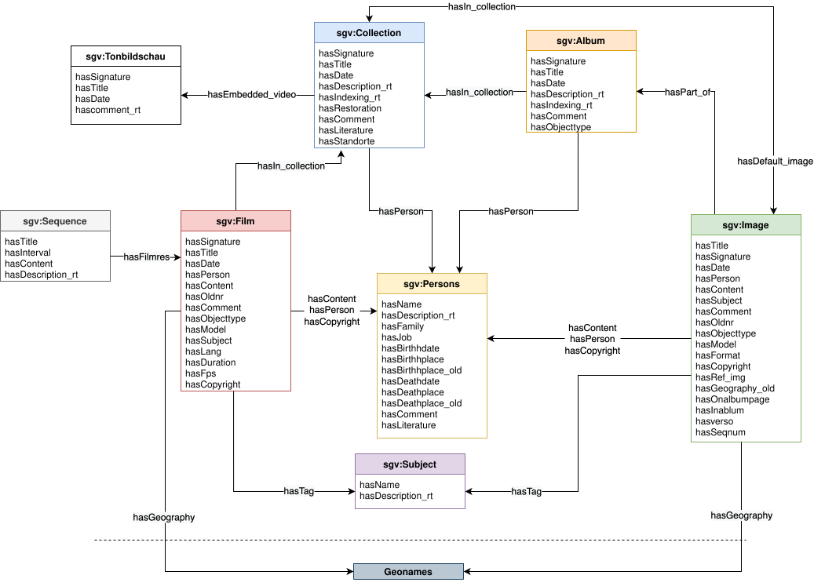
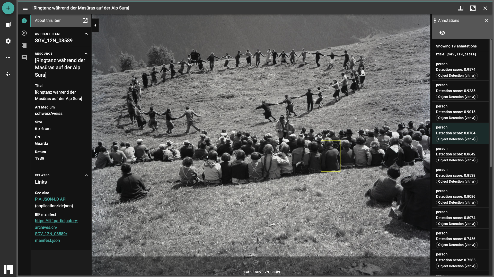
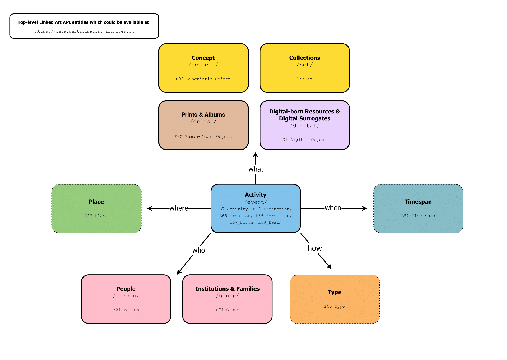
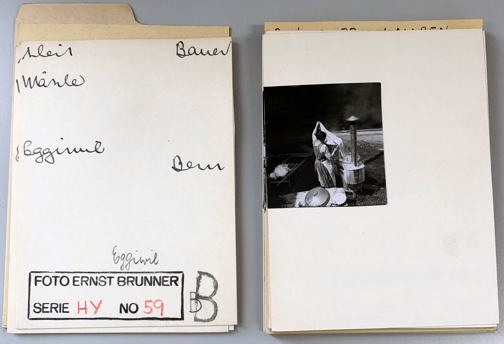
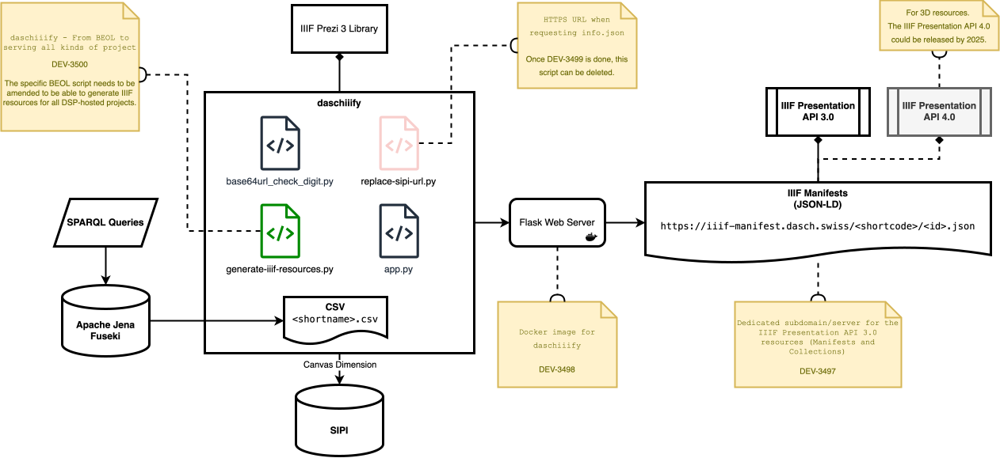

# 7. PIA as a Laboratory {id="cha:pia-laboratory"}

> [D]igital environments are, of course, themselves socio-technical assemblages, with agency, affective and material qualities. [@caraffa_photographs_2011 p. 48]

This chapter focuses on an empirical exploration of the implementation and evaluation of LOUD standards within the PIA project, which runs from February 2021 to January 2025. Specifically, the discussion covers the refinement of the data model, the creation of bespoke IIIF-compliant resources, Linked Art templating and the technological framework to undertake the digitisation, cataloguing and indexing of the associated CAS photographic collections (SGV_05, SGV_10 and SGV_12).

This is an attempt to consider how the PIA project's implementation of LOUD standards enhances our understanding of their potential to facilitate data reuse and wider participation. I argue that the implementation of shared API allows for a prompt understanding of the benefits and limitations of these standards, drawing on the expertise and contributions of the extended communities. Expected outcomes include improved accessibility and reusability of heritage data, as well as wider engagement with diverse user communities. The aim is to implement and evaluate these standards in an exploratory setting to assess their impact on long-term engagement. The choice of PIA as a testing ground is suited both to the fluidity of research environments and to the possibility of experimenting with different modes of practice. Research agendas are inherently transient and flexible, making PIA a dynamic space for the uptake and evaluation of LOUD standards. This approach not only deepens the understanding of these technologies, but also increases the flexibility to adapt to emerging capabilities.

In [Section 7.1](#baseline-pia), I begin by providing an overview of the infrastructure baseline that was established at the start of the project and the data that was aggregated to set the stage for a thorough assessment of the research. The application and impact of LOUD standards within the research project will be explored in [Section 7.2](#sec:loud-explorative), a section that is crucial to deriving actionable insights and understanding the wider impact of LOUD in a real-world and relatively short-term context. The synthesis of these findings in [Section 7.3](#sec:synthesis-insights-7) provides a comprehensive overview of the impact and potential benefits of LOUD standards on participatory knowledge practices.

The chapter concludes with [Section 7.4](#sec:perspectives-7), which offers insights into the future implications of this work for research and practice, for what will be done until the end of the PIA project or beyond.

## 7.1 Data and Infrastructure Baseline at the Project Onset {id="baseline-pia"} 

The journey of the analogue archives of CAS began at the end of the 19<sup>th</sup> century with the creation of the first archives by the SSFS in 1896, now known as CAS. They began collecting photographs in the 1930s and have approximately 300,000 objects spread across 30 collections. This first phase, which continued well into the era of digitisation, consisted of maintaining and expanding analogue archives. Over time, as social and cultural contexts evolved, so did archival practices and technologies. Early photographic collections were central to shaping national identities and cultural origins during periods of significant industrial and social change [see @caraffa_introduction_2015]. These collections were not simply repositories of existing cultural elements, but were instrumental in constructing the very notions of culture they purported to document through the systematic collection, archiving and interpretation of images and materials.

In the early 2010s, the second stage began, involving the digitisation of approximately 105,000 photographs, in collaboration with the DHLab and the restoration atelier of Anklin & Assen [@graf_fotoarchiv_2019]. This phase included the development of a database for the digitised images and the addition of metadata to these images. The move to digital archives offered many benefits, including easier classification, access from anywhere, and increased security through redundant storage [see @rosenthaler_international_2016]. Moreover, as the physical life of analogue originals diminishes and reproduction becomes more difficult, digitisation has become an essential strategy not only for preservation but also for redefining collections as integral components of CH in today's knowledge society.

The digital transformation of the CAS archives has involved a network of interconnected actors, primarily centred around the University of Basel. The analogue CAS archives are stored on one of the university's premises, underlining the collaborative ties and shared resources between the Institute of Cultural Anthropology and European Ethnology and the broader university framework [@leimgruberVolkskundeZurKulturwissenschaft2011; @eggmann_interview_2010]. The digitisation initiative, overseen by the DHLab, reinforces the university's key role in the digital preservation and management of CH [@fornaro_digital_2020]. After its inception as a project within the DHLab, DaSCH became an independent entity in 2021, operating as a national research data infrastructure with substantial support from the SNSF, with the University of Basel continuing as the hosting institution [@rosenthaler_dasch_2015; @gautschy_swiss_2022]. This transition underlines the integral role of the University of Basel in the management of digital archives. In addition, the PIA project, involving similar stakeholders such as the Institute and the DHLab, and now also the HKB as design experts, with DaSCH overseeing the long-term preservation of the (meta)data @cornut_annotations_2023.

Among the practices for cataloguing and indexing the photographic archives of CAS was, and still is, spreadsheet-based processing of metadata according to a specific data model agreed upon with the DHLab, and uploading this along with the associated data, i.e. the digitisations, onto the Salsah platform, which was the first virtual research environment developed for DaSCH. The metadata uploads could be corrected at any time using an online mass editor on Salsah, and sometimes the digitised objects were uploaded first, sometimes in parallel with the metadata, depending on the needs and resources available.

[Figure 7.1](#fig:old-cas-data-model) shows a rather elementary data model of SSFS, which was still in use at the beginning of the PIA project. It is primarily centred on photographic objects, through `sgv:Image`, `sgv:Album` or `sgv:Tonbildschau`, although it already had links to other types of entities, whether people or subjects, or links to Geonames[^281] for geographical referencing. While this model aligns with the spirit of Linked Data, its integration was quite basic; apart from using Dublin Core for titles (`dc:title`), there were no other subproperties or mappings being actively implemented [^282]. 

<figure id="fig:old-cas-data-model" style="margin: 0 auto; text-align: center;">
 
<figcaption>
<strong>Figure 7.1</strong>:
 Overview of the Legacy SSFS Data Model
</figcaption>
</figure>

Additionally, the naming convention for properties did not fully adhere to camel case[^283], which combines words or phrases by capitalising all words following the first word and removing spaces (e.g., `CamelCase`), often used to improve readability and compatibility in coding environments. The eight classes of the SSFS data model are as follows:

- `sgv:Collection`:   This class is representative of one of the archive's photographic     collections. While the material of 17 different collections was     partially or fully available through Salsah, 20 were already     described at this level.
- `sgv:Image`:   This is the most widely used class of the data model representing     digitised images, totalling around 105,000. This class also includes     the largest number of properties, whether for a title, date or     location, or to specify the format or type of object, or links     representing the subject(s) covered by the image, or to identify the     people or institutions depicted in it.
- `sgv:Album`:   This is an intermediate class between `sgv:Image` and     `sgv:Collection` for objects belonging to a photographic album. This     class was conceived for visualisation purposes by integrating the     notion of sequence number, but was only realised conceptually.
- `sgv:Tonbildschau`:   A series of diapositives that were originally shown through a     carousel slide projector. Like `sgv:Album`, this is also an     intermediate layer, and 26 resources from the SGV_13 collection were     assigned to it.
- `sgv:Film`:   The photographic archives also hold a number of audiovisual     materials, such as filmed anthropological interviews. 34 films, all     from the SGV_01 collection, were uploaded onto Salsah.
- `sgv:Sequence`:   The sequences are oral transcriptions of a `sgv:Film`. For each     film, a series of sequences has been associated, generally under the     time constraint and therefore includes a property to mark an     interval. 290 resources belong to this class.
- `sgv:Persons`:   They may be individuals, groups of individuals or legal entities.     2515 resources were identified using this class.
- `sgv:Subject`:   These are monitored topics specifying recurring keywords, but which     do not necessarily come from controlled vocabularies. 3005 entries     were identified as subjects.

Furthermore, a series of lists completes this legacy data model, notably on the accepted formats (through `has:Format`), medium (via `hasModel`), and types of photographic objects (via `hasObjecttype`), in which a hierarchy was created and is maintained by CAS.

A dedicated website has also been created to present the digitised photographic archives, aggregating (meta)data from the Salsah API. On this interface, and still at the time of writing in April 2024, visitors can access around the images digitally preserved by DaSCH, although some of these have not yet been catalogued and/or digitised.

This phenomenon can be clearly illustrated by the three corresponding CAS collections studied over the course of the PIA research project. In the SGV_05 collection, which comprises approximately 90,000 objects, none had been catalogued or digitised prior to the initiation of PIA, with these processes beginning concurrently once the project commenced. However, not all items in this collection are slated for digitisation or fine cataloguing. In the case of the SGV_10 collection, although over 12,000 photographs were digitised and catalogued, the level of detail in this cataloguing remains minimal. Regarding the Kreis Family collection, approximately fifty photo albums had yet to be digitised. For the SGV_12 collection, while more than 47,000 black and white negatives were successfully digitised and catalogued, there remained over 10,000 prints yet to be processed. These prints, a curated selection by the photographer Brunner, are organised within boxes according to a nomenclature established by the photographer himself. Additionally, some of these objects from these three collections needed to be restored prior to digitisation[^284].

The following consideration regarding the assignment of identifiers within the CAS photographic archives is intended to provide additional contextual information. Understanding the structure of these identifiers is important, particularly for images without extensive associated metadata, as the identifiers themselves provide valuable clues as to the original format of the items and the collection to which they belong. This systematic approach to naming helps to infer details that are not always explicitly documented elsewhere within the metadata.

- **Collection Prefix**:   All identifiers start with `SGV_`, followed by a two-digit number     which represents the specific collection within the     CAS archives.     For example, `SGV_10` represent the Kreis Family collection.
- **Item Type**:   After the collection number, a letter or letters denote the type of     item. Each type has a designated letter:
    - `A` for Albums (e.g., `SGV_10A_00001`)
    - `D` for Dias (slides) (e.g., `SGV_10D_00001`)
    - `N` for Negatives (e.g., `SGV_10N_00001`)
    - `P` for Positives (photographic prints) (e.g., `SGV_10P_00001`)
    - `S` for Schriftliches (written documents) (e.g.,         `SGV_10S_00001`)
    - `G` for Gegenstand (objects) (e.g., `SGV_10G_00001`)
    - `F` for Film (e.g., `SGV_10F_00001`)
    - `T` for Ton (sound recordings) (e.g., `SGV_10T_00001`)
- **Sequential Number**:   Following the item type, there is an underscore followed by a     sequence number formatted with leading zeros. This number uniquely     identifies each item within its type and collection. For example,     the first album in the `SGV_10` collection would be `SGV_10A_00001`.
- **Special Identifiers for Carousel Items**:   Some collections, such as those involving carousels, have additional     components in their identifiers. After the type and sequential     number, additional identifiers may include a carousel number and     position within that carousel, separated by underscores. For     instance, `SGV_13D_22_00001_a` indicates the first item in the 22<sup>nd</sup> carousel of the `SGV_13D` collection, position `a`.

Initially, the database migration from Salsah to DSP was scheduled to be completed by the start of the project in 2021. However, delays meant that this task extended nearly to the project's conclusion, necessitating some extraction and handling of (meta)data, especially at the beginning of PIA. This ongoing requirement significantly influenced the project workflow and data management strategies, underscoring the dynamic nature of managing large-scale digital archives.

The migration to DSP also provided an opportunity to redesign the data model to better meet the needs of both CAS and PIA. A balance had to be struck between minting new PIA-specific properties and dealing with the extension of the model on the research project so as not to overload the CAS data model. The development of DSP started as a replacement for Salsah and consists of three main components: DSP-APP, DSP-API and DSP-TOOLS. DSP-APP is the GUI that allows users to view and edit data directly in their browser, improving accessibility and interaction. DSP-API acts as the core of the software stack, an RDF database that provides API access to data, enabling data interactions. Finally, DSP-TOOLS is a command-line tool for uploading data models and large datasets to a DSP server, streamlining the data integration process.

One of the challenges was to integrate LOUD standards within these processes and to coordinate this implementation alongside the myriad satellite activities of the research project. In the following section, I will delve into the specifics of these efforts and discuss how collaboration and technological adaptation were managed concurrently with the main objective tied to my thesis within PIA.

## 7.2 LOUD Standards in an Explorative Setting {id="sec:loud-explorative"} 

PIA has envisioned the development of processes, tools and interfaces to generate and make visible knowledge in a participatory manner. The purpose is to enable intuitive access and exploration, based on the example of three collections from the CAS photographic archives. To this end, we have used a variety of face-to-face, virtual and hybrid formats: plenary meetings every six weeks, group and thematic meetings at different intervals, meetings between PhD students, sprint meetings among developers or designers, project-related courses, as well as internal and external workshops. Additionally, we had to navigate the creation of a technical infrastructure that would allow us to begin our research activities independently or in tandem with the ongoing database migration, restoration, and digitisation efforts. This infrastructure setup was critical to ensure that our research could proceed without too much delay, even as fundamental records management tasks were being completed.

With a view to achieving semantic interoperability affordances beyond or in parallel with the development of GUI-based tools, I, with the help of my colleagues, have approached the deployment and establishment of LOUD specifications and practices within the project incrementally, as a way of addressing the needs of different audiences, whether human or machine, but also as an attempt to extend participation beyond the set of tools being developed specifically for PIA. As such, the two main IIIF APIs were first implemented to streamline access to image-based resources and to facilitate user annotation of resources in accordance with WADM. Then, an endpoint compatible with the IIIF Change Discovery API to support ongoing updates and changes was deployed. On the Linked Art front, a conceptual model mapping the current classes and properties, and boilerplate documents were created, followed by the roll-out of a preliminary version to coincide with the ongoing development of the initiative's first stable specification release. Not only does Linked Art serve as a benchmark for accessing CH semantic metadata, but also as an alternative endpoint that expands the scope and accessibility of data interactions.

[Figure 7.2](#fig:infra-constellation) presents a synoptic - and asynchronously processed - overview of the PIA technical infrastructure, providing a high-level perspective focusing on APIs and (meta)data integration rather than the various GUI-based prototypes. This view helps to outline the phased implementation of the infrastructure, which will be explored hereafter, starting with (meta)data extraction, followed by an explanation of the updated CAS data model. I will then look at the IIIF Image API and the IIIF Presentation API along with WADM, moving on to IIIF Change Discovery and concludes with an overview of the metadata APIs, including Linked Art. Each of these components plays an important role in the project's architecture. The systematic deployment of these processes and standards has been strategically designed to build layers of semantic interoperability incrementally.

<figure id="fig:infra-constellation" style="margin: 0 auto; text-align: center;">
 
<figcaption>
<strong>Figure 7.2</strong>:
 Synoptic View of the PIA Infrastructure: Showcasing its Connection to DSP and the CAS Photo Archive Website
</figcaption>
</figure>

### 7.2.1 Metadata Extraction and Integration {id="subsec:metadata-extraction"}

For the extraction of (meta)data, we used and extended a Python-based workflow originally developed by DaSCH[^286]. The primary script helped us to export data in XML and images in various formats. Further, the script's ability to filter and batch-download data according to specific parameters, such as project identifier or resource type, streamlined the management of large datasets. This process of exporting images from the Kreis Family and Ernst Brunner collections, along with all available metadata, was repeated in the early stages of the research project in 2021 to populate our database and our own SIPI instance to serve IIIF-compliant images.

As shown in [Table 7.1](#tab:images-basic-metadata), approximately 40% of the images lack a specific date, and further analysis revealed that 17% of the items (10,423 objects) have no metadata beyond their identifier. This scenario is relatively typical for an archive that often lacks detailed individual records. However, the meticulous item-level cataloguing and indexing undertaken by CAS and more specifically for this project places us in an environment more akin to a museum than a traditional paper archive. Typically, the latter describe collections at a file or series level, but our approach ensures a richer, more detailed context for each item, improving the accessibility of the content.

<figure id="tab:images-basic-metadata" style="text-align: center;">
 <figcaption><strong>Table 7.1</strong>: Exported Images Along with Their Respective Time-Based Metadata from Salsah (SGV_10 and SGV_12)</figcaption>
<table style="margin: 1em auto;">
<thead>
<tr>
<th><strong>Description</strong></th>
<th><strong>Count</strong></th>
<th><strong>Percentage</strong></th>
</tr>
</thead>
<tbody>
<tr>
<td>Images without a date</td>
<td>23,993</td>
<td>40.06%</td>
</tr>
<tr>
<td>Images with accuracy to the day</td>
<td>4,344</td>
<td>7.25%</td>
</tr>
<tr>
<td>Images with accuracy to the month</td>
<td>11,882</td>
<td>19.84%</td>
</tr>
<tr>
<td>Images with accuracy to the year</td>
<td>19,674</td>
<td>32.85%</td>
</tr>
<tr>
<td>Images with date ranges</td>
<td>2,377</td>
<td>3.97%</td>
</tr>
<tr class="row-total">
<td>Total images count</td>
<td>59,893</td>
<td>100.00%</td>
</tr>
</tbody>
</table>
</figure>

All images and associated metadata have been hosted on two Ubuntu virtual machine servers at the University of Basel, where we have also installed code repositories. We then purchased for a few years the domain `participatory-archives.ch` from Infomaniak, a Geneva-based web hosting company. Post-2021 digitised data was also temporarily stored on these servers pending migration to DSP. Although PIA has primarily served as an interim stage for image hosting, it is envisaged that the project's micro-services, together with the front-end prototypes and functionalities, should persist and possibly be developed beyond the end of the project. However, these developments may not necessarily be maintained within the PIA ecosystem, suggesting a possible transition to other platforms or frameworks to ensure their long-term sustainability and integration.

### 7.2.2 CAS Data Model {id="subsec:cas-data-model"}

Initial discussions on database migration began in November 2021, and the migration process itself was completed on the production server in March 2024. Throughout this period, the extraction and upload of (meta)data to DSP was performed repeatedly, primarily facilitated by DSP-TOOLS and DSP-INGEST[^287], a service which streamline and optimise the process of ingesting data within DSP, carried out largely by the DaSCH team, with my assistance when required. At the same time, I undertook the task of extending and aligning the data model with the Knora Base Ontology[^288], a built-in OWL model [see @bikakis_gravsearch_2021].

The Knora Base Ontology serves as the foundational meta-ontology for all projects using the DSP-API[^289]. It is designed to support the complex data structures common in humanities research, where values often have their own metadata, including creation dates and permissions. Each project must define its data model through extensions to this base ontology, ensuring compatibility and integration within the DSP framework.

Projects need to create their ontologies as extensions of Knora, defining specific resource classes that are subclasses of `kb:Resource`. These classes can represent different types of content, such as documents, images or audio files, and must be attached to the project using the `kb:attachedToProject` property. This structured approach facilitates a detailed and nuanced representation of data, enabling advanced queries and updates. In addition, the ontology specifies structured value types for storing detailed metadata for each value, increasing the granularity of data management. Resources in a project are associated not only by their type, but also by properties defined in the ontology. These properties, which can be linked to Knora values or other resources, obey the constraints set by the ontology to ensure data consistency and integrity.

An overview of the main classes and the properties that link them within the updated CAS Data Model is presented in [Figure 7.3](#fig:new-cas-data-model)[^290]. This update was decisive not only to facilitate the migration of the database to DSP, but also to meet the specific requirements of the PIA project[^291]. This involved integrating new properties, deprecating or minting new classes, making naming consistent, as well as adding or pruning categories to the existing controlled vocabularies.

<figure id="fig:new-cas-data-model" style="margin: 0 auto; text-align: center;">
 
<figcaption>
<strong>Figure 7.3</strong>:
 Overview of the Updated CAS Data Model
</figcaption>
</figure>

The renaming of CAS provided an opportunity to change the prefix from `sgv` to `ekws`, reflecting the updated organisational identity in German in the model's entity names. Entities such as `sgv:Bild`, `sgv:Film`, `sgv:Tonbildschau` and `sgv:Album` have all been superseded by `ekws:Object`, which is iterative to allow the creation of series of objects (such as photo albums or books).

To support the representation of different digital assets on DSP (e.g. when multiple media types portray the same object), especially by viewers or players, the following three classes related to `ekws:Object` have been created:

-   `ekws:ImageRepresentation`
-   `ekws:AudioRepresentation`
-   `ekws:MovingImageRepresentation`

Two new classes have also been added: `ekws:Dataset`, a placeholder for sub-collections, used for example in the SGV_17 collection to split it in two, as well as for any user-generated lists worth preserving, and `ekws:Event` for modelling activity-centric representations (e.g. an exhibition, an object biography, a crowdsourcing campaign, etc.). Also, `sgv:Subject` has been renamed to `ekws:Concept` and `sgv:Persons` changed to `ekws:Agent`.

A concerted effort was made to map classes and properties, primarily with Schema.org and to some extent with Dublin Core, SKOS and EDM, to ensure a common denominator with the data model being created for the PIA project within its Omeka S intance, a lightweight content management system to publish CH online collections [@sacramento_considering_2022 p. 122][^292]. Furthermore, it is also anticipated that the CAS data model will be revised by the end of PIA to integrate new, enriched information. Throughout the project, the metadata of the SGV_05, SGV_10, and SGV_12 collections have been further refined. These improved (meta)data should be imported into DSP at some point near the completion of PIA or shortly after. [Table 7.2](#tab:data-model-mapping) provides a detailed overview of the classes from both the original and updated data models. In the revised model, each CAS class is mapped to Knora using `rdfs:subClassOf`, which ensures alignment, essential for integration within DSP.

<figure id="tab:data-model-mapping" style="text-align: center;">
 <figcaption><strong>Table 7.2</strong>: Overview of Classes: Legacy and Updated Data Models and its Mapping to the Knora Base Ontology</figcaption>
<table style="margin: 1em auto;">
<thead>
<tr>
<th><strong>Legacy SSFS Data Model</strong></th>
<th><strong>Updated CAS Data Model</strong></th>
<th><strong>Knora Base Ontology Resource Type</strong></th>
</tr>
</thead>
<tbody>
<tr>
<td><code>sgv:Image</code></td>
<td>This class has been deprecated in favour of <code>ekws:Object</code>. Digital assets will be represented through <code>ekws:ImageRepresentation</code>.</td>
<td>-</td>
</tr>
<tr>
<td><code>sgv:Film</code></td>
<td>This class has been deprecated in favour of <code>ekws:Object</code>. Digital assets will be represented through <code>ekws:MovingImageRepresentation</code>.</td>
<td>-</td>
</tr>
<tr>
<td><code>sgv:Tonbildschau</code></td>
<td>This class has been deprecated in favour of <code>sgv:Object</code> but still exist as an object type category. Digital assets will be represented through <code>ekws:ImageRepresentation</code>.</td>
<td>-</td>
</tr>
<tr>
<td><code>sgv:Sequence</code></td>
<td><code>ekws:Sequence</code></td>
<td><code>kb:VideoSegment</code></td>
</tr>
<tr>
<td><code>sgv:Album</code></td>
<td>This class has been deprecated in favour of <code>ekws:Object</code>. Digital assets will be represented through <code>ekws:ImageRepresentation</code>.</td>
<td>-</td>
</tr>
<tr>
<td><code>sgv:Subject</code></td>
<td><code>ekws:Concept</code></td>
<td><code>kb:Resource</code></td>
</tr>
<tr>
<td><code>sgv:Collection</code></td>
<td><code>ekws:Collection</code></td>
<td><code>kb:Resource</code></td>
</tr>
<tr>
<td><code>sgv:Persons</code></td>
<td><code>ekws:Agent</code></td>
<td><code>kb:Resource</code></td>
</tr>
<tr>
<td>-</td>
<td><code>ekws:Object</code></td>
<td><code>kb:Resource</code></td>
</tr>
<tr>
<td>-</td>
<td><code>ekws:Dataset</code></td>
<td><code>kb:Resource</code></td>
</tr>
<tr>
<td>-</td>
<td><code>eksw:Event</code></td>
<td><code>kb:Resource</code></td>
</tr>
<tr>
<td>-</td>
<td><code>ekws:ImageRepresentation</code></td>
<td><code>kb:StillImageRepresentation</code></td>
</tr>
<tr>
<td>-</td>
<td><code>ekws:MovingImageRepresentation</code></td>
<td><code>kb:MovingImageRepresentation</code></td>
</tr>
<tr>
<td>-</td>
<td><code>ekws:AudioRepresentation</code></td>
<td><code>kb:AudioRepresentation</code></td>
</tr>
</tbody>
</table>
</figure>

### 7.2.3 Implementation of the IIIF APIs and Web Annotation {id="subsec:iiif-wadm-pia"}

To make the images compatible with the IIIF Image API, we decided to use our own SIPI instance, a IIIF image server developed by colleagues at the University of Basel. This server works, at the time of writing, with the JPEG2000 format and uses the Kakadu software to encode and decode the images on-the-fly [@rosenthaler_simple_2017][^293].

In addition, SIPI includes a built-in web server capable of handling common file types and running Lua scripts, including Lua embedded in HTML pages. This server facilitates the creation and management of dynamic web content directly within the SIPI environment. For command-line use, SIPI provides utilities for converting images to and from formats such as TIFF, JPEG2000, JPEG and PNG, attempting to preserve all embedded metadata and ICC colour profiles, i.e. any set of data that characterises a colour input or colour space[^294]. Deploying images using SIPI was fairly straightforward as it is provided as a Docker image, although our implementation relied on the free but temporary service provided by the University of Basel. This dependency required careful management of the directories to be served and their paths specified in the Docker settings. As this service often undergoes updates and maintenance, we were occasionally faced with disruptions where our web services were temporarily unavailable. To integrate these images into the PIA front-end, we implemented Leaflet-IIIF[^295], a plugin for the Leaflet mapping library specifically designed to display IIIF-compliant images. This setup allowed us to display images using structured URLs within our infrastructure, as shown below:

-   `https://sipi.participatory-archives.ch/<collection>/<filename>`
-   <https://sipi.participatory-archives.ch/SGV_12/SGV_12N_08589.jp2>

As the migration of images from Salsah to DSP has finally been completed[^296], the transition from a virtual research environment without IIIF capability to one that includes a IIIF Image API service via the DSP's SIPI, meaning that we now have two hosting spaces that are both compliant with the IIIF Image API 3.0. With these images now available on DSP, the need to maintain duplicate images on the virtual machine servers is reduced, at least for all images digitised prior to 2021. As a suggestion for streamlining our storage of digitised content, it would be efficient to consolidate all image hosting back to DSP. This would not only simplify the infrastructure, but also improve the accessibility and manageability of our digital assets. The URL structure for accessing these images served by their SIPI instance, uses a combination of a short code for the dataset and a unique identifier, on DSP is as follows[^297]:

-   `https://iiif.dasch.swiss/<shortcode>/<uuid>`
-   <https://iiif.dasch.swiss/0812/276uIbjSulF-k5RrtYZ3LUA.jpx>

The example URLs point to the same image. Locating these images requires some care due to the opaque nature of the identifiers used on DSP, which differs from our strategy of using CAS identifiers. Interestingly, the first extraction process from Salsah revealed discrepancies, such as the discovery that 661 images from the Ernst Brunner collection were present on Salsah but not retrievable, and 102 images, although digitised, were missing from both Salsah and the PIA database. The 661 missing images have since been located on DSP following the database migration. Ongoing research aims to resolve the remaining discrepancies.

[Code Snippet 7.1](#lst:sparql-dsp-fuseki) illustrates the SPARQL query employed to retrieve and construct all IIIF Image API URLs on the Apache Jena Fuseki[^298] server provided by DaSCH. The results of this query, along with a dedicated Python script to populate a spreadsheet, have been comprehensively documented on GitHub[^299]. Currently, this approach has provided us with all necessary links to potentially streamline our digital asset management by integrating these URLs into the PIA environment, thus bypassing our SIPI server and potentially improving the efficiency of our infrastructure.

<figure id="lst:sparql-dsp-fuseki" style="text-align: center;">
 <figcaption>
<strong>Code Snippet 7.1:</strong> SPARQL Query Executed on the DaSCH Fuseki Instance to Retrieve and Construct IIIF Image API URLs
</figcaption>

```text
PREFIX rdf: <http://www.w3.org/1999/02/22-rdf-syntax-ns#>
PREFIX rdfs: <http://www.w3.org/2000/01/rdf-schema#>
PREFIX ekws: <http://www.knora.org/ontology/0812/ekws#>
PREFIX kb: <http://www.knora.org/ontology/kb#>

SELECT ?img ?internalLink ?label ?stillImageUUID ?stillImageInternalFilename ?ImageAPI ?ImageAPIinfo ?ImageAPIfull WHERE {
  ?img a ekws:ImageRepresentation ;
       rdfs:label ?label ;
       kb:hasStillImageFileValue ?hasStillImageFileValue .
  
  ?hasStillImageFileValue kb:valueHasUUID ?stillImageUUID ;
                          kb:internalFilename ?stillImageInternalFilename .

  BIND(URI(CONCAT("https://iiif.dasch.swiss/0812/", STR(?stillImageInternalFilename))) AS ?ImageAPI)
  BIND(URI(CONCAT("https://iiif.dasch.swiss/0812/", STR(?stillImageInternalFilename), "/info.json")) AS ?ImageAPIinfo)
  BIND(URI(CONCAT("https://iiif.dasch.swiss/0812/", STR(?stillImageInternalFilename), "/full/max/0/default.jpg")) AS ?ImageAPIfull)
  
  BIND(STRAFTER(STR(?img), "http://rdfh.ch/0812/") AS ?internalLink)  
}
 
ORDER BY ASC(?label)
```

</figure>

After establishing a service aligned with the IIIF Image API, we created boilerplates[^300] for resources compatible with the Presentation API, largely inspired by cookbook recipes from the IIIF community. As illustrated in [Table 7.3](#tab:cookbook-relevance), these recipes have been instrumental in optimising the interaction capabilities. For instance, the ‘Single Image File Manifest’ recipe is particularly relevant as it aligns with the predominant composition of the CAS dataset, which consists mainly of individual images. Similarly, the ‘Book Manifest’ recipe has been applied effectively to structure our collections of photo albums. The deployment of the SIPI instance allows for deep viewing experiences, leveraging image service capabilities for interactive engagement with high-resolution images. Additionally, incorporating multi-language metadata fields supports accessibility and inclusiveness, reflecting Switzerland's linguistic diversity[^301]. We also would like to ensure proper acknowledgement of content contributors, enhancing transparency and crediting all parties involved. The use of structured metadata links (`seeAlso`) facilitates better aggregation and discovery processes, while the annotations management system, should be able to handle both user inputs and ML outputs.

<figure id="tab:cookbook-relevance" style="text-align: center;">
 <figcaption><strong>Table 7.3</strong>: Relevance of IIIF Cookbook recipes to our resources. Adapted from [@raemyImplementationIIIFPresentation2023a]</figcaption>
<table style="margin: 1em auto;">
<thead>
<tr>
<th><strong>IIIF Cookbook Recipe</strong></th>
<th><strong>Relevance to PIA</strong></th>
</tr>
</thead>
<tbody>
<tr>
<td>Simplest Manifest - Single Image File</td>
<td>Predominantly used for individual images in the CAS dataset</td>
</tr>
<tr>
<td>Simple Manifest - Book</td>
<td>Applied to photo albums</td>
</tr>
<tr>
<td>Support Deep Viewing</td>
<td>Leveraging SIPI for enhanced image interaction</td>
</tr>
<tr>
<td>Internationalization and Multi-language Values</td>
<td>Supports metadata (fields) in different languages</td>
</tr>
<tr>
<td>Acknowledge Content Contributors (<code>providers</code>)</td>
<td>Credits to CAS and other stakeholders</td>
</tr>
<tr>
<td>Linking to Structured Metadata (<code>seeAlso</code>)</td>
<td>Enhancing discovery and aggregation</td>
</tr>
<tr>
<td>Annotations Management</td>
<td>Pointing to one <code>AnnotationPage</code> per user (including ML outputs)</td>
</tr>
</tbody>
</table>
</figure>

A script was then set up to generate JSON-LD files automatically by fetching descriptive and legal metadata from a database and extracting image dimension data from our IIIF Image API service. In our efforts to comply with the IIIF Presentation API 3.0, we not only aimed to improve the accessibility of resources, but also explored the implementation of annotations according to the WADM standard. As a result, the following two endpoints have been created to facilitate access to these resources:

-   For accessing the IIIF manifests of individual resources:    `https://iiif.participatory-archives.ch/<id>/<manifest.json>`
-   For retrieving annotations associated with the resources:   `https://iiif.participatory-archives.ch/annotations/<id.json>`

[Figure 7.4](#fig:iiif-anno-workflow) displays the annotation workflow, initially managed by a Laravel-based application[^303]. This setup was responsible for generating our IIIF manifests and was fully integrated into our Omeka S instance. Although the management system has evolved, the basic principles of the workflow remain unchanged. The URL structure for the endpoints remains similar, accommodating both the machine-generated annotations from vitrivr[^304], a ML multimedia retrieval system developed at the University of Basel [see @rossetto_vitrivr_2016; @spiess_multimodal_2022], and the IIIF Presentation API resources.

<figure id="fig:iiif-anno-workflow" style="margin: 0 auto; text-align: center;">
 
<figcaption>
<strong>Figure 7.4</strong>:
 Overview of the Legacy Automatic Annotation Workflow [@cornut_annotations_2023 p. 12]
</figcaption>
</figure>

[Code Snippet 7.2](#lst:pia-iiif-wadm) shows an `AnnotationPage` with a machine-generated annotation using vitrivr applied to detect objects. This JSON-LD snippets is associated with a specific Manifest featuring a photograph from the Ernst Brunner collection[^305]. Notably, this photograph, depicting people dancing as displayed on Mirador in [Figure 7.5](#fig:SGV_12N_08589-mirador), was one of the works selected for inclusion in the iconic ‘The Family of Man’ exhibition, curated by Edward Steichen and first presented in 1955 at the Museum of Modern Art in New York[^306].

<figure id="lst:pia-iiif-wadm" style="text-align: center;">
 <figcaption>
<strong>Code Snippet 7.2:</strong> Example of Machine-generated Annotations in a IIIF setting from PIA
</figcaption>

```json
{
  "@context": "http://iiif.io/api/presentation/3/context.json",
  "id": "https://iiif.participatory-archives.ch/annotations/SGV_12N_08589-p1-list.json",
  "type": "AnnotationPage",
  "items": [
    {
      "@context": "http://www.w3.org/ns/anno.jsonld",
      "id": "https://iiif.participatory-archives.ch/annotations/SGV_12N_08589-p1-list/annotation-436121.json",
      "motivation": "commenting",
      "type": "Annotation",
      "body": [
        {
          "type": "TextualBody",
          "value": "person",
          "purpose": "commenting"
        },
        {
          "type": "TextualBody",
          "value": "Object Detection (vitrivr)",
          "purpose": "tagging"
        },
        {
          "type": "TextualBody",
          "value": "Detection score: 0.9574",
          "purpose": "commenting"
        }
      ],
      "target": {
        "source": "https://iiif.participatory-archives.ch/SGV_12N_08589/canvas/p1",
        "selector": {
          "type": "FragmentSelector",
          "conformsTo": "http://www.w3.org/TR/media-frags/",
          "value": "xywh=319,2942,463,523"
        },
        "dcterms:isPartOf": {
          "type": "Manifest",
          "id": "https://iiif.participatory-archives.ch/SGV_12N_08589/manifest.json"
        }
      }
    }
  ]
}
```

</figure>

In the beginning, our workflow was designed for single images and did not take into account objects consisting of a sequence of images. To address this, we worked with my colleague Murielle Cornut to identify a number of use cases to be built as IIIF Manifest. This development was largely facilitated by the IIIF Presentation API 3 Python Library, a community developed tool[^307]. Specifically, we focused on two photo albums from the Kreis Family collection, which were then modelled as templates for subsequent implementation on Omeka S. These templates not only facilitated the standardisation of our digital representations, but also provided a framework for future extensions.

<figure id="fig:SGV_12N_08589-mirador" style="margin: 0 auto; text-align: center;">
 
<figcaption>
<strong>Figure 7.5</strong>:
 SGV_12N_08589 Displayed on Mirador with Machine-generated Annotations
</figcaption>
</figure>

The digital artefacts from this process have been meticulously organised into three different types of IIIF Manifests[^308], each that I self-hosted for different viewing preferences: a comprehensive Manifest containing all pages with and without protective film, a paged Manifest for a cleaner view of the pages, and a layered Manifest that shows the overlay options.

As a practical application of this methodology, [Code Snippet 7.3](#lst:pia-iiif-layers) illustrates how two digitised images -- one with and one without protective film -- of a particular page from a photo album are layered onto the same Canvas. I have resized the width to the same dimension to ensure that the images retain their proportions and do not appear too much distorted in the viewer when the layers are switched on and off.

<figure id="lst:pia-iiif-layers" style="text-align: center;">
 <figcaption>
<strong>Code Snippet 7.3:</strong> IIIF Manifest with Two Images Painted onto the Same Canvas
</figcaption>

```json
{
  "id": "https://julsraemy.ch/hostiiing/manifests/SGV_10A_00050_layers/canvas/p3",
  "type": "Canvas",
  "label": {
    "en": [
      "SGV_10A_00050_003.jp2"
    ]
  },
  "height": 3519,
  "width": 5000,
  "items": [
    {
      "id": "https://julsraemy.ch/hostiiing/manifests/SGV_10A_00050_layers/page/p3",
      "type": "AnnotationPage",
      "items": [
        {
          "id": "https://julsraemy.ch/hostiiing/manifests/SGV_10A_00050_layers/annotation/p3",
          "type": "Annotation",
          "motivation": "painting",
          "body": {
            "id": "https://sipi.participatory-archives.ch/SGV_10/album/SGV_10A_00050_003.jp2/full/max/0/default.jpg",
            "type": "Image",
            "height": 3519,
            "width": 5000,
            "service": [
              {
                "id": "https://sipi.participatory-archives.ch/SGV_10/album/SGV_10A_00050_003.jp2",
                "type": "ImageService3",
                "profile": "level2"
              }
            ],
            "format": "image/jpeg"
          },
          "target": "https://julsraemy.ch/hostiiing/manifests/SGV_10A_00050_layers/canvas/p3"
        },
        {
          "id": "https://julsraemy.ch/hostiiing/manifests/SGV_10A_00050_layers/annotation/p3/2",
          "type": "Annotation",
          "motivation": "painting",
          "body": {
            "id": "https://sipi.participatory-archives.ch/SGV_10/album/SGV_10A_00050_003_mit_Schutzfolie.jp2/full/max/0/default.jpg",
            "type": "Image",
            "height": 3524,
            "width": 5000,
            "service": [
              {
                "id": "https://sipi.participatory-archives.ch/SGV_10/album/SGV_10A_00050_003_mit_Schutzfolie.jp2",
                "type": "ImageService3",
                "profile": "level2"
              }
            ],
            "format": "image/jpeg"
          },
          "target": "https://julsraemy.ch/hostiiing/manifests/SGV_10A_00050_layers/canvas/p3"
        }
      ]
    }
  ]
}
```

</figure>

Through the initial workflow, the IIIF Change Discovery API was successfully deployed within PIA. As of the end of April 2024, we have hosted 60,230 Manifests. This count represents a modest increase from the initial ingest in Spring 2021, with a few hundred additional images. However, the current script's approach of generating one Manifest per image may introduce a bias in representing the digital materiality of the collections, as it does not account for the structured nature of certain objects, such as photo albums. The following three URLs illustrate the hierarchical structure of our Change Discovery API, facilitating the tracking and dissemination of updates across the digital collection:

-   `OrderedCollection` --- Root Endpoint: <https://iiif.participatory-archives.ch/activity/all-changes.json>
-   `OrderedCollectionPage` --- Page 0: <https://iiif.participatory-archives.ch/activity/page-0.json>
-   `Create` --- SGV_12N_08589: <https://iiif.participatory-archives.ch/activity/create/SGV_12N_08589.json>

[Code Snippet 7.4](#lst:pia-iiif-cd) illustrates the root endpoint of our Change Discovery API, following a similar implementation to that of the University of Oxford's Digital Bodleian[^309].

<figure id="lst:pia-iiif-cd" style="text-align: center;">
 <figcaption>
<strong>Code Snippet 7.4:</strong> PIA IIIF Change Discovery API
</figcaption>

```json
{
  "@context": "http://iiif.io/api/discovery/1/context.json",
  "id": "https://iiif.participatory-archives.ch/activity/all-changes.json",
  "type": "OrderedCollection",
  "totalItems": 60230,
  "first": {
    "id": "https://iiif.participatory-archives.ch/activity/page-0.json",
    "type": "OrderedCollectionPage"
  },
  "last": {
    "id": "https://iiif.participatory-archives.ch/activity/page-2409.json",
    "type": "OrderedCollectionPage"
  }
}
```

</figure>


### 7.2.4 Deployment of APIs and Vocabulary to Support Semantic Interoperability {id="subsec:api-voc-semantic"}

In the extended PIA infrastructure, several APIs fulfil key functions in providing semantic metadata, each supporting different facets of the project's digital ecosystem. Initially, the PIA research project used a bespoke JSON API which, although no longer maintained, laid the foundations for current and more sustainable solutions[^310]. We then moved on to Omeka S, which has its own REST API[^311]. In this constellation there is the already mentioned DSP-API from DaSCH as well as our initiative to create a Linked Art API[^312], which is intended both as a benchmark for interoperability and as a practical implementation exercise.

In parallel to these API deployments, we created a controlled vocabulary in SKOS, specifically for the categorisation of Ernst Brunner's photographic material[^313]. Although all the technological building blocks mentioned are closely interrelated, I will focus here on the latter two of these efforts: the Linked Art API and the development of the thesaurus.

[Figure 7.6](#fig:pia_linkedart_entities) illustrates the various Linked Art entities expected to be deployed as API endpoints, a move designed to provide another community-driven norm, this time in terms of semantic affordances, to the PIA project's digital ecosystem[^314]. The primary focus will be on the full use of the `object`, `digital`, `concept` and `set` endpoints, with the additional use and to some degree the `person` and `group` endpoints to supplement the relational and contextual metadata. The use of these endpoints is not just a technical improvement, but a fundamental step towards a more networked and semantically accessible digital archive.

<figure id="fig:pia_linkedart_entities" style="margin: 0 auto; text-align: center;">
 
<figcaption>
<strong>Figure 7.6</strong>:
 Suggested Top-level Entities of the PIA Linked Art API
</figcaption>
</figure>

An example of a `HumanMadeObject` boilerplate for integration with the Linked Art `object` endpoint is shown in [Code Snippet 7.5](#lst:pia-la-hmo), which is a fundamental step in structuring the archives for improved semantic interoperability.

<figure id="lst:pia-la-hmo" style="text-align: center;">
 <figcaption>
<strong>Code Snippet 7.5:</strong> Modelling in Linked Art of a <code>HumanMadeObject</code> from the Kreis Family Collection
</figcaption>
 

```json
{
  "@context": "https://linked.art/ns/v1/linked-art.json", 
  "id": "https://data.participatory-archives.ch/object/220133.json",
  "type": "HumanMadeObject",
  "_label": "PIA ID 220133 - [Porträt von Emilie Kreis-Martz]",
  "classified_as": [
    {
      "id": "http://vocab.getty.edu/aat/300127121", 
      "type": "Type", 
      "_label": "Albumen Print",
      "classified_as": [
        {
          "id": "http://vocab.getty.edu/aat/300435443",
          "type": "Type",
          "_label": "Type of Work"
        }
      ]
    },
    {
      "id": "http://vocab.getty.edu/aat/300127131", 
      "type": "Type", 
      "_label": "Cabinet Photograph",
      "classified_as": [
        {
          "id": "http://vocab.getty.edu/aat/300435443",
          "type": "Type",
          "_label": "Type of Work"
        }
      ]
    }
  ]
}
```

</figure>

To generate data for the Linked Art API, I initiated a collaboration with the University of Oxford in late 2022[^315], drawing on their experience with CH data and the Linked Art model [@raemy_enabling_2023]. Together we developed a workflow to transform the already digitised SGV_10 and SGV_12 collections into Linked Art. This process involved reusing the existing boilerplates that encapsulate the data characteristics and cataloguing practices, thus standardising the representation of different object types within these collections.

The transformation workflow[^316] used a three-stage process where the collection data, initially queried via the existing PIA JSON API, was first mapped to an intermediate JSON format. This intermediate format acts as a flexible stage to facilitate the subsequent transformation into Linked Art JSON-LD, allowing greater adaptability to different data sources and object types. We used the Python library Cromulent to create basic Linked Art representations, which were then enriched with detailed attributes of photographic objects, such as names, web pages and digital services. The adaptability of this workflow not only meets the immediate needs of the PIA project, but also sets a precedent for future adaptations. It provides a framework that can be reconfigured for use with other data sources, or extended to include new object types and Linked Art patterns.

Despite the initial success and adaptability of the workflow, it has become increasingly clear that the JSON API, which had not been populated for some time, was long out of date and no longer met the evolving needs of the PIA project. In light of this and the delayed implementation of the PIA Linked Art API, I have decided to develop an alternative approach that is better suited to our specific needs. This new process is inspired by the basic ETL principles of the original workflow, but has been adapted to produce Linked Art data that better suits the needs of the PIA project and my thesis. This revised method allows for more precise control over data transformations and is designed to handle the latest data inputs from Omeka S and DSP, ensuring that our Linked Art representations are both current and relevant. These changes were essential, especially as the Linked Art API 1.0 had not been officially released at the time of these developments, and remained a moving target. Moreover, the plan to deploy the Linked Art API through this ETL pipeline for the research project has unfortunately never seen the light of day and remains an outstanding task that should be addressed.

The Ernst Brunner Thesaurus was developed in collaboration with my colleague Fabienne Lüthi in order to systematise the vast number of terms used by the photographer Ernst Brunner to categorise his photographs, or rather a selection of his black and white negatives that were printed and mounted on index cards. The printed photographs were systematically stored in a series of boxes by the photographer and his assistant, as depicted in [Figure 7.7](#fig:eb-thausaurus-box).

<figure id="fig:eb-thausaurus-box" style="margin: 0 auto; text-align: center;">
 
<figcaption>
<strong>Figure 7.7</strong>:
 Boxes Holding Printed Photographs by Ernst Brunner According to his System of Classification
</figcaption>
</figure>

This meticulous classification covers a wide range of topics, from occupational activities to regional differences within Switzerland, from animal species, especially those encountered in the countryside, to infrastructure elements. For example, under the broad category ‘work’ there are subcategories for specific tasks such as ‘watering’, ‘haymaking’ and ‘baking’. Each term not only reflects the subject of the photograph, but also provides insights into the cultural and social contexts of the time. In total, Ernst Brunner made use of 255 terms. [Figure 7.8](#fig:eb-thesaurus-hy59) shows on the left hand side with a few terms from Ernst Brunner's classification, the place (Eggiwil, Bern) as well as an identifier (`HY 59`), on the right hand side there is the actual photograph on an other card[^317].

<figure id="fig:eb-thesaurus-hy59" style="margin: 0 auto; text-align: center;">
 
<figcaption>
<strong>Figure 7.8</strong>:
 Ernst Brunner Thesaurus: Index Card of HY 59
</figcaption>
</figure>

[Code Snippet 7.6](#lst:brunner-turtle) presents the Turtle serialisation for a subset of the Ernst Brunner Thesaurus, specifically illustrating the term ‘Brauch’ and its related narrower concepts. This serialisation is part of a broader effort to encode the Thesaurus using SKOS, in which SkoHub[^318] plays a central role. SkoHub is a tool for managing and publishing SKOS vocabularies, effectively facilitating the linking and dissemination of structured semantic data [@pohl_presenting_2019].

<figure id="lst:brunner-turtle" style="text-align: center;">
 <figcaption>
<strong>Code Snippet 7.6:</strong> Turtle Snippet of the Ernst Brunner Thesaurus: <code>Brauch</code>
</figcaption>

```turtle
brunner:04 a skos:Concept ;
  skos:prefLabel "Brauch"@de ;
  skos:topConceptOf brunner: ;
  skos:narrower brunner:04a, brunner:04b, brunner:04c, brunner:04d, brunner:04e,
                brunner:04f, brunner:04g, brunner:04h, brunner:04i, brunner:04j,
                brunner:04k, brunner:04l, brunner:04m, brunner:04n .

brunner:04a a skos:Concept ;
  skos:prefLabel "Religion"@de ;
  skos:inScheme brunner: ;
  skos:broader brunner:04 .

brunner:04b a skos:Concept ;
  skos:prefLabel "Politik"@de ;
  skos:inScheme brunner: ;
  skos:broader brunner:04 .

brunner:04c a skos:Concept ;
  skos:prefLabel "Alp"@de ;
  skos:inScheme brunner: ;
  skos:broader brunner:04 ;
  skos:narrower brunner:04c01, brunner:04c02, brunner:04c03 .

brunner:04c01 a skos:Concept ;
  skos:prefLabel "Alp-Abfahrt"@de ;
  skos:inScheme brunner: ;
  skos:broader brunner:04c ;
  skos:scopeNote "Vermutlich nicht von Ernst Brunner erstellt (kommt wahrscheinlich von Loosli)."@de .
```

</figure>

In the early stages of developing our digital infrastructure, we used ARKs, an open PID system recognised for its robust community support [@koster_persistent_2020; @kunze_ark_2024] and managed by the ARK Alliance[^319]. The decision to use ARKs was influenced by their flexibility and established practice in Swiss digital infrastructure projects [@raemy_towards_2019; @cevey_swiss_2020]. Each term in our Ernst Brunner Thesaurus has been assigned an ARK identifier through a collaboration with Arketype, an ARK allocation service. Although it is no longer maintained and that we decided to not assign other ARKs[^320], the resolution for these identifiers are still operational as the binding took place directly on the N2T global resolver[^321]. This assignment process for the thesaurus consisted of leveraging the suffix passthrough functionality[^322], which is a feature of the N2T resolver. This functionality allows a single identifier to be assigned to a complex object or collection, in this case the root vocabulary of the vocabulary, while still allowing clear references to each individual component or term within the collection. Each term within the thesaurus was then given a distinct identifier based on an internal numbering system. This method allows efficient referencing and management of hierarchical or grouped data, with the primary ARK acting as a gateway to a structured set of resources.

The use of ARKs has streamlined the process of integrating and mapping the thesaurus concepts across various platforms. Now, each concept can be easily linked to our Omeka S instance and represented in Linked Art by using the `equivalent` property. This approach ensures that our metadata remains interconnected and semantically enriched across different systems.

This section has provided a condensed yet detailed exploration of how LOUD standards and their associated components have been implemented within PIA in an attempt to provide common semantic interoperability affordances. The successful integration of these standards across our infrastructure is the result of a collaborative effort that extended beyond individual endeavours. It involved not only the concerted efforts of fellow PhD candidates and software developers within our project but also drew significantly on the expertise of the IIIF and Linked Art communities. This community-driven approach has been instrumental in enriching our infrastructure with interoperable solutions that will continue to support research and broader engagements.

## 7.3 Synthesis and Insights {id="sec:synthesis-insights-7"}

To encapsulate the implementation of the LOUD standards within this exploratory framework: we adhered as much as possible to the best practices and guidelines derived from these two communities. My ability to serialise and represent data was contingent on its digital availability and to some extent to the database migration. Consequently, while I was able to effectively interact with and explore the Kreis Family and Ernst Brunner collections, the ASV collection presented challenges due to its late digitisation in the project timeline. Despite this timing issue, the impact of the ASV collection will ultimately be realised through the application of the aforementioned APIs. This delay has partly been offset by a productive collaboration between PhD candidates Birgit Huber and Max Frischknecht, who have jointly contributed to the digital integration of this collection [see @huber_prototyp_2024].

Overall, different APIs have been progressively deployed to address different requirements while allowing parallel exploration of data modelling. Each APIs offers unique advantages, but their collective integration promotes a semantic interoperability layer. This not only represents high-resolution images with their structural and essential metadata, but also incorporates both machine-generated and human annotations, which can be retrieved via the IIIF Change Discovery API. The Manifests are also linked to semantic metadata captured in Linked Art, which in turn can semantically model the various IIIF services. As a result, this setup permits round-tripping across the APIs.

As a concrete example, the IIIF Image API has been instrumental in rationalising the distribution of images across our various prototypes, providing efficient access to high quality digital surrogates and the ability to easily resize them for different use cases. The API's capabilities ensure that images can not only be viewed in detail, but can also be interactively manipulated, increasing user engagement and accessibility[^323].

Similarly, the IIIF Presentation API has enabled rich storytelling through external annotation tools such as Exhibit, which we have used on several occasions. This API allows for the dynamic presentation of images and metadata, creating engaging narratives that highlight the cultural and historical significance of the collections.

However, this implementation of complex digital objects has primarily been on a case-by-case basis, focusing on accurately representing the digital materiality of photographic albums. This selective approach echoes practices even at major institutions such as the Getty Institute, which uses a similar method for edge cases such as the Bayard Album. This album, a digital replica of a long disassembled 19<sup>th</sup> century photo album, has been reconstructed using the IIIF Presentation API. Over 300 images are composed on a single canvas, closely mimicking the original layout, and enhanced by using the `Choice` class[^324] to provide views of the recto and verso of the inserted photos, demonstrating nuanced materiality[^325]. Such detailed representations, while enriching for scholarly discourse, pose challenges for scalability, even across larger collections. PIA explores such detailed visualisations, albeit on a very different scale, and provides users with alternative views that significantly improve the understanding of photographic albums.

Reflecting on the digital presentation of the Kreis Family Collection, @edwards_photographs_2004 [p. 12] remind us that photographs should be seen as *‘objects in a historically marked time’*. @edwards_photography_2009 [pp.130-131] argues that photographs should be seen as *‘material performances’* that involve more than the forensic and semiotic analysis of content; they also circulate through complex networks. This perspective is relevant to PIA because it reveals the need to capture comprehensively the materiality of digital objects. @edwards_photographs_2004 [p. 15] go on to argue that *‘even in the digital world, these material decisions are integral to the social saliency of the photograph’*, underscoring the importance of thoughtful digital curation. Adapting such detailed visual representations for scalable application presents significant challenges, particularly because the structural information that seems obvious in analogue form does not always translate seamlessly into digital formats. Furthermore, some aspects of materiality may never be fully captured digitally, limiting the scope of what can be effectively displayed. This recognition compels us to continually rethink ways to record and convey the rich material and historical context of photographic archives, in order to broaden their interpretive richness and maintain their relevance in the wider scholarly discourse.

The deployment of the Change Discovery API served as a practical demonstration that establishing such a protocol on top of the IIIF Presentation API is not only viable but quite straightforward. This particular implementation highlights the potential for wider adoption by other IIIF implementers. However, the true utility of this setup will be realised through the development of aggregators that can leverage this capability, particularly for harvesting by leveraging structured metadata available through the `seeAlso` property in Manifests. This requirement demonstrates an opportunity for further innovation in how digital collections are accessed and integrated across platforms.

While the Manifest serves as the fundamental unit within IIIF, Linked Art protocol can assume a similarly central role as semantic gateways in broader contexts. [Figure 7.9](#fig:ant-linked-art-api) illustrates an ANT perspective to highlight the potential of Linked Art as a central hub for connecting metadata, analogous to the role of IIIF in promoting common modelling practices. The diagram illustrates how the Linked Art data model, together with the CAS Data Model, influences the structuring and granularity of the PIA Linked Art API and guides its integration. This network acts as a critical conduit for weaving together disparate data threads.

<figure id="fig:ant-linked-art-api" style="margin: 0 auto; text-align: center;">
 
<figcaption>
<strong>Figure 7.9</strong>:
 The Main Actors and their Associations around the PIA Linked Art API
</figcaption>
</figure>

The exploration within PIA went beyond simply establishing common practices and adhering to open standards; it involved thinking about the future of such an ephemeral infrastructure. Echoing @star_ethnography_1999, this process highlighted the inherent precariousness of computing, which in turn necessitated regular real-world testing to assess its resilience and effectiveness.

The materiality of digital objects is not limited to their immediate electronic form, but is extended by the infrastructure that supports them, encompassing micro-services, software and hardware, as @hahn_digitale_2018 [p. 56] considers. These components are integral, not peripheral, and can either enhance or limit the utility and prominence of digital artefacts. In addition, the scalability of such a system should be further explored, and it will be necessary to see to what extent these open standards, maintained by communities or built around community practice, can serve as an example and thus become what is referred to in @hyvonen_using_2020 as a third generation of portals that can automatically solve research questions according to the constraints set by researchers and experienced users.

Moving on to the final section of this chapter, I will consider the role of LOUD standards and their associated components in relation to participation, setting the stage for a discussion of perspectives ahead and the wider implications of these findings.

## 7.4 Perspectives {id="sec:perspectives-7"}

The use of LOUD standards within this exploratory context has demonstrated the feasibility of rapid implementation of these APIs and underlines the need for a sustainable long-term strategy for their maintenance. While images can still be compliant with the IIIF Image API using the DSP's SIPI image server, thereby alleviating back-end maintenance concerns, the IIIF Presentation, and IIIF Change Discovery would benefit from a consistent, albeit read-only, post-project operational approach[^326]. This approach would primarily involve managing the costs associated with domain hosting, which could be sustained over an extended period. Alternatively, these costs might be further reduced or even eliminated if DaSCH decides to extend its hosting services to include these APIs[^327]. A workflow proof of concept for the deployment of the IIIF Presentation API at DaSCH is illustrated in [Figure 7.10](#fig:daschiiify). This strategy not only ensures the long-term accessibility of these digital resources but also aligns with future organisational hosting policies.

<figure id="fig:daschiiify" style="margin: 0 auto; text-align: center;">
 
<figcaption>
<strong>Figure 7.10</strong>:
 Overview of the IIIF Presentation API Workflow Proof of Concept at DaSCH
</figcaption>
</figure>

This strategy facilitates access without the need for ongoing back-end updates, ensuring that the digital assets remain accessible and the metadata continues to enrich the user experience. However, managing end-user annotations introduces another layer of complexity. Decisions about whether to allow users to add annotations, either anonymously or with authentication, are not only technical, but also involve significant socio-political considerations. These decisions reflect wider implications for user engagement and the democratisation of data interaction, which are essential for the long-term viability and relevance of digital archives.

With regard to the IIIF Change Discovery API, if future maintainers, including CAS, choose to continue its development, several optimisations could be considered[^329] Parallelising fetch requests can significantly reduce data retrieval times by allowing simultaneous access to multiple data points, rather than waiting for each request to complete sequentially. This is particularly effective if the URL structure of the API is predictable, allowing URLs to be pre-constructed for concurrent fetching. Using HTTP/2 and asynchronous requests can also optimise the handling of multiple concurrent connections and reduce response times. It allows multiple requests to be interleaved on a single connection, reducing the latency associated with HTTP protocols [see @thomson_http2_2022].

In addition, improving data transfer involves adapting the `Accept-Encoding` to support compression formats such as brotli[^330], which can significantly reduce the bandwidth required by compressing the data before transmission [see @alakuijala_brotli_2016]. This is beneficial if servers support such encoding techniques, as it minimises the data payload and speeds up the transfer. Finally, rethinking API pagination to accommodate larger datasets per page or fetching from both ends of the dataset reduce the total number of requests required.

In exploring further possibilities for the Ernst Brunner Thesaurus, the integration of HTR and LLM technologies offers a promising avenue. This approach could automate the extraction of terms and their original identifiers from the index cards on which they are catalogued. This would not only facilitate the process of digitising and preserving this valuable metadata, but would also greatly enhance the richness of the semantic information available in our databases.

With regard to the use of ARK identifiers, if there is a need to host the controlled vocabulary elsewhere or to restart ARK assignment for all published digital artefacts, the authority number assigned to PIA could still be used effectively. It is conceivable either to work with another third party that supports ARK resolution, or to develop an in-house mechanism similar to that used by DaSCH with its ARK resolver[^331]. Such flexibility in the management of ARK identifiers ensures continuity and scalability of access to digital resources, in line with practices at other institutions [see @peyrard_ark_2014; @huynh_simplifying_2022].

As I reflect on the PIA project's use of LOUD standards to enhance digital practices, it is also appropriate to consider broader participatory trends in the CH sector. While PIA has incorporated various innovative technologies and methodologies to facilitate access and interoperability, broadening its scope to include participatory and crowdsourcing efforts offers further avenues for enrichment. Such strategies have not yet been fully explored within PIA on a practical and large scale, but observing and learning from other projects could provide valuable insights and models for future development.

The innovative approach taken by the Swedish National Archives provides a compelling case study in participatory archival practices, as detailed by @kasperowski_temporalities_2024 in their examination of the project ‘The Detective Section’[^332]. This initiative used AI-assisted transcription of historical documents to effectively involve the public. The project involved volunteers in transcribing 25,000 pages of 19<sup>th</sup> century police records, using citizen humanities to improve the accuracy and cultural relevance of HTR. The authors found that the emotional and personal ties of the volunteers to the archival content significantly improved the AI's learning process, resulting in a lower error rate in text recognition. Technical discussions in the paper reveal that the project used the Transkribus platform[^333], which allowed non-expert users to contribute to AI training by correcting machine-generated transcriptions. In doing so, the archives not only democratised access to historical information, but also enriched Sweden's CH with diverse interpretations that reflect broader community involvement. The success of this project could provide an important model for the PIA research project, suggesting that similar participatory methods -- which @kasperowski_temporalities_2024 praise for its ability to merge technical efficiency with rich, community-driven content curation -- can be used to effectively engage the public. While HTR itself is not central to the PIA research project[^334], the methods used for public engagement and data enrichment provide valuable insights.

With the implementation of IIIF APIs it will be easier to use proxy mechanisms to send and receive metadata, further enriching the archival resources. The PIA project can thus explore the synergy between advanced digital tools and humanistic insights to enrich its heritage and expand public engagement in historical research.

To conclude this chapter, I have, with the help of my colleagues, as well as members and critters from the wider IIIF and Linked Art communities, navigated the entanglements of implementing LOUD standards and following their design principles within the PIA project, demonstrating both the successes and the complexities involved. Looking forward, the next chapter moves to a different scale, examining how these standards have been adopted and adapted within Yale's discovery platform, LUX. This comparison will highlight differences in scale, scope and methodology, providing a broader perspective on the adaptability and benefit of LOUD in different environments.

[^281]: Geonames: <https://www.geonames.org/>

[^282]: The legacy data model in JSON-LD ca be viewed at
    <https://raw.githubusercontent.com/Participatory-Image-Archives/pia-data-model/main/ontology/SGV-EKWS/salsah/sgv_old_ontology.json>.

[^283]: Cf. <https://en.wikipedia.org/wiki/Camel_case>

[^284]: Within PIA,
    a dedicated tool was created so that the conservator-restorers could
    write notes about their work on objects from the three collections:
    <https://pia-restoration.dhlab.unibas.ch/>.

[^286]: salsah-export: <https://codeberg.org/PIA/salsah-export>

[^287]: DSP-INGEST:
    <https://docs.dasch.swiss/latest/Dsp-Ingest/>

[^288]: Knora Base Ontology:
    <https://docs.dasch.swiss/latest/DSP-API/02-dsp-ontologies/kb/>

[^289]: The Knora Base Ontology is identified by the
    IRI
    `http://www.knora.org/ontology/kb` and typically abbreviated as `kb`
    in documentation.

[^290]: The colour schemes used in this representation follow best
    practices similar to those used in
    CIDOC-CRM
    and Linked Art data visualisations, and help to identify entity
    types. It is important to note, however, that the colour coding does
    not reflect mappings to the Knora Base Ontology, as this ontology
    focuses primarily on media-based entities.

[^291]: CAS Data
    Model (Ontology) on DSP-API:
    <https://api.dasch.swiss/ontology/0812/ekws/v2>

[^292]: Omeka S: <https://omeka.org/s/>

[^293]: Kakadu is the fastest library for encoding JPEG2000, yet it is
    not open source [see @robson_evaluating_2023].

[^294]: ICC: <https://www.color.org>

[^295]: Leaflet-IIIF:
    <https://github.com/mejackreed/Leaflet-IIIF>

[^296]: Approximately 21TB from the CAS dataset were uploaded onto
    DSP.

[^297]: The short code for CAS on DSP is $0812$. See
    <https://ark.dasch.swiss/ark:/72163/1/0812>

[^298]: Apache Jena Fuseki:
    <https://jena.apache.org/documentation/fuseki2/>

[^299]: Finding IIIF Image API URLs from DSP:
    <https://github.com/Participatory-Image-Archives/pia-data-model/tree/main/dsp-migration/find-iiif-url>

[^300]: Host Application for PIA IIIF Resources -- Boilerplates:\
    <https://codeberg.org/PIA/pia-iiif-manifest-host/src/branch/main/boilerplates>

[^301]: Not all metadata fields have been translated in all official
    Swiss languages and English. As far as the metadata itself is
    concerned, the cataloguing has been done almost exclusively in
    German.

[^303]: Laravel: <https://laravel.com/>

[^304]: vitrivr: <https://vitrivr.org/>

[^305]: Brunner, Ernst. \[Ringtanz während der Masüras auf der Alp
    Sura\]. Guarda, 1939. Black and White Negative, 6x6cm. SGV_12 Ernst
    Brunner. SGV_12N_08589. CC BY-NC 4.0\
    CAS Photo
    Archive Website: <https://archiv.sgv-sstp.ch/resource/430824>.\
    DSP-APP:
    <https://ark.dasch.swiss/ark:/72163/1/0812/T6ITgGbkVomteyknedSDsA7>

[^306]: This global tour showcased photographs that emphasised universal
    human experiences and cultural moments. The collection has been
    permanently displayed at Clervaux Castle in Luxembourg since 1994.

[^307]: iiif-prezi3: <https://iiif-prezi.github.io/iiif-prezi3/>

[^308]: IIIF
    Manifest for SGV_10 Photo Albums:
    <https://github.com/Participatory-Image-Archives/iiif-photoalbum>

[^309]: Digital Bodleian's IIIF Change Discovery
    API:
    <https://iiif.bodleian.ox.ac.uk/iiif/activity/all-changes>

[^310]: PIA Data
    API:
    <https://json.participatory-archives.ch/>

[^311]: PIA Omeka S
    REST
    API:
    <https://participatory-archives.ch/api>

[^312]: PIA Linked
    Art API:
    <https://data.participatory-archives.ch/> -- Note that the
    production instance for this API hasn't been deployed.

[^313]: Ernst Brunner Thesaurus:
    <https://vocab.participatory-archives.ch/>

[^314]: PIA Linked
    Art (GitHub):
    <https://github.com/Participatory-Image-Archives/linkedart/>

[^315]: Linked Art II: Developing Community, Practice, and Scholarship:\
    <https://linked.art/community/projects/linkedartii/>

[^316]: Linked Art Collection Data Workflow:
    <https://github.com/tgra/Linked-Art-Collection-Data-Workflow>

[^317]: The source of this image is: Brunner, Ernst. \[Wäsche im
    Freien\]. Eggiwil, March 1944. Black and White Negative, 6x6cm.
    SGV_12 Ernst Brunner. SGV_12N_19859. CC BY-NC 4.0\
    CAS Photo
    Archive Website: <https://archiv.sgv-sstp.ch/resource/442094>.\
    DSP-APP:
    <https://ark.dasch.swiss/ark:/72163/1/0812/_Xn9IpyYWzSwkrObzG=q0Qp>

[^318]: SkoHub: <https://skohub.io/>

[^319]: ARK
    Alliance: <https://arks.org/>

[^320]: PIA
    ARK (public
    archive): <https://github.com/Participatory-Image-Archives/ark>

[^321]: N2T:
    <https://n2t.net/>

[^322]: Cf. N2T feature: suffix passthrough:
    <https://arks.org/about/ark-naans-and-systems/>

[^323]: For example, we deployed a meme generator that could easily
    leverage the IIIF Image API URL syntax.

[^324]: Cf. Multiple Choice of Images in a Single View (Canvas):
    <https://iiif.io/api/cookbook/recipe/0033-choice/>

[^325]: Bayard Album:
    <https://www.getty.edu/art/collection/object/1040J2>\
    Custom IIIF
    Manifest: <https://data.getty.edu/media/manifest/bayard-custom>

[^326]: As mentioned earlier, the Linked Art API and the ETL pipeline have not been deployed in a
    production environment. Ensuring that these components are fully
    implemented and operational remains an ongoing task that may serve
    as a benchmark for collaboration with other
    CHIs.

[^327]: It is anticipated that the IIIF Presentation
    API 3.0 will
    also be accessible through DSP, a development I have been
    coordinating (cf. <https://github.com/dasch-swiss/daschiiify>).
    However, the hosting of machine-generated annotations would still
    require additional infrastructure, and hotlinking could be employed
    so that the annotations remain visible on a given client.

[^329]: Some of these considerations are elements that have been
    discussed on the IIIF Slack Workspace technical channel.

[^330]: brotli: <https://github.com/google/brotli>

[^331]: DSP
    ARK resolver:
    <https://github.com/dasch-swiss/ark-resolver>

[^332]: Detektiva avdelningen: <https://eu-citizen.science/project/326>

[^333]: Transkribus: <https://www.transkribus.org/>

[^334]: Apart from perhaps handwritten records made by people involved
    in collecting evidence for the ASV collection, and the identification of
    terms used by Ernst Brunner to label some of his photographs in the
    eponymous collection.
