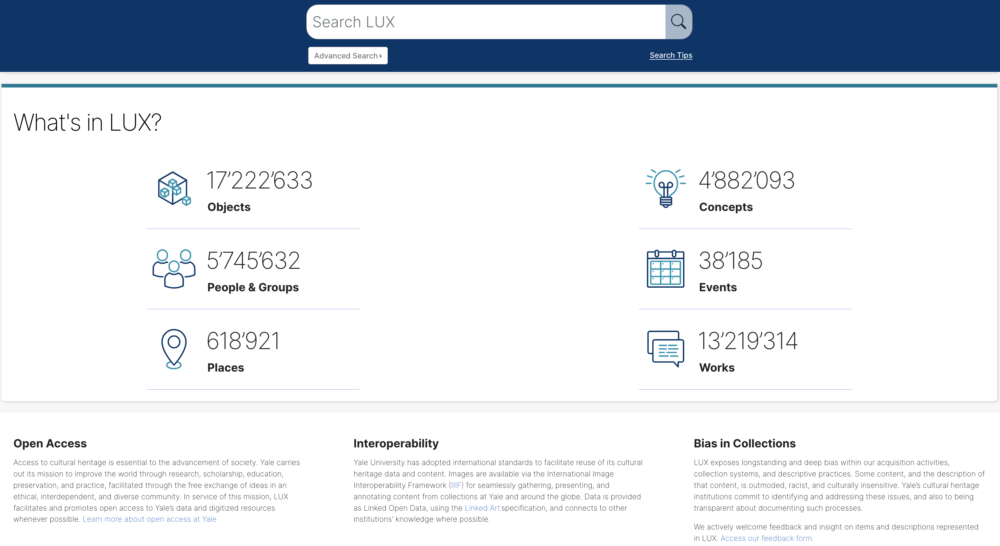
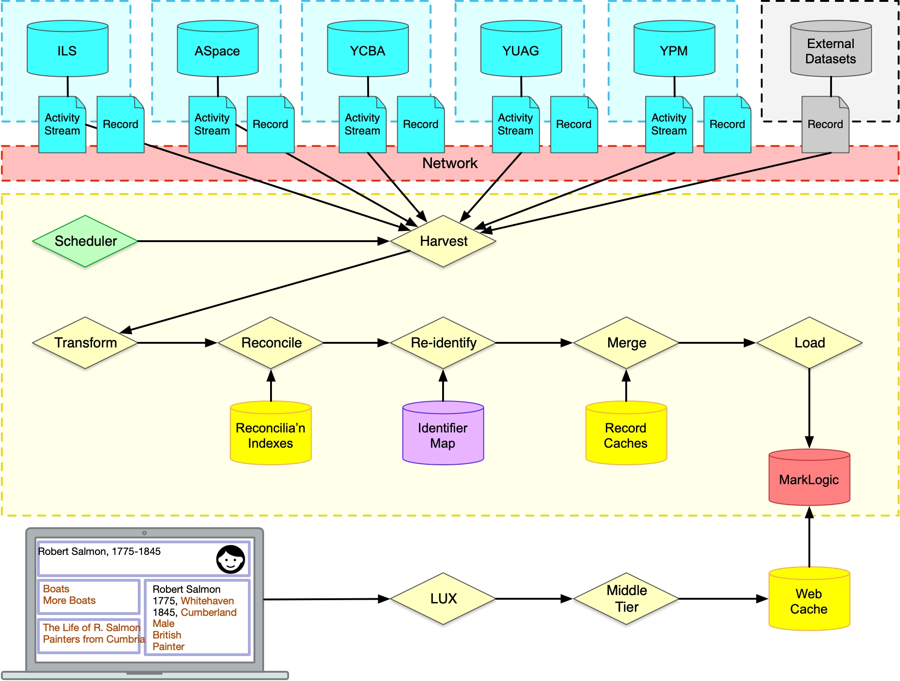
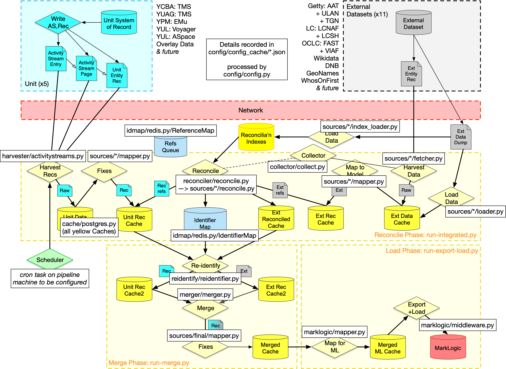
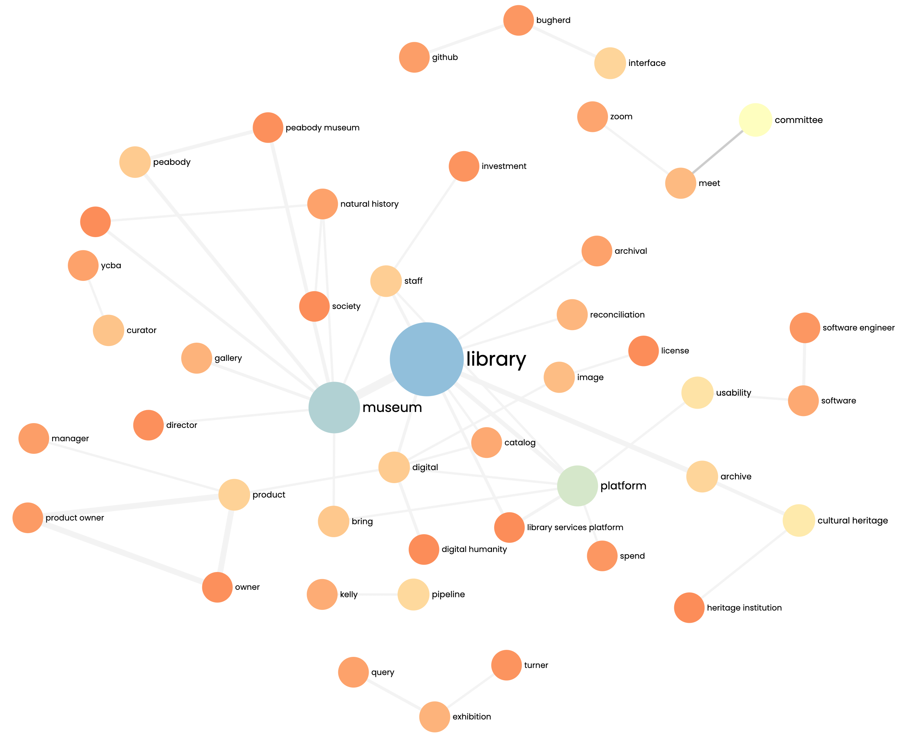
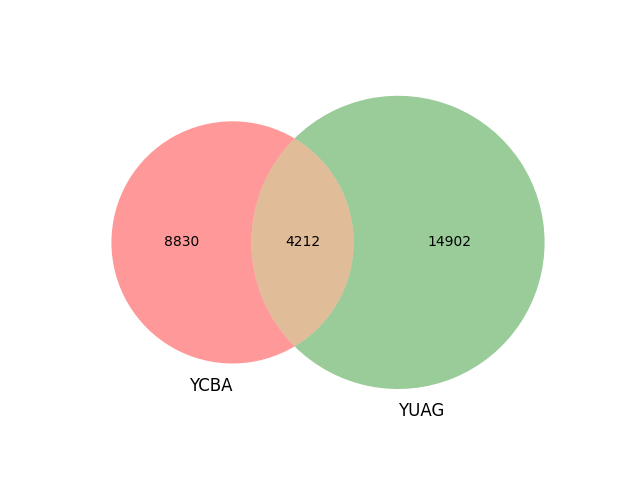
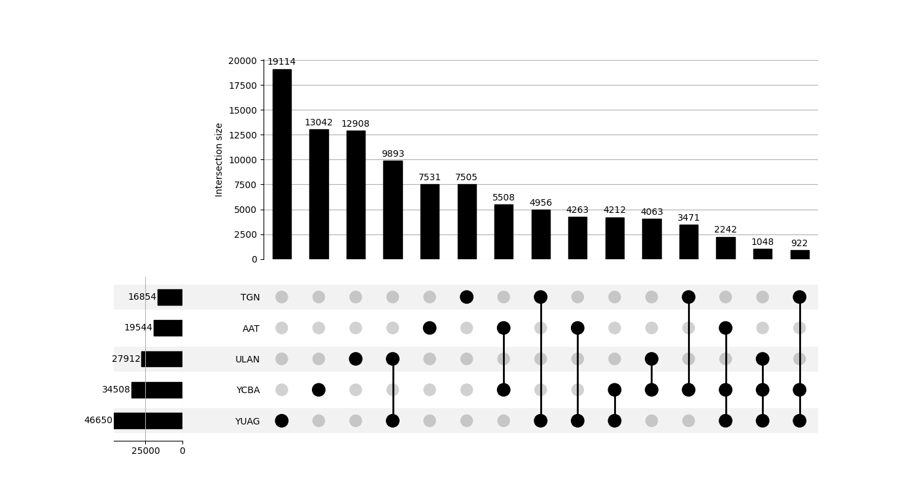
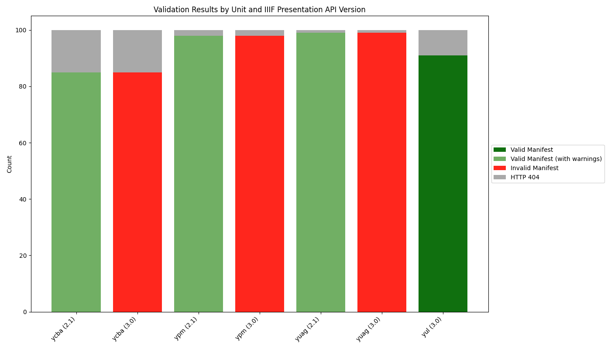

# 8. Yale's LUX and LOUD Consistency {id="cha:lux-consistency"}

> The LUX initiative has created a model of collegial and productive collaboration that colleagues at Yale can look to. This collaborative approach extends beyond Yale, and I hope it has a trickle-down effect on the thinking of those who develop systems for libraries and museums. It remains to be seen how this initiative will influence the broader community and shape the future of museum system development.<br/> Heather Gendron, Director, Robert B. Haas Family Arts Library, YUL

This chapter initiates the third and final empirical investigation of the thesis, exploring the application of LOUD specifications on the LUX platform at Yale University, as detailed in [Section 8.1](#sec:large-scale-loud). Additionally, it examines the consistency of Linked Art and IIIF Presentation API resources within LUX, as discussed in [Section 8.2](#sec:la-iiif-consistency).

The impetus for this investigation arose from preliminary insights obtained from the PIA research project, which suggested that relying almost exclusively on those empirical findings may not fully capture the complexities of developing and sustaining LOUD-compatible infrastructures. Following an important PhD midway meeting in February 2023 [@raemy_linked_2023], which underscored the need for more practical engagement, I arranged a ten-day visit to Yale in May 2023. This visit, a direct follow-up to an in-person Linked Art meeting, aimed to deepen my understanding of the specific challenges and strategies involved in implementing LOUD.

The overarching goal of this investigation is to illustrate the diverse practices Yale has undertaken in its extensive adoption of LOUD standards, and to identify the ongoing challenges posed by specialised skill requirements and resource constraints within CHIs. The study aims to demonstrate how overcoming these challenges and ensuring the overall alignment of Linked Art and IIIF across the LUX platform and further afield can significantly advance shared methodologies and accessibility. This in turn could facilitate wider and more effective use and sharing of data, underlining the critical role of LOUD norms in the development of data stewardship in the CH sector.

As with the previous chapters, the findings of this research are compiled in [Section 8.3](#sec:synthesis-insights-8). This section provides a comprehensive summary and delves into the findings regarding the use of LOUD standards at Yale, as well as examining how well their resources align with the Linked Art and IIIF Presentation APIs. The chapter culminates in [Section 8.4](#sec:perspectives-8), which offers forward-looking perspectives for Yale and other CHIs. This final section reflects on the lessons learned during the course of the study and discusses potential strategies. It also considers the wider implications for the CH sector, suggesting ways in which institutions might address similar challenges and seek to improve semantic interoperability through community and local socio-technical practices.


## 8.1 Large-Scale Deployment of LOUD at Yale {id="sec:large-scale-loud"} 

This section examines the use of LOUD at Yale University. It is divided into three parts: the background to the LUX initiative is detailed in [8.1.1](#subsec:lux-background), the technology stack used is outlined in [8.1.2](#subsec:lux-technology), and a series of interviews conducted in 2023 with Yale staff members involved in developing LUX is covered in [8.1.3](#subsec:lux-interviews). This structure provides an account of the deployment, from its conceptualisation to its technological realisation, as well as practical insights from its implementers.

### 8.1.1 Background {id="subsec:lux-background"}

The trajectory of the LUX platform[^332] at Yale began over a decade ago, marked by a series of strategic developments aimed at improving digital access and infrastructure across CH units. The journey began in 2008 with the establishment of the Office for Digital Access and Infrastructure and the creation of the first shared DAM system. This system initially connected the collections of YUAG, YCBA and YPM, providing a basic framework for subsequent digital integration efforts. In fact, the development of LUX was built on a series of incremental steps.

In 2011, Yale University adopted an OA policy and launched its first-generation cross-collection discovery platform, which included digital assets from its major CH collections. This platform was a precursor to the LUX system and demonstrated Yale's commitment to making its vast resources more accessible and connected.

The appointment of Susan Gibbons in 2016 as first Vice Provost for CSC significantly advanced these initiatives. Her leadership coincided with the creation of the CHIT Pillar in 2017, which brought together CH directors and ITS representatives on a regular basis, fostering a collaborative environment critical to the subsequent phases of the project.

2018 saw the launch of a five-year project to improve access to Yale's collections, supported by initial project funding and an expanded scope to include YUL bibliographic records and archival finding aids. The following year, 2019, was pivotal, with the adoption of IIIF as the image standard for the collections, the beginning of project management, and a significant grant from the Andrew W. Mellon Foundation to support metadata reconciliation and harmonisation efforts.

The proof of concept, based on Blacklight[^333], for LUX in 2020 united data from over 15 million object records into a shared index, marking a major milestone in the project. Despite budget cuts due to the COVID-19 pandemic, the project continued with the refinement of the metadata schema and the addition of Robert Sanderson to lead these efforts[^334].

Although this proof of concept was an achievement in that it demonstrated the ability to integrate data from all units. However, it also showed that the interface did not meet the functional expectations. As a result, a technology evaluation process called a ‘bake off’ was initiated. Teams of community members from across CHIT - the museums, YUL and ITS - looked at a number of technology stacks and made an informed recommendation within a few months. LUX has been governed by several committees and groups[^335]. The CHIT Steering Committee oversees all strategic decisions, supported by technical and interdisciplinary collaboration teams such as the Cross-Collections Discovery Working Group, Cultural Heritage Information Technology Architecture, the Metadata Working Group, and the Bias Awareness and Responsibility Committee.

In 2021, after a thorough six-month evaluation of technologies, the LUX project entered the build phase of LUX 1.0. By 2022, all metadata from participating units had been ingested into LUX, and internal reviews of the beta version began, leading to its public release in May 2023.

At the time of writing, LUX integrates over 17 million objects, over 5 million agents (people and groups), over 600,000 places, some 4.8 million concepts, over 38,000 events, and over 13 million works from Yale's diverse collections (as seen in [Figure 8.1](#fig:lux-gui)), facilitating access and connectivity through a platform built on Linked Art. This format is not only appropriate for art museums, but has also proven adaptable to mapping library and archival data, thereby addressing cross-disciplinary challenges and ensuring that the LUX platform remains a vital resource for scholars, researchers and the general public, enabling detailed exploration of Yale's vast CH resources.

<figure id="fig:lux-gui" style="margin: 0 auto; text-align: center;">
 
<figcaption>
<strong>Figure 8.1</strong>:
 Snapshot of the LUX GUI (23 May 2024)
</figcaption>
</figure>

Through collaboration and a shared understanding of responsibilities, Yale has established a data architecture in which each unit is responsible for providing data in a format and structure that supports a consistent approach to data harvesting. This approach allows for easy updates and future enhancements. This collaborative effort has not only facilitated numerous improvements to the dataset, but has also led to advances in the technologies used.

The following subsection on the technology stack, in particular the LUX Data Transformation Pipeline, looks at the specific technologies and strategies used to achieve these optimisations and functional integrations.

### 8.1.2 Technology Stack {id="subsec:lux-technology"}

This subsection explores the comprehensive technology stack that underpins the LUX platform at Yale, detailing its architectural components, collaborative development processes and integration with external data sources. It covers the initial design principles, system components, data management procedures and continuous data quality improvement efforts. Key elements of the architecture and data pipeline are illustrated in [Figure 8.2](#fig:lux-pipeline) and [Figure 8.3](#fig:lux-pipeline-annotated), providing a visual representation of the workflows and technologies involved.

LUX was initially designed with a strong emphasis on standards compliance and interoperability [@sanderson_linking_2023]. This design approach includes the use of AS and JSON-LD for efficient data harvesting, Linked Art to facilitate data sharing across domains, and IIIF for seamless image delivery. To enable efficient data interpretation and simplify the work for software engineers, each collection exports their content using JSON-LD, which can be interpreted as triples. The choice was made to employ a low-level ontology, specifically Linked Art. LUX also uses HAL to generate the accordions in the GUI through the `_links` properties.

As noted by @sanderson_lux_2023, LUX functions primarily as an aggregator, with individual institutions retaining ownership of their data. This arrangement fosters a highly collaborative environment, characterised by engagement and experimentation that drives consensus building. Described as ‘contagious’, this cooperative spirit fosters community-wide collaboration. Guided by agreed models for governance and cost-sharing, LUX integrates LOUD standards and adheres to the self-defined SHARED technical principle. The platform's front-end facilitates user interaction by seamlessly handling all Linked Data under the hood, eliminating the need for stakeholders to learn SPARQL. In addition, LUX's advanced search capabilities feature graph queries that balance search depth and performance, limiting computation times to one minute to optimise responsiveness and usability.

The architecture of LUX consists of several interconnected components: data harvesting, data pipeline, back-end database, middle tier and front-end. These components have been integrated according to some of the established standards mentioned earlier, allowing any individual component to be replaced without requiring a complete rewrite of the system. Hosted by Amazon, LUX benefits from the widespread adoption and robust support within the software development community for technologies such as Python, JavaScript, Node.js and React.

Moreover, LUX harnesses the power of an enterprise-class, multi-modal back-end database, increasing its efficiency. To encourage collaboration and knowledge sharing, the code for all components of LUX, including the custom code for MarkLogic[^336], has been made open source and available to the wider community[^337] [see @cahill_open-source_2024].

The LUX platform is characterised by its extensive connections, not only within Yale units, but also beyond, through the inclusion of external data sources during data processing. These sources cover different subject areas and perspectives and are available as Linked Data, enriching the information available to users by matching records in LUX. For example, one of the key processes used to match works and objects is the integration of Wikidata records, providing the ability to make meaningful associations between objects from units, such as those within the YCBA collection, and related works. They also include additional names and terms from authority records and subject headings of libraries like GND[^338], LoC[^339], or the NDL[^340], as well as the VIAF[^341]. This strategic approach requires careful anticipation of the requirements for Linked Data integration, accompanied by a concerted effort to foster extensive collaboration within the YCBA unit. In particular, the scope of authority control procedures at YCBA encompasses all collections, further emphasising the need for extensive collaboration. In addition, collaborative efforts extend beyond the YCBA unit to include partnerships with external services and inter-unit collaborations between the YCBA and the YUAG. This collaborative approach is particularly evident in the joint exhibitions mounted by the two units.

[Figure 8.2](#fig:lux-pipeline) depicts the overall data transformation, reconciliation, enrichment and publication workflow for LUX. The base records come from both internal and external sources, with internal records being harvested through the IIIF Change Discovery API [see @raemyAnalysisUsabilityAutomatically2024]. The processes (represented by diamonds) are described hereafter. The source code of the pipeline, which notably includes the identifier map of equivalencies and their associated indexes, was also released on GitHub in March 2024[^342].

<figure id="fig:lux-pipeline" style="margin: 0 auto; text-align: center;">
 
<figcaption>
<strong>Figure 8.2</strong>:
 LUX Data Pipeline and Architecture
</figcaption>
</figure>

- **Harvest**:   It runs nightly and is triggered by an operating system level     scheduler to poll each stream to find and retrieve records that have     changed since the previous harvest.
- **Transform**:   The records are passed through source specific transformation     routines in order to either map from arbitrary data formats, or to     validate and clean up records already provided in Linked Art.
- **Reconcile**:   This process is conducted to discover further identities from the     various datasets to be able to collect all information about a     particular entity eventually into a single record.
- **Re-Identify**:   It maps the original URIs of the records to the internal     identifiers.
- **Merge**:   The records from multiple sources that have been mapped to the same     identifier are merged together to form the single record.
- **Load**:   The resulting dataset is then annotated with some additional     features for indexing and exported to MarkLogic.

[Figure 8.3](#fig:lux-pipeline-annotated) shows an annotated version of the data pipeline, detailing specific Python scripts required for each step of the process or for handling different datasets. For example, when mapping and establishing dependencies, it's necessary to consider the different systems used by different units, such as ILS and TMS. A specific example is the YCBA, where data harvesting moves from LIDO format to Linked Art. In addition, the middle tier of the architecture manages four separate instances of LUX -- primary, backup, development and sandbox -- each customised for specific operational needs. The platform uses code libraries such as LinkedArt.js (JavaScript) and Cromulent (a Python library), which include built-in validation and convenience functions [@sanderson_linked_2024]. These tools exemplify the level of engineering sophistication of the LUX platform, guaranteeing its adaptability and efficiency in a variety of data integration scenarios.

<figure id="fig:lux-pipeline-annotated" style="margin: 0 auto; text-align: center;">
 
<figcaption>
<strong>Figure 8.3</strong>:
 Annotated LUX Data Pipeline and Architecture
</figcaption>
</figure>

This integration significantly enhances the record by combining knowledge from different Yale units, the Getty's ULAN, European national libraries and other external sources. This is an example of the positive impact and improvement that can be achieved by linking disparate data sources. The linking process is automated within the data processing code, using equivalent URIs and intelligent matching of names associated with people, places and things. However, matching and merging data into a single LUX record can be a complex task. Data quality is affected by human imperfections, as all data is derived from human input. As a result, efforts are constantly being made to refine and improve the matching process as part of a continuous improvement process.

Having discussed the technology behind the LUX platform, I now turn to the perspectives of a few of the Yale staff who worked on it. The next section is an account of interviews conducted in 2023 with team members involved in the development of LUX, offering a reflection on the project shortly after its official launch, their experiences, the challenges they faced, and the results of their efforts. It provides a personal account of the collaboration and technological development that went into LUX.

### 8.1.3 Interviews {id="subsec:lux-interviews"}

In May 2023, a number of interviews were conducted with 20 individuals associated with the LUX project at Yale University[^343]. These interviews, which included both one-on-one and group sessions with up to four participants, took place over nine separate sessions. Two of these sessions were conducted via Zoom to accommodate remote participants, while the remaining seven were held face-to-face on the Yale campus in New Haven, CT, USA. Each interview was designed to last approximately 45 minutes and prior to these sessions, each participant was provided with a consent form and a prepared questionnaire to streamline the discussion and ensure that all relevant topics were adequately covered.

The consent form explained the aims of the study, the voluntary nature of their participation, their right to withdraw at any time, and detailed the process of audio recording and verbatim transcription for analysis as part of my PhD. It emphasised that the data collected would be stored securely, accessible only to myself, and could be used for future research with all identifying information removed or pseudonymised to ensure confidentiality. One copy of the transcript was also given to all participants to review and confirm their comfort with the recorded content.

To further protect the integrity of participants, those who agreed to have their names disclosed and their statements published underwent a secondary verification process. This process allowed them to review and amend their contributions in order to ensure accuracy and satisfaction with the representation of their views. Of the 20 participants, thirteen agreed that their names and any quotes from them could be published in this thesis or any related report.

#### 8.1.3.1 Themes and Questions {id="subsubsec:themes-questions"}

The interview questions were systematically organised around four main themes: Mission & Values, Collaboration, Technology and Principles. This organisation helped to guide the interviews, although not all questions were asked of each participant. Instead, the selection of questions was specifically tailored to the expertise and role of each interviewee, allowing for more focused and meaningful discussions. For example, technical questions about the infrastructure or data interoperability of the platform were directed at software developers and data engineers, while broader questions about the impact and overarching values of LUX were asked of a wider audience. This approach ensured that each session was both focused and adaptable, providing comprehensive feedback on both the operational and strategic dimensions of the LUX platform, as detailed in [Table 8.1](#tab:lux-interview-questions).

<figure id="tab:lux-interview-questions" style="text-align: center;">
 <figcaption><strong>Table 8.1</strong>: LUX Interview Questions</figcaption>
<table style="margin: 1em auto;">
<thead>
<tr>
<th><strong>Topic</strong></th>
<th><strong>Questions</strong></th>
</tr>
</thead>
<tbody>
<tr>
<td>Mission & Values</td>
<td>1) How would you define the LUX platform in a few words?<br>
2) What impact has LUX had internally and/or outside Yale?<br>
3) What does LUX do that previous systems haven't?</td>
</tr>
<tr>
<td>Collaboration</td>
<td>4) Has LUX succeeded in bringing together people from different units at Yale? Were you equipped with all the necessary tools or methods to work together?<br>
5) How did you manage to build consensus? Can you give me an example of a successful and unsuccessful scenario of consensus building?<br>
6) Has the LUX platform brought you closer to national or international communities and working groups (such as LD4, IIIF or Linked Art)?</td>
</tr>
<tr>
<td>Technology</td>
<td>7) Infrastructure a) For everyone: What do you find innovative about the technological foundation you have deployed?<br>
7) Infrastructure b) For software developers and data engineers: Can you explain the steps involved in designing the LUX data pipeline?<br>
7) Infrastructure c) For software developers: How do you plan to measure usage of the system?<br>
8) Data Usability a) For everyone: To what extent is the data on the LUX platform easily reusable (on the user interface or/and with the APIs)?<br>
8) Data Usability b) For software developers and data engineers: How usable was the data for building LUX?<br>
8) Data Usability c) For software developers and data engineers: How can you ensure data concurrency and consistency?<br>
9) Interoperability a) For everyone: How do you assess the mapping process that has been done to expose the metadata in Linked Art? Would you have used other standards and/or serialisation formats?<br>
9) Interoperability b) For software developers: How much computational effort is required to generate IIIF and Linked Art resources?<br>
9) Interoperability c) For software developers, metadata experts, data engineers, and semantic architects: How to assess the semantic interoperability of the data produced for LUX? How to ensure that the data can be easily reconciled with other datasets?</td>
</tr>
<tr>
<td>Principles</td>
<td>10) The LOUD standards, which include the IIIF Presentation API and Linked Art, have their own design principles and LUX is based on the FAIR data Principles and SHARED technical principles.<br>
a) Have these principles provided you with any real guidance?<br>
b) Which of these principles do you feel have been achieved?<br>
c) Are there any other principles (or norms, best practices) that you feel are relevant to LUX?</td>
</tr>
<tr>
<td>Misc</td>
<td>Further comments</td>
</tr>
</tbody>
</table>
</figure>

A dual method of capturing data was adopted during the interviews: I transcribed key points directly into a spreadsheet for real-time analysis and tracking, while simultaneously recording the interviews for comprehensive documentation. This approach allowed for immediate adjustments to the questioning process - questions could be rephrased or redirected on-the-fly based on the flow of the conversation and preliminary findings from the real-time notes.

To convert the recorded audio into text,, Whisper[^344], an ASR system, was used. Whisper is designed to provide robust and accurate speech-to-text capabilities and supports multiple languages. It has been trained on a wide range of data collected from the internet and has shown considerable ability to understand different types of accents and dialects, making it an ideal choice for transcribing the varied responses of the interview participants [@radford_robust_2022]. The transcription process was facilitated using the CLI. The specific commands executed to transcribe the interviews from audio files into text are detailed in [Code Snippet 8.1](#lst:whisper-cl).

<figure id="lst:whisper-cl" style="text-align: center;">
 <figcaption>
<strong>Code Snippet 8.1:</strong> Command to Transcribe the Interviews into Audio Files Using Whisper
</figcaption>

```bash
~ % for f in *.wav ; do whisper $f --fp16 False ; done
```

</figure>

This sequence is designed to systematically process each `.wav` file located in a specified directory to transcribe the audio content into plain text. It is a Bash loop that iterates over all `.wav` audio files. For each file, it invokes Whisper with the parameter `–fp16 False`, which specifies that the floating point precision should be maintained at 32 bits for better accuracy during the transcription process. This option is particularly useful when the quality of audio files varies or when the highest possible accuracy is required, as it ensures the neural network computations retain more information during processing.

The command does not specify a particular model, which means it defaults to the `base` model unless otherwise configured. This model strikes a balance between speed and accuracy, making it suitable for general purposes where the audio quality is reasonable and the content does not require intensely detailed linguistic analysis. Each transcription is then saved in a separate text file corresponding to its `.wav` file, ensuring that the data remains organised and each session's content is easily accessible for further review and analysis. Whisper automatically detected that the recordings were in English and adjusted its processing to optimise for English language transcription.

Once transcribed, the raw text files were converted into a more manageable format for content analysis. The conversion process involved formatting the transcribed text into `.md` files, which are easier to handle and annotate than plain text files. This was achieved by using the `sed` command to insert newline characters between successive blank lines in the text files, effectively creating a new paragraph for each spoken segment. The `awk` utility was then used to ensure proper line spacing in the final Markdown documents. The command used for this conversion is shown in [Code Snippet 8.2](#lst:md-newlines).

<figure id="lst:md-newlines" style="text-align: center;">
 <figcaption>
<strong>Code Snippet 8.2:</strong> Command to Convert Text files into Markdown with New Lines
</figcaption>

```bash
~ % sed -e 's/^$/\n/g' transcript.txt \
  | awk '{ printf "%s\n\n", $0 }' > transcript.md
```

</figure>

These Markdown files then served as the primary source for detailed analysis, allowing easy navigation through the interview content and facilitating data management and retrieval.

#### 8.1.3.2 Findings {id="subsubsec:interview-findings"}

Upon reviewing the transcriptions, the interviews revealed a rich description and perception of LUX. The following passages provide an overview of these findings, supported by selected quotes from participants. This is followed by a distant reading process using topic modelling to uncover further threads of interest.

LUX is perceived as a ground-breaking search and discovery tool that brings together disparate CH data, enabling users to explore and discover connections between collection items. The platform is seen as having transformative potential for teaching, learning and research. Internally, it has fostered collaboration, increased the visibility of participating units, and demonstrated the feasibility of integrating current technology. Externally, LUX has attracted significant interest from other institutions, highlighting its potential impact on a wider scale.

Emmanuelle Delmas-Glass, Head of Collections Information Access at YCBA, expressed some nuanced concerns:

> I do have concerns about how LUX is perceived at times and its positioning as a highly sophisticated technical tool. While it certainly possesses advanced capabilities, it is important to remember that it is not solely defined by its technical complexity <br/> Emmanuelle Delmas-Glass, Head of Collections Information Access, YCBA

Collaboration across units at Yale has been a notable success of the LUX project, fostering interactions between libraries and museums. However, challenges in decision-making have been identified, particularly around the issue of ownership. Despite Susan Gibbons' leadership, the question of who owns LUX remains unresolved. Efforts to promote LUX through training and campus discussions have faced hurdles in terms of resource allocation and division of responsibilities. The impact of COVID-19 has been unexpectedly positive, increasing participation and trust through virtual meetings. Heather White, User Experience Designer at ITS, highlighted the project's dedication to sustainable development:

> Unlike previous projects at Yale, LUX stands out as the first one with a post-launch plan, demonstrating a commitment to sustainability and ongoing development. This is in stark contrast to the common practice of addressing issues and implementing requested features on an ad hoc basis without a clear roadmap. LUX, on the other hand, has upcoming releases and planned features that were not initially included, indicating a long-term staffing and development strategy. However, it is worth noting that, similar to most projects at Yale, there is still a lack of dedicated product management. <br/> Heather White, User Experience Designer, ITS

The consensus-building process for mapping metadata in Linked Art, while generally successful, faced some disagreements and challenges, particularly between data owners and mapping teams. The iterative, collaborative process involving Linked Art and JSON-LD proved beneficial. Future projects could benefit from consolidating collaborative norms and achieving coherence in both technical and social aspects. Long-term support and prioritisation of LUX amidst staff turnover and changing institutional priorities requires careful planning and commitment. Peter Clarke, a Full Stack Engineer at ITS, shared his experience with Linked Data:

> Working with Linked Data was an interesting experience for me, as it revealed the fascinating connections that can be discovered across different products. It provided me with valuable exposure to triples and expanded my understanding of document databases and JSON-based indexing. This shift in technology, particularly in how we handle data, has been the most significant change for me personally <br/> Peter Clarke, Full Stack Engineer, ITS

Key individuals played a pivotal role in the success of LUX. Susan Gibbons' high-level support as Vice Provost facilitated trust and established LUX as a layer of discovery without replacing existing units. Sarah Prown's role as project manager was central to fostering collaboration and audience engagement, with norms and boundaries that built trust. Robert Sanderson's facilitation and collaboration with developers was also significant, despite some challenges in communicating the potential of Linked Art. His strategic role, particularly with a documented API, is expected to encourage future cross-collection projects such as hackathons.

Alison Clemens, Access Strategist for Special Collections at the Beinecke Rare Book & Manuscript Library, emphasised the impact of Susan Gibbons' leadership.

> The success of this iteration of cross-collection discovery can be attributed, in large part, to Susan Gibbon’s role as Vice Provost, who initiated the project and revitalised cross-campus collaboration efforts. This new approach to cross-collection discovery has resulted in a significant investment of staff time and resources <br/> Alison Clemens, Access Strategist for Special Collections, Beinecke Rare Book & Manuscript Library, YUL

LUX's technological foundation is considered innovative, providing a cross-collection discovery platform that integrates and links digital data more effectively than previous systems. LUX is known as the largest known CH Linked Data platform, based on open standards such as Linked Art, IIIF and AS. The platform provides new entry points for accessing data, improving data integration and organisation. However, the usability of the data varied between units, with significant challenges around data quality and consistency, particularly from YUL. The lack of dedicated resources for data cleansing and reconciliation at unit level hinders transparency and effectiveness, highlighting the need for specialised roles within each unit. Kelly Davis, Data Engineer at CSC, underscored the importance of data ownership and quality:

> I firmly believe that the owners of the data should be responsible for fixing any issues that arise, as the pipeline or external sources may not have the necessary context. However, addressing such issues requires significant time and resources. Improving the mapping process and leveraging high-quality external sources can enhance the usability of the data, although errors are inevitable <br/> Kelly Davis, Data Engineer, CSC

There is also a consensus that the advanced search function needs further improvement to make it more intuitive. Anna Arays, Librarian for Slavic & East European Studies at YUL, shared her insights into the challenges faced by libraries and museums:

> The library’s role is to provide quick, reasonable, and easy access to a large volume of materials. Our users typically have specific search goals, and while they do browse, their approach to discovery differs from object-based environments. Collaborating with museums revealed challenges that may seem straightforward to them but become real problems for our users. For instance, the object/works split in the platform, which stems from the distinction between intellectual content and objects. Balancing these elements to ensure user-friendly integration poses significant friction. Additionally, discussions on data privacy highlighted librarians’ strong concerns about recording user search data. Achieving consensus required labour-intensive efforts to address the distinct needs of both user communities. Despite the complexity, this project fostered mutual learning and serves as a foundation for further improvements based on user feedback. <br/> Anna Arays, Librarian for Slavic & East European Studies, YUL

In addition, the separation of objects and works on the GUI has been confusing for many users. This challenge is deeply rooted in the distinction made by CIDOC-CRM and Linked Art between the intellectual content of a work and the physical Human-Made Object. While this separation facilitates more nuanced metadata and relational connections in databases, it often complicates the UX, particularly for those accustomed to viewing an object and its intellectual content as a single, unified entity.

Yer Vang-Cohen, Data and Database Administrator at YUAG, explained this difficulty:

> It was challenging to convey the distinction between work and the Human-Made Object, particularly to our curators who perceive the object as a unified entity. Although they have a general understanding of the visual entity record, it proved difficult for them to grasp the concept of splitting the record and having metadata about the visual content reside separately from the Human-Made Object <br/> Yer Vang-Cohen, Data and Database Administrator, YUAG

LUX adheres to principles such as FAIR and LOUD, which have provided essential guidance, ensured interoperability and influenced its design and development. However, perceptions of these principles varied considerably. Project managers placed a strong emphasis on these principles, while developers, librarians and archivists considered them to be of secondary importance in the creation of LUX, with some individuals simply unaware of them. This variance underlines the need for wider awareness and integration of these principles across all roles involved in the project.

In terms of future potential, there is significant interest in the potential re-use of the LUX code base. Many believe that with a small, dedicated team possessing foundational knowledge in core technologies like JavaScript and React, it is feasible to adapt and extend the LUX system for new applications. Leveraging the work already done with MarkLogic could further streamline this process, making it accessible for research-oriented systems or other institutional needs. Jeff Campbell, Associate Director of Digital Asset Technologies at ITS, elaborated on this potential:

> I believe that a small team of two or three individuals, who are open to exploring new avenues and possess a sense of curiosity, could accomplish it. Ideally, they should have a foundational understanding of core technologies like JavaScript and React, so they can focus on specific requirements without starting from scratch. While MarkLogic is a robust system, the work we’ve already done with it can potentially be leveraged for their use cases, making the process smoother. If someone is interested in a research-oriented system similar to LUX, they could start with a single-node environment or opt for a powerful machine. <br/> Jeff Campbell, Associate Director, Digital Asset Technologies, ITS

After collecting these qualitative findings, I aimed to obtain a distant reading perspective of the interviews using simple topic modelling methods. To do this, I used an online topic extraction tool[^345]. The tool performs the following steps:

1.  Clean up the text: flatten to ASCII, remove     URLs and     punctuation marks.
2.  Lemmatisation.
3.  Decompose the text into n-grams up to four grams and remove less     relevant n-grams.
4.  Counting co-occurrences: identifying which pairs of n-grams occur     frequently together.
5.  Create a network from the list of co-occurring n-grams: connect     frequent n-grams.
6.  Apply a community detection algorithm to the network using the     Louvain algorithm.
7.  Apply the parameter chosen by the user: a large value detects a few     large communities, while a small value detects many small clusters.
8.  Each cluster in the network is identified as a topic. The key terms     in each topic are the n-grams contained in the cluster.

I fed all the raw `.txt` files, which contained no names or identification, into the tool. I set the parameter to detect large topics, limiting the number to ten, and used a special stopword file (e.g. LUX, data) to avoid overcrowding the results. The identified clusters can be seen in [Figure 8.4](#fig:lux-interviews-topics) [^346]:

<figure id="fig:lux-interviews-topics" style="margin: 0 auto; text-align: center;">
 
<figcaption>
<strong>Figure 8.4</strong>:
 LUX Interviews: Key Topics and Their Relationships
</figcaption>
</figure>

The topic modelling results reveal a broad range of themes and focal points across the interviews. Below is a detailed analysis of each identified cluster:

- Topic 1:   This cluster centres around the pipeline, prominently featuring     Kelly Davis, the Data Engineer. This indicates a significant     emphasis on the technical aspects of data processing and     infrastructure within LUX. The focus on a single individual     highlights the pivotal role played by certain key personnel in the     project's technical operations.
- Topic 2:   This topic focuses on YCBA and curators, suggesting strong     involvement and interest from this particular unit and its staff. It     could indicate that the YCBA has been particularly proactive or     influential in the LUX project's development.
- Topic 3:   This cluster pertains to usability and software, reflecting ongoing     discussions about the user experience and the practical     implementation of software tools. It underscores the importance of     ensuring that the GUI and functionality are accessible and     effective for end users.
- Topic 4:   This topic highlights semantic and interoperability issues, which     are critical for achieving seamless integration and use of data     across different systems and platforms.
Topic 5:   This cluster revolves around meetings and committee activities, with ‘Zoom’     being a prominent term. It reflects the impact of virtual meetings     on collaboration.
- Topic 6:   This topic discusses product ownership and management, highlighting     the need for clear leadership and accountability.
- Topic 7:   This cluster includes terms related to technical aspects such as ‘GitHub’ and ‘Bugherd’     , indicating a focus on software development and issue tracking     tools.
- Topic 8:   This topic is focused on museums, particularly the     YPM,     emphasising the role of specific institutions within the LUX     initiative.
- Topic 9:   This cluster covers exhibitions and CH, with mentions of ‘Turner’ and ‘Gallery’, suggesting an     emphasis on public engagement and the presentation of collections.     It highlights the importance of exhibitions in making collections     accessible and engaging to the public.
- Topic 10:   This topic focuses on library services and DH, with key terms like ‘platform’ and ‘catalogue’, indicating     discussions about the integration of digital tools and resources in     library contexts. It reflects the evolving nature of     CH services in     the digital space.

While these clusters provide valuable insights into the main themes discussed during the interviews, some limitations should be noted. For instance, the prominence of individual names, such as Kelly Davis, may skew the perceived importance of certain topics. Additionally, the clustering process might overlook nuanced discussions or smaller, yet significant, themes that are not captured by the dominant n-grams. Nonetheless, this topic modelling exercise offers a useful overview of the key areas of focus and concern within LUX.

Having explored the qualitative findings and performed a distant reading of the interviews data using topic modelling, I now turn my attention to the second objective of this investigation: assessing the consistency of Linked Art and IIIF resources within LUX. The following section examines the tools and methods used to ensure compliance with LOUD standards and highlighting key findings from this analysis.

## 8.2 Linked Art and IIIF Consistency {id="sec:la-iiif-consistency"}

This section addresses the second, more technical, objective of the investigation around LUX. It is divided into two parts. Subsection [8.2.1](#subsec:consistency-tools) presents the available software tools used to validate Linked Art and IIIF resources. The second part, [8.2.2](#subsec:consistency-lux), examines how some of these tools were applied to verify the LOUD consistency of a portion of the resources available on the platform.

### 8.2.1 Ensuring Compliance: Tools and Validators {id="subsec:consistency-tools"}

Verifying the compliance of JSON-LD documents can be done at several levels: first, from a purely syntactic perspective; then by checking if the `@context` is correct, meaning whether the correct properties and patterns (lists, arrays, and path construction) are used; and finally, by ensuring that the values of the elements within are correct. The latter is more complex when external controlled vocabularies are used, as is the case with Linked Art. Although certain terms are recurrent and some are mandatory or recommended, such as AAT terms, there is always some leeway for institutions implementing the API.

In this dissertation, I am primarily concerned with the second level, which unfortunately only partially addresses full validation at the level of semantic interoperability. However, the tools for this level are available and maintained. This validation process involves ensuring that the JSON-LD structure is correct, which includes validating that the `@context`, properties, and patterns adhere to the expected formats. This ensures that data can be hopefully interpreted and integrated across different systems.

Within Linked Art, two validators have been created: the first is a JSON validator[^347] testing resource compliance according to various entities, and the second is a SHACL validator[^348]. The former is still maintained, while the latter, though a commendable individual effort, hasn't been updated to accommodate all community needs.

Regarding validation and schema consistency, there are some affordances that have been allowed by the Linked Art community which can be found in the Linked Art JSON Validator and not directly in the schema documentation, such as having internal additional properties starting with underscores. For instance, LUX does this by appending `_links`, borrowed from HAL.

For IIIF, the available validation tools cover both the Image API and the Presentation API. The Image API validator[^349] supports all major versions of the API and thoroughly tests the server's behaviour in delivering images, not just the quality of the images themselves. This validator can detect most potential issues by requiring the upload of a specific test image. It is available as a Python package, allowing integration into pipelines for automated testing.

The IIIF Presentation API validator[^350] works similarly by parsing resources (such as Manifest and Collection) and detecting common issues, particularly related to JSON-LD. While it ensures that the manifests are correctly structured, it does not verify the existence of referenced images. This validator can be used from its homepage, by making JSON requests, or by running it locally[^351]. It is important to note that a valid Manifest or Collection does not guarantee that all its functionalities -- patterns -- will be properly displayed by IIIF viewers or players. Complex manifests might be valid but may not be fully supported by all clients, which might not yet have the capacity to render all the features[^352]. Conversely, non-compliant manifests could still be partially or fully understood by some clients, which might not need to interpret every aspect of a resource.

Tripoli, an unofficial validator for the IIIF Presentation API 2.1, written in Python, provided an API for integrating IIIF validation into code. However, it has not been updated since 2017. Hyperion, a collection of NPM packages including a validator for version 3.0 of the IIIF Presentation API, has been integrated into the IIIF Commons initiative. Its dedicated validator functionality is now part of parsers and other helpers.

These tools ensure that IIIF services and resources are compliant with the standards, although some validators, such as Tripoli, are outdated. Despite these challenges, the tools provided by IIIF-C and the integrated functionalities within the IIIF Commons initiative support validation and help maintain the integrity and interoperability of IIIF resources. For validating them, I chose to leverage the official IIIF-C validators as described in the following subsection.

### 8.2.2 LUX Data Consistency {id="subsec:consistency-lux"}

This subsection discusses the data consistency of a large-scale LOUD application, focusing primarily on Linked Art in [8.2.2.1](#subsubsec:consistency-la) and peripherally on IIIF in [8.2.2.2](#subsubsec:consistency-iiif).

The consistency of the Linked Art data was assessed in three different ways: against the `JSON` validator based on the API endpoint constraints, unit-to-unit consistency between YUAG and YCBA, and by comparing concept terms from LUX with Getty's AAT. Finally, the consistency of IIIF Presentation API resources (V2.1 and/or V3.0, depending on their availability across Yale units).

#### 8.2.2.1 Linked Art Consistency {id="subsubsec:consistency-la"}

In May 2023, I received one of the full LUX dataset, i.e. a slice of records which correspond to the highest number of parallel processes possible. It is a JSONL file which is composed of lines of LUX JSON-LD that include Marklogic's rather verbose triples format. The full dataset is about $435$GB uncompressed, or about $45$GB compressed with `gzip`. At the time of verifying the consistency of the data, a downloadable LUX dataset or a custom dataset builder were not available.

To ensure data consistency across LUX, I conducted in October 2023 an extensive validation of Linked Art data. This process involved testing the Linked Art JSON validator and schemas with data from both the Linked Art API Endpoints and the LUX platform. The goal was to verify if the Linked Art examples and schemas were up-to-date and to validate exemplary data from LUX before a larger scale validation.

Originally, my intention was to check all the resources I received from LUX. However, after testing an initial batch, I found that they all yielded similar results for each entity endpoint. Consequently, I did not continue to check every resource. I communicated the results to Robert Sanderson, who maintains the Linked Art JSON validator, manages the Linked Art website, and also works on LUX, to ensure that the findings were accurate.

The validation process was conducted using a Python script that was forked and adapted with specific arguments from the Linked Art JSON validator[^353]. This script processed data from the examples found on the Linked Art website and LUX, checking for compliance with the respective `JSON` schemas. [Code Snippet 8.3](#lst:la-concept) and [Code Snippet 8.4](#lst:lux-concept) are validation results for a `Concept`[^354]:

<figure id="lst:la-concept" style="text-align: center;">
 <figcaption>
<strong>Code Snippet 8.3:</strong> Validating a Linked Art Resource: Example Concept
</figcaption>

```bash
----------------------- Processing: https://linked.art/example/concept/0
  Validation failed. Validation errors:
  Error 1: /member_of/0 --> 'id' is a required property
  Error 2: /created_by/influenced_by/0 --> 'id' is a required property
  Error 3: /created_by/influenced_by/1 --> 'id' is a required property
  Error 4: /broader/0 --> 'id' is a required property
```

</figure>

<figure id="lst:lux-concept" style="text-align: center;">
 <figcaption>
<strong>Code Snippet 8.4:</strong> Validating a Linked Art Resource: Concept on LUX
</figcaption>
 

```bash
---------------------------------- Processing: https://lux.collections.yale.edu/data/concept/000052b6-a350-4bcb-afca-15dceb72920a
  Validated!
```

</figure>

[Table 8.2](#tab:lux-validation-summary) summarises the validation results for different Linked Art endpoints and selected LUX instances. The table includes the status of the JSON schema validation, specific issues identified, and the required actions to achieve consistency. The main validation errors were due to missing identifiers in the Linked Art Endpoint examples and issues with the `identified_by` $\rightarrow$ `Identifier` pattern and the `referred_to_by` property in `Set` instances for the LUX data. All instances that bear the `TBD*` in the table had the same message warning regarding the use of `Identifier` within `identified_by`. It is a pattern that seems correct according to the documentation, informed by the Linked Art core schema[^355] which led to validation errors.

<figure id="tab:lux-validation-summary" style="text-align: center;">
 <figcaption><strong>Table 8.2</strong>: Validation Summary of Linked Art Example Endpoints and LUX Instances</figcaption>
<table style="margin: 1em auto;">
<thead>
<tr>
<th><strong>Endpoint</strong></th>
<th><strong>JSON Schema</strong></th>
<th><strong>LA Example</strong></th>
<th><strong>LUX Instance</strong></th>
</tr>
</thead>
<tbody>
<tr>
<td><strong>Concepts</strong></td>
<td></td>
<td>Add missing IDs</td>
<td></td>
</tr>
<tr>
<td><strong>Digital Objects</strong></td>
<td></td>
<td>Add missing ID</td>
<td>TBD*</td>
</tr>
<tr>
<td><strong>Events</strong></td>
<td>Add <code>Period</code> as accepted Class when using the <code>equivalent</code> property</td>
<td></td>
<td></td>
</tr>
<tr>
<td><strong>Groups</strong></td>
<td></td>
<td>Add missing IDs</td>
<td></td>
</tr>
<tr>
<td><strong>People</strong></td>
<td></td>
<td>Add missing IDs</td>
<td></td>
</tr>
<tr>
<td><strong>Physical Objects</strong></td>
<td></td>
<td>Add missing IDs</td>
<td>TBD*</td>
</tr>
<tr>
<td><strong>Places</strong></td>
<td></td>
<td>Add missing IDs</td>
<td>TBD*</td>
</tr>
<tr>
<td><strong>Provenance Activities</strong></td>
<td></td>
<td></td>
<td>N/A</td>
</tr>
<tr>
<td><strong>Sets</strong></td>
<td></td>
<td></td>
<td><code>referred_to_by</code> - LUX specific hack to deal with HTML</td>
</tr>
<tr>
<td><strong>Textual Works</strong></td>
<td></td>
<td>Add missing IDs</td>
<td>TBD*</td>
</tr>
<tr>
<td><strong>Visual Works</strong></td>
<td>Add <code>shown_by</code>. Schema name (endpoint path) to be changed to <code>visual</code>?</td>
<td></td>
<td>TBD*</td>
</tr>
</tbody>
</table>
</figure>

As part of this Linked Art consistency effort, I received two different spreadsheets from Robert Sanderson. The first contained 113,151 Getty terms from either AAT, TGN, or ULAN that are also present in LUX. The spreadsheet indicated how many times these terms appeared at both YCBA and YUAG. This data was used to check the consistency of concepts between LUX and the Getty Vocabularies, as well as the unit-to-unit consistency of both art museums. The Linked Art endpoints in question are categorised as either `concept` (AAT), `person` (ULAN and occasionally AAT), `group` (ULAN and occasionally AAT), or `place` (TGN and occasionally AAT).

For example, when comparing the term ‘goddesses’ (`aat:300343852`) between the AAT[^356] and LUX endpoints[^357], which is also present in both YCBA and YUAG digital collections, we can observe some differences. The Linked Art representation of the term on the Getty endpoint is loosely consistent with the data model but not with the Linked Art API, whereas LUX strictly follows the `concept` schema. Additionally, some SKOS properties present in the Getty endpoint, such as `skos:inScheme`, are not allowed by either the model or the API. Others, like `skos:narrower`, are permitted in the model but not in the Linked Art API. While it is understandable that Getty wants to maintain the hierarchical structure of a controlled vocabulary in both directions, Linked Art typically constrains this type of relationship in one direction. Therefore, external institutions building upon any of the Getty Vocabularies' Linked Art representations need to do so carefully.

The second spreadsheet focused on the 27,944 Getty terms that are also present in both of the art museums, either as direct references or after reconciliation through the LUX pipeline. YCBA uses 13,042 concepts and YUAG uses 19,114, with 4,212 terms present in both collections[^358], as illustrated in [Figure 8.5](#fig:vocab-ycba-yuag).

<figure id="fig:vocab-ycba-yuag" style="margin: 0 auto; text-align: center;">
 
<figcaption>
<strong>Figure 8.5</strong>:
 Getty Vocabularies Term Presence in the YCBA and YUAG Digital Collections
</figcaption>
</figure>

[Figure 8.6](#fig:vocab-ycba-yuag-upset) is an UpSet plot which was used to analyse the intersections between these terms. It reveals that ULAN is the most used controlled vocabulary, especially to reference people, with 12,908 terms, including 4,063 shared between YCBA and ULAN and 9,893 between YUAG and ULAN. However, AAT is the most shared controlled vocabulary, with significant overlaps: 5,508 terms shared between YCBA and AAT, and 4,263 terms between YUAG and AAT. Additionally, there are 2,242 terms shared among YCBA, YUAG, and AAT; 1,048 terms shared among YCBA, YUAG, and ULAN; and 922 terms shared among YCBA, YUAG, and TGN. In contrast, TGN is the least leveraged vocabulary, contributing 7,505 terms, with 3,471 shared between YCBA and TGN and 4,956 between YUAG and TGN. This analysis shows the predominant use of ULAN for referencing people and the extensive sharing of AAT within LUX for these particular units.

<figure id="fig:vocab-ycba-yuag-upset" style="margin: 0 auto; text-align: center;">
 
<figcaption>
<strong>Figure 8.6</strong>:
 Shared Terminology in YCBA and YUAG via Getty Vocabularies
</figcaption>
</figure>

[Table 8.3](#tab:ycba-vocab) and [Table 8.4](#tab:yuag-vocab) illustrate how YCBA and YUAG use the Getty controlled vocabularies. The columns represent the terms directly referenced, terms added after reconciliation through the LUX platform, and the total terms that are both directly referenced and added after reconciliation. Direct reference indicates terms that these units have directly put into their systems, while reconciliation is thanks to the LUX pipeline mechanism.

<figure id="tab:ycba-vocab" style="text-align: center;">
 <figcaption><strong>Table 8.3</strong>: YCBA - Usage of Getty Controlled Vocabularies</figcaption>
<table style="margin: 1em auto;">
<thead>
<tr>
<th><strong>Vocabulary</strong></th>
<th><strong>Direct Reference</strong></th>
<th><strong>After Reconciliation</strong></th>
<th><strong>Both</strong></th>
</tr>
</thead>
<tbody>
<tr>
<td>AAT</td>
<td>4949</td>
<td>417</td>
<td>142</td>
</tr>
<tr>
<td>ULAN</td>
<td>1</td>
<td>4062</td>
<td>0</td>
</tr>
<tr>
<td>TGN</td>
<td>4</td>
<td>3454</td>
<td>13</td>
</tr>
</tbody>
</table>
</figure>

<figure id="tab:yuag-vocab" style="text-align: center;">
 <figcaption><strong>Table 8.4</strong>: YUAG - Usage of Getty Controlled Vocabularies</figcaption>
<table style="margin: 1em auto;">
<thead>
<tr>
<th><strong>Vocabulary</strong></th>
<th><strong>Direct Reference</strong></th>
<th><strong>After Reconciliation</strong></th>
<th><strong>Both</strong></th>
</tr>
</thead>
<tbody>
<tr>
<td>AAT</td>
<td>4189</td>
<td>72</td>
<td>4</td>
</tr>
<tr>
<td>ULAN</td>
<td>0</td>
<td>9893</td>
<td>0</td>
</tr>
<tr>
<td>TGN</td>
<td>4939</td>
<td>12</td>
<td>5</td>
</tr>
</tbody>
</table>
</figure>

This breakdown shows the significant role of the LUX platform in enriching the datasets of both museums. It is notable that AAT is heavily used directly by both units and TGN by YUAG, whereas ULAN is heavily incorporated through reconciliation.

Overall, the consistency of Linked Art across LUX is quite satisfactory. The main challenges were navigating the Linked Art JSON schemas, which were occasionally out of date. In addition, the Linked Art examples have been heavily modified since the initial validation and no longer have the `Identifier` issue. Despite these improvements, the findings indicate that while terms referenced by AAT are the most shared entities between YUAG and YCBA, there is probably still room for further reconciliation of other entities to enhance the cross-interoperability within LUX.

#### 8.2.2.2 IIIF Consistency {id="subsubsec:consistency-iiif"}

In this subsection, I will evaluate the IIIF Presentation API resources from the LUX platform in terms of compliance with the specifications. Manifests from YUAG, YPM, and YCBA are available both as versions 2.1 and 3.0 of the Presentation API. The following URL patterns are used for either serving Version 2.1 (default for YCBA) or 3.0 (default for the two other museums):

- `https://manifests.collections.yale.edu/v2/<unit>/<obj|nat>/<id>`     
- `https://manifests.collections.yale.edu/<unit>/<obj|nat>/<id>`

YPM's IIIF resources have `nat` in their URLs and the art museums have `obj` as a slug before the identifier. As for YUL, Manifests are available in version 3.0 at the following URL:

- `https://collections.library.yale.edu/manifests/<id>`

[Code Snippet 8.5](#lst:curl) is an example command to validate a IIIF Presentation API resource against the validator installed locally. The command sends a request to the local instance of the validator, specifying the version of the IIIF Presentation API (either 2.1 or 3.0) and the URL of the IIIF resource to be validated.

<figure id="lst:curl" style="text-align: center;">
 <figcaption>
<strong>Code Snippet 8.5:</strong> CURL Command Against a Local Instance of the IIIF Presentation API Validator
</figcaption>
 

```bash
curl "http://localhost:8080/validate?version=<2.1|3.0>&url=<iiif-resource-url>"
```

</figure>

The results are returned as JSON, as shown in [Code Snippet 8.6](#lst:curl-result-v2.1) for a Version 2.1 Manifest and in [Code Snippet 8.7](#lst:curl-result-v3.0) for a Version 3.0 Manifest. These results indicate whether the IIIF resource is valid ($1$) or invalid ($0$) by the value of the `okay` field. Additionally, the response includes any potential `warnings` and errors found in the resource. The way errors are handled differs slightly between the two versions.

<figure id="lst:curl-result-v2.1" style="text-align: center;">
 <figcaption>
<strong>Code Snippet 8.6:</strong> JSON Responses against the Presentation API Validator: V2.1 Resource
</figcaption>

```json
{
  "okay": 1,
  "warnings": [
    "The remote server did not use the requested gzip transfer compression, which will slow access. (Content-Encoding: )",
    "WARNING: Setting non-standard field 'rendering' on resource of type 'sc:Canvas'\n",
    "WARNING: Setting non-standard field 'rendering' on resource of type 'sc:Canvas'\n",
    "WARNING: Resource type 'sc:Manifest' should have 'description' set\n",
    "WARNING: Resource type 'dctypes:Image' should have 'format' set\n",
    "WARNING: Resource type 'dctypes:Image' should have 'format' set\n"
  ],
  "error": "None",
  "url": "https://manifests.collections.yale.edu/v2/ycba/obj/53822"
}
```

</figure>

..<figure id="lst:curl-result-v3.0" style="text-align: center;">
 <figcaption>
<strong>Code Snippet 8.7:</strong> JSON Responses against the Presentation API Validator: V3.0 Resource
</figcaption>

```json
{
  "okay": 0,
  "warnings": [],
  "error": "",
  "errorList": [
    {
      "title": "Error 1 of 2.\n Message: Additional properties are not allowed ('logo' was unexpected)",
      "detail": "",
      "description": "",
      "path": "/[Additional properties are not allowed ('logo' was unexpected)]",
      "context": {
        "@context": "http://iiif.io/api/presentation/3/context.json",
        "id": "https://manifests.collections.yale.edu/ycba/obj/53822",
        "type": "Manifest",
        "label": "{ ... }",
        "metadata": "[ ... ]",
        "rights": "https://creativecommons.org/publicdomain/zero/1.0/",
        "requiredStatement": "{ ... }",
        "logo": "[ ... ]",
        "homepage": "[ ... ]",
        "seeAlso": "[ ... ]",
        "items": "[ ... ]"
      }
    },
    {
      "title": "Error 2 of 2.\n Message: 'https://creativecommons.org/publicdomain/zero/1.0/' does not match 'http://creativecommons.org/licenses/.*'",
      "detail": "",
      "description": "",
      "path": "/rights/['https://creativecommons.org/publicdomain/zero/1.0/' does not match 'http://creativecommons.org/licenses/.*']",
      "context": "https://creativecommons.org/publicdomain/zero/1.0/"
    }
  ],
  "url": "https://manifests.collections.yale.edu/ycba/obj/53822"
}
```

</figure>

With the help of a forked version of the Presentation API Validator[^359], I created a shell script to automate the validation of multiple IIIF Presentation API resources using the CLI. The script prompts the user for the unit, version, base URL, starting identifier, and the desired number of valid manifests. It then incrementally generates URLs by adding sequential identifiers to the base URL and sends validation requests to the local instance of the validator for each generated URL. This method was particularly useful as the exact range of identifiers was unknown and, besides, there were no IIIF Collections available from Yale to be parsed.

The script was designed with embedded logic to handle situations where certain identifiers might result in 404 errors, intending to skip these invalid URLs and continue crawling until the specified number of valid Manifests was attained. However, this logic did not work as intended. Instead of continuing beyond the specified range to achieve the desired count of valid manifests, the script stopped once it reached the end of the specified range, even if it had not yet processed the desired number of valid resources. As a result, some intended validations were skipped and not replaced by additional identifiers.

The outputs are then saved into a consolidated JSONL file, maintaining a structured and easily readable format. This facilitates further analysis and reporting by providing a comprehensive and structured dataset of the validation results. [Table 8.5](#tab:iiif-base-urls) lists the base URL and respective version used for validating the IIIF Presentation API resources.

<figure id="tab:iiif-base-urls" style="text-align: center;">
 <figcaption><strong>Table 8.5</strong>: Base Yale Manifest URLs and Respective Versions Used for Validation</figcaption>
<table style="margin: 1em auto;">
<thead>
<tr>
<th><strong>Unit</strong></th>
<th><strong>V.</strong></th>
<th><strong>Base URL</strong></th>
<th><strong>Start ID</strong></th>
</tr>
</thead>
<tbody>
<tr>
<td>ycba</td>
<td>2.1</td>
<td><code>https://manifests.collections.yale.edu/v2/ycba/obj/</code></td>
<td>53800</td>
</tr>
<tr>
<td>ycba</td>
<td>3.0</td>
<td><code>https://manifests.collections.yale.edu/ycba/obj/</code></td>
<td>53800</td>
</tr>
<tr>
<td>yuag</td>
<td>2.1</td>
<td><code>https://manifests.collections.yale.edu/v2/yuag/obj/</code></td>
<td>53800</td>
</tr>
<tr>
<td>yuag</td>
<td>3.0</td>
<td><code>https://manifests.collections.yale.edu/yuag/obj/</code></td>
<td>53800</td>
</tr>
<tr>
<td>ypm</td>
<td>2.1</td>
<td><code>https://manifests.collections.yale.edu/v2/ypm/nat/</code></td>
<td>53800</td>
</tr>
<tr>
<td>ypm</td>
<td>3.0</td>
<td><code>https://manifests.collections.yale.edu/ypm/nat/</code></td>
<td>1629301</td>
</tr>
<tr>
<td>yul</td>
<td>3.0</td>
<td><code>https://collections.library.yale.edu/manifests/</code></td>
<td>16198300</td>
</tr>
</tbody>
</table>
</figure>

Using the shell script, 100 Manifests per version and per unit were crawled. Since YUL only had IIIF Presentation API 3.0, a total of 700 URLs potentially discoverable on LUX were parsed with the validator. This resulted in the following outcomes:

- V2.1 Manifests from YCBA, YUAG, and YPM:   These Manifests all validated successfully but had the following     warnings: the remote server did not use the requested gzip transfer     compression, which can significantly slow down access to the     resources. Gzip[^360] compression reduces the size of the data being     transferred, thereby speeding up the download process and reducing     the load on network bandwidth. Additionally, the warnings included     non-standard field `rendering` on resource of type `sc:Canvas`, and     resource type `dctypes:Image` should have `format` set.
- V3.0 Manifests from YCBA, YUAG, and YPM:   These Manifests were all invalid and had minor error issues: the     `logo` property was not properly structured as it should be embedded     within the provider; the URL to Creative Commons should be     HTTP rather     than HTTPS[^361]; and in some     YUAG     Manifests, the language map construction was not leveraged     correctly, as `en` cannot be an array.
- V3.0 Manifests from YUL:   These Manifests all validated successfully.

[Figure 8.7](#fig:iiif-lux-validation) shows the distribution of valid Manifests, valid Manifests with warnings, invalid Manifests, and HTTP 404 responses across the different units and versions.

<figure id="fig:iiif-lux-validation" style="margin: 0 auto; text-align: center;">
 
<figcaption>
<strong>Figure 8.7</strong>:
 Validation Results of IIIF Presentation API Resources from Yale (Sample)
</figcaption>
</figure>

All of the errors in the Version 3.0 Manifests likely stem from conversions from Version 2.1 to 3.0. For example, the `logo` property could be at the top level in older versions but must now be embedded within the `provider` object, which is an array that includes the provider's details. The `logo` itself should be a list of image objects associated with the provider. Similarly, the language map construction logic has been updated in the more recent specification to improve internationalisation efforts. Additionally, the Presentation API specifies that the HTTP form of Creative Commons license URIs should be used for machine readability, even though HTTPS is recommended for human-readable contexts.

The following section synthesises these findings and provide further insights into the deployment of LOUD standards within LUX.

## 8.3 Synthesis and Insights {id="sec:synthesis-insights-8"}

This section, which summarises the empirical research into the large-scale use of LOUD within the LUX platform, is divided into two subsections, one for each research question or objective, emphasising the collaborative aspect that emerged from the interviews and then pointing out the relative character of sheer consistency with standards.

### 8.3.1 Cross-Unit Collaboration {id="subsec:cross-unit"}

The success of the collaboration at Yale can be attributed to a shared vision that recognises the value of highlighting the connections between our diverse collections across different domains. This shared vision has enabled the resources of all participating units to contribute significantly over a number of years through active participation in committees, working groups and unit-level development efforts.

The LUX project has successfully fostered collaboration among various units at Yale, bringing together libraries and museums to work on a unified platform. The technological foundation of LUX, based on open standards, offers innovative features for data integration and organisation, facilitating cross-collections discovery. This collaborative environment has the potential to transform teaching, learning, and research, generating interest and demonstrating potential for other institutions. High-level support from leadership, particularly Susan Gibbons as Vice Provost, has been crucial in building trust and ensuring the project's success as a valuable discovery layer.

Despite the positive outcomes, several challenges and areas for improvement have been identified. One major issue is the unresolved question of ownership and decision-making for LUX, which complicates resource allocation and responsibility assignments. Data quality and consistency present another challenge, particularly with library data, and the lack of dedicated resources for data cleanup and reconciliation hinders transparency and effectiveness. Additionally, the advanced search feature of LUX requires further enhancement to improve its intuitiveness, and the separation of `Objects` and `Works` on the GUI has been confusing for some users. There is also a variation in the perception of principles such as FAIR and LOUD, with some stakeholders placing high importance on them, while others view them as secondary or are unaware of them.

The topic modelling exercise revealed actor-networks composed of organisations, individuals, and non-human actors that are intricately intertwined. This analysis provides insights into the complex web of relationships that sustain the LUX initiative. These findings resonate with the work of Ashwin Jacob Mathew, who in an ethnographic study of the internet, highlighted that it is maintained by a variety of social and technical relationships built on trust and technique [@mullaney_internet_2021]. This concept, echoing the notion of ‘infrastructuring’ [see @pawlicka-deger_infrastructuring_2022], underscores the importance of ongoing processes and relationships in maintaining and evolving infrastructure, similar to the collaborative efforts seen in LUX.

Ultimately, the lessons learned from cross-unit collaboration at Yale underscore the importance of a shared vision and strong leadership support in driving successful projects. While challenges remain, LUX's collaborative model offers a promising framework for future initiatives within and beyond the confines of this university.

### 8.3.2 As Consistent as Required {id="subsec:consistent-required"}

Ensuring full consistency in data across different institutions and platforms is challenging. The balance lies between achieving semantic consistency that can be reconciled or matched across diverse datasets and maintaining sound UX that remains intuitive and functional across various GUIs, mostly embodied by compliant viewers or players, from one institution to another.

Adherence to LOUD standards and schemas within LUX has generally been positive. However, specific issues arise, particularly when transitioning between versions of a specification. For instance, the `logo` property, which could be appended at the top level in Version 2.1 of the IIIF Presentation API, must now be embedded within the `provider` object in Version 3.0. This transition can be problematic for validators, as they might flag such properties as errors. Nevertheless, clients like Mirador can still display the logo correctly upon parsing the Manifest. This makes it currently acceptable but client-dependent. Maintaining strict consistency with the API is crucial for large institutions that could serve as examples for others, particularly those that are IIIF-C members.

For Linked Art representations in LUX, achieving consistency within the API entity endpoints is fundamental to ensuring interoperability beyond the portal, positioning it as a flagship for Linked Art implementation. For IIIF, as long as key clients such as UV and Mirador can accurately interpret the data patterns, the focus on strict consistency can be loosened to some extent. However, maintaining a high level of consistency remains a prerequisite for success, ensuring that data can be seamlessly integrated and used across different platforms and institutions.

In conclusion, while LUX's adherence to LOUD standards and schemas is commendable, the initiative must continue to address specific consistency issues to enhance (semantic) interoperability. The following section will explore the broader perspectives of the LUX initiative and its implications for the CH field, highlighting the lessons learned and potential future developments.

## 8.4 Perspectives {id="sec:perspectives-8"}

This chapter has explored the complexities and achievements of the LUX initiative at Yale, highlighting the importance of cross-unit collaboration, technical innovations, and the adherence to standards. Looking forward, the LUX platform continues to evolve, offering valuable lessons for other institutions in the CH field.

The LUX platform is dedicated to a multi-faceted approach for its development and expansion. Actively collecting user feedback through a form available on each page, the platform leverages this input to continually refine its services and features. Additionally, LUX will broaden its scope by incorporating more collections, including those from renowned institutions like the Paul Mellon Centre in London[^362]. Furthermore, their commitment to updating descriptive metadata aims to enhance the accuracy of collection descriptions and reduce any inherent biases. These efforts are guided by the Bias Awareness and Responsibility Committee, ensuring a more equitable representation of cultural heritage [@metcalfe_hurst_lux_2023 p. 4].

The integration of external data sources, such as Wikimedia statements for public domain images, introduces new dimensions and challenges to the LUX platform. While enriching the dataset, it also poses issues where queries may return unrelated results due to these external statements. For instance, searching for ‘lightning talk’ might return results related to ‘Bird of paradise’. This highlights the need for ongoing refinement in query handling and data integration processes to maintain relevance and accuracy in search results.

One of the key insights from the LUX initiative is that a Linked Data-driven infrastructure does not necessarily necessitate SPARQL for its implementation. The use of community-driven JSON-LD-based specifications has enabled the platform to maintain interoperability and data consistency without the complexity of SPARQL queries. This approach simplifies the adoption and integration process for institutions with varying levels of technical expertise, promoting wider usage and collaboration. Additionally, by leveraging MarkLogic, a multi-modal database, LUX benefits from robust data management capabilities [@sanderson_implementing_2024]. Although MarkLogic is a paid service, all the processes related to its use -- such as API usage, build tools and tasks, data constants, database indexing, or performance testing procedure -- along with the data pipeline, have been made open source as part of the LUX project. This transparency further encourages collaboration and adoption by other institutions.

The experiences and lessons learnt from LUX provide valuable insights for other institutions looking to implement similar projects. The success of the LUX platform underscores the importance of high-level support, interdisciplinary collaboration, and a commitment to standards compliance. Other institutions can draw from these experiences to enhance their own digital collections and discovery platforms. That said, the requirements of the API ecosystem, such as the implementation of HAL and the IIIF Change Discovery API for deploying Linked Art, as LUX has done, are quite significant. Consolidation work within the Linked Art community is needed to help support smaller institutions in adopting this ecosystem. For LUX, the ecosystem they have built will need to be updated once Linked Art comes to an agreement on how to have sound naming conventions using HAL for back-links, which is necessary to drive the GUI affordances as well.

In reflecting on the broader implications of the LUX initiative, it becomes clear that innovation within the digital space is a multifaceted concept that extends beyond technological advancements. It encompasses innovative approaches to knowledge building and production methods, often influenced by interdisciplinary fields. @nell_smith_frozen_2014 highlights the need to question what counts as innovation, particularly the contributions of critical and feminist studies to DH.

> Innovation continues to be a hot term, especially in the digital world. What counts as innovation should persistently be questioned, especially since technological innovation has repeatedly overshadowed innovations in knowledge building, including methods of knowledge production. These suggestions all come from methods generated by feminist criticism and theory, critical race studies, sexuality studies and queer theory, and class studies and have advanced and otherwise improved my own work, and, as is surely obvious, can improve the work of digital humanities, scholarly editing, computer science, information studies, library science and humanities computing. The frozen social relations of old orders can and should be thawed in order to enable sociological innovations, which should be key and self-consciously incorporated into the production of any postcolonial digital archive [@nell_smith_frozen_2014]

Large-scale Linked Data projects such as LUX need to be enabled by the adoption of sound socio-technical principles. These principles ensure that technological innovations are balanced with social and institutional considerations, fostering an environment where both data and human (f)actors are aligned towards common goals. Interdisciplinary committees, such as those focused on metadata or bias awareness, play a crucial role in achieving mutual agreement and, most importantly, in recognising the diverse perspectives and contributions of all current and past contributors.

As LUX moves forward, it will continue to focus on user feedback, integrating new collections, and updating metadata to improve accuracy and representation. These efforts will ensure that LUX remains a flagship project for the integration and discovery of CH data leveraging LOUD specifications and their design principles, setting a benchmark for other institutions in the field.

[^332]: LUX: <https://lux.collections.yale.edu/>

[^333]: Blacklight: <https://projectblacklight.org/>

[^334]: As a matter of fact, the development and refinement of LUX
    actually benefited significantly from the effects of the pandemic,
    as meetings were moved to Zoom, increasing productivity and
    inclusiveness [see @bishop_making_2023].

[^335]: LUX - Who We Are: :
    <https://lux.collections.yale.edu/content/who-we-are>

[^336]: MarkLogic: <https://www.marklogic.com>

[^337]: LUX code base: <https://github.com/project-lux/>

[^338]: GND:
    <https://gnd.network>

[^339]: LoC Linked
    Data Service: <https://id.loc.gov>

[^340]: Web NDL
    Authorities: <https://id.ndl.go.jp/auth/ndla> and
    <http://id.ndl.go.jp/auth/ndlsh>

[^341]: VIAF:
    <https://viaf.org>

[^342]: Data Transformation Pipeline Code:
    <https://github.com/project-lux/data-pipeline>

[^343]: The 20 individuals interviewed represented various Yale units: 6
    from ITS, 2
    from CSC, 8
    from YUL, 1
    from YUAG, 2
    from YCBA, and
    1 from YPM.

[^344]: Whisper: <https://github.com/openai/whisper/>

[^345]: Topic extraction tool for documents and social media:
    <https://nocodefunctions.com/topics/topic_extraction_tool.html>

[^346]: The figure can be recreated using the data provided in this
    Gist, which was fed into Gephi to create this
    SNA-based
    visualisation:
    <https://gist.github.com/julsraemy/027a194a1a1090b249ea08c2d03fbbee>

[^347]: JSON
    Schema Validation of Linked Art Resources:
    <https://github.com/linked-art/json-validator>

[^348]: SHACL
    Linked Art Validator: <https://github.com/linked-art/shacl>

[^349]: IIIF Image
    API Validator:
    <https://iiif.io/api/image/validator/>

[^350]: IIIF
    Presentation API Validator:
    <https://presentation-validator.iiif.io/>

[^351]: Validator for the Presentation API:
    <https://github.com/IIIF/presentation-validator>

[^352]: This is to some of extent documented in the Viewer Matrix:
    <https://iiif.io/api/cookbook/recipe/matrix/>

[^353]: Forked Linked Art JSON Validator:
    <https://github.com/julsraemy/json-validator>

[^354]: A comprehensive analysis is documented on GitHub at\
    <https://github.com/julsraemy/loud-consistency/tree/main/linked-art>.

[^355]: Linked Art Core Schema Definition:
    <https://linked.art/api/1.0/schema/core.json>

[^356]: AAT --
    goddesses: <http://vocab.getty.edu/aat/300343852> /
    <https://vocab.getty.edu/aat/300343852.json> (Linked Art)

[^357]: LUX -- goddesses:
    <https://lux.collections.yale.edu/data/concept/6891f2d0-455f-47f9-96d6-b718c0a05fe2>

[^358]: A dedicated CSV with the Getty terms found in
    YCBA and
    YUAG can be
    found at
    <https://github.com/julsraemy/loud-consistency/blob/main/linked-art/ycba-yuag-vocab.csv>.

[^359]: Validator for the Presentation API (Fork):
    <https://github.com/julsraemy/presentation-validator/>

[^360]: GNU Gzip: <https://www.gnu.org/software/gzip/>

[^361]: Although HTTPS URIs are listed as the ‘license deed’ and are recommended
    for general usage, the canonical form for machine-readable layers,
    as used in the IIIF Presentation API should be
    HTTP. This is
    because the Presentation API's enumeration of values is primarily
    software-driven, and thus, the HTTP form is considered the canonical form
    for software infrastructures. See
    <https://github.com/IIIF/trc/issues/32>

[^362]: Paul Mellon Centre: <https://www.paul-mellon-centre.ac.uk/>
